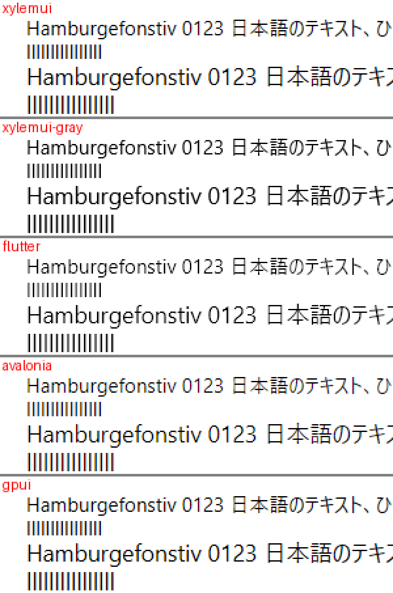
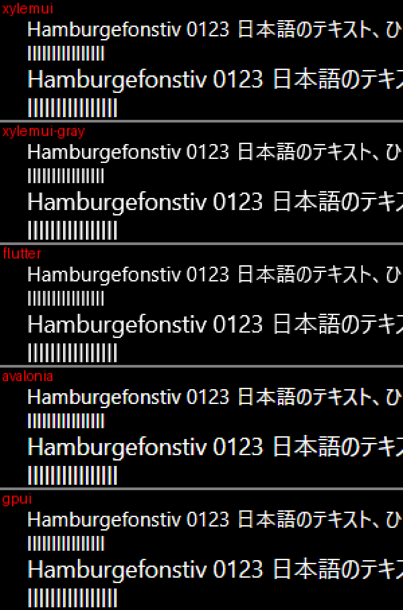

# T2: Windows の ClearType の結果

Windows で、設定が ClearType で、ウィンドウが不透明で、画素の並びが RGB か BGR のとき、グリフを ClearType で描くようにした（ロードマップの行 T2、Issue #182、設計書 §5.0.3「ClearType」）。グリフは DirectWrite の 3x1 で描いて RGBA のページに入れ、デュアルソースのブレンドで色ごとに補正して描く。その見た目を GPUI・Avalonia と比べ、グレースケールとの費用の差を測る。

## 測った物と機械

- コミット: このファイルを加えたコミット（`git log -1 -- docs/benchmarks/t2-cleartype.md`）。main は 92d4502
- 機械: T4 と同じ（`docs/benchmarks/t4-glyphs.md`）。Windows 11（ja-JP、26300）、NVIDIA GeForce RTX 3060 Ti。表示倍率 125 %（120 DPI）。NativeAOT
- この機械の値: フォントのスムージングは ClearType、画素の並びは RGB なので、ウィンドウのカバレッジは Rgb になる
- 比べた版: T4 と同じ（Flutter 3.47.7、Avalonia 12.1.4、Zed v1.24.3 の gpui）

## 再現

```powershell
$env:PATH += ';C:\Program Files (x86)\Microsoft Visual Studio\Installer'
./benchmarks/compare/build.ps1 -Out <builds>
./benchmarks/compare/text.ps1 -Builds <builds> -Out <pictures>          # xylemui は ClearType、xylemui-gray はグレースケール
<builds>/xylemui/XylemUI.E2E.exe frames 600 [--gray]
<builds>/xylemui/XylemUI.E2E.exe text --frames 600 [--gray]
dotnet publish samples/HelloText -c Release -r win-x64 -o <dir>
<dir>/HelloText.exe --atlas-sizing C:\Windows\Fonts\YuGothR.ttc 0 1.5 40 docs/design.ja.md [--cleartype]
```

## 見た目（125 %）

T4 の場面を、ClearType の XylemUI、グレースケールの XylemUI（T4 と同じ描き方）、Flutter、Avalonia、GPUI で描き、画面から取り込んだ。下の画像は、Segoe UI の 12 px と 14 px の行の左を 3 倍にしたもの。





ClearType の XylemUI は、16 行すべてで GPUI と同じ画素になった（白地も黒地も）。違うのは行の縦の位置だけで、GPUI は行の上端を 3〜5 画素下に置く。同じ画素になるのは、同じ DirectWrite の呼び出し（描き方と grid fit の推奨、¼ 画素の 4 段階）で描き、同じ式で補正し、同じブレンドで合成しているためである。Avalonia（Skia）と同じ画素の行は 0 で、Flutter とグレースケールの XylemUI は LCD で描かないので 0 になる。

位置の誤差（最大 / RMS、画素）と縦線の濃さ（`text_quality.py`）:

| 行 | XylemUI（ClearType） | XylemUI（グレー） | Flutter | Avalonia | GPUI |
| --- | --- | --- | --- | --- | --- |
| 白地 Segoe UI 12 px | 0.12 / 0.08、1.00 | 0.13 / 0.08、0.86 | 0.09 / 0.07、0.78 | 0.11 / 0.07、1.00 | 0.12 / 0.08、1.00 |
| 白地 Segoe UI 14 px | 0.15 / 0.08、1.00 | 0.18 / 0.09、0.95 | 0.14 / 0.07、0.92 | 0.15 / 0.08、1.00 | 0.15 / 0.08、1.00 |
| 白地 Segoe UI 16 px | 0.16 / 0.08、1.00 | 0.12 / 0.07、1.00 | 0.13 / 0.07、1.00 | 0.15 / 0.08、1.00 | 0.16 / 0.08、1.00 |
| 白地 Segoe UI 20 px | 0.16 / 0.09、1.00 | 0.12 / 0.07、1.00 | 0.12 / 0.07、1.00 | 0.15 / 0.08、1.00 | 0.16 / 0.09、1.00 |
| 黒地 Segoe UI 12 px | 0.18 / 0.10、1.00 | 0.25 / 0.15、0.93 | 0.20 / 0.12、0.92 | 0.25 / 0.14、1.00 | 0.18 / 0.10、1.00 |
| 黒地 Segoe UI 14 px | 0.23 / 0.12、1.00 | 0.27 / 0.14、0.97 | 0.24 / 0.12、0.97 | 0.29 / 0.15、1.00 | 0.23 / 0.12、1.00 |
| 黒地 Segoe UI 16 px | 0.25 / 0.14、1.00 | 0.17 / 0.09、1.00 | 0.20 / 0.10、1.00 | 0.33 / 0.16、1.00 | 0.25 / 0.14、1.00 |
| 黒地 Segoe UI 20 px | 0.20 / 0.11、1.00 | 0.14 / 0.07、1.00 | 0.12 / 0.07、1.00 | 0.21 / 0.11、1.00 | 0.20 / 0.11、1.00 |

- Yu Gothic UI の 8 行も、ClearType の XylemUI と GPUI で同じ値になった（`text_quality.py` の出力）
- ClearType の縦線の濃さは、どの行も 1.00 になる。`text_quality.py` はカバレッジを、いちばん動いた色の値から読むためである（LCD の縦線では、どれか 1 つの色がいつも濃い）
- 16 px と 20 px では、ClearType の位置の誤差がグレースケールより大きい（白地で 0.12 から 0.16）。GPUI と Avalonia も同じ範囲にある。誤差は、いちばん動いた色から読んだ縦線の中心で測るので、色ごとに位置がずれる LCD では、グレースケールと同じ物差しにならない

## アトラスの大きさ（`HelloText --atlas-sizing`、游ゴシック、150 %）

ClearType のページは、一辺がグレースケールのページの半分（512 px）で、1 枚のバイト数は同じ（1 MB）。上限の枚数は 4 倍（16 枚）。

| 送り方 | カバレッジ | 最初の画面 | 1 フレームのラスタライズ（中央値 / p95 / 最大） | ページ | メモリ | 追い出し |
| --- | --- | --- | --- | --- | --- | --- |
| 1 画面ずつ | グレー | 1,076 | 43 / 185 / 431 | 1024 px を 3 枚 | 3.0 MB | 0 |
| 1 画面ずつ | ClearType | 1,076 | 43 / 185 / 431 | 512 px を 12 枚 | 12.0 MB | 0 |
| 1 行ずつ | グレー | 1,076 | 0 / 8 / 46 | 1024 px を 3 枚 | 3.0 MB | 0 |
| 1 行ずつ | ClearType | 1,076 | 0 / 8 / 46 | 512 px を 12 枚 | 12.0 MB | 0 |

- ClearType は 1 画素 4 バイトなので、同じグリフで 4 倍のメモリになる。上限の 16 枚に収まり、追い出しは 0 なので、既定は変えない
- T4 の場面（`text --frames 30`）は、グレースケールで 1024 px を 1 枚、ClearType で 512 px を 1 枚（どちらも 1 MB）
- ウィンドウの種類が変わると、使わなくなった種類のページは、その種類に場所が要るまで残る（多くて上限の 16 MB。T6 のレビューの後に、4 MB と書いていた誤りを直した）。消すための処理は足さない（設計書 §5.0.3）

## アイドルのメモリ（`idle`、§11.3）

| ビルド | プライベートメモリ（3 回） |
| --- | --- |
| main（グレースケール） | 57.9〜58.6 MB（2 回。3 回目は、同時に別のウィンドウの測定を動かしていて、印が画面に出るのを待ったまま止まった） |
| T2、`--gray` | 57.9〜59.2 MB |
| T2、ClearType、1024 px のページ（PR #183 のレビューの前） | 67.5〜68.4 MB |
| T2、ClearType、512 px のページ | 59.0〜59.4 MB |

- 1024 px の RGBA のページでは、1 行のテキストのために 9.5 MB 増え、§11.3 の目安の 64 MB を超えた。CPU 側のページの写しは 4 MB で、残りは GPU のテクスチャ（4 MB）が数えられた分と推定する（分けて測ってはいない）
- 512 px にすると、ClearType とグレースケールが同じ範囲に入った（オーナー決定、Q10）

## 描画の回数と費用（`XylemUI.E2E`、NativeAOT、ハードウェア、600 フレームの中央値、A・B・B・A を 2 回）

1 フレームの描画の回数は、矩形とグレースケールのグリフで 1 回、そのあとの ClearType の並びで 1 回になる。

| 場面 | カバレッジ | 描画 | DisplayList の構築 | `Draw` の CPU | GPU |
| --- | --- | --- | --- | --- | --- |
| `frames`（矩形 1,001 個と 1 行） | グレー | 1 | 0.020〜0.021 ms | 0.023〜0.024 ms | 0.089〜0.090 ms |
| `frames`（矩形 1,001 個と 1 行） | ClearType | 2 | 0.020〜0.021 ms | 0.024 ms | 0.090〜0.092 ms |
| `text`（384 グリフ） | グレー | 1 | 0.208〜0.213 ms | 0.015〜0.016 ms | 0.094〜0.096 ms |
| `text`（384 グリフ） | ClearType | 2 | 0.209〜0.211 ms | 0.015〜0.016 ms | 0.103〜0.107 ms |

- `Draw` の CPU の時間は、どちらの場面でも 2 つの範囲が重なり、差は見えない。描画が 1 回増えても、ブレンドの状態とシェーダを替える呼び出しが 2 つ増えるだけである
- GPU の時間は、ClearType で `text` が 0.009〜0.011 ms、`frames` が 0.001〜0.003 ms 増えた。グリフが 384 個の場面で増え方が大きく、1 行の場面では小さいので、描画の回数ではなく、ClearType の画素のシェーダ（4 バイトのテクセルを読み、色ごとに補正し、2 つの出力を書く）を通る画素の数に比例する費用と読める
- `frames` の取りこぼしたフレームは、8 回のうち 1・3・5・7 回目に 2〜16 出た（ClearType 16・12、グレー 14・2）。main でも、同じ実行ファイルを続けて起動すると 1 回おきに 10〜22 出るので、この変更によるものではない。Issue #184、行 Q2

## 初めて出るグリフのラスタライズ（游ゴシック、2,000 グリフ、NativeAOT、毎回新しいプロセス）

| | グレー | ClearType |
| --- | --- | --- |
| その大きさを、どのプロセスもまだその種類で描いていない | 107〜146 µs | 113〜167 µs |
| ほかのプロセスが同じ種類で描いた後 | 1.6 µs（23.3 px） | 2.8〜7.8 µs（14.3〜31.7 px） |
| 同じプロセスで、同じグリフの次の ¼ 画素の段階 | 0.9〜3.4 µs | 1.9〜9.3 µs |

- 大きさは 14.3・23.3・31.7・37.9 px で、どれもこの機械で描いたことのない端数の大きさを選んだ
- DirectWrite がプロセスをまたいで共有するのは、同じ種類どうしだけだった。ClearType で描いた後でも、同じ大きさのグレースケールは初めての費用（31.7 px で 145.8 µs）を払った
- 初めての費用は T4 の記録（78〜103 µs）より大きい。同じ大きさのグレーと ClearType を続けて測ると、ClearType は 1.05〜1.21 倍だった
- 2 回目からの ClearType の費用の差は、ほぼすべて `Rasterize`（3x1 のテクスチャを作り、1 画素 4 バイトに広げる）にある。31.7 px で、`Measure`（解析を作る）はグレー 1.5 µs、ClearType 2.0 µs、`Rasterize` はグレー 2.1 µs、ClearType 7.2 µs だった（14.3 px では 0.5 / 0.4 µs と 0.5 / 1.7 µs）。テクスチャを作る分と広げる分は分けて測っていない
- ほかのプロセスが描いた後でも、しばらくたつと初めての費用に戻ることがあった。31.7 px のグレーは、上の表を測ってから後で測り直すと、また 126 µs かかった。DirectWrite が共有を保つ時間は、行 T5 で調べる
- このままにする。初めて出るグリフをフレームの外に出すかは行 T5 で決める

## 実行ファイルの大きさ

| アプリ | main | T2 |
| --- | --- | --- |
| `XylemUI.E2E.exe` | 4,004,864 バイト | 4,020,224 バイト（+15,360） |
| `HelloWindow.exe` | 2,705,920 バイト | 2,719,744 バイト（+13,824） |

NativeAOT の publish に警告は出なかった。

## レンダリングモードが `ALIASED` のとき（PR #183 のレビュー）

DirectWrite が `ALIASED` を推奨すると、ClearType の 3x1 のテクスチャは空になり、グリフが描かれない。XylemUI の呼び方（`GetRecommendedRenderingMode` に描画のパラメータを渡さない、しきい値はアンチエイリアス）では、Windows 11 のフォントの 391 個の face を 6〜32 px で調べても、テストのフォントの `gasp` を平滑化なしにした複製でも、`ALIASED` は返らなかった。それでも API の上では返りうるので、Skia と同じく `ALIASED` は 1x1 のテクスチャと組にし、ClearType ではその値を 3 色に広げる（`DirectWriteGlyphRasterizer.TextureOf`）。テストは、レンダリングモードを差し替えてこの経路を通す。
