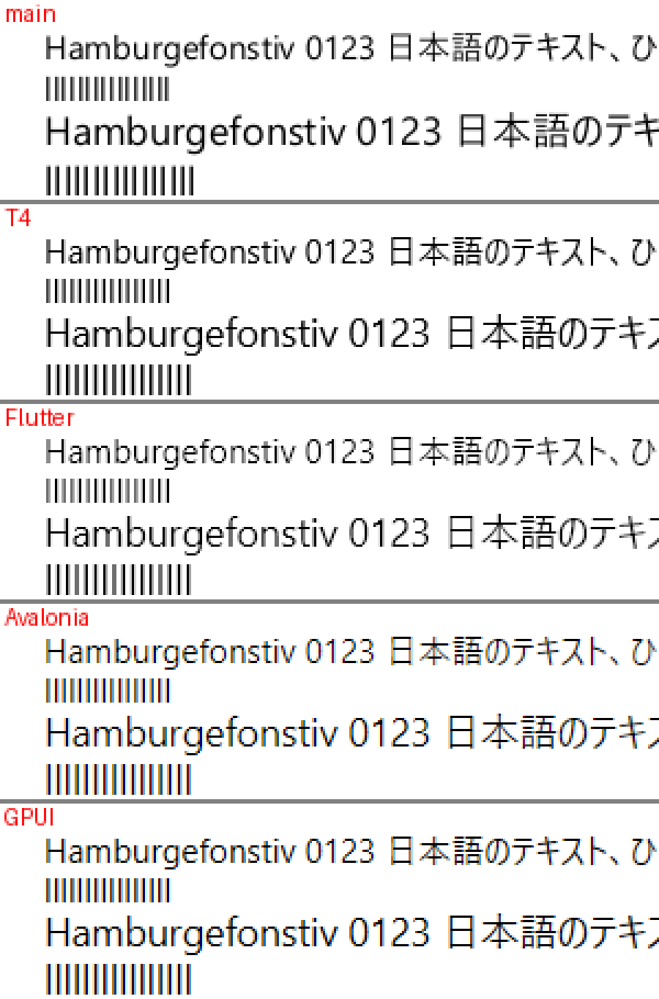
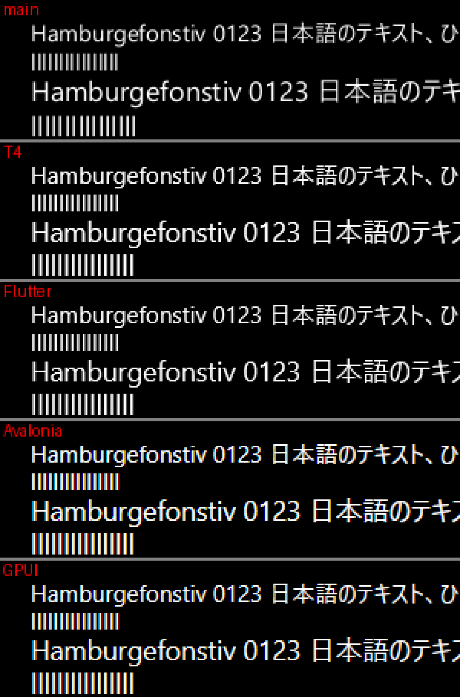
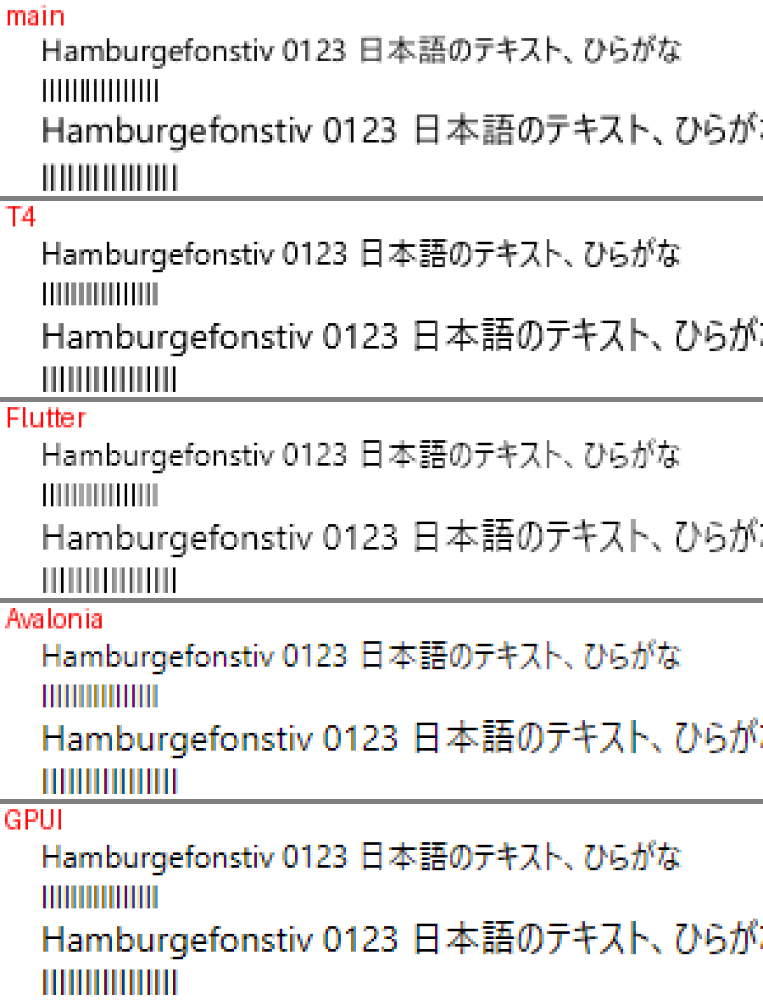
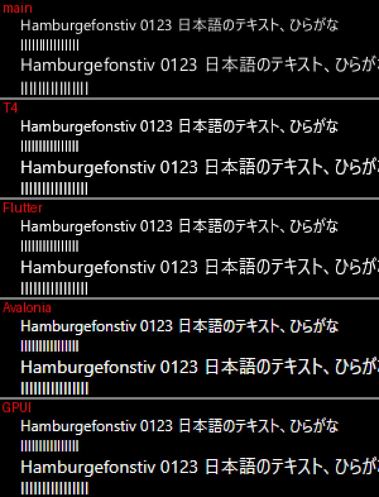
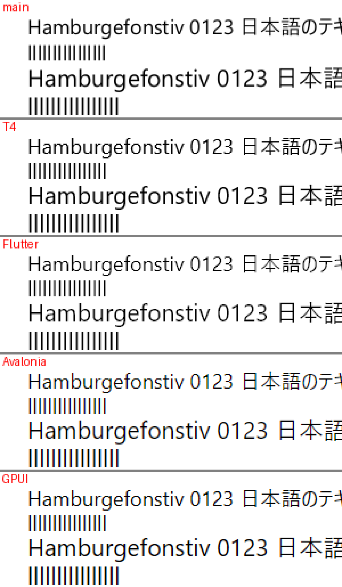
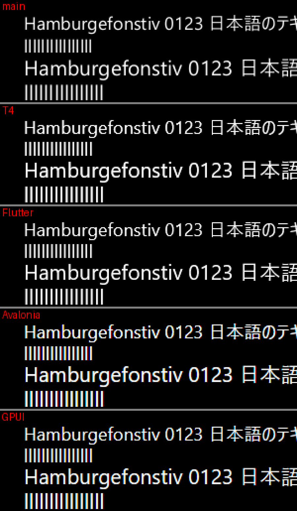

# T4: グリフの描き方を変えた結果

Windows のグリフを DirectWrite で描き、横に ¼ 画素の 4 段階のサブピクセル位置を作り分け、カバレッジをシェーダで文字の色によって補正した（ロードマップの行 T4、Issue #161、設計書 §5.0.3「グリフの描き方」）。その見た目と費用を、main（FreeType、整数の画素、補正なし）と、Flutter・Avalonia・GPUI と比べる。

## 測った物と機械

- コミット: このファイルを加えたコミット（`git log -1 -- docs/benchmarks/t4-glyphs.md`）。main は c341084
- 機械: L1a と同じ（`docs/benchmarks/l1a-layout.md`）。Windows 11（ja-JP、26300）。表示倍率 125 %（120 DPI）、100 %（96 DPI）、150 %（144 DPI）。NativeAOT。表示倍率を変えたときはサインインし直していないので、XylemUI の場面は倍率をシステムの DPI ではなくウィンドウの DPI（`GetDpiForWindow`）から読む
- 比べた版: Flutter 3.47.7（Windows でも既定で Impeller、OpenGLES の SDF のバックエンド）、Avalonia 12.1.4（SkiaSharp 3.119.4）、Zed v1.24.3 の gpui（git のタグ、`benchmarks/compare/gpui-text`）

## 再現

```powershell
$env:PATH += ';C:\Program Files (x86)\Microsoft Visual Studio\Installer'
./benchmarks/compare/build.ps1 -Out <builds>                          # 4 つのアプリ
./benchmarks/compare/text.ps1 -Builds <builds> -Out <pictures>         # 取り込みと、位置の誤差・縦線の濃さ
dotnet publish samples/HelloText -c Release -r win-x64 -o <dir>
<dir>/HelloText.exe --atlas-sizing C:\Windows\Fonts\YuGothR.ttc 0 1.5 40 docs/design.ja.md
<builds>/xylemui/XylemUI.E2E.exe glyph-refused
```

## 見た目の比べ方

4 つのアプリ（と main の XylemUI）が同じ場面を描く（`benchmarks/XylemUI.E2E/TextQuality.cs` と、`benchmarks/compare` の各アプリの同じ場面）。Segoe UI と Yu Gothic UI を 12・14・16・20 px で、見本の行（`Hamburgefonstiv 0123 日本語のテキスト、ひらがな`）と、`l` を 16 個並べた行を描く。白地に黒と、黒地に白。XylemUI はまだ表示の倍率に対応していない（行 W1）ので、この場面だけ DPI aware にし、物理の画素で倍率を掛けて描く。

`text_quality.py` が、取り込んだ画像の `l` の行を、16 本の縦線に分ける。縦線ごとに 1 送り幅の窓を割り当て、16 個の窓は 1 つの格子にする。格子の送り幅と位置は、境目がいちばんインクの少ない所（縦線の間）に来るように選ぶ。小さい大きさでは、アンチエイリアスで縦線が隣とつながるので、閾値では分けられない。最初に窓を「インクの左端から 16 等分」にしたときは、窓の端が隣の縦線の縁にかかり、24 px の行の両端の縦線を 0.3 画素ずらした。窓を 1 本ずつ縦線に寄せ直したときは、LCD の縦線がつながる所で窓が隣へずれた。

- **位置の誤差:** 各縦線のインクの中心と、16 個の中心を通る最小二乗の直線とのずれ（最大と RMS、画素）。整数の画素に置くと最大 ½ 画素、¼ 画素に置くと最大 ⅛ 画素ずれる。画素から測るので、アンチエイリアスとヒンティングによるずれも入る
- **縦線の濃さ:** 各縦線で最も濃い列の、行の中ほどのカバレッジ（0〜1）の、16 本の平均。カバレッジは背景からの距離を文字の色までの距離で割ったもので、最も大きく動いた色のチャンネル（R・G・B）から取る（LCD の AA はチャンネルを別々に動かすので、Avalonia と GPUI は 1.00 に近くなり、ほかとは比べられない）

表は「位置の誤差の最大 / RMS（画素）、縦線の濃さ」。Segoe UI と Yu Gothic UI の値が違う所は、2 つの範囲で書く。

### 125 %

白地に黒:

| 行 | main | T4 | Flutter | Avalonia | GPUI |
| --- | --- | --- | --- | --- | --- |
| 12 px | 0.47 / 0.28、0.78 | 0.13 / 0.08、0.86 | 0.09 / 0.07、0.78 | 0.11 / 0.07、1.00 | 0.12 / 0.08、1.00 |
| 14 px | 0.49 / 0.28、0.91 | 0.18 / 0.09、0.95 | 0.14 / 0.07、0.92 | 0.15〜0.16 / 0.08、1.00 | 0.15 / 0.08、1.00 |
| 16 px | 0.48 / 0.27、1.00 | 0.17 / 0.08、1.00 | 0.13 / 0.07、1.00 | 0.15 / 0.08、1.00 | 0.16 / 0.08、1.00 |
| 20 px | 0.51 / 0.26、1.00 | 0.12 / 0.07、1.00 | 0.12 / 0.07、1.00 | 0.15 / 0.08、1.00 | 0.16 / 0.09、1.00 |

黒地に白:

| 行 | main | T4 | Flutter | Avalonia | GPUI |
| --- | --- | --- | --- | --- | --- |
| 12 px | 0.47 / 0.28、0.78 | 0.25 / 0.15、0.93 | 0.20 / 0.12、0.92 | 0.25 / 0.14、1.00 | 0.18 / 0.10、1.00 |
| 14 px | 0.49 / 0.28、0.91 | 0.27 / 0.14、0.97 | 0.24 / 0.12、0.97 | 0.21〜0.29 / 0.10〜0.15、1.00 | 0.18〜0.23 / 0.09〜0.12、1.00 |
| 16 px | 0.48 / 0.27、1.00 | 0.21 / 0.10、1.00 | 0.20 / 0.10、1.00 | 0.33 / 0.16、1.00 | 0.25 / 0.14、1.00 |
| 20 px | 0.51 / 0.26、1.00 | 0.14 / 0.07、1.00 | 0.12 / 0.07、1.00 | 0.21 / 0.11、1.00 | 0.20 / 0.11、1.00 |





### 100 %

100 % では、12 px は物理でも 12 画素で、`l` の縦線は 1 画素ほどの細さになる。

白地に黒:

| 行 | main | T4 | Flutter | Avalonia | GPUI |
| --- | --- | --- | --- | --- | --- |
| 12 px | 0.48 / 0.26、0.94 | 0.12 / 0.07、0.74 | 0.13 / 0.07、0.66 | 0.14 / 0.07、0.84 | 0.18 / 0.09、0.87 |
| 14 px | 0.48 / 0.28、0.86 | 0.12〜0.15 / 0.07、0.74〜0.81 | 0.12 / 0.07、0.62〜0.68 | 0.17 / 0.08、1.00 | 0.15 / 0.08、1.00 |
| 16 px | 0.47 / 0.27、0.71 | 0.16〜0.20 / 0.09〜0.10、0.86〜0.88 | 0.09 / 0.07、0.78〜0.82 | 0.12 / 0.07、1.00 | 0.11〜0.12 / 0.07、1.00 |
| 20 px | 0.48 / 0.27、1.00 | 0.17 / 0.08、1.00 | 0.13 / 0.07、1.00 | 0.15 / 0.08、1.00 | 0.16 / 0.08、1.00 |

黒地に白:

| 行 | main | T4 | Flutter | Avalonia | GPUI |
| --- | --- | --- | --- | --- | --- |
| 12 px | 0.48 / 0.26、0.94 | 0.18 / 0.09、0.86 | 0.12 / 0.07、0.85 | 0.21 / 0.10、0.97 | 0.26 / 0.11、0.95 |
| 14 px | 0.48 / 0.28、0.86 | 0.19〜0.26 / 0.09〜0.12、0.86〜0.90 | 0.13〜0.19 / 0.07〜0.10、0.83〜0.88 | 0.17 / 0.09、1.00 | 0.15 / 0.08、1.00 |
| 16 px | 0.47 / 0.27、0.71 | 0.21〜0.31 / 0.12〜0.15、0.93〜0.94 | 0.21 / 0.10〜0.11、0.92〜0.94 | 0.16〜0.20 / 0.08〜0.09、1.00 | 0.11〜0.16 / 0.07〜0.08、1.00 |
| 20 px | 0.48 / 0.27、1.00 | 0.21 / 0.10、1.00 | 0.20 / 0.10、1.00 | 0.33 / 0.16、1.00 | 0.25 / 0.14、1.00 |





### 150 %

白地に黒:

| 行 | main | T4 | Flutter | Avalonia | GPUI |
| --- | --- | --- | --- | --- | --- |
| 12 px | 0.49 / 0.28、0.91 | 0.14 / 0.08、0.95 | 0.10 / 0.07、0.92 | 0.15〜0.16 / 0.07〜0.08、1.00 | 0.15 / 0.08、1.00 |
| 14 px | 0.51 / 0.26、1.00 | 0.13 / 0.07、1.00 | 0.10 / 0.07、1.00 | 0.14〜0.15 / 0.08〜0.09、1.00 | 0.14〜0.15 / 0.08〜0.09、1.00 |
| 16 px | 0.50 / 0.29、1.00 | 0.14〜0.17 / 0.07〜0.08、1.00 | 0.11 / 0.07、1.00 | 0.17 / 0.08、1.00 | 0.14 / 0.08、1.00 |
| 20 px | 0.42 / 0.28、1.00 | 0.14 / 0.07、1.00 | 0.12 / 0.06、1.00 | 0.16 / 0.08、1.00 | 0.15 / 0.07、1.00 |

黒地に白:

| 行 | main | T4 | Flutter | Avalonia | GPUI |
| --- | --- | --- | --- | --- | --- |
| 12 px | 0.49 / 0.28、0.91 | 0.25 / 0.14、0.97 | 0.22 / 0.12、0.97 | 0.24〜0.29 / 0.10〜0.16、1.00 | 0.18〜0.25 / 0.08〜0.12、1.00 |
| 14 px | 0.51 / 0.26、1.00 | 0.18 / 0.09、1.00 | 0.18 / 0.09、1.00 | 0.18〜0.26 / 0.10〜0.11、1.00 | 0.18〜0.24 / 0.10、1.00 |
| 16 px | 0.50 / 0.29、1.00 | 0.14〜0.20 / 0.08〜0.10、1.00 | 0.11〜0.17 / 0.07〜0.09、1.00 | 0.25 / 0.12、1.00 | 0.24 / 0.12、1.00 |
| 20 px | 0.42 / 0.28、1.00 | 0.24 / 0.12、1.00 | 0.18 / 0.09、1.00 | 0.21 / 0.10、1.00 | 0.16 / 0.08、1.00 |





### 読み方

- 位置の誤差の最大は、3 つの倍率で main が 0.42〜0.51 画素、T4 が 0.12〜0.31 画素で、3 つ（Flutter 0.09〜0.24、Avalonia 0.11〜0.33、GPUI 0.11〜0.26）と同じ範囲に入った。⅛ 画素を超える分は、位置の丸めではなく、画素から測ったときのアンチエイリアスとヒンティングによるずれ（Issue の「⅛ 画素以下」は位置の丸めの値で、`GlyphPosition.Snap` のテストで確かめた。画素からの測り方では 3 つとも ⅛ を超える）
- 黒地で T4 の誤差が白地より大きいのは、カバレッジの補正による。150 % で補正を切った T4 を作って測ると、黒地の最大は 0.14〜0.25 から 0.14〜0.18 画素に下がり、白地はほとんど変わらなかった（0.13〜0.17 と 0.14〜0.18）。補正は明るい文字のカバレッジを濃くする向き（Windows のコントラストの強調）にかかり、縦線の縁の中心を動かす
- 白地で T4 は、多くの行で Flutter より 0.02〜0.11 画素大きい（100 % の 12 px だけ 0.01 小さい）。補正を切っても変わらないので、補正の差ではない。2 つとも DirectWrite で描き、¼ 画素の 4 段階を使う。差の理由は行 T7 で調べる。候補は、Skia が描き方を `GetRecommendedRenderingMode` ではなく `gasp` 表と大きさで自分で選ぶこと（Impeller のヒンティングは `kSlight` だが、Skia の DirectWrite の経路で効くのは「なし」かどうかだけ）
- 縦線の濃さは、T4 が Flutter と同じか少し濃い（100 % の白地の 12 px で T4 0.74、Flutter 0.66。150 % の黒地の 12 px で同じ 0.97）。main は 100 % の白地の 12 px で 0.94 と濃い。縦線ごとの一番濃い列（記録の画像から読んだ）は、main が 16 本とも 0.94 で、T4 は ¼ 画素の段階によって 1.00・0.72・0.46 を繰り返す（Flutter は 1.00・0.57・0.36）。main は整数の画素に置くので、どの縦線も同じ段階の形になる。¼ 画素の段階では、縦線が 2 つの列にまたがる段階で一番濃い列が薄くなり、16 本の平均が下がる
- Segoe UI と Yu Gothic UI は、125 % と 150 % ではほとんど同じ値で、100 % の 14 px と 16 px で分かれた。fontTools で読むと、Segoe UI（`segoeui.ttf`）と Yu Gothic UI の標準の太さ（`YuGothM.ttc` の face 1）の `l` は、アウトラインが同じで、ヒントの命令（グリフの命令、`fpgm`、`prep`）と `gasp` 表が違う（Segoe UI は 9〜19 ppem で対称のスムージングが無く、Yu Gothic UI は 8 ppem から全部）。ヒンティングしない main は、どの倍率でも 2 つで同じ値だった。分かれたのは、DirectWrite がヒントを実行した結果である。どの大きさで分かれるかは、ヒントの命令の結果による
- main は、125 % の 14 px（17.5 px）を 18 px に丸めて描くので、行が一回り大きい（125 % の画像）

## 初めて出るグリフのラスタライズ（游ゴシック、2,000 グリフ、NativeAOT、毎回新しいプロセス）

| | 初めて | 同じプロセスで 2 回目 |
| --- | --- | --- |
| main の FreeType（14 / 21 / 30 px） | 4.0〜4.5 / 4.9〜5.1 / 6.1〜6.7 µs | 3.8〜4.2 / 4.7〜5.0 / 6.0〜6.6 µs |
| DirectWrite、その大きさをどのプロセスもまだ描いていない | 78〜103 µs | 1.0〜2.7 µs |
| DirectWrite、ほかのプロセスが描いた後（ファイルのフォント） | 1.5〜3.0 µs | 1.0〜2.0 µs |

- 時間はほぼすべて `CreateGlyphRunAnalysis` の中（37 px で、1 グリフ 102.9 µs のうち 98.0 µs。`CreateAlphaTexture` は 3〜4 µs）。grid fit を切っても変わらない（31 px で 103 µs）ので、フォントのヒントの実行ではない
- DirectWrite は、ファイルのフォント（`CreateFontFileReference`）について、ある大きさで描いたグリフをプロセスをまたいで共有する。メモリのフォント（`IDWriteInMemoryFontFileLoader`）は共有しない（どのプロセスでも初めは 67〜81 µs）。共有が再起動の後も残るかは確かめていない。そのため OS のフォントはファイルから開く
- GPUI（`crates/gpui_windows/src/direct_write.rs` 738 行目）も Skia（Flutter・Avalonia、`src/ports/SkScalerContext_win_dw.cpp` 2097 行目）も、同じ `CreateGlyphRunAnalysis` で描く
- このままにする（オーナー決定）。フレームの外に出すかは行 T5
- 2 つを掛け合わせた見積もり（測ったものではない）: 1 画面ずつ送るときの 1 フレームの最大 431 グリフ（下のアトラスの表）が、どれもまだどのプロセスも描いていない大きさなら、431 × 78〜103 µs で約 34〜44 ms（60 Hz の 2〜3 フレーム）になる。p95 の 185 グリフなら約 14〜19 ms

## アトラスの大きさ（`HelloText --atlas-sizing`、游ゴシック、`docs/design.ja.md` を 40 行の画面で送る）

| 倍率 | 送り方 | 最初の画面 | 1 フレームのラスタライズ（中央値 / p95 / 最大） | 50 を超えたフレーム | ページ（1024 px・256 px・上限 4） | 追い出し |
| --- | --- | --- | --- | --- | --- | --- |
| 150 %（main） | 1 画面ずつ | 525 | 10 / 55 / 162 | 4 | 2 | 0 |
| 150 %（main） | 1 行ずつ | 525 | 0 / 3 / 24 | 0 | 2 | 0 |
| 150 % | 1 画面ずつ | 1,076 | 43 / 185 / 431 | 26 | 3 | 0 |
| 150 % | 1 行ずつ | 1,076 | 0 / 8 / 46 | 0 | 3 | 0 |
| 125 % | 1 画面ずつ | 1,068 | 44 / 187 / 443 | 26 | 3 | 0 |
| 125 % | 1 行ずつ | 1,068 | 0 / 8 / 41 | 0 | 3 | 0 |
| 100 % | 1 画面ずつ | 1,093 | 44 / 177 / 436 | 24 | 2 | 0 |
| 100 % | 1 行ずつ | 1,093 | 0 / 8 / 42 | 0 | 2 | 0 |

- 最初の画面は 2.05 倍で、見込み（1〜2 倍）を少し超えた。150 % の最初の画面で、全角の文字のうち整数の画素に乗ったのは 1,543 個中 153 個だけで、全角の文字は 1.87 倍、それ以外は 2.70 倍だった。行の中に半角の文字（コードの名前や数字）があると、その後ろの全角の文字もペンの位置が端数を持つためである
- 既定のままで追い出しは 0 なので、既定は変えない

## `GlyphInstance` の形（S8b の理由）

40 行の画面（150 %）の 2,947 グリフで、書き込みとレンダラのインスタンスへの変換（NativeAOT、1,000 回で 1 標本、A・B・B・A で 20 標本ずつ、3 回）:

| 形 | 1 グリフ |
| --- | --- |
| 1 本の配列（今） | 3.0 ns（2.8〜3.3） |
| 属性ごとの 7 本の配列 | 4.6〜4.8 ns（4.4〜5.1） |
| 参考: `DrawText` 全体 | 143〜146 ns |

範囲は重ならず、1 本の配列のほうが速いので、今の形を残す。どちらも `DrawText` の 2〜3 % である。

## 断られたグリフ（`glyph-refused`）

| | main（FreeType） | T4（DirectWrite） |
| --- | --- | --- |
| 同じグリフが続けて断られる 1 回 | 5.80〜5.85 µs | 0.035〜0.038 µs |
| 2 つのグリフが交互に断られる 1 回 | — | 0.35 µs |
| キャッシュから返す 1 回 | 0.011 µs | 0.013〜0.014 µs |

ラスタライザは最後に作った解析を 1 つ覚えているので、同じグリフが続けて断られると作り直さない。場面は、グリフの箱の大きさによらず満杯になるよう、テストのフォントのグリフを 1 番から順に、断られるまで入れるようにした（それまでは日本語の 8 グリフで埋まる前提で、DirectWrite では 2 つが 1 つのプロットに入り、何も断られなかった）。

## 実行ファイルの大きさ

| アプリ | main | T4 |
| --- | --- | --- |
| `XylemUI.E2E.exe` | 4,485,632 バイト | 3,896,832 バイト（−588,800） |
| `HelloWindow.exe` | 3,294,720 バイト | 2,705,920 バイト（−588,800） |
| `HelloText.exe` | 2,966,016 バイト | 2,387,968 バイト（−578,048） |

FreeType のモジュールの名前（`autofitter`・`truetype`・`psaux`）は、T4 の実行ファイルに残っていない。TFM を `net10.0-windows10.0.17763.0` にしても、Windows SDK の投影（WinRT）はリンクされなかった（ILC のマップファイル）。

## `Font.FamilyName`

Windows のフォント（`C:\Windows\Fonts` と利用者のフォント）の 393 個の face と、テストのフォント・同梱フォントで、HarfBuzz から読んだ名前が main の FreeType の名前とすべて同じだった。
