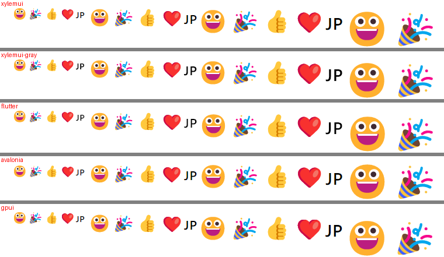
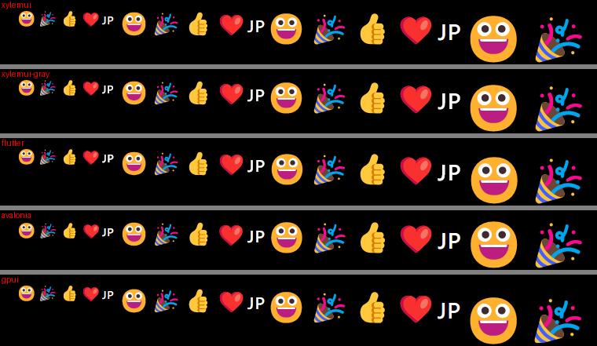

# T6: Windows の色のグリフ（絵文字）の結果

Windows で色のグリフ（絵文字）を描くようにした（ロードマップの行 T6、Issue #191、設計書 §4.6 と §5.0.3「色のグリフ」）。DirectWrite で COLRv0 の層に分け、層ごとのグレースケールのカバレッジを層の色で CPU の上で重ね、`GlyphCoverage.Color`（premultiplied の BGRA）のページに入れ、整数の画素に置いて、グレースケールの文字と同じ描画で描く。

T6 の Grill では、OS が描く形式すべて（COLRv1 のペイントの木を含む）を Direct2D で描くと決めていた。実装して測ると重かったので、COLRv0 だけを描く形に決め直した（PR #192 で Q11、オーナー決定）。下の「Direct2D の COLRv1」は、そのとき測った値である。

## 測った物と機械

- コミット: このファイルを加えたコミット（`git log -1 -- docs/benchmarks/t6-color-glyphs.md`）。main は 3f4a7d8
- 機械: T2 と同じ（`docs/benchmarks/t2-cleartype.md`）。Windows 11（ja-JP、26300）、NVIDIA GeForce RTX 3060 Ti。表示倍率 125 %（120 DPI）。NativeAOT
- フォント: Segoe UI Emoji（`seguiemj.ttf`）。COLR の version 1 で、3,487 グリフのそれぞれが v0 の層と v1 のペイントの木を持つ（fontTools で読んだ）。文字の色の層を持つグリフは無かった（COLRv0 で 3,487 個を調べた）
- 比べた版: T4 と同じ（Flutter 3.47.7、Avalonia 12.1.4、Zed v1.24.3 の gpui）

## 再現

```powershell
$env:PATH += ';C:\Program Files (x86)\Microsoft Visual Studio\Installer'
./benchmarks/compare/build.ps1 -Out <builds>
./benchmarks/compare/text.ps1 -Builds <builds> -Out <pictures>   # emoji-light.png と emoji-dark.png が絵文字の行
<builds>/xylemui/XylemUI.E2E.exe text --frames 30 [--gray]        # アトラスのページとプライベートメモリ
<builds>/xylemui/XylemUI.E2E.exe idle 1
```

初めて出る絵文字の時間と、最初の絵文字で増えるメモリは、`DirectWriteGlyphRasterizer` で Segoe UI Emoji の 12 個の絵文字を `GlyphCoverage.Color` で描く使い捨ての NativeAOT のプログラムで、毎回新しいプロセスで測った（どの大きさも、この機械で描いたことのない端数）。

## 見た目（125 %）

T4 の場面の 16 行の下に、`😀🎉👍❤️🇯🇵` を 16・24・32・48 px で並べた行を、どのアプリにも足した。下の画像は、その行を各アプリから切り出して並べたもの。





- 4 つのアプリは、どれも COLRv0 の絵文字（平らな塗り）で描いた。Direct2D で COLRv1 を描いた XylemUI だけが、グラデーションのある絵文字になっていた（決め直す前）
- グレースケールの XylemUI と ClearType の XylemUI の絵文字は同じ（色のグリフは ClearType で描かない）
- `🇯🇵` は、どのアプリも「JP」の 2 文字になった。Segoe UI Emoji は国旗を持たない
- 文字の 16 行は、白地でも黒地でも GPUI と同じ画素のまま（T2 と同じ）

## 費用（NativeAOT、毎回新しいプロセス）

初めて出る絵文字 1 つ（17.1・29.3・47.7 px、12 個）:

| | COLRv0（採った形） | Direct2D の COLRv1（決め直す前） | Direct2D の COLRv0（参考） |
| --- | --- | --- | --- |
| どのプロセスもまだその大きさで描いていない | 中央値 0.49〜0.66 ms（0.17〜2.4 ms） | 中央値 4.0〜4.6 ms（2.4〜7.7 ms） | 中央値 0.14〜0.45 ms |
| ほかのプロセスが描いた後 | 中央値 13〜41 µs | — | — |
| 同じプロセスで 2 回目（アトラスから追い出された後） | 中央値 10〜30 µs | — | — |
| プロセスで最初の絵文字 | 0.7〜1.5 ms | 3〜35 ms | 3.4〜4.2 ms |
| 最初の絵文字で増えるプライベートメモリ | 0.2〜0.4 MB | 約 8.5 MB（8.1〜8.3 → 16.4〜16.9 MB） | 測っていない（Direct2D と WIC を読み込むのは同じ） |

- COLRv0 は、層の数だけ DirectWrite の `CreateGlyphRunAnalysis` を呼ぶ。T4 の単色のグリフ（どのプロセスもまだ描いていない大きさで 1 つ 78〜146 µs）と同じく、ほかのプロセスが同じ大きさで描いた後は下がった（13〜41 µs）
- Direct2D の COLRv1 は大きさによらず 4 ms 前後で、COLRv0 の 10〜30 倍だった。COLRv1・SVG・ビットマップの色のグリフは行 T9 で、速さとメモリの目途が立ってから入れる

単色のグリフ（游ゴシック、2,000 グリフ）:

| | main | T6 |
| --- | --- | --- |
| どのプロセスもまだその大きさで描いていない | 114〜133 µs | 119〜136 µs |
| ほかのプロセスが描いた後 | 1.05〜2.49 µs | 1.05〜2.73 µs |

色のフォントでなければ色のグリフかを調べないので、単色のグリフの費用は変わらない。

## メモリとアトラス

| | main | T6 |
| --- | --- | --- |
| アイドルのプライベートメモリ（`idle`、3 回） | 57.96〜58.67 MB | 58.08〜58.92 MB |
| `text` 場面（文字 16 行と絵文字の行）のプライベートメモリ | — | 62.5〜63.6 MB（Direct2D のときは 75.2〜76.3 MB） |
| `text` 場面のアトラス | — | 色のページ 1 枚（512 px、1 MB） |

- `idle` の場面には絵文字が無いので、アイドルのメモリは変わらない
- `text` 場面の描画は、グレースケールで 1 回、ClearType で 10 回だった。絵文字（グレースケールと同じブレンド）と、国旗の代わりに出る「JP」の文字（ClearType のブレンド）が、絵文字の行の中で交互に並ぶためである。文字だけの行は、T2 と同じく 2 回

## 実行ファイルの大きさ

| アプリ | main | T6 |
| --- | --- | --- |
| `XylemUI.E2E.exe` | 4,022,784 バイト | 4,038,656 バイト（+15,872） |
| `HelloWindow.exe` | 2,719,744 バイト | 2,735,616 バイト（+15,872） |

NativeAOT の publish に警告は出なかった。

## 実装で分かったこと

- DirectWrite は、COLRv0 の層の形式を `TRUETYPE | COLR` のように 2 つのフラグを重ねて返す。1 つの値として比べると、層を輪郭と見なしてしまうので、フラグとして読む（GPUI も `TRUETYPE` を外してから比べる、`direct_write.rs` 954 行目）
- .NET はスレッドを COM の MTA で始めるので、UI スレッドで `OleInitialize` を呼ぶと `RPC_E_CHANGED_MODE` が返る（NativeAOT でも同じ）。UI スレッドの STA を入れる行では、ウィンドウを作るアプリの `Main` に `[STAThread]` が要る。COM を初期化していないスレッドも、プロセスに MTA があれば暗黙の MTA に入る（.NET のプロセスにはある）
- Direct2D の形では、約 20 px より小さい絵文字を最初に描くと、描いている最中にビットマップを作り直して `EndDraw` が失敗していた（直した後に、Direct2D の形ごと外した）
