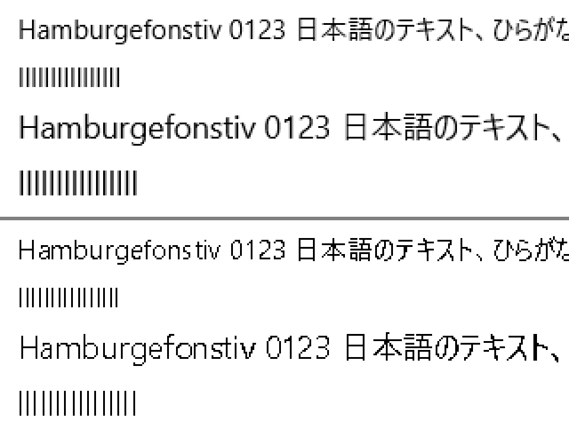
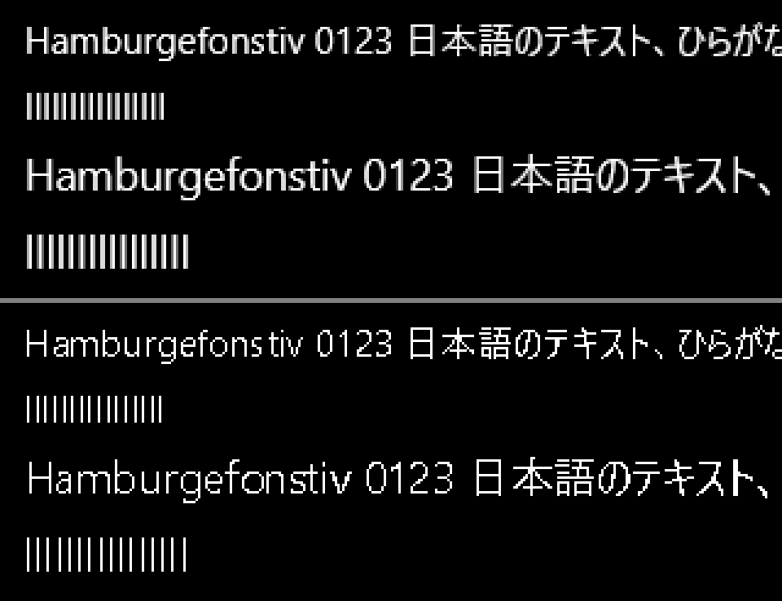

# T8: 縁を滑らかにしない設定の白黒の文字

Windows の「スクリーン フォントの縁を滑らかにする」を切ったときの白黒の文字（ロードマップの行 T8、Issue #203、設計書 §5.0.3「なめらかにしない設定」）を、グレースケールの文字と比べる。どれも Windows 11 26300、NativeAOT の Release で測った。エージェントはシステムの設定を変えないので、場面は白黒を指定して描いた（`--aliased`）。倍率も場面に指定し（`--scale`）、システムの表示の倍率は 125 % のままにした。

## 再現

```powershell
$env:PATH += ';C:\Program Files (x86)\Microsoft Visual Studio\Installer'
dotnet publish benchmarks/XylemUI.E2E -c Release -r win-x64 -o <dir>
<dir>/XylemUI.E2E.exe text-capture <out>/1.25-aliased-light.png <dir>/XylemUI.E2E.exe text --aliased --scale 1.25
<dir>/XylemUI.E2E.exe text-capture <out>/1.25-gray-light.png <dir>/XylemUI.E2E.exe text --gray --scale 1.25
<dir>/XylemUI.E2E.exe text --aliased --scale 1.25 --frames 60
```

倍率は 1.0・1.25・1.5、黒地は `--dark` を足す。PowerShell では、引数を配列にして渡す（`.cursor/rules/powershell-shell.mdc`）。

## 見た目（125 %）

T4 の場面の左上（Segoe UI の 12 px と 14 px の見本の行と `l` の行）を 3 倍にした。上がグレースケール、下が白黒。





## 画素（16 行、3 つの倍率、白地と黒地）

| | 白黒 | グレースケール |
| --- | --- | --- |
| 文字の行の画素の値の種類 | 2（0 と 255） | 17 |
| 16 本の縦線の間隔のばらつき（最大と最小の差） | どの行も 1 画素以内 | どの行も 1 画素以内 |
| 1 行の中の縦線の太さの種類 | 1 | 1〜2 |

- 縦線の間隔と太さは、`l` を 16 個並べた 8 行（Segoe UI と Yu Gothic UI の 12・14・16・20 px）で、行の中ほどの半分の高さの列の平均が 0.5 を超える列を縦線として数えた。白黒は 3 つの倍率、白地と黒地のどれでも、間隔のばらつきは 1 画素以内で、太さは行の中でそろった
- 間隔がばらつくのは、送り幅が端数を持つまま、グリフごとにペンを最も近い画素に丸めるためである（設計書 §5.0.3「送り幅」）。上の画像の白黒の 12 px の行では、`fons` と `tiv` の間が開いて見える
- グレースケールの太さが 2 種類になるのは、¼ 画素の段階で縦線が 2 つの列にまたがり、中ほどの平均が 0.5 を超える列の数が変わるためで、測り方による

## アトラスとフレーム（T4 の場面、`--frames 60`）

| 倍率 | ラスタライズしたグリフ（白黒 / グレースケール） | グレースケールのページ | 描画の回数 | 表示リストを作る時間の中央値（白黒 / グレースケール） |
| --- | --- | --- | --- | --- |
| 100 % | 244 / 270 | 1 / 1 | 1 / 1 | 0.248 / 0.260 ms |
| 125 % | 244 / 276 | 1 / 1 | 1 / 1 | 0.250 / 0.264 ms |
| 150 % | 244 / 272 | 1 / 1 | 1 / 1 | 0.260 / 0.251 ms |

- 白黒は ¼ 画素の段階を作らないので、グリフの数は 1 割ほど少ない（場面は 408 個のグリフを描く）。白黒のグリフはグレースケールのページに入り、描画の回数は変わらない
- プライベートメモリは、どちらも 61.4〜63.0 MB だった

## 初めて描く費用（游ゴシック、2,000 グリフ、毎回新しいプロセス）

`DirectWriteGlyphRasterizer` で、`YuGothR.ttc` の face 0 のグリフ 100〜2,099 を、どのプロセスもまだ描いていない大きさで描く使い捨ての NativeAOT のプログラムで測った（T4・T6 と同じ形）。9 つの大きさ（21〜38 px）で、白黒とグレースケールを交互に、どちらを先にするかも入れ替えて測った。

| | 初めて | 同じプロセスで 2 回目 |
| --- | --- | --- |
| 白黒 | 85〜104 µs | 1.0〜1.8 µs |
| グレースケール | 103〜124 µs | 1.2〜2.9 µs |
| 白黒、ほかのプロセスが白黒で描いた後 | 1.7〜2.6 µs | 1.3 µs |

- DirectWrite のプロセスをまたぐ共有は、描き方ごとだった。グレースケールで描いた大きさでも、白黒は初めての費用になる。そのため、設定を切り替えた直後の画面は、どのグリフも初めての費用で描く（行 T5 の材料）
- 游ゴシックは、白黒でもグレースケールでも、端数の大きさを整数の画素に丸めて描いた（17.5 px と 18 px、17.6 px と 17.9 px、15 px と 15.4 px で、2,000 グリフすべての箱とカバレッジが同じだった。17.5 px と 17 px で同じだったのは 22 グリフ）。ヒントを実行するときの DirectWrite の形で、白黒に限らない。27.771 px と 28.433 px は同じ 28 px なので、後の方は初めてでも 1.7 µs だった。表の大きさは、互いに違う整数の画素になるように選んだ。アドバンスは丸めないので、グリフとアドバンスのずれが残る（行 T10）
