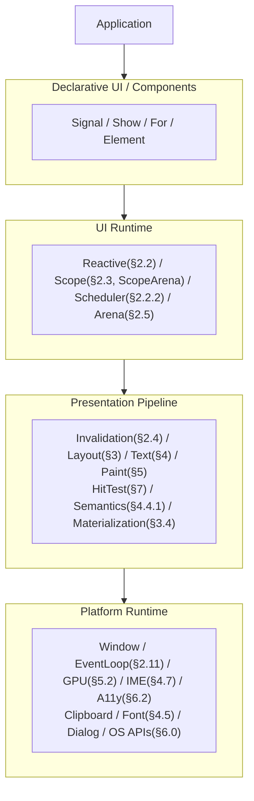
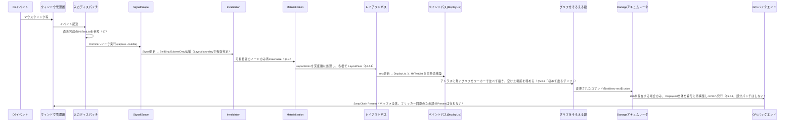
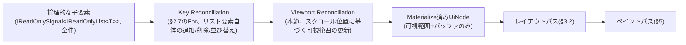
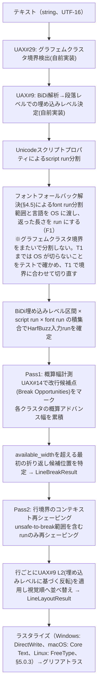
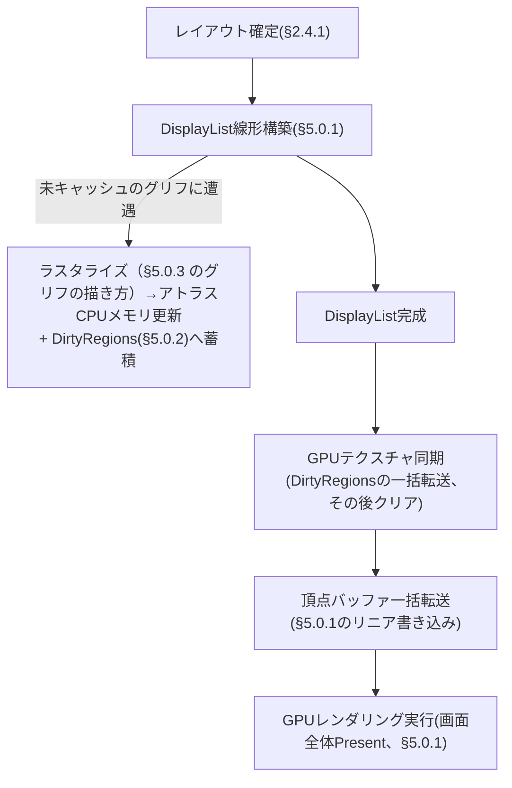
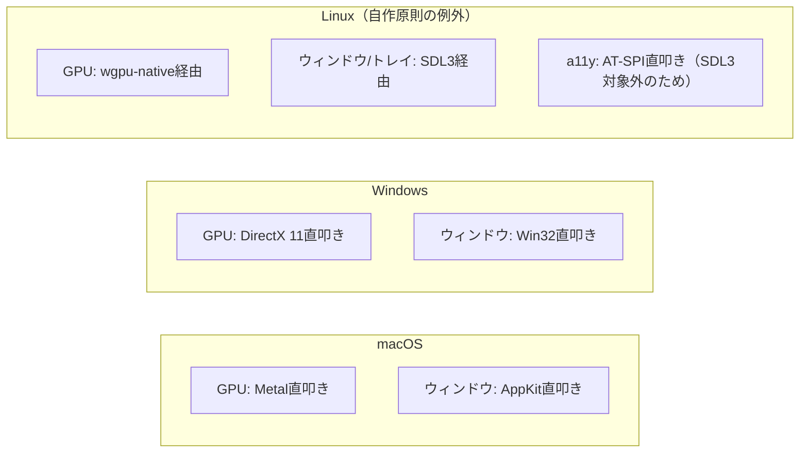

# XylemUI：C#製デスクトップGUIフレームワーク 設計ドキュメント v1

現行仕様のみを記す。本ドキュメントは MoonBit 版の設計（外部レビュー第1〜7回を反映済み）を C# / .NET 前提に書き換えたものである。却下した代替案は [design-decisions.md](./design-decisions.md)、進捗は [roadmap.md](./roadmap.md)、判断の詳細は [adr/](./adr/)。

## 0. 目標

Flutter / AvaloniaUI / GPUI と並ぶ完成度・性能を持つ、C#製のクロスプラットフォームネイティブデスクトップGUIフレームワークを自作する。
Electron / Tauri（Webエンジン依存、バンドルサイズ大、メモリ消費大、レンダリング遅延）を反面教師とし、ネイティブ・軽量・高速な配布形態を目指す。

**AIエージェントとの相性（副次的な価値）:** 主目標はあくまで人間が使う Flutter 級の GUI である。そのうえで、AI エージェントが UI を生成・検証・修正するループに向いた性質を、次の3つの要件として持つ。「AI が推論しやすいこと」を理由に API や機能を削ることはしない。

1. **型安全な C# API**: XAML / CSS / スタイル文字列を持たない。UI の誤りはコンパイルエラーとして現れ、エージェントは Roslyn の診断から修正できる（§2.13）
2. **ヘッドレス描画**: OS のウィンドウなしで描画し、PNG として取り出せる（§12.3）
3. **決定論的なテスト基盤**: 仮想クロックと `PumpAndSettle` により、タイミングに依存しないテストを書ける（§12.2）

**配布形態**: リリースビルドは NativeAOT でネイティブコードにコンパイルし、.NET ランタイムのインストールを要求しない。**Windows/macOS は外部 DLL を持たない単一の実行ファイル/アプリバンドル**（HarfBuzz は静的リンク。グリフのラスタライズは OS の DirectWrite / Core Text、§5.0.3・§9）。**Linux は自己完結したアプリケーションバイナリ＋システムライブラリ**（glibc・fontconfig・libdbus-1・GPUドライバ・Wayland/X11等）であり、「外部 DLL ゼロ」とは言わない。サイズ・起動時間の数値目標は §11.3 で扱う（実測前の仮説）。Electron/Tauriとの対比で重要なのは「バイナリが1個かどうか」ではなく「WebViewエンジンやCEFのような数百MB級の同梱ランタイムを持たないこと」。NativeAOT が同梱する .NET ランタイム（GC・型システム）は数MB規模であり、この方針と矛盾しない。

**自作するもの:** フレームワークの独自価値（Reactive・Layout・Invalidation・DisplayList・GPU レンダラ）は自作する。既存の重量級抽象化ライブラリ（Skia、CEF等）や、.NET 上の既存UIスタック（WPF・WinForms・WinUI・MAUI・Avalonia）にも乗らない。

**外部依存の基準:** 外部依存を避けること自体は目的ではない。避けたいのは、(1) 性能の最適化を自分たちの手元に置けなくなること、(2) 単一バイナリ化の障壁、(3) NativeAOT の障壁、の3つである。次の条件をすべて満たすライブラリは使ってよく、性能上の理由が実測で出たときに自作へ置き換える。

1. trim / AOT 警告ゼロで NativeAOT にリンクできる（リフレクションや動的コード生成に依存しない）
2. 単一バイナリを壊さない（Windows / macOS で追加の DLL を配布しない。ネイティブライブラリは静的リンクできる）
3. ホットパス（フレームの経路）に入る場合、アロケーションと呼び出しのコストを自分たちで測り、必要なら置き換えられる位置にある（公開 API の型として外へ漏らさない）
4. ライセンスが MIT 相当で、保守されている

継続的な仕様更新（Unicode年次改定、GPUドライバの互換性維持等）が個人〜小規模チームの手に負えない領域（HarfBuzz・FreeType・wgpu-native・SDL3）は、この基準を満たしたうえで意図的に依存する。外部依存を原則として禁止しない理由（D3 の Grill、Issue #441）: 守りたいのは性能の制御で、それは 3 つ目の条件（フレームの経路では測り、型を公開 API に出さない）が守る。禁止すると、OpenType と Unicode の改定に追いつけず、正しさで比べる相手と並べなくなる。比べた 3 つは、どれも外部の整形とテキストの部品に依存する（Flutter 3.47.8 の `DEPS` の harfbuzz 237 行目・icu 261 行目・skia 474 行目、Avalonia 12.1.4 の `Directory.Packages.props` の SkiaSharp 56 行目・HarfBuzzSharp 14 行目、zed v1.25.3 の `crates/gpui/Cargo.toml` の taffy 99 行目・accesskit 54 行目）。新しい依存は下の表に一行足し、[`dependencies` ルール](../.cursor/rules/dependencies.mdc)の確認項目を通してから入れる。

**Dependency Decision Matrix**: 「これは自作か、依存か」の判断は本ドキュメント全体で繰り返し発生してきた。判断基準を一覧表として明示し、今後の設計判断（新しい要素を追加する際）の参照点とする。

| 要素                              | 自作 |           外部            | 理由                                                                                                                                                                                                 |
| --------------------------------- | :--: | :-----------------------: | ---------------------------------------------------------------------------------------------------------------------------------------------------------------------------------------------------- |
| Reactive（§2.2）                  |  ○   |                           | フレームワークの独自価値そのもの                                                                                                                                                                     |
| Layout（§3）                      |  ○   |                           | GUIのコア機能、Taffyのアルゴリズムを参考にしつつ自前実装                                                                                                                                             |
| BiDi（§4.2）                      |  ○   |                           | アルゴリズムが相対的に安定、学習コストの割に依存回避の価値が高い                                                                                                                                     |
| Grapheme（§4.1）                  |  ○   |                           | Unicodeコアアルゴリズム、BiDiと同じ判断基準。.NET の `StringInfo` は使わない（§4.1）                                                                                                                 |
| Shaping                           |      |        ○ HarfBuzz         | OpenType仕様の継続更新コストが個人の手に負えない                                                                                                                                                     |
| Rasterization                     |      | ○ DirectWrite / Core Text / FreeType（Linux） | フォントレンダリングの複雑性、継続更新コスト。Windows と macOS は OS のラスタライザ（§5.0.3、T4 の Grill）                                                                                                                                                         |
| Linux GPU（§5.1）                 |      |       ○ wgpu-native       | ドライバ互換性対応の継続保守コスト                                                                                                                                                                   |
| Linux Window（§6.1）              |      |          ○ SDL3           | Wayland/X11の差異吸収コスト                                                                                                                                                                          |
| GPUレンダラ（§5.0/5.2）           |  ○   |                           | 独自設計（DisplayList、SDFシェーダー等）                                                                                                                                                             |
| 言語ランタイム                    |      |    ○ .NET（NativeAOT）    | GC・型システム・BCL。NativeAOTで実行ファイルに同梱する                                                                                                                                               |
| Windows APIバインディング（§2.9） |      | ○ TerraFX.Interop.Windows | Win32 / COM（D3D11・DXGI・DirectWrite・UIA）の宣言を Windows SDK のヘッダから生成しているので、手で書いた宣言の誤り（構造体の配置、vtable の順）が入らない。生成されたバインディングだけで構成され、ランタイムの抽象層を持たないので、呼び出しは COM の vtable と P/Invoke を直接たどり、性能の制御を失わない（MIT）。使わない宣言は NativeAOT のトリミングで消え、単一バイナリを保つ |
| macOS / Linux APIバインディング   |  ○   |                           | macOS には相当品がないため、Obj-C ランタイムの呼び出しを自前で書く。Linux の C API（SDL3・wgpu-native・fontconfig・D-Bus）も `LibraryImport` で自前に宣言する                                        |
| GPU 抽象化ライブラリ              |  ○   |                           | Silk.NET・Vortice 等の GPU 抽象は使わない。バックエンドは §5.2 のとおり自前                                                                                                                          |
| ベクトル/行列型                   |      | ○ System.Numerics（BCL）  | `Vector2` / `Matrix3x2` / `Matrix4x4` はSIMD対応済みでランタイムに含まれる。追加依存にならない                                                                                                       |

新しい技術要素を追加する際は、この表に一行追加する形で判断根拠を残す運用とする。

**v1 の対象外（non-goal）:** Web（Wasm）とモバイル（iOS / Android）は v1 の対象外とし、将来の対応を保証しない。iOS は NativeAOT が使えるが、Android の NativeAOT は実験的で、Wasm はスレッド・P/Invoke・ネイティブライブラリの前提が大きく異なる。これらへの対応を理由に今の設計判断を縛らない。守るのは「Core が OS の型を参照しない」（§2.9.1）という既存の規則だけである。

### 0.1 C# / .NET 採用に伴う前提

- **ターゲット**: .NET 10（LTS）、C# 14。.NET 11 以降への追従は LTS 単位で行う。
- **ビルド構成**: リリースは NativeAOT。開発時は JIT で実行し、デバッガと .NET Hot Reload（`MetadataUpdateHandler` によるUI再構築フック、要件8）を使う。両構成で同じ挙動になるよう、フレームワーク本体は **trim / AOT 互換（警告ゼロ）** を必須とする。リフレクションに頼る仕組み（リフレクションベースのシリアライザ、動的コード生成）は使わず、必要な定型コードは Source Generator で生成する。
- **グローバリゼーション**: フレームワーク本体は .NET のカルチャ依存API（カルチャ依存の文字列比較・`StringInfo` 等）に依存しない。テキスト処理は自前の Unicode 実装（§4）で行い、文字列比較は Ordinal とする。これによりアプリは `InvariantGlobalization=true` で動かせ、Linux で `libicu` を要求しない（§6.3、§9）。
- **unsafe の範囲**: `unsafe` / 関数ポインタ / `Span<T>` の再解釈は Interop 層と Render 層に限定する。Core（Reactive・Layout・Invalidation）は safe なコードで書く。
- **Nullable 参照型**: 全プロジェクトで有効化する。
- **擬似コードの表記**: 本ドキュメントのコードは C# の擬似コードである。MoonBit 版からの読み替えは次のとおり。
  - `Option[T]` → `T?`（値型は `Nullable<T>`、参照型は nullable 参照）
  - ペイロード付き enum → ホットパスでなければ `abstract record` の派生型。毎フレーム大量に生成するもの（`ForOp` 等）は「種別 enum ＋ フィールド」の `struct` にしてアロケーションを避ける
  - trait → interface（`I` 接頭辞）
  - `Array[T]` → `List<T>` または `T[]`、`Map[K, V]` → `Dictionary<TKey, TValue>`
  - `Float` → `float`、`UInt64` → `ulong`
  - `abort()` → `Invariant.Fail(...)`。debug ビルドでは `InvariantViolationException` を投げる（デバッガはそこで止まり、テストは捕捉して確かめられる。`Debug.Fail` はデバッガがないとプロセスを終了させ、テストで確かめられないため使わない。S2）。release ビルドでは `Environment.FailFast` でプロセスを終了する（状態の復旧は試みない。MoonBit 版の `abort` と同じクラッシュ・ファスト方針）
  - 命名は C# の規約に従う（型・メソッド・プロパティは PascalCase、private フィールドは `_camelCase`）

### 0.2 MoonBit 版からの主な変更点

| 項目                               | MoonBit 版                                      | C# 版                                                                                                                                   | 参照    |
| ---------------------------------- | ----------------------------------------------- | --------------------------------------------------------------------------------------------------------------------------------------- | ------- |
| ネイティブ連携                     | C / C++ / Obj-C のシム層が必須                  | P/Invoke と unmanaged 関数ポインタで OS API を直接呼ぶ。Windows の宣言は TerraFX.Interop.Windows。中継層（shim）は、P/Invoke で書けない API（C のマクロ、`static inline`、可変長の引数）だけの例外で、どの OS も同じ規則で判断する（D3 の Grill、行 P06 で決める） | §2.9    |
| GC とネイティブ境界                | GC 特性が未検証。GC ルート登録方法から要検証    | .NET GC は移動する（コンパクションあり）前提で設計できる。OS へは世代付き整数IDのみ渡す                                                 | §2.12   |
| スレッド                           | GC 安全性のため全コードを単一スレッドにピン留め | ランタイム自体はどのスレッドでも安全。Core の型は UI スレッドアフィンとし、実行時チェックで守る                                         | §2.12   |
| アリーナ                           | struct が参照型のため `get` が生きた参照を返す  | `UiNode` は値型。`ref` 返しで扱い、配列の再確保をまたいで `ref` を保持しない                                                            | §2.5    |
| 再入ガード                         | defer / finally が無く手動で戻す                | `try` / `finally`（`using` ＋ `ref struct`）で必ず戻す                                                                                  | §2.11.1 |
| DisplayList のアップロード         | `Bytes` へ手動パック                            | unmanaged struct 配列を `MemoryMarshal.AsBytes` でゼロコピー転送                                                                        | §5.0.1  |
| テキストのオフセット単位           | UTF-8                                           | UTF-16 コード単位（`string` と OS の IME / a11y API に合わせる）                                                                        | §4.3    |
| パッケージ名                       | `moonbit-gui` / `moonbit-text`                  | `XylemUI.Core` / `XylemUI.Text`（名前空間も `XylemUI.*`）                                                                               | §2.9.1  |
| スパイク結果（S1〜S9、V1〜V3、C0） | MoonBit 版で検証済み                            | 得られた知見は設計に残す。C# 版で再検証する（§10.5）                                                                                    | §10.5   |

---

## 1. 要件一覧（サマリ）

全13カテゴリ。各項目の受け入れ基準は §11 で定義する。全項目を後回しにせず要件として維持する方針。

1. レンダリング/描画（クリッピング、半透明合成順序、ダメージトラッキング等）
2. レイアウト（Flexbox/Grid/絶対配置、intrinsic sizing、スクロール、増分再計算、RTL）
3. テキスト/国際化（シェーピング、複雑スクリプト、BiDi、IME、a11y読み上げ順序、リッチテキスト（範囲のスタイル・装飾・リンク・インラインオブジェクト、§4.8、D9 の Grill））
4. 入力/インタラクション（マウス/キーボード/タッチ、フォーカス管理、ヒットテスト、D&D、カーソル、ジェスチャー）
5. アクセシビリティ（OS a11y API連携、役割/状態/値の公開、高コントラスト対応）
6. ウィンドウ管理/OS統合（マルチウィンドウ、トレイ、通知、クリップボード、テーマ検知）
7. アニメーション/トランジション（補間状態保持、ジェスチャー追従、フレーム駆動）
8. 開発者体験/API（宣言的UI、状態管理、ホットリロード、デバッガ、テーマシステム）
9. パフォーマンス/リソース（起動時間、メモリ、GCポーズ、バッテリー消費）
10. 配布/ビルド（単一バイナリ、クロスコンパイル、コード署名、自動アップデート）
11. プラットフォーム対応範囲（Windows/macOS/Linux、将来のモバイル/Web展開）
12. テスト/品質保証（自動UIテスト、ビジュアルリグレッション、実機検証体制）
13. 拡張性/エコシステム（プラグイン、他言語連携、デザインシステム模倣）

**対応する Windows の最も古い版（T4 でオーナーが決定）: Windows 10 1809（ビルド 17763）。** Microsoft のサポートが続く Windows 10 のクライアントで最も古い版（LTSC 2019）で、1607 LTSB は 2026-10-13 にサポートが終わった。グリフのラスタライズに使う `IDWriteFactory5`（§5.0.3）と、行 R2 の `ID3D11Fence` は 1703 から使える。.NET 10 は Windows 10 の 1607（E）・1809（E）・21H2 に対応し（`dotnet/core` の `release-notes/10.0/supported-os.md`）、Flutter 3.47 は Windows 10 と 11（docs.flutter.dev の Supported deployment platforms）、Zed は Windows 10 1903 以降、Avalonia 12 は Windows 10 22H2 を確かめ、それより前はベストエフォート（docs.avaloniaui.net の Supported platforms）。Windows の TFM のプロジェクトは `SupportedOSPlatformVersion` を `10.0.17763.0` にする。1903（Zed）にすると LTSC 2019 の利用者が外れ、1607 まで下げるとメモリから読むフォントの読み込み器を手書きの COM で作ることになるが、1607 のクライアントはもうサポートされていない

---

## 2. 全体アーキテクチャ：Fine-grained Reactive方式

### 2.1 比較検討の結論

Flutter方式(Widget/Element/RenderObject三層)、WPF/Avalonia方式(単一ツリー+変更通知)、Fine-grained reactive方式(SolidJS/Leptos)、ECS方式、Elm/Iced方式(VDOM diff)を比較。

**採用: Fine-grained reactive方式。**
理由:
- a11yノードID・IME合成状態・アニメーション補間値を、初回構築後ずっと同一インスタンスのノードのフィールドとして自然に保持できる（Flutter方式のような使い捨てWidgetと永続Elementの分離・マッピング管理が不要）
- Signal変更時に影響を受けるノードのプロパティのみ直接書き換えるため、フレーム毎のアロケーション量が原理的に最小になり、GCポーズによるフレーム落ちリスクを構造的に抑制できる。.NET の世代別GCは Gen0 回収こそ短いが、短命オブジェクトが多いと Gen0 回収が頻発し、昇格したオブジェクトは Gen2 のブロッキング回収を招く。フレームあたりのアロケーションを減らすことがそのまま対策になる
- Signalの依存関係グラフからダメージトラッキング対象が直接わかり、「変化した領域だけ再描画」という要件と自然に噛み合う

WPF/Avalonia 方式は .NET で最も実績のある方式だが、`DependencyProperty` と変更通知を全ノードに持たせる構造であり、Layout 境界・Paint 境界を自動算出する本設計（§2.4）と噛み合わないため採らない。

**粒度の原則:** Fine-grained reactiveは UI 状態と Layout の更新範囲に適用する。v1の DisplayList・頂点バッファ・GPU Present は意図的に coarse（dirty フレームは全体再構築・画面全体 Present）である。Fine-grained だから全パイプラインが Fine-grained になるわけではない。

### 2.2 Signal依存関係追跡

**採用: ランタイム追跡（SolidJS/Leptos方式）。** コンパイル時解析（Svelte方式）はコンポーネント本体の書き換えを前提とする。C# には Source Generator があるが、できるのはコードの追加までで、既存メソッド本体の変換はできない（Interceptors も呼び出し箇所の差し替えに限られる）。本体を書き換えるには IL を書き換える形（Fody、ビルド後の Mono.Cecil）が要るが、採らない（D3 の Grill、Issue #441）。.NET の Hot Reload（§0.1 の要件）は元の IL に Roslyn の差分を当てるので、書き換えた本体とずれる。比べた 3 つも、Signal に当たる依存をコンパイル時に解析しない。GPUI は描画中に読んだ entity を記録し（`crates/gpui/src/app.rs` 1347 行目 `detect_accessed_entities`）、Flutter と Avalonia は通知で知らせる。動的な依存は、どの形でも実行時の追跡が要る。コンパイル時に誤りを見つける道具は、Roslyn のアナライザー（`XylemUI.Analyzers`、行 A1）として配る。Avalonia も自前のアナライザーを利用者に配り（`packages/Avalonia/Avalonia.csproj` 16〜27 行目、`src/tools/Avalonia.Analyzers.CSharp/AvaloniaPropertyAnalyzer.cs` 24〜60 行目）、Flutter は自前の lint を CI で回す（`dev/bots/analyze.dart` 2924〜2950 行目）。ランタイム追跡は「実行中の computation」を指す静的フィールドと Signal getter 呼び出し時の自動登録で実現する。Core は UI スレッドでのみ動く（§2.12）ため、このフィールドは `[ThreadStatic]` にせず通常の静的フィールドでよい。動的な依存関係（条件分岐で読むSignalが変わる場合）にも自然に対応する。Source Generator は Binding 層の定型コード生成（§2.4）に限って使う。

### 2.2.1 バッチ/トランザクション境界

Signal $A$ から派生するComputed $B$, $C$ があり、両者を束ねるComputed $D$ があるとする（$A \to B, C \to D$）。$A$を更新した際、素朴なpush型のランタイム追跡では$B$経由で$D$が先に1回再計算され、その後$C$経由で$D$がもう1回再計算される。1回目の計算で$D$は「新しい$B$・古い$C$」という一時的な不整合状態（Glitch）を読む。UIにおいてはこれが境界外アクセスによる例外や一瞬のチラつきの原因になる。また、1つのイベントハンドラ内で`firstName.Set(...)`と`lastName.Set(...)`を連続して呼んだ場合、バッチ化がないとハンドラ実行中に2回フルでInvalidation〜Layout〜Paintがトリガーされる。

**採用: `Batch`境界を導入する。** イベントハンドラの実行は暗黙的に`Batch`スコープに入り、Signalの変更はマークのみを行い、Effect（およびInvalidation、§2.4の`MarkDirty`呼び出し）の発火はバッチ終了時（ハンドラ脱出時）にトポロジカル順で1回だけ実行する。

```csharp
public static T Batch<T>(Func<T> f)
{
    // 正式な終了処理は §2.2.2。Computed を一括 push 評価しない。
    // f の実行中、Signal.Set() は dirty マークのみ。
    // outermost 終了時、Effect を Depth 昇順で flush し、Dirty な Computed は読み取り時に pull する。
    // バッチ深度の増減は try / finally で行い、f が例外を投げても深度を必ず戻す。
    ...
}

public static void Batch(Action f) { ... }  // 戻り値なし版
```

イベントディスパッチ（§7）は各ハンドラ呼び出しを自動的に`Batch`で包む。開発者が明示的に`Batch`を呼ぶのは、タイマーコールバックや非同期I/O完了時など、イベントハンドラの外で複数のSignalをまとめて更新したい場合に限る。UI スレッドのキュー（§2.12）から取り出した1件、つまり `SynchronizationContext` 経由で再開した `await` の継続1回分と `UiMessage` 1件も、暗黙の `Batch` で包む（S6a）。

### 2.2.2 Reactive Scheduler

グラフ全体を毎回トポロジカルソートしない。各Computationが持つ`Depth`（トポロジカル深さ）の昇順キューで処理する。状態遷移・動的依存でのDepth再計算・lazy Computedを以下に契約する。`PendingDependencies`カウンタは採用しない。

```csharp
public enum ComputationKind { Computed, Effect }

public enum ComputationStatus
{
    Clean,    // 現在の Sources に対して値が新しい
    Dirty,    // 少なくとも1つのdependencyが変化した
    Queued,   // Effect のみ。scheduler queue に投入済み
    Running,  // 再評価中
}

// Signal と Computation のどちらかを指す ID。依存リストに大量に載るため struct にする
public readonly record struct ReactiveNodeId(ReactiveNodeKind Kind, int Index);
public enum ReactiveNodeKind : byte { Signal, Computation }

// 依存辺は両端に「相手側の何番目に載っているか」を持つ（SolidJS の observers / observerSlots と同じ形）。
// 削除は末尾との入れ替えで O(1)。配列は解放せず使い回すので、定常状態ではアロケーションしない。
internal struct SourceEdge     // 依存元（Computation）が持つ。自分が読んだ依存先
{
    public ReactiveNodeId Source;
    public int SlotInSource;    // Source の Observers 配列での自分の位置
}

internal struct ObserverEdge   // 依存先（Signal / Computation）が持つ。自分を読んでいる Computation
{
    public ComputationId Observer;
    public int SlotInObserver;  // Observer の Sources 配列での自分の位置
}

internal sealed class ComputationState
{
    public ComputationId Id;
    public ComputationKind Kind;
    public ComputationStatus Status;
    public ulong Version;     // 再評価完了時にインクリメント。依存側の鮮度判定に使う
    public ulong DirtyEpoch;  // 最後にDirtyになったflush世代。同一cycleの重複enqueueを抑制
    public uint Depth;        // 実行順序のヒント。Signalは0。正しさは Version / pull が保証する

    public SourceEdge[] Sources = [];      // 直近の再評価で読んだ依存。読んだ順に並ぶ（§2.2）
    public int SourceCount;
    public int ReadCursor;                 // 再評価中: 次に読む依存が Sources の何番目か
    public ObserverEdge[] Observers = [];  // この Computation を読んでいる Computation
    public int ObserverCount;

    public Exception? Error;               // Computed のみ。直近の再評価が投げた例外（下記）
    public required Action Run;
}

// Signal 側も同じ Observers / ObserverCount を持つ（SignalState）。

static uint DepthOf(ReactiveNodeId id) => id.Kind switch
{
    ReactiveNodeKind.Signal => 0,
    ReactiveNodeKind.Computation => GetComputation(id.Index).Depth,
    _ => throw new UnreachableException(),
};

static void RegisterDependency(ComputationState computation, ReactiveNodeId dependency)
{
    // 再評価中(Running)にのみ呼ばれる。Depthは最適化用ヒントであり、正しさの根拠ではない。
    int position = computation.ReadCursor++;
    bool sameAsLastRun = position < computation.SourceCount && computation.Sources[position].Source == dependency;
    if (!sameAsLastRun)
    {
        // 前回と食い違った位置から先の辺だけを外し、今回の依存を末尾に足す
        RemoveSourcesFrom(computation, position);
        AddSource(computation, dependency);   // Sources の末尾と、dependency の Observers の末尾に辺を足す
    }

    uint newDepth = DepthOf(dependency) + 1;
    if (newDepth > computation.Depth) computation.Depth = newDepth;
}

static void Reevaluate(ComputationState computation)
{
    computation.Status = ComputationStatus.Running;
    computation.ReadCursor = 0;    // 前回と同じ順に同じ依存を読む間は辺を触らない（全購読解除はしない）
    computation.Depth = 0;         // 減少も含めて再計算する。下流への減少伝播はしない

    var previous = _current;
    _current = computation;       // getterがRegisterDependencyを呼び、Depthが再構築される
    try
    {
        computation.Run();
        computation.Error = null;
    }
    catch (Exception exception)
    {
        HandleComputationException(computation, exception);   // 下記「例外」
    }
    finally
    {
        _current = previous;
        // 今回読まなかった末尾の依存を外す。投げた場合も、投げるまでに読んだ依存は残る
        RemoveSourcesFrom(computation, computation.ReadCursor);
    }

    computation.Version++;
    if (computation.Status == ComputationStatus.Running)
    {
        computation.Status = ComputationStatus.Clean;  // 実行中に自身が再度DirtyになっていなければCleanへ
    }
    // Running中にSignal.Setで自身がDirtyになった場合はDirtyのまま次cycleへ回す
}
```

`ComputationState` は v1 では class とする。`ReactiveArena`（§2.5）への移行は実測で必要になってから行う。

**C# 版の実装（S6a で確定）:** 上の擬似コードの形から、次の点を変えた。

- **型:** Signal と Computation は class なので、`ReactiveNodeId` の表は引かず、辺は相手のオブジェクトの参照を持つ。基底は `ReactiveNode`（`Observers` と `Version`）と `Computation`（`Sources` と状態）、具体型は `Signal<T>`・`Computed<T>`・`Effect`。公開型の基底は public にする必要があるので、`ReactiveNode` と `Computation` は public な抽象クラスで、public なメンバーは持たない
- **鮮度の判定:** `SourceEdge` は読んだときの相手の `Version`（`SeenVersion`）を持つ。dirty な Computation は、依存を読んだ順に最新にし（Computed なら pull）、`Version` を比べ、変わったものがあったときだけ再評価する。比べるのは最初の変化までなので、次の実行で読まなくなるかもしれない依存は評価しない
- **Computed の `Version`:** 再評価の結果が前回と等しい（比較器で判定）ときは進めない。読み手は再実行されない。例外になったときと、例外から戻ったときは進める
- **`DirtyEpoch` は持たない:** dirty の伝播は、すでに `Dirty` / `Queued` のノードで止まる。同じ cycle の重複した enqueue はこれで起きない
- **queue:** 深さ別のバケット（`EffectQueue`）。同じ深さの中は積んだ順。1 回の cycle の間はその cycle の queue に足さない（実行中に dirty になった Effect は次の cycle の queue へ）ので、バケットを先頭から順に実行するだけでよい。`PriorityQueue<Effect, uint>` と比べ、1 つの Signal を 1,000 個の Effect が読む場合の `Set` が 28.3 → 18.3 µs（NativeAOT、3 回ずつ交互に測った最良値）
- **安定しなかったとき:** 打ち切った時点で次の cycle の queue にある Effect は、`Queued` のまま残り、次の flush で実行される（dirty の伝播は `Queued` で止まるので、捨てると二度と実行されなくなる）
- **自分を読む Computed:** 評価中に自分を読むと `InvalidOperationException`。例外として保持し、`Get` で投げ直す
- **`Effect.Create`:** 作った時点で1回実行する。その実行は `Batch` として扱い、中で `Set` した Signal の Effect は実行の後に flush する（途中で他の Effect が走らない）。flush の中で作った場合は、その flush の次の cycle に回る。S6a のレビューで、`Batch` の外で作ると自分が読む Signal の `Set` が次の無関係な `Set` まで処理されないことが分かり、こうした
- **破棄:** `Effect.Dispose` と `Computed.Dispose` は依存への辺を外す。queue で待っている Effect を破棄すると、その Effect は実行されない。`Computed` を破棄しても読み手には通知しない。読み手は別の依存が変わって再実行されたとき、`Get` で `ObjectDisposedException` を受ける（Effect ならハンドラへ）
- **pull の再帰:** Computed の pull は鎖の長さに比例してスタックを使う。1,000 段は確かめたが、数万段の鎖は想定しない
- **Computed の中の `Set`（S6b でオーナーが決定）:** Computed の計算中に `Signal.Set` すると、debug・release とも `InvalidOperationException`（Computed は副作用を持たない。自分を読む Computed と同じく、例外として保持して `Get` で投げ直す）。layout 中の `Get` / `Set` は §2.4.1 の不変条件違反
- **Computed の所有（S9 の Grill でオーナーが決定）:** Scope は Computed を持たない。Computed は、最後の読み手（`Observers` の最後の辺）が外れたら、上流の `Observers` から自分を外す。読んだ依存とその版（`Sources` と `SeenVersion`）は残す。読み手のいない Computed は `Set` で dirty にされず、Signal から参照されないので GC に回収される。読み手のいない状態の `Get` は、ランタイム全体の版（どれかの Signal が変わるたびに進む）が前回と同じなら値をそのまま返し、違えば依存の版を順に確かめて、変わっていれば計算し直す。Effect や Computed の中で再び読まれたら、上流の `Observers` に登録し直す。`Dispose` はこれまでどおり使える。Preact Signals・Vue 3.5（最初の読み手で依存に登録し、最後の読み手で外れる。メモリ 56 % 減）・MobX（観測されない computed を止める）・Angular（live な読み手だけが逆向きの辺を張る）と同じ考え方。Solid の「所有者が Computed も持つ」は、Scope が生きている間、読まれない Computed も `Set` のたびに dirty にされるので採らない。弱参照で辺を持つ方式は、辺ごとの確保と GC の負担で採らない。**S9（C# 版で検証済み、Issue #60）:** 読み手のいない Computed の辺は `SlotInSource` が -1 で、上流には載らない。最初の読み手で上流に登録し、最後の読み手が外れると外れる（連鎖の上まで）。全体の版は `Signal.Set` が値を変えるたびに進む。テストで、最後の読み手を破棄すると `Set` で計算されず、`Get` は 1 回だけ計算して新しい値を返し、関係のない Signal が変わっても依存の版を比べて計算しないことを確かめた。また、Effect に再び読まれると登録し直すこと、参照の無くなった Computed が GC に回収される（`WeakReference`）こと、読み始めと読み終わりを 1,000 回繰り返してアロケーション 0 であることも確かめた
- **公開 API:** `Signal.Create(value, comparer)`・`Computed.Create(func, comparer)`・`Effect.Create(action)`（上記。`Dispose` で止める）・`ReactiveRuntime.Batch`・`ReactiveRuntime.UnhandledExceptionHandler`。読み取り専用の型は `IReadOnlySignal<T>`

**依存辺の差分維持:** 大半の再評価は前回と同じ依存を同じ順に読むので、`ReadCursor` が前回の `Sources` と一致している間は辺を張り替えない。条件分岐で読む依存が変わったときだけ、食い違った位置から先を付け替える（Preact Signals のノード再利用と同じ考え方）。1回の実行で同じ依存を2度読んだ場合は辺を2本持つ。dirty 化は冪等なので結果は変わらない。辺を外すときは、相手側の配列で末尾の辺を空いた位置へ移し、移した辺の相手が持つ `Slot*` を書き換える。

**同じ値の `Set`:** `Signal<T>.Set(value)` は、比較器（既定は `EqualityComparer<T>.Default`、`Signal.Create(value, comparer)` で差し替え可）で現在値と等しければ何もしない。dirty にもせず、`Version` も進めない。強制的に通知する API は持たない。同じ値でも通知が必要な場合は、値の型の側で区別できるようにする（R3 の `ReactiveProperty` と同じ扱い）。

**例外:**

- **Effect** が投げた例外は `ReactiveRuntime.UnhandledExceptionHandler`（既定は `Trace` への出力）に渡し、flush は残りの Effect を続ける。購読は止めない。投げるまでに読んだ依存は残るので、それが変われば Effect は再実行される（R3 の OnErrorResume と同じ考え方）
- **Computed** が投げた例外は値の代わりに `Error` として保持し、`Get` のたびに投げ直す（`ExceptionDispatchInfo` で元のスタックを保つ）。依存が変われば通常どおり再評価する
- ハンドラ自体が投げた例外は捕捉して捨てる。flush を途中で止めない
- 内部の不変条件違反（`Invariant.Fail`）は捕捉しない

**状態遷移（正式契約）:** Effect と Computed で分ける。`Queued` は Effect 専用。

```text
Effect:
  Clean -- dependency changed --> Dirty
  Dirty -- outermost batch / 次cycle で未Queuedなら enqueue --> Queued
  Queued -- 依存Computedを pull して実行開始 --> Running
  Running -- 再評価完了、実行中に再Dirtyなし --> Clean
  Running -- 再評価中にSignal.Setで再Dirty --> Dirty（次のstabilization cycleでQueued）

Computed:
  Clean -- dependency changed --> Dirty
  Dirty -- 読み取り時に pull --> Running
  Running -- 再評価完了、実行中に再Dirtyなし --> Clean
  Running -- 再評価中に再Dirty --> Dirty
  Computed は scheduler queue に入れない。Queued へは遷移しない。
```

**Depthの契約:** Depth は Effect の実行順序を最適化するヒントであり、正しさを保証する情報ではない。正しさは dependency traversal と `Version`、および Computed の pull 評価が保証する。再評価の冒頭で`Depth = 0`に戻し、今回の購読から再構築する。下流への減少伝播はしない。Depth が一時的に古くても、Effect → pull Computed → pull dependency で最新値を取る。`MaxFlushIterations`は1回の flush が許容する stabilization cycle 数の上限であり、Depth値ではない。

**Computedはlazy、Effectはeager。** Computedはbatch終了時のqueueには通常入れない。Effect（または他のComputed）が値を読んだ時点で、対象がDirtyならその場で`Reevaluate`する（pull）。Effectはoutermost batch終了時に必ずqueueへ入り、Depth昇順で実行する。実行直前に、DirtyなComputed依存を再帰的にpull評価してから本体を走らせる。§2.4の`Invalidate(node, ChangeKind)`呼び出しはEffect側（描画に反映する処理）から行われる。

```csharp
public static T Batch<T>(Func<T> f)
{
    // fの実行中、Signal.Set()は該当ComputationをDirtyにし、
    // Effectのみ（かつ未Queued）をscheduler queueへ投入する。ComputedはDirtyマークのみ。
    // f終了時、queueをDepth昇順（PriorityQueue<ComputationId, uint>、または深さ別バケット）で処理する。
    // 各Effect実行前に、DirtyなComputed依存をpull評価する。
    ...
}
```

**batchの契約:**

```text
batch depth > 0（nested batch中）でのSignal.Set()
    → dirtyマークのみ行い、flushはしない（最も外側のbatchの終了を待つ）

batch outermost（最も外側のbatch）の終了時
    → schedulerをflush（EffectをDepth昇順。DirtyなComputedはEffect実行前にpull）
    → flush中に新たなdirtyが発生した場合（Effect内のSignal変更等）
    → 次のstabilization cycleとして再度flushする
    → 無限ループを防ぐため MaxFlushIterations（暫定値: 100）を設ける。
      超過は「循環を検出した」ではなく「configured cycle limit 内で安定しなかった」。
      診断は Reactive graph failed to stabilize within the configured cycle limit。
      debug・release とも、診断用の例外（ReactiveStabilizationException）を
      ReactiveRuntime.UnhandledExceptionHandler に渡し、現在の flush を中断する（下記）
```

**S6a（C# 版で検証済み、Issue #25）:** `Batch` 内の複数 `Set` は Effect を1回だけ flush し、ダイヤモンド（A→B,C→D）の D は pull で1回だけ評価され、新しい B と古い C を同時に読まなかった。Computed は queue に入らない。条件分岐で読む依存が変わると、変わった位置から先の辺だけが付け替わった。定常状態の `Set` → flush はアロケーション 0（Debug・Release、1 万回）。Effect 内の `Set` は次 cycle で処理され、安定しない Effect は 100 cycle で打ち切られて診断がハンドラに届いた。UI スレッドのキューから取り出した1件（`await` の継続・メッセージ）は暗黙の `Batch` になった。NativeAOT で、Signal → Computed → Effect の `Set` は 1 回約 53 ns、1 万個の Signal と Effect の `Batch` は約 0.34 ms（§11.3 の Reactive 更新 0.5 ms の内側）。

**S6b（C# 版で検証済み、Issue #30）:** `MarkDirty` は起点に `SelfDirty`、境界までの経路に `SubtreeDirty` を立て、境界（構造の境界・計算された境界・根）で `LayoutRoots` に積んで止まった。Color は積まない。worklist は浅い順に処理し、入れ子の根を二重に layout しなかった。pass の中で dirty になったものは次の cycle で処理され、上限（100）で打ち切って診断が届いた。Block / Flex は手計算した矩形と一致し、clean な子はキャッシュで省略された（測る実行と layout の実行の両方）。layout 中の Signal の `Get` / `Set` は不変条件違反になった。1 万ノードで1か所を変えた再 layout はアロケーション 0（テスト、Debug・Release）。NativeAOT で、10,101 ノードの最初の layout が約 1.6 ms、1か所を変えた再 layout が 21.1 µs、固定サイズの行の中の変更が 5.5 µs、ウィンドウ幅の変更（全ノードの制約が変わる）が約 1.6 ms（§11.3 の Layout 2.0 ms の内側）。

**安定しない flush の扱い（C# 版で変更）:** 上限を超えるのはアプリ側の循環（Effect が自分の依存を書き続ける等）であり、内部の不変条件違反（§0.1）ではない。debug と release で振る舞いを変えず、テストで確かめられるよう、診断用の例外をハンドラに渡して打ち切る。.NET の `Debug.Fail` はデバッガが付いていないとプロセスを終えるので使わない。debug で止めたい場合はハンドラ側でブレークする。

nested batchのネスト管理・安定化打ち切りの具体的アルゴリズムの詳細仕様化は、引き続き S6 の実装検証を経てから正式化する。例外の扱いは上の「例外」で確定した。

### 2.3 所有権（ownership）とdisposal

GCとは別に、購読解除・a11yツリーからの除去・IME状態解放などの明示的な後始末が必要。ファイナライザは実行時期が不定で、UI スレッドでも実行されないため後始末には使わない。**所有権ツリー(Scope)** を導入し、親スコープ破棄時に配下のクリーンアップ関数を再帰的に実行する。

**破棄順序は2段階で契約する: (1) 子Scopeを先に、登録の逆順（LIFO）で破棄する。(2) その後、自身の`Cleanups`を登録の逆順（LIFO）で実行する。** 子Scopeが親のリソースを参照しうる一方、親のcleanup自体は自身の子が全て破棄された後に実行されるべきなので、「子が先、親が後」という大枠の順序は維持しつつ、各階層内はLIFOにする。

```csharp
public sealed class Scope : IDisposable
{
    private readonly List<Action> _cleanups = new();
    private readonly List<Scope> _children = new();

    public void Dispose()
    {
        // 1. 子Scopeを登録の逆順(LIFO)で先に破棄する
        for (int i = _children.Count - 1; i >= 0; i--)
        {
            _children[i].Dispose();
        }
        // 2. 自身のcleanupsを登録の逆順(LIFO)で実行する
        for (int i = _cleanups.Count - 1; i >= 0; i--)
        {
            _cleanups[i]();
        }
    }
}
```

**cleanup の例外（C# 版で追加）:** C# では cleanup が例外を投げると後続の cleanup が実行されずにリークする。cleanup の例外は捕捉して残りの cleanup を最後まで実行し、全て終わってから `AggregateException` として報告する。debug と release で扱いを変えない（`Debug.Fail` はデバッガが無いとプロセスを終え、テストで確かめられないため使わない。§2.2.2 の安定しない flush と同じ）。

上記は概念上の表現である。実装では Scope 本体を `ScopeArena`（§2.5）に置き、`UiNode` からは `ScopeRef`（アリーナのハンドル。公開の `ScopeHandle` はこれを包む）で参照する。

**今の Scope（S9 の Grill でオーナーが決定）:** コンポーネント関数を実行している間は「今の Scope」が決まっていて、その間に作った Effect・子の Scope・後始末はその Scope に属する。今の Scope は UI スレッド専用の static で持つ（Core は UI スレッドだけで動くので `[ThreadStatic]` は要らない）。SolidJS の owner（`getOwner` / `runWithOwner` / `onCleanup`）、Vue の `effectScope`、Svelte 5 と同じ形で、Scope をコンポーネントの全部の関数に引数で渡す形は採らない。

```csharp
public static class Scope
{
    public static ScopeHandle Current { get; }       // 今の Scope。Scope の外では default
    public static ScopeHandle Create(Action body, [CallerMemberName] string owner = "");  // 今の Scope の子を作り、body をその中で実行する
    public static bool Run(ScopeHandle scope, Action body);  // scope を今の Scope にして body を実行する。破棄済みなら実行せず false
    public static void OnCleanup(Action cleanup);    // 今の Scope（Effect の実行中はその Effect）に後始末を登録する
    public static void Dispose(ScopeHandle scope);   // 子を LIFO、その後に自分の後始末を LIFO
}
```

**`await` の後（S9 のレビューで追加）:** 今の Scope は UI スレッドの static なので、`await` をまたいで引き継がれない。`await` の継続（§2.12 の `SynchronizationContext` から呼ばれる）は Scope の外で動き、そこで作った Effect は所有者がなく、`OnCleanup` は例外になる。`await` の前に `Scope.Current` を取っておき、後で `Scope.Run(scope, ...)` に渡す（SolidJS の `getOwner` / `runWithOwner` と同じ）。`await` の間に部品が破棄されるのは普通のことなので、破棄済みの Scope を渡した `Run` は例外にせず、本体を実行しないで `false` を返す（§2.5 の、非同期の文脈では破棄済みのハンドルを静かに無視する方針）。

```csharp
async Task LoadAsync()
{
    ScopeHandle scope = Scope.Current;
    var items = await FetchAsync();
    // false: the part of the screen went away during the await, so there is nothing to render.
    _ = Scope.Run(scope, () => Effect.Create(() => Render(items)));
}
```

**Effect は所有者（S9 の Grill でオーナーが決定）:** Effect の実行中に作った子の Effect・Scope と、登録した後始末は、その Effect に属する。次に再実行する前と、Effect を破棄したときに、子を LIFO、その後に後始末を LIFO で片付ける（Solid と同じ）。こうしないと、`Show` / `For` のように Effect の中で部分木を作る部品で、再実行のたびに前の部分木が残る。

**破棄の途中（S9 のレビューで追加）:** 破棄の途中の Scope は新しい子を取らない。破棄の途中の Scope が今の Scope のまま（たとえば `Create` の本体が自分の Scope を破棄した）その後始末が Scope や Effect を作ると、それは所有者のない物になり、破棄された Scope より長く生きる。実行中の Effect が自分を破棄した場合、その実行の残りには今の Scope がなく、`OnCleanup` は例外になり、作った Effect は所有者のない物になる。

**後始末の例外の行き先（S9 のレビューで追加）:** `Scope.Dispose` と `Effect.Dispose` は、後始末の例外を `AggregateException` として呼び出し元に投げる。Effect の再実行の前の片付けは呼び出し元がいない（flush の中で起きる）ので、`ReactiveRuntime.UnhandledExceptionHandler` に渡す。`using` の中で `Dispose` が例外を投げると、`using` の本体の例外を隠すので、後始末は例外を投げないように書く。`Create` の本体と後始末の両方が例外を投げたときは、本体の例外を先頭にした `AggregateException` にする（本体の例外を失わない）。

**Scope の外の Effect（S9 の Grill でオーナーが決定）:** どの Scope の中でもないところで作った Effect（アプリの起動時の処理など）は許し、`Dispose` で止める。アプリの状態を Scope の外に置けるようにするためである。`ScopeTracker` を有効にしているときは、所有者のない Effect も一覧に出す（Solid は root の外の computation を開発時に警告するだけで、作ることは許している）。

**リーク検出（`ScopeTracker`）:** GUI のように寿命の長いアプリでは、破棄し忘れた Scope が購読・タイマー・OS リソースを抱えたまま残るのが典型的なリークになる。R3 の `ObservableTracker` と同じく、有効にしたときだけ生きている Scope を記録する仕組みを持つ。

```csharp
public static class ScopeTracker
{
    public static bool IsEnabled { get; set; }            // 既定は false
    public static bool CaptureStackTrace { get; set; }    // 有効時のみ意味を持つ。生成時のスタックを記録する
    public static void ForEachActiveScope(Action<TrackedScope> action) { ... }
}

public readonly record struct TrackedScope(int Id, string Owner, bool IsEffect, bool IsOwned, string? StackTrace);  // Owner は生成したコンポーネント等の名前（既定は呼び出し元の名前）
```

- 無効時のコストは、Scope の生成と破棄のたびに static な bool を1回読むだけとする（Zero-Alloc ゲートの対象経路で確保を増やさない）
- 有効時は Scope の生成で記録し、破棄で外す。所有者のない Effect も、作ったときに記録し、破棄で外す。スタックの取得は `CaptureStackTrace` のときだけ行う
- `XylemUI.Testing` は、テストの終わりに破棄されていない Scope がないことを確かめる `AssertNoLeakedScopes()` を持つ（§12）

**S9（MoonBit 版で検証済み。C# 版で再検証）:** 子を LIFO、その後自身の cleanup を LIFO とする契約はテストで閉じた。v1 は closure 配列のまま（実測は §2.5）。

**S9（C# 版で検証済み、Issue #60）:** `Scope`（`Create` / `OnCleanup` / `Dispose`）、今の Scope、Effect が所有者、`ScopeTracker` を Core に作った。テストで次を確かめた。

- 破棄の順は、子を新しい順に（孫まで）、その後に自分の cleanup を新しい順に（b11, b1, a2, a1, r2, r1）。
- cleanup が例外を投げても残りを全部実行し、実行した順の `AggregateException` になる。
- Effect が作った子の Scope と cleanup は、再実行の前と Scope の破棄で片付く。Scope の外の Effect は自分の `Dispose` で cleanup が走る。
- `Create` の本体が例外を投げると、その Scope は作った物と一緒に破棄され、例外はそのまま出る。
- 今の Scope のない `OnCleanup` と、Computed の計算中の `OnCleanup` / `Scope.Create` / `Effect.Create` は `InvalidOperationException`。
- `ScopeTracker` は有効な間、所有者の名前（既定は `[CallerMemberName]` の呼び出し元）・Effect か・所有されているかを一覧にし、破棄で外れる。無効な間は記録しない。
- `static` のラムダだけで Scope を作って破棄する定常状態はアロケーション 0（1,000 回）。

公開 API の `Scope.Create` は、公開の `readonly record struct ScopeHandle`（中に `Handle<ScopeData>` を持つ）を返し、`ScopeData` は internal にする（V1d の Grill、Issue #335）。V1d の前は `Handle<ScopeData>` を返し、`ScopeHandle` は Core の中の別名だった。アプリが見る名前を 1 つに決める。変異 9 個を試し、8 個がテストで落ちた。残りの 1 個（読み手を登録し直すときに dirty にする分岐）は到達しない分岐だった。登録し直すのは、同じ全体の版で値を確かめた直後だけだからで、分岐は消した。

### 2.4 Invalidation Architecture

テキスト内容が変わった場合、その高さが変わって親のレイアウトにまで波及することがある一方、色だけが変わった場合はペイントのみで済む。「何が変更されたか」と「何を再計算しなければならないか」は別問題であり、Reactive graph（Signalの依存関係、ダイヤモンド依存を含む有向グラフであり木ではない）と、Invalidation（何を再計算すべきかの伝播、こちらはツリー構造を前提にできる）を明確に分離する。

**ChangeKind→DirtyFlags依存関係マトリクス**: `DirtyFlags`を呼び出し側が直接操作するAPIにはしない。「何が変わったか(`ChangeKind`)」から「何を再計算すべきか」を機械的に導出する依存関係マトリクスを用意する。

```csharp
public enum ChangeKind { TextContent, Font, Size, Color, TransformProp, A11yLabel }

[Flags]
internal enum DirtyFlags : ushort
{
    None      = 0,
    Text      = 1 << 0,
    Layout    = 1 << 1,
    Paint     = 1 << 2,
    HitTest   = 1 << 3,
    Semantics = 1 << 4,
    Transform = 1 << 5,
}

// ChangeKind → 波及するDirtyFlagsの依存関係マトリクス
internal static DirtyFlags FlagsFor(ChangeKind kind) => kind switch
{
    ChangeKind.TextContent   => DirtyFlags.Text | DirtyFlags.Layout | DirtyFlags.Paint | DirtyFlags.HitTest,
    ChangeKind.Font          => DirtyFlags.Text | DirtyFlags.Layout | DirtyFlags.Paint,
    ChangeKind.Size          => DirtyFlags.Layout | DirtyFlags.Paint | DirtyFlags.HitTest,
    ChangeKind.Color         => DirtyFlags.Paint,
    ChangeKind.TransformProp => DirtyFlags.Transform | DirtyFlags.Paint | DirtyFlags.HitTest,
    ChangeKind.A11yLabel     => DirtyFlags.Semantics,
    _ => throw new UnreachableException(),
};

internal static void Invalidate(UiTree tree, NodeHandle node, ChangeKind kind)
{
    MarkDirty(tree, node, FlagsFor(kind));  // 下記2.4.1のLayoutRoots登録も内部で行う
}
```

`DirtyFlags`自体は `internal` の実装詳細であり、Signal更新時に開発者が直接触るのは`Invalidate(node, ChangeKind.TextContent)`のような意味のあるAPIのみとする。

**Binding層:** コンポーネント作者が`Invalidate(node, ChangeKind.TextContent)`を手書きしなくて済むよう、`Signal`と`Invalidate`の間に**Binding/Property層**を置く。プロパティは `ChangeKind` を持つ静的な記述子として宣言し、`node.Bind(TextProperties.Text, signal)` のように「どのプロパティにどのSignalを紐づけるか」を宣言すれば、そのプロパティが属する`ChangeKind`が自動的に決まる。WPF の `DependencyProperty` メタデータに近いが、値の格納と変更通知は持たず、Signal → UiNode への書き込み経路だけを担う。

```csharp
public sealed class NodeProperty<T>
{
    public required string Name { get; init; }
    public required ChangeKind ChangeKind { get; init; }
    internal required NodePropertySetter<T> Setter { get; init; }  // UiNode の該当フィールドへ書く
}

internal delegate void NodePropertySetter<T>(ref UiNode node, T value);

public static class TextProperties
{
    public static readonly NodeProperty<string> Text = new()
    {
        Name = "Text",
        ChangeKind = ChangeKind.TextContent,
        Setter = static (ref UiNode n, string v) => n.Text!.SetContent(v),  // 文字の葉だけに使う。TextLeaf.Buffer へコピーする（§3.2「文字の葉」）
    };
}
```

記述子の定型部分は Source Generator で生成してよい。Binding は Effect として outermost batch 内で走り、`LayoutPass` の前に UiNode へ値を書き終える。公開の入口は `Element.Bind(property, signal)` で、`.Background(IReadOnlySignal<Paint>)` などの多重定義もこれを呼ぶ。Effect は要素を作った Scope が持ち、Scope の破棄で消える（§2.13「部品の API」、V1d の Grill）。V1d の記述子は手で書く。Layout / `MeasureText` は Signal を読まない。

**DirtyFlagsと必要なパイプライン段階の対応**: `FlagsFor`が返す各フラグは、実行すべきパイプライン段階に機械的に対応する。

| DirtyFlags  | 必要な処理                                                            |
| ----------- | --------------------------------------------------------------------- |
| `Text`      | §4のテキストパイプライン再実行（シェーピング〜改行）                  |
| `Layout`    | §3のレイアウト再計算 → 連鎖的にPaint・DisplayList再構築も必要         |
| `Paint`     | §5.0のDisplayList全体再構築（Layoutは不要、v1は全体線形再構築のため） |
| `HitTest`   | §7のヒットテスト用データ更新（次回ポインタイベント時に参照）          |
| `Semantics` | §4.4.1のAccessibilityInfo更新→OS a11yツリーへの同期                   |
| `Transform` | Paint・HitTest双方に連鎖（座標変換が両方に影響するため）              |

**InvalidationBoundary:** 「Layout境界であること」と「Paint境界であること」は独立に真偽を持ちうるため、単一enumではなく独立したフラグの組にする。`Scroll`は境界の種類ではなくスクロールコンテナ固有の意味論（§3.4のMaterializationに関わる座標系・クリッピング）であるため、この構造体からは除く。

**境界判定は開発者が手動でセットするフラグではなく、エンジンが自動算出する。** 誤った宣言で結果が狂う「信じて」の旗（WPF の形）は持たない。推せない場面（親が中身を読む、決まった大きさの子など）のために、CSS の containment（`contain: size layout`）を手で置く境界として、行 L11 で足す（D3 の Grill、Issue #441）。containment は中身を無いものとして測るので、親が中身を読むことがなく、宣言が結果を狂わせない。GPUI の手で選ぶキャッシュの view も、決まった大きさを求める（`crates/gpui/src/view.rs` 41〜47 行目、242〜252 行目）。 `constraints.IsTight`は親のlayout結果に依存するため、invalidation と layout が循環する。境界を2種に分ける。

```csharp
static bool IsStructuralBoundary(in LayoutStyle style)
    => (style.Size.Width.IsFixed && style.Size.Height.IsFixed)
       || style.Algorithm.IsSizedByParent;

static bool IsComputedBoundary(in AvailableSpace constraints)
    => constraints.IsTight;  // 親からmin==maxが与えられた。layout後にだけ確定する

static bool IsLayoutBoundaryForInvalidation(in UiNode node)
{
    // MarkDirtyが使う。今フレームのconstraintsはまだ無いので、
    // スタイル由来のStructuralBoundaryか、前フレームのComputedBoundaryキャッシュだけを見る。
    return node.Layout.StructuralBoundary || node.Layout.CachedComputedBoundary;
}
```

`MarkDirty`は`IsLayoutBoundaryForInvalidation`のみを使う。layout完了後に`CachedComputedBoundary`を更新し、前フレームから境界資格が変化した場合は親へ`MarkDirty(Layout)`して次フレームで伝播範囲を修復する。内容によって外形サイズが変わりうるノード（幅固定・高さAuto等）はどちらの条件も満たさないため境界にならず、親へ`SubtreeDirty`を伝播し続ける。

**AffectsParentSizeとIsolatesSubtreeの分離**: 「境界がancestorへの伝播を止めること」と「境界が自分のsubtree layoutを再計算しなくてよいこと」は別の問いであり、単一の`Layout: bool`に混在させていたのは不正確だった。2つのフラグに分離する。

```csharp
internal struct InvalidationBoundary
{
    public bool AffectsParentSize;  // false なら、この境界でancestorへのSubtreeDirty伝播を止めてよい
    public bool IsolatesSubtree;    // true なら、この境界のAvailableSpaceが変わらない限りsubtree全体のlayoutを省略できる
    public bool Paint;
    public bool Semantics;
    public bool HitTest;
}
```

`AffectsParentSize`は上記`IsLayoutBoundaryForInvalidation`の結果（`false`ならancestorへの伝播を止めてよい）、`IsolatesSubtree`は下記のLayoutCacheKeyによるキャッシュ命中判定と連動する。`StructuralBoundary`はスタイルから、`CachedComputedBoundary`は直近layoutのconstraintsから更新する。

**LayoutCacheKey:** 境界であっても実際に渡される`AvailableSpace`は変わりうる。キャッシュの妥当性はAvailableSpace自体の一致に加え、スタイル・子構造・子孫layoutのバージョンも含めて判定する。§11.5.2の`NodeVersions`を用いる。

**`DescendantLayoutVersion`:** `ChildStructureVersion`は子の追加/削除/並び替えしか意味しない。子孫のlayout結果が変化するたびにインクリメントされる`DescendantLayoutVersion`（`NodeVersions.DescendantLayout`）をキャッシュキーに含める。

**`TryReuseCachedLayout`の使用箇所**: このキャッシュは「親から再帰された、Layout dirtyを持たない子」に対してのみ使う。`LayoutRoots`に載っているノードはdirtyである以上、キャッシュ命中を理由にスキップしてはならない。`DescendantLayout`はlayoutの**結果**として上がる値なので、dirtyな根の事前判定には使えない。

```csharp
// record struct の値等価性をそのままキャッシュ判定に使う。AvailableSpace も IEquatable な struct とする
internal readonly record struct LayoutCacheKey(
    AvailableSpace AvailableSpace,
    ulong LayoutStyleVersion,       // NodeVersions.LayoutStyle（描画の状態の `NodeVisual` と文字の色は含めない）
    ulong ChildStructureVersion,    // NodeVersions.Children（子の追加/削除/並び替え）
    ulong DescendantLayoutVersion); // NodeVersions.DescendantLayout（子孫のいずれかのrectが実際に変化）

static bool TryReuseCachedLayout(in UiNode node, AvailableSpace available, out Rect rect)
{
    rect = default;
    if (node.Dirty.SelfDirty != DirtyFlags.None) return false;
    if ((node.Dirty.SubtreeDirty & DirtyFlags.Layout) != 0) return false;

    var key = new LayoutCacheKey(
        available,
        node.Versions.LayoutStyle,
        node.Versions.Children,
        node.Versions.DescendantLayout);
    if (node.Layout.CachedKey != key) return false;

    rect = node.Layout.Rect;
    return true;
}
```

子ノードの`LayoutPass`（§2.4.1）でrectが実際に変化した場合、その親の`NodeVersions.DescendantLayout`をインクリメントして上へ伝播させる（子から親への一方向。Layout Boundaryで停止）。この伝播はO(depth)であり、境界までの深さに比例する。性能モデル上の扱いは§11.3。

### 2.4.1 Invalidation走査：LayoutRootsによる境界起点方式

dirtyになった境界ノードをフラットなリストに登録し、そのノードを起点に局所レイアウトを実行する。Flutterの`PipelineOwner`が`_nodesNeedingLayout`を使うのと同じ考え方。ルートから`SubtreeDirty`を降りる走査は、境界で伝播が止まると内側へ到達できないため採用しない。

```csharp
// 数値は MergeLayoutReason の優先度を兼ねる（大きいほど優先）
internal enum LayoutReason
{
    IntrinsicSizeChanged = 0,
    ParentLayoutChanged = 1,
    MaterializationChanged = 2,  // 子集合の変化
    WindowResize = 3,            // 最優先（OSサイズが正）
}

internal struct LayoutRequest
{
    public NodeHandle Node;
    public AvailableSpace? AvailableSpace;  // 値があれば制約源が確定している。nullは処理時に解決する
    public LayoutReason Reason;
}

internal sealed class UiTree
{
    internal readonly Arena<UiNode> Nodes = new();                // §2.5参照
    internal List<LayoutRequest> LayoutRoots = new();             // dirtyな境界、またはboundaryのない最上位。制約源付き
    private List<LayoutRequest> _layoutRootsSpare = new();        // TakeLayoutRoots で入れ替える予備（毎フレームのアロケーションを避ける）
}

static LayoutReason MergeLayoutReason(LayoutReason a, LayoutReason b)
    => b >= a ? b : a;

static void EnqueueLayoutRoot(UiTree tree, NodeHandle node, AvailableSpace? space, LayoutReason reason)
{
    var roots = CollectionsMarshal.AsSpan(tree.LayoutRoots);
    for (int i = 0; i < roots.Length; i++)
    {
        ref var r = ref roots[i];
        if (r.Node != node) continue;
        if (space is { } s) r.AvailableSpace = s;
        r.Reason = MergeLayoutReason(r.Reason, reason);
        return;
    }
    tree.LayoutRoots.Add(new LayoutRequest { Node = node, AvailableSpace = space, Reason = reason });
}

static void OverwriteLayoutRequest(UiTree tree, NodeHandle node, AvailableSpace? space, LayoutReason reason)
{
    var roots = CollectionsMarshal.AsSpan(tree.LayoutRoots);
    for (int i = 0; i < roots.Length; i++)
    {
        ref var r = ref roots[i];
        if (r.Node != node) continue;
        r.AvailableSpace = space;
        r.Reason = reason;
        return;
    }
    EnqueueLayoutRoot(tree, node, space, reason);
}
```

**`SelfDirty` / `SubtreeDirty`:** `SelfDirty`は変更の起点ノードのみに立て、そこから境界（または根）までの経路上のノードには`SubtreeDirty`のみを伝播する。境界は「子の変化が自分の**サイズ**に影響しない」ノードであり、境界自身の`SelfDirty`は立てない。ただし境界自身も**子の再配置のためにlayout algorithmを再実行する**。内容の変更（`Invalidate`）は、L5 から、変わったノードを layout し直して親が読んだものが変わったと分かったときに、経路へ伝える（下の「大きさが変わらなければ親で止める」）。

```csharp
static void MarkDirty(UiTree tree, NodeHandle origin, DirtyFlags flags)
{
    tree.GetRef(origin).Dirty.SelfDirty |= flags;  // 起点ノードのみSelfDirtyを立てる

    // Layout系フラグを含まない変更(Colorの変更等)はLayoutRootsに登録しない
    if ((flags & DirtyFlags.Layout) == 0)
    {
        tree.RegisterPaintUpdate(origin);  // Paint/HitTest/Semantics等、Layout系以外のdirtyは
                                           // 別途DisplayList再構築キュー(§5.0)側で処理する
        return;
    }

    var curr = origin;
    while (true)
    {
        ref var n = ref tree.GetRef(curr);
        n.Dirty.SubtreeDirty |= flags;  // 起点を含む経路上は全てSubtreeDirty
        n.Dirty.Epoch++;
        if (IsLayoutBoundaryForInvalidation(in n) || n.Parent.IsNone)
        {
            EnqueueLayoutRoot(tree, curr, null, LayoutReason.IntrinsicSizeChanged);
            return;
        }
        curr = n.Parent;
    }
}
```

**Layout系フラグを含まない変更:** `Layout`フラグを含まない場合（例: `ChangeKind.Color`）は`LayoutRoots`に登録せず、Paint/HitTest/Semantics別の更新キューに直接登録する。

**LayoutRootsの走査順序・重複処理・AvailableSpace未定義問題の修正**: 親子関係にある境界が同一フレームで同時に`LayoutRoots`へ積まれた場合、素朴な挿入順処理では二重計算やカスケード破壊が起きる。加えて、境界ノードを単独で再計算する際、その親はcleanなままなので`AvailableSpace`をどこから得るかが未定義だった。

(1) 各バッチを**ツリー深度の昇順にソート**し、常に浅い（親に近い）境界から先に処理する。(2) 浅いノードの`LayoutPass`によって子孫境界のdirtyが既に解消されていれば、その子孫はスキップする。(3) `AvailableSpace`は`LastAvailableSpace`を無条件に使わず、`LayoutRequest`の制約源から解決する。(4) 走査中に新たにdirtyになった境界を`Clear()`で消さないよう、**worklist**で空になるまで回す。

**AvailableSpaceの制約源:**

```text
WindowResize
  → Platform層が OS ウィンドウサイズを LayoutRequest.AvailableSpace に載せる。
    LastAvailableSpace は使わない。

ParentLayoutChanged
  → 親の LayoutPass が子へ渡す computed child constraint が制約源。
    子が LayoutRoots に独立登録されていても、親が先に処理され dirty が解消されればスキップ。

IntrinsicSizeChanged（境界で伝播停止）
  → 不変条件: 親は clean で、この境界に前回与えられた AvailableSpace はまだ有効。
    この場合に限り LastAvailableSpace を制約源として使ってよい。

MaterializationChanged
  → VirtualizedList コンテナを LayoutRequest に載せ、コンテナが持つ AvailableSpace を使う（§3.4）。
```

ウィンドウリサイズ時、Platform層は`RunLayoutPass`の前に次を行う。

```csharp
static void NotifyWindowResized(UiTree tree, NodeHandle window, Size size)
{
    var space = AvailableSpace.Definite(size);
    MarkDirty(tree, window, DirtyFlags.Layout);  // 根まで（window自体が境界ならそこで停止）
    // MarkDirtyはIntrinsicSizeChangedでenqueueするが、制約源をWindowResizeで上書きする
    OverwriteLayoutRequest(tree, window, space, LayoutReason.WindowResize);
}
```

```csharp
internal struct LayoutState
{
    public LayoutStyle Style;
    public Rect Rect;
    public InvalidationBoundary Boundary;
    public bool StructuralBoundary;            // スタイルから。invalidation時に使用
    public bool CachedComputedBoundary;        // 前フレームのtight制約。invalidation時に使用
    public AvailableSpace LastAvailableSpace;  // IntrinsicSizeChanged の制約源、およびLayoutCacheKeyの一部
    public LayoutCacheKey? CachedKey;
}

static AvailableSpace ResolveAvailableSpace(UiTree tree, in LayoutRequest req)
{
    if (req.AvailableSpace is { } s) return s;
    return req.Reason switch
    {
        LayoutReason.IntrinsicSizeChanged or LayoutReason.MaterializationChanged
            => tree.GetRef(req.Node).Layout.LastAvailableSpace,
        _ => Invariant.Fail<AvailableSpace>("WindowResize/ParentLayoutChanged must carry AvailableSpace"),
    };
}

static void RunLayoutPass(UiTree tree)
{
    int iterations = 0;
    while (tree.LayoutRoots.Count > 0)
    {
        if (++iterations > MaxLayoutIterations)  // 暫定値: 100。§2.2.2のMaxFlushIterationsと同型
        {
            Diagnostics.LayoutFailedToStabilize();  // debug・release とも LayoutStabilizationException をハンドラに渡して打ち切る（§2.2.2 と同じ）
            return;
        }

        using var noAllocation = tree.Nodes.ForbidAllocation();  // Layout pass はノードを生成しない（§2.5、不変条件 12）
        var current = tree.TakeLayoutRoots();   // 作業集合を取り出し、本体は空の予備リストと入れ替える
        current.Sort(tree.DepthComparer);       // キャッシュ済みの IComparer。ラムダを毎回作らない
        foreach (var req in current)
        {
            if (!tree.IsAlive(req.Node)) continue;
            var dirty = tree.GetRef(req.Node).Dirty;  // 値コピー。ref を LayoutPass の呼び出しをまたいで持たない
            if (((dirty.SelfDirty | dirty.SubtreeDirty) & DirtyFlags.Layout) == 0) continue;

            var available = ResolveAvailableSpace(tree, req);
            LayoutPass(tree, req.Node, available);   // dirtyな根をキャッシュでスキップしない
        }
        current.Clear();
        // TakeLayoutRoots()後にMarkDirtyされた新規LayoutRequestは tree.LayoutRoots に残っており、次のwhileへ
    }
}
```

`LayoutPass`の起点はルート固定ではなく、深度ソート済みworklistの各要素になる。

**C# 版の実装（S6b で確定）:** 上の擬似コードから、次の点を変えた・決めた。

- **型と入口:** `UiTree` が `CreateNode(style, measure)`・`AppendChild`・`SetStyle`・`GetRect` を持ち、構造とスタイルの変更はここを通す（版と dirty を正しく保つため）。`UiNode` は `LastChild`（末尾への追加を O(1) にする）と `Depth`（layout root の並べ替え）を持つ。`LayoutEngine.RunLayoutPass` は UI スレッドだけが呼べる
- **`AvailableSpace`:** 親が子の border box に許す幅と高さの範囲（最小と最大。最大は無限でもよい）。両軸で最小と最大が等しいとき tight（`IsTight`）。L1a で §3.2 の `LayoutInput` に置き換え、この型は廃止する
- **スタイルの変更（L1a で直した）:** `SetStyle` はノード自身と親を dirty にする。親のアルゴリズムがスタイル（サイズ・マージン・伸縮の係数）を読むので、ノードが境界でも親に伝える。S6b は変更をノード自身で止めていたため、固定サイズのノードの大きさを変えても親が新しい大きさを見なかった
- **計算された境界（L1a から、PR #75 のレビューの後の Grill で決定）:** 親が両軸の寸法を決めた（`KnownDimensions` が両方ある）ノードのうち、前回の layout で親が内容に依存する値を読まなかったものだけ。内容に依存する値は、測るだけの実行の結果（MinContent / MaxContent・仮の大きさ）とベースラインで、親が読むと子に印が付く。印を消すのは、dirty な親が計算し直すときだけで、その計算で読んだ子に付け直す。dirty にしたノードの layout と計測のキャッシュはすべて捨てる（Taffy の `mark_dirty` と同じ）ので、そのとき親の結果で残るものは無い。L5 から、内容の変更では、祖先に印を付けてキャッシュを捨てるのは、親が読んだ値が変わったと分かったときだけになる（下の「大きさが変わらなければ親で止める」）。clean な親が別の入力で計算するとき（キャッシュに外れたとき）は印を足すだけで消さず、キャッシュに当たった実行は印に触れない。N 個のキャッシュのうち、まだ残っている結果が読んだ子の印を、別の入力の実行が消さないため（PR #75 の再レビュー、Issue #76）。印のある子の `MarkDirty` は境界で止まらず、親へ伝わる。CSS どおりの Flex では、寸法が決まった子でも、内容が変わると兄弟や親が動く（自動の最小サイズ・wrap の行の切れ目・baseline 揃え・内容の大きさの容器）。Flutter の `RenderBox.markNeedsLayout` も、親が子の内容の大きさ・ベースライン・試しの layout を問い合わせていれば、境界を越えて親を dirty にする（`markParentNeedsLayout`）。境界を根だけにする案は、固定サイズの行の中の変更（S6b で 5.5 µs）を毎回根からの再計算にするので退けた
- **キャッシュ:** 親が子を layout するとき（`LayoutChild`）、子が clean で `LayoutCacheKey` が等しければ、前回の大きさを使い、子の中へ入らない。等しくなければ、clean でも計算し直す（制約が変わった子）。worklist の根は dirty なので、キャッシュで省略しない。これが Boundary barrier を兼ねる
- **測るだけの実行（measure）と layout の実行:** Flex が子の仮の大きさを測る実行は、大きさを返すだけでノードに何も書かない（位置・dirty フラグ・layout のキャッシュ）。キャッシュは実行の種類ごとに1つずつ持つ（`CachedKey` と `MeasureKey`。Taffy の compute-size と perform-layout と同じ分け方）。1つだけだと、Flex の子は毎フレーム「測る制約」と「最終の制約」で交互に外れ、clean な子もすべて計算し直していた（1 万ノードで1か所を変えた再 layout が 1,605 µs。分けて 21.1 µs、NativeAOT）。layout の実行は子を動かして自分の `DescendantLayout` を進めるが、測った結果は子の位置に依らない（中の内容が変われば、読んだ値が変わったときに経路が dirty になる。L5）ので、layout の実行の後に `MeasureKey` の `DescendantLayout` を付け直す
- **`DescendantLayout`:** ノードの矩形（大きさまたは位置）が変わると、そのノードの `Versions.Layout` と、境界までの祖先の `DescendantLayout` を進める。キーはアルゴリズムの後で書くので、子が進めた分を含む
- **`LayoutReason`:** S6b にあるのは `IntrinsicSizeChanged` と `WindowResize` だけ。`ParentLayoutChanged` は、親が子を直接 layout するので要らない。`MaterializationChanged` は P02e。`MarkDirty` の要求は、同じノードの要求がすでにあれば足さない。ウィンドウのリサイズは、同じノードの要求を制約付きで置き換える
- **大きさが変わらなければ親で止める（L5 の Grill で決定、Issue #108）:** Avalonia の `Layoutable.Measure` は、測り直した `DesiredSize` が変わったときだけ `ChildDesiredSizeChanged` で親を無効にし、`LayoutManager` は印の付いた要素を前回の制約で測り直してから親へ進む。XylemUI の親は、子を本番の layout のほかに違う入力で測り、内容の幅とベースラインも読むので、`DesiredSize` 1 つでは足りない。次のように決めた。
  - **入口:** 内容の種類（`ChangeKind.TextContent`・`Font`）の `Invalidate` が L5 の経路を通る。`Size` とスタイルの変更（`SetStyle`。親がスタイルを読むので親にも印を付ける）、前回 layout されていないノード（`WasLaidOut` でない）、取り付けられていないノードは、今の `MarkDirty` のまま
  - **印:** 変わったノード自身だけを dirty にして、layout root に積む（前回の入力で layout し直す要求）。境界までの経路の祖先には、まだ印を付けず、キャッシュも捨てない。L5 が止めるのは layout の伝播だけで、変わったノードの再描画（Paint・HitTest・Text）は、色の変更と同じく `PaintUpdates` に積んで伝える。祖先の `SubtreeDirty` に Layout 以外の印だけを立てる案は、深さの分だけ祖先をたどるので退けた。dirty のあるフレームは DisplayList を全体から作り直し（§2.10）、再描画が要るかは `PaintUpdates` で分かる。Flutter の `markNeedsPaint` と Avalonia の `InvalidateVisual` も、描画の無効化を layout の伝播とは別に持つ（オーナー決定、PR #109 の再レビュー）
  - **残す値:** ノードが clean から dirty に変わるときだけ、親が前回読んだもの（本番の layout の大きさ、計測のキャッシュの各項目のキーと大きさ、内容の幅、最初のベースライン）を残してから、ノードのキャッシュを捨てる。すでに dirty なら残さない（1 つの pass の前に 2 回 `Invalidate` されても、比べるのは前回の layout の値）。残した値は、比べ終わったときに捨てる。ノードの要求より先に、浅い要求の layout がノードを計算し直して clean にしたとき（別の変更で祖先が layout し直され、親の入力が変わったときなど）は、比べずに捨てて、今の `MarkDirty` と同じく親から境界（または根）までの経路に印を付ける。親の layout は新しい内容を読んだが、親の計測のキャッシュには前の内容で測った値が残っていることがあり、祖先が同じ pass でそれを読む（L5 の乱数のテストで、1 つの pass の前に複数の葉を変えたときに見つけた。オーナー決定、Issue #114）。葉を残したキーで測り直して比べる案は、親が残している値が前回の入力での本番の layout の大きさとベースラインも読んでいて、葉はもう新しい入力で layout されているので比べられず、退けた
  - **比べる:** layout の pass で、そのノードを前回の入力で layout し直し、残したキーで測り直し、内容の幅とベースラインを求め直して、残した値と比べる。どれも同じなら、親へは伝えない（親は動かない）。どれかが違えば、今の `MarkDirty` と同じく、親から境界（または根）までの経路に印を付けてキャッシュを捨て、同じ pass の worklist で続ける。親が内容を読んだ印があっても、読んだ値が変わらなければ止める
  - **比べられないとき:** 計測のキャッシュ（4 項目、使っていないものから上書き）か内容の幅の高さごとの入れ物が、親が読んだ値を上書きしていたら、その値は比べられない。上書きしたときに「上書きした」印を親の `CacheGeneration` と一緒に付け（読んだ印と同じ方式。親のキャッシュが捨てられると印も効かなくなる）、印のある子は比べずに今の `MarkDirty` で伝える（PR #109 のレビュー）。内容の幅の関数（`IntrinsicWidthsFunc`）を持たない葉は、列の中の行に置くだけで、最初の layout から 5 通り以上の入力で測られて 4 項目から溢れ、この印で伝わる（L5 の実装で確かめた）。内容の幅の関数を持つ葉（T1 からのテキストの葉）は、min-content と max-content の幅を計測のキャッシュに入れないので、同じ木で 2 項目に収まる
  - **受け入れ:** 比較に「葉の内容が変わるが大きさは変わらない」場面を足す（L1a と同じ 10,101 ノードの木で、葉 1 つの内容を、同じ大きさのまま変える。Flutter と Avalonia にも同じ場面）。この場面で、動くのは変わった葉と読んだ値の求め直しだけ（親は動かない）で、時間が Avalonia と 5 ラウンド交互の中央値で同等か速い（範囲が重なるか下回る）。大きさが変わる「1 か所の変更」は、L4 の値（S6b の意味 20.0 µs、CSS の既定 35.6 µs、`%` あり 38.0 µs、`docs/benchmarks/l4-layout.md`）よりばらつきを超えて遅くならない（オーナー決定、数字は PR #109 のレビュー）
  - **テスト:** 増分の結果は、同じ木を最初から layout した結果と同じでなければならない。木と内容の変更を乱数で作り（種を固定）、増分で layout した結果と最初から layout した結果を、全ノードの矩形と最初のベースラインで比べるテストを、L5 の基準にする。上書きした印で伝わる場面のテストと、大きさが変わらない文字の書き換えで、変わった葉が `PaintUpdates` に入るテストも入れる。乱数のテストも、各ステップで、内容を変えた葉の再描画が伝わったこと（`PaintUpdates` に入るか、今の `MarkDirty` の経路で親の `SubtreeDirty` に Paint が立つ）を確かめる（PR #109 のレビューと再レビュー）
- **計算された境界の修復は持たない:** 上の「前フレームから境界資格が変化した場合は親へ `MarkDirty(Layout)`」は入れなかった。`CachedComputedBoundary` は親が子を layout するたびに書き直され、親は子を layout し直さずに制約を変えられないので、古い値で伝播が止まることがない。S6b のアルゴリズムが両軸 tight の制約を渡すのは根だけで、根以外が計算された境界になるのは L1b の stretch から
- **`InvalidationBoundary` の構造体は持たない:** `AffectsParentSize` は `IsLayoutBoundaryForInvalidation`、`IsolatesSubtree` はキャッシュの命中で表せた。Paint / Semantics / HitTest の境界はそれぞれの行で足す
- **根と取り付け:** `UiTree.Root` は、ウィンドウの大きさを渡したノード（`NotifyWindowResized`）。木の根は 1 つで、2 つ目は不変条件違反。根から辿れるノードだけが `IsAttached` を持ち、`MarkDirty` は取り付けられていないノードで止まっても layout root を足さない（dirty フラグは残る。取り付けると `AppendChild` が親を dirty にし、親の layout が子に届く）。子を作ってスタイルを当ててから親に付ける流れ（§2.13 のメソッドチェーン）の間に pass が挟まっても落ちない。S6b のレビューで、親の無いノードをすべて根と見なしていたために、取り付ける前の `SetStyle` の後の pass が不変条件違反になることが見つかり、こうした
- **layout 中の例外:** 計測関数が投げた例外は、Effect と同じく `ReactiveRuntime.UnhandledExceptionHandler` に渡し、同じ pass の他の要求を続ける。投げた要求は捨てずに、pass の後で `LayoutRoots` に戻す（次の pass で試す）。同じノードの要求が pass 中に積まれていれば、強い理由（ウィンドウのリサイズ）が制約ごと勝つ。不変条件違反は捕まえない。同じ例外は 1 回だけ報告する（V1a の Grill でオーナーが決定、Issue #296）。葉の計測（利用者の `MeasureFunc`・`IntrinsicWidthsFunc` と文字の葉）が投げた例外は、葉の呼び出しで捕まえ、投げたノードと元の例外を持つ内部の例外に包んで投げ直す。pass の捕まえる所は、そのノードが前に同じ型の例外を報告していれば報告せずに数だけを数え（`UiTree` の内部の数。テストが読む）、そうでなければ元の例外を報告してノードに型を記録する。記録は、ノードの内容・スタイル・計測関数の変更と `MarkDirty` で消え、次の例外はまた報告する。投げたノードは dirty のまま残って次の pass でまた試されるので、すでに dirty のノードでも、これらの変更で記録を消す。減らすのは報告だけで、再試行は pass ごとに行う。そのため、投げ続けるノードは、例外を投げて捕まえる費用を pass ごとに払う。リサイズだけではノードは dirty にならないので、リサイズのたびに同じ例外を報告しない。比べた 3 つのうち、Flutter は 2 回目からの報告を 1 行の要約にする（Flutter 3.47.8 の `assertions.dart` 982〜1042 行目。数はアプリ全体で 1 つで、`resetErrorCount` で戻す）。GPUI（zed v1.25.3）は整形の失敗を毎回ログに出す（`elements/text.rs` 747〜754 行目の `log_err`）。Avalonia 12.1.4 の `LayoutManager` は計測の例外を捕まえない（`LayoutManager.cs` 145〜162・189〜198 行目は `try` と `finally` だけ）。XylemUI は要約も出さない。同じノードの同じ例外の 2 回目からは、利用者に新しい情報が無いため
- **要求の重複の確認は線形探索:** `MarkDirty` は、同じノードの要求があるかを `LayoutRoots` を先頭から探して確かめる。根の数に比例するので、1 フレームに多数の境界がそれぞれ変わる場合（固定サイズの境界 1 万個なら 5×10⁷ 回程度の比較）は、ノードの `Dirty` に「根の一覧にいる」印を持たせて O(1) にする。S6b の計測（1 か所の変更）には出ない
- **安定しなかったとき:** `MaxLayoutIterations`（100）を超えると、`LayoutStabilizationException` を `ReactiveRuntime.UnhandledExceptionHandler` に渡して打ち切る。残った要求は次の pass で処理する（Reactive と同じ）
- **ガード:** layout の pass の間は、Signal の `Get` / `Set` と Computed の `Get` が不変条件違反（debug は `InvariantViolationException`、release は `FailFast`）。layout を書くのはフレームワーク自身なので（オーナー決定）。pass は `ForbidAllocation` の区間でもあり、ノードを作ると不変条件違反
- **ノードの破棄はまだ無い:** 要求のノードが生きているかの確認は、ノードを外す処理（Materialization、P02e）と一緒に入れる

**LayoutPass は純粋な計算フェーズである。** Binding 層（§2.4）が Effect として Signal 値を UiNode プロパティへ書き終えたあとでのみ走る。`LayoutPass` / `LayoutFlex` / `MeasureText` は確定済みプロパティだけを読む。Signal の getter 呼び出し・依存登録・`Signal.Set` は禁止する（トラッキング無効、debug では assert）。pass 中に新たな Reactive dirty は発生しない。Layout 自身が子の intrinsic 変化で `MarkDirty(Layout)` することは許可し、その分は worklist の次サイクルへ回す。ノードフラグは「この pass で処理した分だけ差し引く」。`LayoutRoots` は固定配列の `Clear()` をせず、worklist で処理中追加分を次サイクルへ回す。

**SelfDirty / SubtreeDirty のlayout契約**: `SelfDirty`は「自分自身のstyle/contentが変わった」、`SubtreeDirty`は「この部分木のどこかにlayout変更がある」であり、後者は「自分を再計算しなくてよい」を意味しない。子のintrinsic size変化で親のflex/gridを解き直す必要があるため、**`SelfDirty.Layout || SubtreeDirty.Layout` ならそのノードのlayout algorithmを実行する**。起点ノードは`MarkDirty`により両方立つ。境界や中間親は`SubtreeDirty`のみでも`LayoutFlex`等を走らせ、子へ再帰する。

**子ノードへの再帰呼び出しは`LayoutFlex`/`LayoutGrid`/`LayoutBlock`各アルゴリズム関数の内部で行う（Taffy準拠の統合レイアウトパス）。** Flexboxの計算は伸縮率を解くことと子へ制約を渡すことが不可分である。`LayoutPass`自体は「このノードを計算すべきか判定し、該当アルゴリズムに委譲する」薄いディスパッチャに徹し、子への再帰・子の結果の読み戻しはアルゴリズム関数の責務とする。アルゴリズムは`SubtreeDirty.Layout`の子を必ず訪問する。クリーンな子は`TryReuseCachedLayout`で省略してよい。

**Boundary barrier:** アルゴリズムが子へ再帰するとき、その子が独立した Layout Boundary であり、`AffectsParentSize == false`、かつ渡す制約が `LastAvailableSpace` と一致し `TryReuseCachedLayout` が命中するなら、子の内部へ潜らずキャッシュサイズを採用する。親境界の再帰がネストした境界の隔離を突き抜けて二重 layout してはならない。制約が変わった子、または `SelfDirty.Layout || SubtreeDirty.Layout` の子は通常どおり `LayoutPass` する。

```csharp
static void LayoutPass(UiTree tree, NodeHandle handle, AvailableSpace available)
{
    // 再帰の前に必要な値をローカルへコピーする。ref は再帰をまたいで持たない（§2.5）
    ref readonly var before = ref tree.GetRef(handle);
    var dirty = before.Dirty;
    var algorithm = before.Layout.Style.Algorithm;
    var firstChild = before.FirstChild;

    bool needsLayout = ((dirty.SelfDirty | dirty.SubtreeDirty) & DirtyFlags.Layout) != 0;
    if (!needsLayout) return;
    ulong epochBefore = dirty.Epoch;

    Rect newRect = algorithm switch
    {
        LayoutAlgorithm.Flex(var props) => LayoutFlex(tree, handle, firstChild, props, available),
        LayoutAlgorithm.Grid(var props) => LayoutGrid(tree, handle, firstChild, props, available),
        LayoutAlgorithm.Block           => LayoutBlock(tree, handle, firstChild, available),
        _ => throw new UnreachableException(),
    };

    // 再帰の後で ref を取り直して書き戻す
    ref var n = ref tree.GetRef(handle);
    bool rectChanged = n.Layout.Rect != newRect;
    n.Layout.Rect = newRect;
    n.Layout.LastAvailableSpace = available;
    n.Layout.CachedComputedBoundary = IsComputedBoundary(available);
    n.Layout.CachedKey = new LayoutCacheKey(
        available,
        n.Versions.LayoutStyle,
        n.Versions.Children,
        n.Versions.DescendantLayout);

    // 処理中に同じノードが再dirtyされたら Epoch が上がっている。その場合は差し引かず、
    // worklistの次サイクルに残す
    if (n.Dirty.Epoch == epochBefore)
    {
        n.Dirty.SelfDirty &= ~DirtyFlags.Layout;
        n.Dirty.SubtreeDirty &= ~DirtyFlags.Layout;
    }

    if (rectChanged)
    {
        n.Versions.Layout++;
        var parent = n.Parent;
        PropagateDescendantLayoutVersion(tree, parent);  // 境界まで O(depth)
    }
}
```

`LayoutFlex`（§3.2で詳細化）は内部で以下のような処理になる（擬似コード）。

```csharp
static Rect LayoutFlex(UiTree tree, NodeHandle parent, NodeHandle firstChild, FlexProps props, AvailableSpace available)
{
    // 1. 各子の固有サイズ(intrinsic size)を計測するため、必要な子を先行してLayoutPassする
    //    (例: flex-basis: auto の子は内容依存サイズを知る必要がある)
    // 2. 伸縮率(flex grow/shrink)を解いて各子の最終constraintを確定する
    // 3. 確定したconstraintで各子をLayoutPass(tree, child, childConstraint)する
    //    Boundary barrier: 子が独立境界かつ AffectsParentSize==false かつ制約不変なら
    //    内部へ潜らず TryReuseCachedLayout の結果を使う
    //    それ以外で子が Layout dirty でなければ TryReuseCachedLayout で省略してよい
    //    (子は自身のLayout Boundary(§2.4)を持ちうるので、通常のLayoutPass経由で処理する)
    // 4. 全子の結果(tree.GetRef(child).Layout.Rect)を読み戻し、親自身のサイズを確定して返す
    //    子の走査は NextSibling を値コピーしてから再帰する
    ...
}
```

アリーナ再帰走査中の参照の扱い（§2.5の「値コピー→計算→`ref`を取り直して書き戻し」パターン）は、この`LayoutFlex`内部での子への再帰呼び出しにも同様に適用する。

### 2.5 UiNodeのアリーナ/インデックス化とサブ構造体分離

**ポインタ木ではなくアリーナ+インデックス方式を採用する。** ノードをクラスにして`Parent`/`Children`をオブジェクト参照で持つと、GCは循環参照を回収できるものの、イベントハンドラ・タイマー・OS側のハンドルテーブルから1本でも参照が残っていれば部分木全体が生き残る。`Scope.Dispose`で明示破棄しても、参照の取りこぼしが静かなリークになる。ノード実体を値型としてフラットな配列に保持し、ノード間の関係は`NodeHandle`で表現する。GC が走査するオブジェクト数も減り、キャッシュ局所性の向上とフレーム毎のアロケーション削減（§2.1）にも寄与する。

**世代管理**: `NodeHandle`を単なる`int`のままにすると、破棄されたスロットが別ノードに再利用された際、イベントハンドラ・タイマー・アニメーション・フォーカス状態・IME・a11y・ドラッグ操作等が保持する古いハンドルが新しい無関係なノードを指してしまうダングリング参照（ABA問題）が発生する。インデックスに世代番号を組み込み、破棄時に世代をインクリメントすることで、古いハンドルからのアクセスを安全に検出・拒否できるようにする。

```csharp
// ハンドルは型引数で種類を区別する（NodeHandle と ScopeRef を取り違えない）
public readonly record struct Handle<T>(int Index, ulong Generation)
{
    public bool IsNone => Generation == 0;   // default(Handle<T>)。何も指さない
}

// global using で別名を付ける
global using NodeHandle = XylemUI.Handle<XylemUI.UiNode>;
global using ScopeRef = XylemUI.Handle<XylemUI.ScopeData>;   // 公開の ScopeHandle（§2.3）が中に持つ

internal sealed class Arena<T> where T : struct
{
    public Handle<T> Allocate(in T value);           // 空きスロットを先に使う。ForbidAllocation の中では不変条件違反
    public bool IsAlive(Handle<T> handle);
    public bool TryGet(Handle<T> handle, out T value); // ソフト文脈用（下記ポリシー）。破棄済み・再利用済みは false。コピーを返す
    public ref T GetRef(Handle<T> handle);            // 内部リンク用。stale なら不変条件違反
    public void Free(Handle<T> handle);               // 世代を進め、値を default にしてマネージド参照を落とす。stale なら不変条件違反
    public int GrowthCount { get; }                  // 配列が再確保された回数
    public AllocationForbidden ForbidAllocation();    // 確保を禁止する区間。using で終える。入れ子にできる
}

// スロットは { T Value; ulong Generation; bool IsAlive; }。解放したスロットはスタックに積んで再利用する。
// 拡張は [NoInlining] の別メソッドで、2倍に伸ばす（.cursor/rules/perf.mdc の速い経路と遅い経路）。
```

**「リンクなし」は `default`:** スロットの世代は 1 から始まるので、`default(Handle<T>)`（Index 0・世代 0）は決して生きた値を指さない（`IsNone`）。構造体に保存するリンク（`Parent` / `FirstChild` / `NextSibling`、Scope の親、フォーカス）は `Handle<T>` のまま持ち、リンクがないことを `default` で表す。`Nullable<Handle<T>>` は bool と詰め物の分だけ大きく（16 → 24 バイト）、リンクはノードごとに3本あるため使わない。メソッドの戻り値（`HitTest` の「当たりなし」など）は nullable でよい。S2 のレビューで、世代を 0 から始めていたために `default` が最初のスロットを指していたことが分かり、こう決めた。

**`ref` の寿命（C# 版の注意点）:** `UiNode` は値型なので、`TryGet` はコピーを返し、`GetRef` はスロット上の実体への `ref` を返す。`ref` 経由の書き込みはスロットに反映されるが、**アリーナ配列が容量不足で再確保されると、それ以前に取った `ref` は古い配列を指し続け、以降の書き込みは黙って失われる（例外は出ない）**。したがって `ref` は、スロットの確保を伴う処理（ノード生成・Materialization・`For` の Create）をまたいで保持しない。layout 相当の走査は **`FirstChild` / `NextSibling` を値コピーしてから再帰し、再帰の後に `GetRef` を取り直して `Rect` 等を書き戻す**。Layout pass はノードを生成しないが、この規則は全ての走査で統一する。これを2段で守る。(1) ノードを生成しないと決まっている pass（Layout pass、§2.4.1）は `ForbidAllocation()` の区間で走り、その中の確保は debug・release とも不変条件違反になる。(2) 確保を伴う処理（Materialization 等）で `ref` を持つ必要がある箇所は、`GrowthCount` を取っておき、書き戻しの前に比べる（debug の assert）。S2 で、再確保をまたいだ `ref` への書き込みが黙って失われることを再現し、(1) が働くことを確かめた。`ref` をフィールド・ラムダ・`async` メソッドに持ち出せないことはコンパイラが保証する。

MoonBit 版の S2（struct が参照型で、`get` が生きた参照を返すため再帰先の書き込みが見えてしまう）とは前提が逆だが、採るべきパターン（リンクを値コピーしてから再帰し、最後に書き戻す）は同じである。

**stale handleアクセスのポリシー:** 世代番号は`ulong`。リタイア機構は持たない。オーバーフロー自体への対策はデバッグビルドでのassertのみとする。stale handle検出後の扱いは文脈によって区別する。**タイマー・アニメーション・ポインタキャプチャ・IMEコールバックなど、非同期に発火しうる「ソフトな」文脈では`TryGet`の`false`を受けて静かに無視してよい**（対象が既に破棄されているだけで異常ではない）。一方、**`Parent`/`FirstChild`/`NextSibling`が同一フレーム内でstaleを指す場合は内部不変条件の破壊であり、`GetRef`で`Invariant.Fail`とする**（アリーナ管理自体のバグを早期発見するため）。debug 限定のチェックは `[Conditional("DEBUG")]` のメソッドに分ける。

サブ構造体へ分離する（将来の`Layout`/`Paint`/`Text`/`Input`/`A11y`/`Animation`/`Ime`/`Gesture`/`Scroll`/`Focus`の肥大化を見越す）。

**Scopeを別Arenaに分離**: `UiNode`が`Scope`を直接埋め込むのではなく、最初から`ScopeArena`として`UiNode`とは別のアリーナに分離する。`UiNode`は`ScopeRef`という軽量な参照のみを持つ。これによりノード本体の構造体サイズが増えすぎず、Scope自体のアロケーション・世代管理もNode同様のSlotMapパターンで統一的に扱える。同じパターンは将来的に`ReactiveArena`（Computation）・`AnimationArena`にも適用する。

```csharp
internal struct ScopeData
{
    public List<Action>? Cleanups;       // 遅延確保。cleanup を持たない Scope ではアロケーションしない
    public List<ScopeRef>? Children;
    public ScopeRef Parent;           // default はルート（親なし）
}

internal sealed class ScopeArena
{
    private readonly Arena<ScopeData> _scopes = new();  // §2.5のArenaSlotパターンを流用
    public void Dispose(ScopeRef scope) { ... }         // §2.3 の LIFO 契約に従う
}

internal struct UiNode
{
    public NodeId Id;
    public ScopeRef Scope;               // Scope本体はScopeArena側に置く
    public NodeHandle Parent;            // default（IsNone）はリンクなし。Nullable にしない（下記）
    public NodeHandle FirstChild;
    public NodeHandle NextSibling;
    public DirtyState Dirty;
    public LayoutState Layout;
    public TextLeaf? Text;               // 文字の葉だけが持つ（§3.2「文字の葉」、V1a）
    public NodeVisual? Visual;           // 箱の見た目と描く関数を持つノードだけ（§5.0「描画の段とフレームの駆動」、V1b）
    public NodeInput? Input;             // ハンドラ・カーソル・遮る印・フォーカスの印を持つノードだけ（§7、V1c・K1）
    public PseudoState Pseudo;           // Hovered / Pressed（V1c）、Focused / FocusVisible / FocusWithin / Disabled（K1）。§2.13
    public SemanticsState Semantics;
    public NodeVersions Versions;        // キャッシュ妥当性判定（§11.5.2）
}

internal struct DirtyState
{
    public DirtyFlags SelfDirty;
    public DirtyFlags SubtreeDirty;
    public ulong Epoch;
}


// V1c の前の InteractionState（疑似状態・Focusable・カーソル・IME の状態）は作らない。疑似状態は UiNode.Pseudo、
// カーソルは NodeInput に置いた（V1c の Grill）。Focusable・TabIndex・自分の Disabled も NodeInput に置き（K1）、
// 受け継いだ Disabled は Pseudo のビットに持つ。IME の状態は行 P02c で、持つノードだけが払う形に置く

internal struct SemanticsState
{
    public AccessibilityInfo? A11y;      // §4.4.1で拡張（役割・状態・アクション等）
}
```

`UiNode` は大きな struct になるため、コピーを避けて `GetRef` / `in` 引数で扱う。サブ構造体ごとに別配列へ分ける SoA 化（Layout 用配列・Paint 用配列の分離）は、§11.3 のベンチマークでキャッシュミスが問題になった場合の最適化候補とする。

**Scope内のclosure allocationリスク**: `ScopeData.Cleanups`はデリゲートのリストであり、Signal購読・イベントハンドラ・タイマー・アニメーション・OSリソースの解放処理がすべてデリゲートとしてぶら下がる。C# では変数をキャプチャするラムダはクロージャオブジェクトとデリゲートの2つをヒープに確保する（キャプチャしない `static` ラムダはデリゲートがキャッシュされ確保されない）。Fine-grained reactiveを選んだ理由（§2.1、フレーム毎のアロケーション最小化）と、Scope内部で大量のクロージャを生成する設計は方向性として矛盾しうる。`ScopeArena`分離によりアロケーション自体は多少緩和されるが、根本解決ではないため、§10.5の技術スパイクで実測してから、必要であれば`CleanupNode`/`ResourceHandle`のようなIDベース管理への置き換えを検討する。

**`ScopeData` の形（S9 で変更）:** 下の `ScopeData` は cleanup と子を `List` で持つが、それでは Scope を作るたびに `List` を確保する。C# 版では、子を兄弟の双方向リスト（`LastChild` / `OlderSibling` / `NewerSibling`）で持ち、cleanup を `Arena<CleanupEntry>` 上の片方向リスト（`LastCleanup` / `Older`）で持つ。どちらも新しい物を先頭に足すので、先頭からたどると LIFO になる。スロットは使い回すので、定常状態では確保しない（`static` のラムダなら 0 バイト）。子を外すのは O(1)。Effect は自分の Scope を持ち（`ScopeData.Effect`）、所有者の Scope が破棄されると子として一緒に破棄される。

**S9（MoonBit 版の実測。C# 版で再測定）:** MoonBit native release では、1万件の closure register が約 0.38ms、dispose が約 0.024ms（16.6ms の 2% 台）だった。同数の `CleanupKind` ID は register が約 6 倍速いが、フレーム予算は食っていない。**v1 は `List<Action>` のままにする方針を引き継ぐ。** C# 版では同じ条件で `GC.GetAllocatedBytesForCurrentThread()` によるアロケーション量と Gen0 回収回数も測り、毎フレーム数千件を作り直す経路が予算を圧迫した場合に限り ID 置換を行う。相対比較と絶対比較を混ぜないこと、再検討条件は [adr/0001-scope-cleanup-closures.md](./adr/0001-scope-cleanup-closures.md)。C# 版 S9 の比較対象は次の3つとする（D2）。

**S9（C# 版の実測、Issue #60）:** NativeAOT・ハードウェアで `samples/ScopeCost --auto`（M1a で `benchmarks/XylemUI.E2E scope-cost` に移した）を 3 回測った（中央値、31 回）。1 つの Scope に 1 万件の cleanup を積んで破棄すると、キャプチャするラムダは登録 224〜234 µs と破棄 78〜84 µs で、合わせて 16.6 ms の 1.8〜1.9 %。1 件 72 バイト（クロージャとデリゲート）、1 回 720 KB を確保し、31 回で Gen0 が 2 回、Gen1 が 1 回、停止は合計 3.2〜3.6 ms だった。`static` のラムダは登録 135〜140 µs と破棄 75〜77 µs で確保しない。比べた試作（Scope に入れず、使い回す配列に積んだもの）は、`IDisposable` の配列（R3 の `DisposableBag` の形）が 66〜71 µs と 16〜17 µs（1 件 24 バイト）、ID の配列（`CleanupKind`）が 15〜17 µs と 16〜18 µs（確保なし）。1 千件はどれも 16.6 ms の 0.3 % 以下。毎フレーム 1,000 の Scope を作って破棄する（それぞれキャプチャする cleanup 1 件と子 1 つ）と、600 フレームで Gen0 が 7 回、Gen1・Gen2 は 0 回、1 フレームの中の停止は最大 0.20〜0.24 ms、フレームの時間は中央値 145〜146 µs・最大 360〜416 µs だった。100 なら Gen0 が 1 回、停止 0.12 ms。ADR 0001 の切り替えの条件（16.6 ms の 10 % を安定して超える、Gen0 の回収がフレームごとに起きる）には当たらないので、cleanup は `List<Action>` 相当のクロージャのまま（実装は上の連結リスト）で確定する。

1. `List<Action>`（現行。キャプチャするラムダと `static` ラムダの両方）
2. `IDisposable` を struct の配列に持つ形（R3 の `DisposableBag` と同じ。追加のみで、破棄時に逆順に `Dispose`）
3. ID ベース（`CleanupKind` と対象の ID を struct の配列に持つ）

### 2.6 ツリー走査

Core の内部処理（Invalidation、Focus の Tab 移動、a11y の同期、`Show` / `For` の部分木の破棄など）は、アリーナ上の木を何度も走査する。ZLinq の `ITraverser` と同じく、アリーナの `FirstChild` / `NextSibling` / `Parent` をたどる構造体の走査器を internal に持つ。

```csharp
internal struct ArenaTraverser(UiTree tree, NodeHandle origin)
{
    public ChildrenEnumerator Children() { ... }        // 子。追加の確保なし
    public DescendantsEnumerator Descendants() { ... }  // 子孫（深さ優先・前順）。スタックはプールから借り、Dispose で返す
    public AncestorsEnumerator Ancestors() { ... }      // 祖先。追加の確保なし
}
```

- 列挙子はすべて struct で、`foreach` で使う。列挙は `TryGetNext(out NodeHandle)` の1回の呼び出しで1要素を返す形にする（ZLinq と同じ）
- 子孫の走査のスタックは、ZLinq の `RefStack` と同じくプールから借りる。定常状態では確保しない
- 走査中に木の構造（親子・兄弟のリンク）を変えない。変える処理は、走査を終えてから行う。debug ビルドでは、走査器が開始時の `NodeVersions.Children` と一致しない変更を検出して `Invariant.Fail` にする
- 公開の検索 API は Core に持たない。アプリは `Element` を自分で保持しており、木を検索する必要がない。テストとエージェント向けの検索（`app.Find` など）は `XylemUI.Testing` が持つ（§12）

### 2.7 制御構文プリミティブ

Fine-grained reactiveはview関数が初回しか実行されないため、素のif/switchで条件分岐・動的リストを表現できない。専用プリミティブが必須。

公開 API のコンポーネント関数は、アリーナ上のノードを指す軽量な値 `Element`（内部に `NodeHandle` を持つ）を返す。

**V3 で入れる形（V3 の Grill でオーナーが決定、Issue #363）:** Flutter 3.47.8・Avalonia 12.1.4・GPUI（zed v1.25.3）・SolidJS v1.9.16（dom-expressions v0.40.11）・Vue v3.5.44 を読んで決めた。Flutter は `packages/flutter/lib/src/` から、SolidJS は `packages/solid/src/` から、Vue は `packages/runtime-core/src/` から、GPUI は `crates/` から書く。実装は 3 つに分け、この順に入れる。V3a は `Show` と `For` と木の操作、V3b はスクロールの範囲の使い回し（§3.4.1）、V3c は `samples/Todo` と測定である。下の `ShowState` と `exit` の契約は、アニメーションを入れる行（行 D7 が決める）のもので、V3 の `Show` は持たない。

```csharp
// Elements に足す（using static XylemUI.Elements;）
public static Element Show(IReadOnlySignal<bool> when, Func<Element> render, Func<Element>? fallback = null);

// ElementExtensions に足す。container は子を持たない箱で、For だけがその子を決める
public static Element For<T, TKey>(this Element container, IReadOnlySignal<IReadOnlyList<T>> items,
    Func<T, TKey> key, Func<IReadOnlySignal<T>, Element> render) where TKey : notnull;
public static Element For<T, TKey>(this Element container, IReadOnlySignal<IReadOnlyList<T>> items,
    Func<T, TKey> key, Func<IReadOnlySignal<T>, IReadOnlySignal<int>, Element> render) where TKey : notnull;   // 順番も受ける

// 使い方（V3 の設計の PR で、リポジトリの設定のまま一時の project でコンパイルを確かめた）
Column(
    Button("Add", () => items.Set([.. items.Get(), new TodoItem(next++, $"Task {next}", false)])),
    Show(empty, () => Text("Nothing to do"), fallback: () => Text("Things to do")),
    Column().For(shown, item => item.Id, item => Row(Text(() => item.Get().Title), Button("Done", () => Toggle(item.Get().Id)))).Gap(4));
```

- **置くノード:** `Show` と `For` は、包む箱を木に足さない。行と中身は、layout の親の直接の子になる
  - 比べた実装も同じである。Flutter は要素の木と描画の木を分け、条件や一覧を組み立てる `ComponentElement` は `RenderObject` を作らない（`widgets/framework.dart` 5782〜5799 行目）。layout をするのは `RenderObjectElement` の `RenderObject` だけで（6445〜6451 行目）、`ComponentElement` が持てる子は 1 つだけである（3818〜3824 行目）。SolidJS も、行を親の子の並びにそのまま置く（`render/flow.ts` 34〜49 行目、`reactive/array.ts` 49〜177 行目）。GPUI の `.when()` は、組み立てのための糖衣にすぎない（`gpui/src/util.rs` 11〜60 行目）
  - `Show` は、条件が true なら中身のノードそのものを、false なら `fallback` のノードか `Hidden` の空のノードを、親の同じ位置に入れ替えて置く。`Hidden` のノードは layout の流れに入らない（`LayoutStyle.IsInFlow`）。入れ替えは、親の子を先頭からたどって位置を探す（O(兄弟の数)、1 回の切り替えで 1 回）
  - `For` は、子を持たない箱（`Column()` など）を受け取る拡張メソッドで、その箱の子をすべて決める。箱に子があれば `ArgumentException` を投げる。一覧と別の子を同じ列に並べるときは、列を入れ子にする（`Column(見出し, Column().For(...), ボタン)`）。Flutter の `Column(children: [見出し, ...行, ボタン])` より箱が 1 つ多い
  - CSS の `display: contents` の箱を layout に足す形は採らない。それなら一覧を兄弟と混ぜられ、Flutter と SolidJS の書き方に近い。しかし木を 1 つしか持たない XylemUI では、contents を使わない木も含め、layout の 3 つの方式・描画の段・ヒット領域・Tab の走査・範囲の走査・無効化が、子をたどるたびに contents かを確かめることになる。V2 では、ノードごとの新しい確かめが、木全体の layout が 3〜8 % 長くなった分の約半分だった（`docs/benchmarks/v2-scroll.md`）。Flutter は木を分けて、この確かめを layout で払わない。contents の子が変わると layout し直すのは箱を持つ祖先なので、`Versions.Children`・測りのキャッシュ・layout 境界の規則も 2 段になる。contents の戻り値に `.Background()` や `.On(...)` を付けても効かない。Taffy には `display: contents` が無いので（main 4204e36 の `Display` は Block・FlowRoot・Flex・Grid・None、`src/style/mod.rs` 251〜266 行目）、Taffy のテストを写す今の確かめ方も使えない。一覧を兄弟と混ぜる部品が要るようになったら、その費用を一時のビルドで測って決め直す
- **`Show` の作り直し:** 中身は、false から true に変わるたびに新しい Scope で作り、true から false に変わったらその Scope を破棄する。`fallback` も同じく、false の間だけの Scope で作る。true の間に true が書かれても作り直さない
  - SolidJS の既定の `Show` も、真偽が変わったときだけ作り直す（`render/flow.ts` 115〜124 行目）。Flutter の `Visibility` の既定（`maintainState: false`）は `visible ? child : replacement` で、隠した子を破棄する（`widgets/indexed_stack.dart` 452〜475 行目）
  - `Show` のノードを親に入れる前に条件が変わったら、`InvalidOperationException` を投げる。呼び手が持っているのは最初のノードなので、入れ替えると、呼び手には解放したノードが残る（V3a の実装、PR #369）
  - 値を中身に渡す形（SolidJS の `keyed`、`render/flow.ts` 113〜114 行目）は、要る部品が出るまで足さない。状態を残したまま隠したいときは、`Hidden` を Signal で切り替える。Flutter の `Offstage` は描かないが layout はする（`widgets/basic.dart` 3592〜3623 行目）ので、`Hidden` とは違う
- **同じキーの項目の値が変わったとき:** 行は使い回す。`render` は項目を `IReadOnlySignal<T>` で受け、値が変われば（`EqualityComparer<T>.Default` で比べる）その Signal に書く。行のフォーカスやスクロールの位置は残る
  - Flutter も、型とキーが同じなら Element を使い回し、新しい Widget で更新する（`widgets/framework.dart` 382〜384・3995〜4087 行目）。SolidJS の `For` は項目の参照がキーなので、同じ位置に新しいオブジェクトが来ると行を作り直す（`reactive/array.ts` 147・158 行目）。SolidJS の `Index` は項目を Signal にして書き直す（同 232〜233 行目）
  - 前と同じオブジェクトの項目は、比べずに Signal へも書かない。1 行の変更でも差分は全行を合わせるので、書くたびに Signal 自身の比較（レコードなら各欄）を払うと、1 万行で 1 行あたり約 26 ns かかり、差分の大半になった（V3a の実装、`docs/benchmarks/v3a-show-for.md`）
  - 順番の `IReadOnlySignal<int>` は、2 つ目の多重定義のときだけ作る。SolidJS の `For` も、描く関数が 2 つ目の引数を持つときだけ順番の Signal を作る（`reactive/array.ts` 58・169〜172 行目）
- **差分:** Vue の 5 段と最長増加部分列で、動かすノードの数を最小にする（`renderer.ts` の `patchKeyedChildren` 1834〜2076 行目、最長増加部分列は 2608〜2647 行目で O(n log n)）
  - 5 段は次のとおりである。1. 先頭から一致する分を合わせる。2. 末尾から一致する分を合わせる。3. 増えた分を作る。4. 減った分を消す。5. 残った中間を、キーからの表で突き合わせ、部分列に入らない行だけを動かす（2035〜2074 行目）。Inferno（`packages/inferno/src/DOM/patching.ts` 1318〜1320 行目）と ivi（`packages/ivi/src/lib/core.ts` 1356 行目）も最長増加部分列を使う。SolidJS の DOM の差分（dom-expressions の `reconcile.js` 2〜75 行目）は udomdiff 由来で、動かす数が最小になる保証は無い。Flutter は、先頭と末尾を合わせた後、中間の子を位置の順に置き直す（`widgets/framework.dart` 4138〜4329 行目）
  - キーを比べるのは項目とキーの配列の上で、ノードに触るのは、作る・消す・動かす・値が変わった行だけである。1 行足す、1 行消す、2 行を入れ替える、といった変更で、触るノードは数個で済む。全行の `NextSibling` を 1 回で書き直す形は、1 行足すだけでも 1 万行のノード（576 バイト）すべてに触るので採らない
  - **重なるキー:** 同じキーが一覧に 2 度以上出たら、古い一覧の同じキーの行と、出た順に 1 つずつ対応させる。対応する行の無い分は新しく作る。例外は投げない。SolidJS の `For` も、同じ項目が重なると次の位置へ順につなぐ（`reactive/array.ts` 130〜136・145〜146 行目）。Vue は開発ビルドで警告して続ける（`renderer.ts` 1955〜1971 行目）（V3 の設計の PR でオーナーが決定）
- **木の操作と `Unlink`:** `For` は、行のノードを並びの順の配列に持ち、外す・差し込む・動かすときに前の兄弟を渡す。どれも O(1) になる
  - `UiTree` に internal の 2 つの操作を足す。前の兄弟を受け取ってノードを外す操作と、前の兄弟の後ろにノードを差し込む操作である。どちらも親の `Versions.Children` と layout の印を、今の `AppendChild` と同じに扱う
  - 行の Scope を破棄すると、その行のノードの `UiTree.Remove` が走る（§2.13「持ち主と外し方」）。`For` が先に外したノードなら、`Remove` は外す手順を飛ばして解放だけをする
  - 今の `Unlink` は前の兄弟を先頭から探すので（O(子の数)）、1 万行から 1 行ずつ外すと O(n²) だった（PR #340 のレビュー）。`UiNode` に `PrevSibling` を持たせる形は採らない。`NodeHandle` は 16 バイトで、空きは 2 バイトしか無く、すべてのノードが 576 → 592 バイトになる。V2 では、`LayoutStyle` が 8 バイト大きくなったことが、木全体の layout が 3〜8 % 長くなった分の約半分だった（`docs/benchmarks/v2-scroll.md`）
- **Scope:** `Show` と `For` は、呼ばれたときの今の Scope の下に、自分の Scope を 1 つ作る。行ごとの Scope と、`Show` の中身・`fallback` の Scope は、自分の Scope の下に `Scope.Run` で作る。項目と条件を読む Effect の中では作らない。Effect は作り直す前に、自分の中で作った Scope を破棄するからである（§2.3）。行を消すときは行の Scope を、`Show` と `For` の Scope を破棄するときはすべての行と中身を破棄する。描く間は、`UiTree.Current` をその木にする（§2.13「部品の関数が木を見つける方法」）
  - SolidJS も、行ごとに `createRoot` で所有者を作り（`reactive/array.ts` 102・158・168 行目）、`For` の所有者が片付けられると全行を破棄する（60 行目）
  - 行の `render` が投げたとき、または入れられないノード（無いノード、別の木のノード、親のあるノード）を返したときは、例外を未処理の例外のハンドラへ渡し、その行は `Hidden` の空のノードで位置を保つ。差分の途中で投げると、`For` の配列と木の並びが食い違うからである。`Show` の中身は 1 つなので、そのまま投げる（V3a の実装、PR #369）
- **費用:** 並べ替えと、項目の値の変更（行を作らない変更）は、割り当て 0 にする。差分に使う配列（キー、新しい順、最長増加部分列）は `For` が持ち、足りないときだけ伸ばす。行を作る・消すときは、ノード・Scope・ハンドラ・Effect の分を割り当てる
- **確かめ方（§12.1 の層）:**
  - 第 2 層（Core）: `Show` の切り替えと作り直し、`fallback`、同じ位置への入れ替え。`For` の作る・消す・動かす・値の変更・順番の Signal、最長増加部分列で動かす行の数、行の Scope の破棄とハンドラ・Effect が残らないこと、子を持つ箱への `For` が投げること、1 万行から 1 行ずつ外す時間が行の数に比例すること
  - 第 3 層（表示リスト）: 並べ替えた後の行の位置
  - 割り当て 0: 並べ替えのフレームと、値の変更のフレーム
  - 費用: 1 万行の一覧に対して、末尾に 1 行足す・1 行消す・逆順に並べ替える・1 行の値を変える、のそれぞれの差分の時間と次のフレームの段ごとの時間。`Show` の切り替え 1 回
  - V3c（`samples/Todo`）: MoonBit 版の V3 と同じ到達点を、C# 版でも満たす（§10.5 の表、§3.4.2「V3」）。見出しに件数を出し、Add を 3 回押すと `todos: 3` になる。項目は `ScrollView` の中の Button で、位置を 64 にした後も 2 つ目の項目の y は変わらず、行の間の位置の画素がボタンの色になる。その上に、済みの印・消す・絞り込み・並べ替えを足す。形は V3c の Grill（Issue #380）で決めた。済みは文字の頭の印と灰色の文字、消すボタンはいつも見せ（行に載せたときだけ見せる形は、ホバーを読む口が要るので行 G1）、絞り込みは 3 つのボタンで選んだものの背景を変え、並べ替えは新しい順と古い順を切り替える 1 つのボタンである
  - 費用（V3c）: `samples/Todo` の起動と、何もしていないときのメモリ（`app-startup --idle`）。1,000 項目での各操作（足す・済みの切り替え・消す・絞り込み・並べ替え）の、変更・layout・描画の段の時間（`benchmarks/XylemUI.E2E` の `todo`。サンプルの `TodoApp` を参照する。サンプルは公開の API だけで書くので、段の時刻を読めない）

**`Show`の状態機械:** (1)退場アニメーション中に親のSignalが先に破棄されると、退場中のノードが存在しないデータを参照しうる（ゾンビComputation）。対策として`Exiting`遷移時にReactive購読を切断する。(2)`exit`期間中に条件が`false→true`と高速に切り替わった場合の復帰契約は下表。

```csharp
public enum ShowState { Hidden, Entering, Visible, Exiting }

public static Element Show(IReadOnlySignal<bool> when, TimeSpan? exit, Func<Element> render)
{
    // whenがfalseになった瞬間: ShowStateをExitingへ遷移させ、
    //   1. このサブツリーのReactive graph購読を即座に切断する（ビジネスロジックの再計算を止める）
    //   2. 直前の描画状態（`NodeVisual` と文字の色、§5.0「描画の段とフレームの駆動」）をFreezeし、以降はペイントプロパティ（opacity/transform）
    //      のみをアニメーションさせる
    //   3. exit期間終了時にScopeArena.Disposeする
    // Exiting中にwhenがtrueに戻った場合: サブツリーを復帰させ(Enteringへ)、購読を再接続する
    ...
}
```

- `Show(IReadOnlySignal<bool> when, TimeSpan? exit, Func<Element> render)`: `exit`省略時（`null`）は条件がfalseになった瞬間に即disposeする。

**Show revival semantics**: `Exiting`中に`when`が`true`に戻った際の復帰契約を以下に明示する。

| 状態                                                         | 復帰時の扱い                               |
| ------------------------------------------------------------ | ------------------------------------------ |
| Exiting中の再表示                                            | 同一`UiNode`を復帰させる（作り直さない）   |
| Reactive graph（依存関係）の購読                             | 再subscribeする                            |
| local state（例: スクロール位置、選択範囲）                  | 保持したまま復帰                           |
| Scope配下のexternal resource（native handle、GPUリソース等） | 破棄済みでなければ保持、破棄済みなら再取得 |
| dispose済み（`exit`期間終了後）                              | 必ず新規`UiNode`として作り直す             |

**復帰時の初期同期プロトコル**: 再購読した瞬間に現在のSignal値とComputed/Effectの状態がズレている可能性がある（`Exiting`中もSignal自体は更新され続けている場合があるため）。再subscribe直後に「現在のSignal値から一気にComputed/Effectを再評価し、その結果に応じて必要ならdirty化してLayout/Paintへ反映する」という初期同期ステップを明示する。

```text
Exiting → (whenがtrueに戻る)
  ↓
subscribe（Reactive graphへの再登録）
  ↓
initial synchronization（現在のSignal値から関連Computed/Effectを即時再評価）
  ↓
dirty? （再評価の結果、前回の描画状態の Freeze 時点と値が異なっていればdirty）
  ↓
MarkDirty(§2.4) → 通常のInvalidation〜Layout/Paintパイプラインに合流
```

「data sourceがExiting中に破棄・再作成され、同一UiNodeが復帰する」というケースでUI状態とdomain状態の対応が崩れるリスクが指摘されているが、これはコンポーネント作者が`render`関数内でdomain側のkey変化を検知して明示的に`For`（§2.7）のkey reconciliation経由で扱うべき問題であり、`Show`自体の責務としては上表の契約と初期同期プロトコルのみを保証する。

**リソース種別ごとの保持方針**: `hidden`/`exiting`中に何を保持し何を破棄するかはリソース種別によって方針が異なるため、3層に分けて明示する。

| 層                | 該当する状態                                                                                                                     | hidden/exiting中の扱い                                                                                                                                                                                                                               |
| ----------------- | -------------------------------------------------------------------------------------------------------------------------------- | ---------------------------------------------------------------------------------------------------------------------------------------------------------------------------------------------------------------------------------------------------- |
| Logical state     | Signal値、ローカル変数、スクロール位置、選択範囲                                                                                 | 常に保持（メモリコストが小さい）                                                                                                                                                                                                                     |
| Visual state      | 描画状態（`NodeVisual` と文字の色、§5.0）、アニメーション補間値                                                                                         | 保持しFreeze（§2.7既存の方針通り）                                                                                                                                                                                                                   |
| External resource | native window handle（§2.12）、GPUテクスチャ（§5.0.2のResourceManager）、IMEコンテキスト、a11yノード（§4.4.1）、イベントリスナー | `exiting`中は保持（即座の復帰性を優先）、`exit`タイマー満了によるdispose時に明示的に解放する。ただしGPUテクスチャ等メモリコストの大きいリソースは、`exiting`が一定時間（実装時にチューニング）継続した場合に先行解放し、復帰時に再取得する余地を残す |

- `For<T, TKey>(IReadOnlySignal<IReadOnlyList<T>> items, Func<T, TKey> key, Func<T, Element> render)`（V3 の形は上の「V3 で入れる形」で、`render` は項目の Signal を受け、子を持たない箱への拡張メソッドにした）: create/reuse/move/removeを明示的に扱うreconciliation primitive。並び替え（例: `[A,B,C]`→`[C,A,B]`）では`UiNode`実体を作り直さず**アリーナ内の位置(`FirstChild`/`NextSibling`リンク)だけ動かす**。`key`→`NodeHandle`のマッピング（`Dictionary<TKey, NodeHandle>`）を保持し、リスト更新時に以下の4操作を分けて処理する。

```csharp
internal enum ForOpKind : byte { Create, Reuse, Move, Remove }

// リスト更新のたびに大量に作るため、record class ではなく struct にする
internal readonly record struct ForOp<T>(ForOpKind Kind, T? Item, NodeHandle Node);
```

`Move`は§2.5のアリーナ方式で`FirstChild`/`NextSibling`のリンクを繋ぎ替えるだけで完結し、a11y/IME/アニメーション状態を保持したノード実体の再利用とは独立して扱える。**この`For`のkey reconciliationは、§3.4のMaterialization（viewport reconciliation）とは別物であり、同一機構として流用しない。**

### 2.8 Reactive graphとScope（所有権木）の関係

**Signalの依存関係グラフ（Reactive graph）とScopeによる所有権管理（§2.3）は別物であり、混同しない。** Reactive graphはComputationが複数のSignalに依存し、複数のComputationが同じSignalに依存しうる有向グラフ（ダイヤモンド依存を持ちうる）であり、木構造ではない。一方Scopeは「いつ購読解除・リソース解放すべきか」というライフサイクルの所有関係であり、これは木構造として成立する（親スコープの破棄が子スコープの破棄を含意する）。Signal/Computation/Effectを保持するのはReactive graph側の責務、Timer・Animationハンドル・イベントリスナー等の外部リソースの解放タイミングを管理するのはScope側の責務、と明確に分離する。

### 2.9 アーキテクチャ図（全体レイヤー構成）

**4層メタアーキテクチャ**: 詳細レイヤー図の前に、より高い抽象度でのグルーピングを示す。特に「Reactive runtime（UI Runtime層）」と「Presentation pipeline層」の境界を意識して設計することが、§2.2.2のScheduler・§2.4のInvalidationを実装する際の指針になる。



**詳細レイヤー構成**


矢印は主なデータフローの向きを示す。`Invalidation`と`Materialization`は`Reactive`と`Layout`の間の層である（それぞれ§2.4・§3.4）。GPUバックエンドとOS APIの間には必ずInterop層が存在する。MoonBit 版では C / C++ / Obj-C のシム層が必須だったが、C# 版は P/Invoke と unmanaged 関数ポインタで C API・COM を直接呼べるため、**Windows と Linux では中間のネイティブ shim を置かない**。macOS は Obj-C ランタイム（`objc_msgSend`・`class_addMethod`）を P/Invoke で呼ぶ。block を要求する API など C# から扱いにくい箇所に限り、薄い Obj-C shim（`.m`）を静的ライブラリとして同梱してよい。

**COM の呼び出し方式:** D3D11 / DXGI / DirectWrite は TerraFX.Interop.Windows の宣言を使い、COM の vtable を unmanaged 関数ポインタで直接呼ぶ（P1 スパイクで NativeAOT での動作を確認する）。ランタイムのマーシャリングを経由しないため NativeAOT と相性がよく、参照カウントを自分で管理できる。RCW（`ComImport`）は使わない。RCW の解放はファイナライザ任せになり、§2.11.1 の `ResizeBuffers` の前提（ビューを全て Release 済み）を守れないためである。

**Window/Surface/Swapchain/Renderer/EventLoopの責務分離**: 上図では`GPU`→`Interop`→`Win`という単純な流れに見えるが、実装上は`Window`（OSウィンドウそのもの）・`Surface`（GPU描画対象、§5.2のバックエンド実装が保持）・`Swapchain`（バッファ管理）・`Renderer`（DisplayListからGPUコマンドへの変換、§5.0で明記した原則）・`EventLoop`（§2.11のFrameScheduler）は互いに独立した概念であり、実装時にこれらを1つの巨大なクラスに混在させない。`Application`が`WindowManager`・`Renderer`（`Surface`を内包）・`EventLoop`をそれぞれ独立に保持し、各々が§11.6のInvariant 9/10（GPUバックエンドはUiNodeを直接参照しない、PlatformバックエンドはCore engine型を直接変更しない）に従って疎結合を保つ構成とする。

### 2.9.1 ソリューション構成（C# 版で追加）

```text
src/
  XylemUI.Core/                # Core: Reactive / Scope / Arena / Invalidation / Layout / Materialization
                               #       DisplayList / HitTest / Input / Focus / Popup。OS API を参照しない。部品は持たない
  XylemUI.Text/                # テキストパイプライン（§4.1）。XylemUI.Core から独立
  XylemUI.Primitives/          # 見た目のない部品（§13.1）。ロジック・a11y・キーボード・フォーカス・開閉状態だけ
  XylemUI.Desktop/             # アプリの起動（XylemApp.Run）。Core・Platform・Rendering をつなぐ（V1d）
  XylemUI.Theme.Fluent/        # Fluent 2 デザインシステム（§13.2）。Primitives に見た目を被せる
  XylemUI.Testing/             # ヘッドレスホスト・仮想クロック・入力注入・PNG（§12）。製品バイナリには含めない
  XylemUI.Testing.XUnit/       # xUnit v3 の [UiFact] / [UiTheory]（§12.5「スレッド」）
  XylemUI.Rendering.D3D11/     # GPU バックエンド（Windows）
  XylemUI.Rendering.Metal/     # GPU バックエンド（macOS）
  XylemUI.Rendering.Wgpu/      # GPU バックエンド（Linux）
  XylemUI.Platform.Windows/    # Win32 / IMM32 / UIA / DirectWrite
  XylemUI.Platform.MacOS/      # AppKit / CoreText / NSAccessibility（+ P/Invoke で書けない API だけの、native/macos の薄い Obj-C shim）
  XylemUI.Platform.Linux/      # SDL3 / fontconfig / D-Bus / AT-SPI / portal
  XylemUI.Generators/          # Source Generator（Binding 記述子等、§2.4）
samples/
  Todo/
  XylemUI.Gallery/             # 全機能のショーケース（§13.3、マイルストーン G1）
tests/
  XylemUI.Core.Tests/          # 第2層・第3層（§12.1）
  XylemUI.Text.Tests/          # 第1層：Unicode 適合性テスト（§8.13）
  XylemUI.Rendering.D3D11.Tests/ # 第4層：WARP ゴールデン画像
  XylemUI.Desktop.Tests/       # 第5層：アプリの E2E（G1 で XylemUI.Gallery.Tests を足す）
  XylemUI.Platform.Windows.Tests/ # OS の API と本物のウィンドウ
  XylemUI.Primitives.Tests/    # 見た目のない部品
benchmarks/
  XylemUI.Benchmarks/          # BenchmarkDotNet のマイクロベンチマーク
  E2E/                         # §11.3 のシナリオ（10k Rows、タイピング、Jank、起動時間）
tools/
  UnicodeTableGen/             # Unicode データテーブル生成器（§4.1）
vendor/
  versions.lock                # HarfBuzz / FreeType / SDL3 / wgpu-native / Unicode のバージョン固定
```

- `XylemUI.Core` は `XylemUI.Platform.*` / `XylemUI.Rendering.*` を参照しない（MoonBit 版 C0 の「Core は win32 を import しない」と同じ規則）。Platform / Rendering 側が Core の公開インターフェース（`IPlatform`、`IRenderer` 等）を実装する。
- 部品の依存方向は `XylemUI.Core` ← `XylemUI.Primitives` ← `XylemUI.Theme.Fluent` の一方向。Core はボタン等の部品を一切持たず、特定のデザイン（色・フォント・アイコン・アセット）も持たない。アプリは使うテーマだけを参照し、NativeAOT のトリミングで使った部品だけがバイナリに残る。
- 名前空間はアセンブリ名と同じ `XylemUI.*` とする（`XylemUI.Core` の公開型は名前空間 `XylemUI` に置く）。
- Core の型（`UiTree`・`UiNode` 等）は `internal` とし、Platform / Rendering には `InternalsVisibleTo` ではなく公開されたメッセージ / スナップショット型だけを渡す（§11.6 Invariant 9/10）。**今の形（V1d の Grill）:** V1b（`IRenderTarget`）と V1c（`IPointerPlatform`、`PointerInput`）は、Core の internal の型を `InternalsVisibleTo` で Rendering.D3D11 と Platform.Windows に見せ、`XylemUI.Desktop` も同じ形でつなぐ。K1b で `XylemUI.Primitives` にも見せた。ボタンのキーが、キーから Click を配る `WindowInput.ClickFromKey` と、押下の状態を書く `UiTree.SetPseudoState` を使うためである（オーナーの決定、PR #360）。公開の境界は、行 C0（Core の抽出）で決め、そこでこの形をやめる。
- アプリがどの Platform 実装を取り込むかは、RID（`win-x64` / `osx-arm64` / `linux-x64` 等）に応じて参照を切り替える方式とし、具体的なパッケージ構成は C0 相当の抽出時に決める。

### 2.10 フレーム実行サイクル



変更のなかったノードはdirty subtreeフラグが立たないため、Layout/Materialization双方でスキップされる（§2.4）。DamageアキュムレータはGPU側の描画範囲を絞る用途ではなく、「そもそもこのフレームで再描画が必要か（フレームスキップ判定）」の用途に限定する。dirtyが存在する場合、DisplayList・頂点バッファは差分パッチではなく毎フレーム全体を線形に再構築する。入力のヒットテストは常に直近完成の `HitTestList` を使う。スクロール等で Transform だけが変わったフレームでも、次のポインタイベントより前に DisplayList と HitTestList を再構築する（§3.4.1、§7）。

**V1 の分け方（V1 の Grill でオーナーが決定、Issue #280）:** 行 V1 を次の 4 つに分け、この順に入れる。その前に、改行の行 T1 を入れる（文字の葉が最初から折り返し、§3.2 の 2 段のキャッシュの形で作れるため）。各行は、Grill → 設計の PR → 実装の順で進める。

- **V1a 文字の葉:** `TextShaper` と T1 の改行を使う計測関数、`ShapedTextCache` と `LineBreakCache`（§3.2）、文字の行の高さ、10,101 個の文字の葉のリサイズ（§11.3）、計測関数の例外の報告。設計は §3.2「文字の葉」と §2.4.1「layout 中の例外」（V1a の Grill、Issue #296）
- **V1b 描画の段とフレームの駆動:** ノードの描く関数、木を絶対座標でたどって `DrawingContext` を作る順と段、`PaintUpdates`、`Hidden` の部分木を飛ばすこと、effect → レイアウト → 描画 → Render のフレームの予約、変わらないフレームは Present しないこと。設計は §5.0「描画の段とフレームの駆動」（V1b の Grill、Issue #308）
- **V1c 入力:** Win32 のマウスとポインタのイベントの型、ヒットテストと capture・bubble、ホバーと押下の擬似状態、遮る印、ハンドラに渡す座標を倍率で割ること、カーソル、ノードの不透明度と変換。設計は §7「ポインタの入力」と §5.0「描画の段とフレームの駆動」の「不透明度・変換・擬似状態」（V1c の Grill、Issue #318）
- **V1d 部品の API とサンプル:** `Element`、`Column`・`Text`・`Button`、`TextBuilder` の未決の 2 点、`Scope.Run` の包み方と Scope の型名の見せ方、ノードを外す操作、クリックで数が増えるサンプル。設計は §2.13「部品の API」（V1d の Grill、Issue #335）。受け入れは、§10.5 の MoonBit 版の V1 と同じ到達点（ボタンの中心の画素、クリックで数が増えること、変わらないフレームで Present しないこと）を、同じ判定基準（各段階 4 問 Yes）で確かめる

**V1（MoonBit 版で到達。C# 版で再到達させる）:** Column / Text / Button でこの経路が native で通った。入力は直近 `HitTestList` を末尾から走査し、木は登らない。Button クリックは Signal を `Batch` し Text が変わる。clean フレームは Present しない。C# 版の再現手順（`dotnet test` / `dotnet run` のプロジェクト）は移植時に定義する。

### 2.11 イベントループ / Vsync待機モデル

Win32の`GetMessage`やAppKitの`nextEventMatchingMask`はブロッキングする。ブロッキング中にアニメーション（Tween等）が走っていた場合UIが停止し、逆に`PeekMessage`やポーリングを回すとアイドル時でもCPUを消費し続ける。

**採用: Event Loop Waiterとして以下の規約を設ける。**

- **アニメーション実行中、またはディスパッチ待ちの非同期イベントがある場合**: Vsync同期で次フレームまで待機する。待機中もOSメッセージは割り込めること。Windowsは UI スレッドで `DwmFlush` のような同期ブロックをしない。`IDXGISwapChain2::GetFrameLatencyWaitableObject` のハンドルとメッセージキューを `MsgWaitForMultipleObjectsEx` で多重待機し、メッセージ到着か GPU フレーム準備完了の早い方で起こす。macOSは `CADisplayLink`（下記）。Linuxはwgpu-nativeのSurface present待機に準ずる。
- **完全アイドル時**: OSイベントキューのブロッキング待機（`GetMessage`/`[NSApp run]`/SDL3のイベント待機API）へ移行する。
- **外部スレッドからの起床**: .NET の ThreadPool・非同期I/O完了・ワーカースレッドからUIスレッドを起こすため、OS固有の起床機構をプラットフォーム層（§6）の必須要件として定義する。UI スレッドの `SynchronizationContext`（§2.12）の `Post` もこの起床機構を使う。

| プラットフォーム | 起床機構                                                |
| ---------------- | ------------------------------------------------------- |
| Windows          | メッセージ専用ウィンドウ（`HWND_MESSAGE`）への `PostMessage(WM_NULL)`。スレッドメッセージ（`PostThreadMessage`）はモーダルループ中に捨てられるので使わない |
| macOS            | `CFRunLoopWakeUp`                                       |
| Linux            | `eventfd`（SDL3のイベントキューへの投入と組み合わせる） |

**FrameScheduler抽象化**: 「Vsync待機」という表現は、実際にはdisplay refresh・compositor・swapchain・present mode・frame callbackが絡む非単一の概念であり、そのまま「frame clock」として扱うのは不正確である。プラットフォーム非依存の`IFrameScheduler`インターフェースとして抽象化し、各OSの実際の機構へのマッピングは実装詳細として隠蔽する。

```csharp
public interface IFrameScheduler
{
    void RequestFrame(Action callback);  // 次の描画タイミングでcallbackを1回呼ぶ
    void CancelFrame();
    void FramePresented() { }            // 今のコールバックの中で Present した（I1c、下の「Present しないフレーム」）。既定は何もしない: Present を数えない時計（タイマー、テストの物）の実装は書かなくてよい（PR #410 のレビュー）
}
```

保留できるコールバックは1つだけで、フレームの前に `RequestFrame` を再度呼ぶと置き換わる。コールバックは1回だけ走り、次のフレームが要るならその中で `RequestFrame` を呼ぶ。要求ごとに確保しないよう、デリゲートは一度だけ作って渡す。コールバックの例外は Platform の例外ハンドラに渡し、ループは続ける（§2.11.1）。フレームクロックは、要求がある間だけ動かす（アイドルの UI スレッドを起こす原因を作らない）。

**フレームの時刻（I1b の Grill でオーナーが決定、Issue #392）:** ウィンドウのフレームは、コールバックの始めに `TimeProvider`（§12.2）から時刻を 1 回読み、そのフレームの時刻として持つ。そのフレームの中で時間で動くもの（I1b のタッチの慣性、§7「タッチとペン」）は、この時刻で位置を決める。同じフレームの中では、どれも同じ時刻を見る。今は Core の内部の値で、公開しない。アニメーションの API（行 D7）は、この時刻を使う
  - Flutter の Ticker は、フレームの時刻（`SchedulerBinding.currentFrameTimeStamp`）から始めの時刻を引いた経過時間で進む（`scheduler/ticker.dart` 205・272〜278 行目）
  - GPUI の慣性は、次のフレームで `Instant::now()` を読んで進む（`gpui/src/window.rs` 5919〜5927 行目、`gpui/src/gestures.rs` 968〜978 行目）
  - Avalonia の慣性は、ディスパッチャに投げた処理の中で `Stopwatch` を読んで進む（`Input/GestureRecognizers/ScrollGestureRecognizer.cs` 284〜311 行目）

| プラットフォーム       | マッピング先                                                                                                                                             |
| ---------------------- | -------------------------------------------------------------------------------------------------------------------------------------------------------- |
| Windows                | DXGI待機可能スワップチェーンのフレームレイテンシオブジェクトを `MsgWaitForMultipleObjectsEx` でメッセージと多重待機。`DwmFlush` は UI スレッドで使わない |
| macOS                  | `CADisplayLink`（メインスレッドRunLoop上で安全、下記参照）                                                                                               |
| Wayland                | `wl_surface`のframe callback                                                                                                                             |
| X11/wgpu-native(Linux) | wgpuのSurface present待機に準ずる                                                                                                                        |

**S3（C# 版で検証済み、Issue #10）:** `MsgWaitForMultipleObjectsEx` でメッセージと waitable `HANDLE` を多重待機し、フレームのコールバックと投函されたメッセージの両方が進んだ。フレームの要求がないときはハンドルなしで待ち、300 ms のアイドル中にループの反復は1回（ポーリングなし）、UI スレッドの CPU 時間は計測の分解能（スケジューラのティック、約 15.6 ms）未満だった。他スレッドからの起床は 0.36〜0.39 ms で UI スレッドを起こした。定常状態のフレームでループとスケジューラは確保しない。S3 では DXGI の `GetFrameLatencyWaitableObject` の代わりに高分解能の waitable timer（60 Hz）を待機ハンドルにした。待ち方は同じで、S7 で差し替える。UI スレッドで `DwmFlush` は使わない。

**S7（C# 版で検証済み、Issue #34）:** スワップチェーン（flip モデル、`FRAME_LATENCY_WAITABLE_OBJECT`、最大レイテンシ 1）の待機オブジェクトを `Win32MessageLoop.SetFrameClock` でフレームクロックにすると、ループはフレームを要求している間だけそれをメッセージと多重待機し、フレームの間隔はディスプレイの更新（60 Hz で中央値 16.66 ms）に揃った。要求していない間は待たないので、Present もしない。スワップチェーンができる前（と、スワップチェーンを持たないウィンドウ）は、S3 の waitable timer が残る。

**Present しないフレーム（S7 のレビューで決定、I1c の Grill で改めた、Issue #400）:** 待機オブジェクトはセマフォのように数える。待つと 1 つ減り、Present で 1 つ戻る。フレームのコールバックが Present せずに戻ると（何も変わっていない、最小化している、エラー）、待機オブジェクトは鳴らないままになる。そこで、`WindowFrames` は Present したら、同じコールバックの中で `IFrameScheduler.FramePresented` を呼ぶ。Windows のスケジューラは、最後のコールバックが Present したかを状態として持つ。Present しなかったら、次のフレームがいつ、どこから頼まれても（そのコールバックの中でも、後のマウスのホバーの変化や Effect が付けた印からでも）、待機オブジェクトの代わりに S3 の高分解能の waitable timer（16 ms）を待つ。待機オブジェクトは、Present しなかったコールバックの後は、次のフレームがいつ頼まれても鳴らないためである。Present したコールバックで、待機オブジェクトに戻す。待機オブジェクトを待つときの 50 ms（60 Hz の 3 フレーム）のタイムアウトは残し、Present したのに鳴らない場合もループを止めない。普段の間隔（16.7 ms）は変わらない
  - I1c で改めた理由: 指をタッチパッドに置いて止めている間は描くものがなく Present しないが、DirectManipulation の `Update` は 1 フレームごとに要る（§7「タッチとペン」の I1c）。50 ms のタイムアウトのままでは、指が動き出した最初の量が最大 50 ms 遅れる。Flutter は 14 ms のタイマーで、GPUI と Chromium は vsync ごとに `Update` を呼ぶ
  - S7 は、Present したかをレンダラから Platform に知らせる形を、「レンダラと Platform の間に新しい連絡が要る」として却下した。それは作りの手間で、遅れの元を残す理由にならないので、採り直した
  - 知らせは Core（`WindowFrames`）から出し、`IRenderTarget.Present` は何も返さない。隠れていて出さなかった Present（`DXGI_STATUS_OCCLUDED`）も出したと数える。`Present` が状態（出した・隠れていた・失った）を返す形は、行 R2 で描くことと出すことを分けるときに入れる（D3 の Grill、Issue #441）
  - 却下した案は、「割り当てたフレームは必ず Present する」と契約に書くだけにする（守らないと黙って描画が止まる）、DirectManipulation の接触の間だけタイマーに切り替える（ほかの、頼んだのに描かなかったフレームに、同じ遅れが残る）、別のスレッドで vblank を待って UI スレッドに知らせる（`IDXGIOutput::WaitForVBlank`。スレッドが 1 つ増え、描かないフレームを表示に揃えても得るものが無い）

**GPU が重いときの Present（S8b で測定、Grill でオーナーが決定）:** GPU 律速のフレームでは、UI スレッドが `Present` の中で止まる。NativeAOT・ハードウェアでウィンドウ全体を半透明で 20,000 回塗り、GPU が 1 フレームに約 67 ms かかる状態にすると、待機オブジェクトはすぐ鳴り（50 ms のタイムアウトは関係しない）、`Present` が 66.6 ms（中央値）戻らず、その間メッセージを処理しなかった。上の「待機中も OS メッセージは割り込めること」に反する。バッファを 3 つにしても 57 ms 止まった。前のフレームの GPU 完了を待ってから `Present` すると `Present` は 0.1 ms になったが、イベントクエリを回して待つ素朴な実装では、GPU 律速のフレーム間隔が 67 ms から 77〜83 ms に延びた（`Flush` を足しても同じ）。通常の負荷（1,000 矩形）では `Present` は 0.05 ms で、間隔は 16.67 ms のまま。Flutter（raster スレッド）・Avalonia と WPF（レンダースレッド）・Chromium（GPU プロセス）は UI スレッドの外で Present するので UI スレッドは GPU を待たず、GPUI は描画もメインスレッドで行う（macOS では `nextDrawable` の待ちがメインスレッドに出る）。決定: 1 スレッドの今の設計のまま、`ID3D11Fence`（Windows 10 1703 以降）のイベントを `MsgWaitForMultipleObjectsEx` の多重待機に加え、前のフレームの GPU 完了までメッセージを処理しながら待ってから `Present` する。フレームの契約（描画と Present の間で待てるように分ける）、フェンスのないデバイスでの扱い、GPU 律速の間隔を落とさない形は行 R2 で、設計 PR から決める。描画スレッドを分ける案（Flutter / Avalonia の方式）は、DisplayList の受け渡し・アトラスの所有・同期リサイズ描画（§2.11.1）が変わるので採らなかった。測定は `samples/HelloWindow --auto --heavy 20000`（M1a で `benchmarks/XylemUI.E2E frames-heavy 20000` に移した。同じ場面で GPU 66 ms、Present 66 ms、`docs/benchmarks/m1-baseline.md`）。

**macOS の frame clock:** macOS 14以降は`CADisplayLink`（`NSView.displayLink(target:selector:)`、メインスレッドのRunLoop上で発火）を優先する。target は Obj-C ランタイムで動的に作るクラスに `[UnmanagedCallersOnly]` のメソッドを `class_addMethod` で登録して実現する。**`CVDisplayLink`はバックグラウンドスレッドからコールバックするため直接は使わない。** macOS 13以前への後方互換が必要な場合は`CVDisplayLink`を使う。.NET ではバックグラウンドスレッドからマネージドコードを呼ぶこと自体は安全だが、Core は UI スレッドアフィン（§2.12）なので、コールバック内では Core に触れず、`dispatch_async(dispatch_get_main_queue(), ...)`または`CFRunLoopWakeUp`によってメインスレッドへ明示的にバウンスする。この経路は§10.5のP0スパイクの検証項目に含める。

### 2.11.1 OSモーダルループへの対策

**デスクトップOSには、フレームワークの自前イベントループをハイジャックしてブロックする「OS内部モーダルループ」が存在する。** 対策を用意しないと、ウィンドウのリサイズ・移動中に描画が完全に凍結し、操作を終えた瞬間に画面がワープするという、典型的な「作り込みが甘いGUI」の挙動が発生する。

- **Windows**: ウィンドウ端のドラッグリサイズ中や、タイトルバードラッグ移動中、OSは`WM_ENTERSIZEMOVE`〜`WM_EXITSIZEMOVE`の間、Win32内部のブロッキングループに入り、通常のメインループは一切回らない。
- **macOS**: ライブリサイズ中、AppKitは`[NSWindow displayIfNeeded]`相当を同期的にコールバックとして呼び出し、通常の`nextEventMatchingMask`ループは停止する。

**採用: `WndProc`内で`WM_SIZE`を受け取った際（`WM_SIZING` では描画しない。下記）、メインループの再開を待たずその場でスワップチェーン再作成→（必要なら Materialization）→`RunLayoutPass`→`BuildDisplayList`→GPU Present までを直接呼び出す「同期リサイズ描画パス」をプラットフォーム層に設ける。** macOSは`NSView`の`drawRect:`/`viewWillDraw`コールバック内で同様に即座にフレームを完結させるパイプラインを保証する。この経路は§2.11の通常のEvent Loop Waiterとは別の、同期呼び出し専用の経路として扱う。順序は §2.10 と同じく invalidation → materialization → layout → paint とする。仮想化画面では Materialization を省略しない。

**D3D11スワップチェーン再作成の順序**: D3D11ではサイズ変更時に`IDXGISwapChain::ResizeBuffers`が必須だが、バックバッファを参照するRTV/DSV/SRVが1つでも残っていると`DXGI_ERROR_INVALID_CALL`で失敗する。同期リサイズ描画の前に次の順序を契約する。C# では COM 参照の `Release` を GC やファイナライザに任せず、この順序の中で明示的に呼ぶ（§2.9 の COM 呼び出し方式）。

```text
1. NotifyWindowResized（§2.4.1）で新しい AvailableSpace を渡す
2. RTV / DSV / バックバッファを参照する全てのビューを Release
3. IDXGISwapChain::ResizeBuffers
4. RTV / DSV を再生成
5. SynchronousResizePaint（materialization → layout → DisplayList → Present）
```

2〜4を飛ばして5へ進むことは、Windowsバックエンドでは禁止する。

**S7（C# 版で検証済み）:** 2 の「解放」には、デバイスコンテキストに結び付いたままのビューを外すこと（`OMSetRenderTargets(0, null, null)`）も含める。`ResizeBuffers` のドキュメントが、ビューがコンテキストに結び付いていないことを求めているためである。WARP と手元のハードウェアでは、描画の後・Present の前に外さずに呼んでも通った（ランタイムが外していると見られる）が、ドライバの実装に頼らずドキュメントの契約に合わせる。ビューそのものを残したまま `ResizeBuffers` を呼ぶと `DXGI_ERROR_INVALID_CALL` になることをテストで確かめた。`WM_SIZE` の同期描画（S4）の中で `Resize` → 描画 → Present が通った

**同期パスで許可する処理:** Binding 済みプロパティの読み取り、Computed の pull（layout に入る前）、Materialization、Layout、Paint、Render、Present。**禁止:** アプリケーションイベントコールバック、新規 OS モーダルループ、`MessageBox` 等の再入、Effect 本体のユーザーコード、`SynchronizationContext` に積まれた `await` 継続の実行。OS callback 中に application callback を任意実行しない。「禁止」はその場で実行しないという意味であり、アプリのコールバックは捨てずに同期描画の後まで遅らせる（下記のガード）。

**再入性ガード**: OSコールバック内でフルレンダリングを直接実行する設計は再入を起こしうる。同期描画パスの呼び出し前後に再入検出ガードを設ける。

C# では `try` / `finally` で正常終了・例外経路の両方でガードを確実に戻す。ガードは bool ではなく深さのカウンタにする（入れ子の `WndProc` が return したときに bool だとフラグが落ち、同期パス中にクリック等のユーザーコールバックが漏れるため。MoonBit 版 S4 の知見）。

**例外とネイティブ境界:** `WndProc` は `[UnmanagedCallersOnly]` の静的メソッドとして公開する。マネージド例外がこの境界を越えてネイティブ側へ伝播するとプロセスが終了するため、`WndProc` の入口で全ての例外を捕捉する。通常の例外は診断ログに記録して `DefWindowProc` へ処理を戻し、次の通常フレームで回復を試みる。不変条件違反（`Invariant.Fail`）は捕捉せずにクラッシュ・ファストとする。

**S4（C# 版で検証済み、Issue #15）:** キーボードでのリサイズ（`WM_SYSCOMMAND` の `SC_SIZE`）で OS のモーダルループ（`WM_ENTERSIZEMOVE`〜`WM_EXITSIZEMOVE`）に入り、メインループが止まっている間に、`WM_SIZE` から同期描画が新しいクライアントサイズで走った（Debug・Release で各 3 回、ループ中に 1〜2 回）。入れ子の `WM_SIZE` はその場では描かず、最新のサイズを区間の後に1回描き（別のウィンドウのリサイズも同じ）、同期描画中に上がったアプリのコールバックは描画の後に順に走り、描画が投げた例外は入口で捕捉されてガードが戻った。`ResizeBuffers` の順序は S7 で確かめる。

**同期描画を呼ぶメッセージ:** `WM_SIZE` だけで描画する。`WM_SIZING` はドラッグ中の「これからなる」矩形を運ぶだけで、その時点ではウィンドウもスワップチェーンもまだ古いサイズのままなので、描画には使わない。最小化（`SIZE_MINIMIZED`）では描画しない。

**ガード（`SynchronousRenderGuard`、Core）:** 同期描画の区間は Core のガードで表す。Platform は `WM_SIZE` で `IsActive` を見て、すでに同期描画の中なら、その場では描画しない（描画が自分でサイズを変えた場合や、別のウィンドウの描画中にサイズが変わった場合）。最新のサイズを覚えて「リサイズ保留」を立て、描き直しを遅延コールバックとして1回だけ積む。一番外側の区間の終わりに、保留していたウィンドウが最新のサイズで1回描かれる。OS のモーダルループの中ではメインループが回らず「次のフレーム」が来ないので、捨てるだけにすると最終サイズが描かれないまま残る（S4 のレビュー）。アプリのコールバックは `RunOrDefer` を通して上げる。同期描画の中では捨てずにキューに積み、一番外側の区間を抜けたときに積んだ順に実行する（クリックや `Closed` を失わない）。1つが投げても残りは最後まで実行し、例外はまとめて投げる（§2.3 の cleanup と同じ）。描画自体と遅延コールバックの両方が投げた場合は、両方を `AggregateException` にまとめて入口へ渡す（後の例外で前の例外を置き換えない）。区間は深さで数え、入れ子と食い違う順で閉じたら不変条件違反とする。遅延コールバックを取り出している最中に始まった区間（保留していたリサイズの描き直し）の終わりでは取り出さず、すでに走っている取り出しが、その間に積まれたものも含めて順に実行する（取り出しが入れ子で再帰しない）。

```csharp
public static class SynchronousRenderGuard
{
    public static bool IsActive { get; }              // 同期描画の区間の中か
    public static Scope Enter();                      // using で受ける。一番外側の終わりで遅らせたコールバックを実行する
    public static void RunOrDefer(Action callback);   // 区間の外ならその場で、中なら区間の後で実行する
    public readonly ref struct Scope { public void Dispose(); }   // 開始時の深さを持ち、順序の食い違いを検出する
}

static void SynchronousResizePaint(UiTree tree, IRenderer renderer)   // Platform が WM_SIZE から呼ぶ
{
    if (SynchronousRenderGuard.IsActive) { MarkResizePending(); return; }  // 再入。その場では描かず、区間の後に最新サイズで1回描く

    using (SynchronousRenderGuard.Enter())
    {
        RunMaterializationIfNeeded(tree);  // §2.10 と同順。仮想化 dirty が無ければ no-op
        RunLayoutPass(tree);
        var (displayList, _) = BuildDisplayList(tree, tree.Root);
        renderer.Present(displayList);
    }
}
```

### 2.12 .NET GCとネイティブ層の境界

**マネージドオブジェクトをネイティブ層（Win32の`WndProc`コールバック、OS のタイマーや D&D のコールバック等）から参照させる際のライフサイクルを定義する。** .NET の GC はコンパクションでオブジェクトを移動させるため、マネージドオブジェクトのアドレスを `SetWindowLongPtr(hwnd, GWLP_USERDATA, pointer)` のように OS 側に直接渡すことはできない（ピン留めすれば可能だが、長期間のピン留めはヒープの断片化を招く）。OS 側だけが参照しているオブジェクトは GC から見ると到達不能であり、回収される。

**採用: OS側には世代付きの整数IDのみを渡す。** `NativeHandleTable` は §2.5 の `Arena` と同じ考え方の世代管理を持ち、`(index, generation)` を 64bit の `nint` に詰めて OS 側に渡す。`Arena<T>` とは統合しない（S2）。`Arena<T>` は Core の internal な値型の格納で、`NativeHandleTable` は Platform 側がオブジェクト参照を OS に結びつける表であり、格納するものも置き場所（アセンブリ）も違うため。テーブル自体が対象オブジェクトへの強参照を持つので、登録中は GC に回収されない。`GCHandle.Alloc` + `GCHandle.ToIntPtr` でも同じことはできるが、解放済みの `GCHandle` を使うと未定義動作になり、stale 検出ができないため採らない。

```csharp
internal static class NativeHandleTable
{
    // OS 側に渡すのは (index, generation) を詰めた nint のみ
    public static nint Register(object target) { ... }
    public static bool TryResolve<T>(nint id, [NotNullWhen(true)] out T? target) where T : class { ... }
    public static void Release(nint id) { ... }  // 世代を進め、以降このIDを無効化する
}
```

OS側のコールバック（`WndProc`、各種イベントハンドラ等）は`GWLP_USERDATA`等に整数IDのみを保持し、呼び出し時に`NativeHandleTable.TryResolve`でマネージドオブジェクトを引く。解決に失敗した場合（ウィンドウ破棄後に届いたメッセージ等）は §2.5 のソフト文脈として静かに無視する。§2.9のInterop層はこの規約を実装する責務も負う。

**UIスレッドアフィニティの不変条件**: MoonBit 版では「GC がスレッドローカル状態に依存しうる」ことを理由に全コードを単一スレッドへピン留めしていた。.NET のランタイムはどのスレッドからマネージドコードを呼んでも安全なので、この理由は無くなる。一方で、Win32 のウィンドウは作成したスレッドに属し、AppKit はメインスレッドでしか使えず、Core の型（`UiTree`・`Signal`・`ScopeArena` 等）はロックを持たない。そこで **「Core engine の型は UI スレッド（= OS のメインスレッド、ウィンドウを作成したスレッド）でのみ操作する」ことを設計の前提不変条件として固定する**（§11.6 Invariant 8）。OSコールバックも全て UI スレッド上で処理する。ワーカースレッド・非同期I/Oからの結果は、必ずUIスレッドへのメッセージ経由（§2.11の起床機構）でCoreに届ける。

**UIスレッド境界の強制**: C# の型システムだけでは「ワーカーのラムダが `UiTree` をキャプチャする」ことを完全には防げない。そこで次の2段で強制する。

1. **型の公開範囲**: Core の型は `internal` とし、アプリやワーカーから触れる公開 API は `Signal` / `Element` / `IUiDispatcher` に限る。
2. **実行時チェック**: 公開 API の入口（`Signal.Set`、`Element` の変更操作等）で `Environment.CurrentManagedThreadId` を UI スレッドの ID と比較し、違えば全ビルドで `InvalidOperationException` を投げる（WPF の `Dispatcher.VerifyAccess` と同じ）。比較は整数1回なので release でも残す。内部のホットパスでは `[Conditional("DEBUG")]` の assert に留める。

画像デコード・ファイル列挙・フォント処理等の重い処理はワーカースレッド（`Task.Run` 等）で実行し、結果はメッセージとしてUIスレッドへ渡す。

```csharp
// ワーカースレッド/非同期I/Oの結果をUIスレッドへ渡すための型付きメッセージ
public abstract record UiMessage
{
    public sealed record ImageDecoded(ImageHandle Image, ImageData Data) : UiMessage;
    public sealed record FileEnumerated(IReadOnlyList<string> Paths) : UiMessage;
    public sealed record FontLoaded(FontHandle Font, FontData Data) : UiMessage;
    // 今後追加される非同期処理の結果はすべてここに派生型として追加する
}

public interface IUiDispatcher
{
    void Post(UiMessage message);  // どのスレッドからでも呼べる。キューへ積み、UIスレッドを起床させる
}

// UIスレッド側のみが呼ぶ。UiTree/UiNode/Signal等のCore engine型への
// 直接アクセスはこの経路を経由したコードからのみ許可される（§11.6 Invariant 10と同型の制約）
internal static void DispatchUiMessage(UiTree tree, UiMessage message) { ... }
```

キューは `ConcurrentQueue`（複数ライター・単一リーダー）とする（S5）。読み手は UI スレッドのループだけで、`await` で待つ読み手がいないため、`Channel` の非同期の読み出しは要らない。メッセージと `await` の継続は同じキューに積み、積んだ順に実行する。投入後に §2.11 の起床機構（Windows なら `PostMessage(WM_NULL)`）を呼ぶ。`PostMessage` の `LPARAM` にマネージド参照を詰めない。起床機構はループの開始前（Windows では起床用のメッセージ専用ウィンドウを作る前）には何もしないので、ループは開始時に必ず1回キューを空にしてから最初の待機に入る。開始前に投入されたメッセージを取りこぼさないためである（S3 のレビュー）。

**取り出し（`UiDispatcher.Drain`、Core）:** UI スレッドだけが呼べる。呼んだ時点でキューにあった件数だけを実行し、実行中に積まれたもの（すぐ完了する `await` の継続など）は次の反復に回す。取り出しが終わらなくなるのを防ぐためである。ハンドラや継続が投げた例外は Platform の例外ハンドラに渡し、残りを続ける。同期描画（§2.11.1）の中では何もしない（`SynchronousRenderGuard.IsActive` なら 0 件）。Platform のループは、OS メッセージを処理した後、待機に入る前に毎回取り出す。

取り出すのはメインループだけなので、OS のモーダルループ（タイトルバーのドラッグ、リサイズ、システムメニュー、`MessageBox`）の間は、キューのメッセージも `await` の継続も止まり、モーダルループが終わってから実行される。起床のメッセージはメッセージ専用ウィンドウに送るので、モーダルループの間に捨てられることはない。

`MessageHandler` が設定されていないときにメッセージを取り出したら、不変条件違反（§0.1）にする。黙って捨てると取りこぼしに気づけないためである。

`ConcurrentQueue` は使い終わったセグメントを捨てるので、継続が続くと定常状態でもアロケーションが出る。この経路はフレーム経路ではないので Zero-Alloc の対象外とする。

**`Send` の扱い:** `SynchronizationContext.Send` は、UI スレッドからならその場で実行し、他のスレッドからならキューに積んで実行が終わるまで待つ。UI スレッドがループを回していない間（同期描画の最中や、ループの開始前）に他のスレッドから `Send` すると待ち続けるので、フレームワーク自身は `Send` を使わない。UI スレッドからの `Send` は同期描画の中でもその場で実行するので、「同期描画中はアプリのコールバックを実行しない」（§2.11.1）の例外になる。

**async/await との統合（C# 版で追加）:** UI スレッドに独自の `SynchronizationContext` を設定する。`Post` / `Send` は上記のキューと同じ経路で UI スレッドへ継続を積み、起床させる。これにより、イベントハンドラ内の `await` の後の継続は自動的に UI スレッドで再開し、そのまま `Signal.Set` できる。継続とメッセージは、キューから取り出したとき1件ごとに暗黙の `Batch`（§2.2.1）で包む（S6a）。同期リサイズ描画パス（§2.11.1）の実行中は継続を取り出さない。

ワーカースレッドは`UiMessage`を生成してキューに投入するだけで、`UiTree`への参照自体を一切持たない設計とする。これにより「将来ワーカー対応する際に境界を作る」のではなく、最初から境界を守った実装しかできない構造にする。

**`UiMessage` の分け方（D3 の Grill、Issue #441）:** 領域（画像・ファイル・フォント）ごとの基底の型には分けない。分けても配り方は変わらず、比べた 3 つも作業の結果を領域の型に分けない（Avalonia の `Dispatcher.Post(Action)`、`src/Avalonia.Base/Threading/Dispatcher.Invoke.cs` 616 行目。GPUI の `ForegroundExecutor::spawn`、`crates/gpui/src/executor.rs` 354 行目）。1 つの基底の型は、作業のスレッドが `UiTree` をつかまない境界として残す。直すのは受け手で、今の 1 つの `MessageHandler` は、フレームワークの中の知らせ（フォントの読み込みなど）とアプリの知らせが取り合う。受け手は型ごとに登録する形（`On<T>`、総称型の静的な表で、リフレクションを使わない）にし、フレームワークの中の知らせは内部の作業として流す。行 U1 で入れる。

**S5（C# 版で検証済み、Issue #17）:** 4 つのワーカースレッドが 1,000 件ずつ同時に投函したメッセージは、すべて UI スレッドで、ワーカーごとの投函順に処理された。ループの開始前に投函したものは最初の反復（最初の待機の前）で処理され、ブロッキング待機中の投函は 1.4〜1.6 ms で処理された。UI スレッドで始めた `async` メソッドは、スレッドプールへの `await` と `Task.Yield` の後も UI スレッドで再開した。同期描画の中では取り出さず、描画の後のループで処理した。ハンドラが投げた例外は報告され、後続のメッセージは処理された。ワーカーの API（`IUiDispatcher.Post`）は Core の型を受け取らない。

**検証要件**: MoonBit 版では「C 側から MoonBit オブジェクトを GC ルートとして保持できるか」自体が未検証だった。.NET では GC の挙動（移動する・強参照があれば回収されない）が文書化されているため、この検証は不要になる。代わりに §10.5 の P0 スパイクで、NativeAOT ビルドの `[UnmanagedCallersOnly]` な `WndProc` から `NativeHandleTable` 経由でウィンドウオブジェクトを解決できること、GC を強制的に走らせても（`GC.Collect` + コンパクション）解決結果が正しいことを確認する。

### 2.13 開発者向けAPI

アプリとテーマの作者が書くのは、`Element` を返す C# のメソッドである。XAML・CSS・スタイル文字列は持たない。状態はメソッド内のローカル変数として `Signal.Create` で作る。ViewModel クラスも手動の `Dispose` も要らない。コンポーネント関数は初回に1度だけ実行され、以降は Signal を読んでいる箇所だけが更新される（§2.1）。

```csharp
using static XylemUI.Elements;
using static XylemUI.Primitives.Primitive;

static Element Counter()
{
    var count = Signal.Create(0);

    return Column(
        Text((ref text) => text.Write($"clicks: {count.Get()}")),
        Button("+1", () => count.Set(count.Get() + 1))
            .Padding(8)
            .Background(Color.FromRgb(0x3366CC))
            .Foreground(Color.FromRgb(0xFFFFFF))
            .CornerRadius(4)
            .Hovered(new PaintStyle { Background = Color.FromRgb(0x4477DD) })
            .Pressed(new PaintStyle { Background = Color.FromRgb(0x2255AA) }));
}

// アプリの入口（XylemUI.Desktop）
XylemApp.Run(Counter, new WindowOptions("Counter", 320, 200));
```

**テキストの更新:** `Text` は 3 つのオーバーロードを持つ。

```csharp
public static Element Text(string content);         // 変わらない文字
public static Element Text(Func<string> content);   // 簡便版。更新のたびに string を確保する
public static Element Text(TextBuilder content);    // 頻繁に変わるテキスト用。更新時に確保しない

public delegate void TextBuilder(ref NodeTextWriter text);

public struct NodeTextWriter { }   // 書いた文字と長さを持つ。書くのは下の拡張メソッド

public static class NodeTextWriterExtensions
{
    public static void Write(this ref NodeTextWriter writer, ReadOnlySpan<char> value);
    public static void Write<T>(this ref NodeTextWriter writer, T value) where T : ISpanFormattable;   // 数値などをボクシングせずに書く
    public static void Write(this ref NodeTextWriter writer,
        [InterpolatedStringHandlerArgument("writer")] ref NodeTextWriterHandler handler);           // $"..." を直接書く
}
```

- `TextBuilder` は、UI スレッドに 1 つの予備のバッファ（`TextContext`）へ書く。書き終えた内容が前回と同じなら、`ChangeKind.TextContent` の無効化をしない。違えば、ノードの char バッファ（`TextLeaf.Buffer`、§3.2「文字の葉」）と入れ替える（下の「`TextBuilder` の 2 点」）
- バッファは使い回し、足りないときだけ拡張する（`.cursor/rules/perf.mdc`）。ラムダの確保はノード作成時の1回だけで、更新時は確保しない
- `NodeTextWriterHandler` は補間文字列ハンドラ（`[InterpolatedStringHandler]`）で、各部分を `ISpanFormattable.TryFormat` でバッファに書く。ZString と同じ目的を、.NET 6 以降の標準の仕組みで実現する
- リッチテキスト（§4.8、D9 の Grill）: 書き手に、範囲の `Style`・`Link`・`Inline` を、今の `Write` と同じ拡張メソッドとして足す（行 T12・T13）。範囲は作業用の `TextRanges` に平らな並びとして書き、文字と同じく前回と比べ、違うときだけ無効化する
- 書き手の名前は `NodeTextWriter` にした。`TextWriter` は、implicit usings で見える `System.IO.TextWriter` とぶつかり、`(ref TextWriter text) =>` と書くと CS0104 になる（V1d の実装で見つけ、オーナーが決定。§8.9 の `EventHandler<TEvent>` を `PointerHandler` にしたのと同じ理由）。C# 14 では型を書かずに `(ref text) =>` と書ける
- 書き込み中に Signal を読むと依存が登録される（`Func<string>` 版と同じ）
- テキスト更新を Zero-Alloc ゲート（§11.3）のシナリオに入れるかは、シェーピング側の確保を S8 で測ってから決める。S8a の計測では、同じ文字列のシェーピングとキャッシュ済みのグリフのアトラスの引き当ては、定常状態で 0 バイト（Debug・Release、1,000 回）だった。シナリオに入れられる条件は満たしている。入れるかは Zero-Alloc ゲートを作る P02a（`XylemUI.Testing`）で決める

**スタイルのメソッドチェーン:** `.Padding()` / `.Background()` / `.CornerRadius()` 等は `Element`（`NodeHandle` を包む struct）の拡張メソッドとする。各メソッドはアリーナ上のノードのスタイルへ直接書き込み、同じ `Element` を返す。中間のスタイルオブジェクトは作らないので、チェーンはアロケーションを発生させない。Signal を受け取るオーバーロード（`.Background(IReadOnlySignal<Paint>)`）は Binding 層（§2.4）に繋ぎ、該当する `ChangeKind` で無効化する。

**部品の API（V1d の Grill でオーナーが決定、Issue #335）:** Flutter 3.47.8・Avalonia 12.1.4・GPUI（zed v1.25.3）を読んで決めた。以下、Flutter のパスは `packages/flutter/lib/src/` から、Avalonia は `src/` から、GPUI は `crates/` から書く。

```csharp
// Core（名前空間 XylemUI）。木とノードの組。default は何も指さない
public readonly struct Element
{
    internal UiTree Tree { get; }
    internal NodeHandle Node { get; }
}

// using static XylemUI.Elements; で Column(...) と書く
public static class Elements
{
    public static Element Box();                                     // 子を持たない箱
    public static Element Box(Element child);
    public static Element Column(params ReadOnlySpan<Element> children);   // 縦に並べる（Flex の column）
    public static Element Row(params ReadOnlySpan<Element> children);      // 横に並べる（Flex の row）
    public static Element Text(string content);
    public static Element Text(Func<string> content);                // 読んだ Signal が変わるたびに書き直す（string を確保する）
    public static Element Text(TextBuilder content);                 // 同じ。確保しない
    public static Element ScrollView(Element child, ScrollState? state = null);   // 縦にスクロールする箱（V2、§3.4.1）
    public static Element Show(IReadOnlySignal<bool> when, Func<Element> render, Func<Element>? fallback = null);   // V3（§2.7）
}

// メソッドチェーン。どれもその木の setter に直接書き、同じ Element を返す。長さは論理画素
public static class ElementExtensions
{
    // layout（ChangeKind.Size）
    public static Element Width(this Element e, float width);
    public static Element Height(this Element e, float height);
    public static Element Padding(this Element e, float all);
    public static Element Padding(this Element e, float horizontal, float vertical);
    public static Element Gap(this Element e, float gap);
    public static Element Border(this Element e, float width, Paint paint);
    public static Element FontSize(this Element e, float size);              // 文字の葉だけ（ChangeKind.Font）
    public static Element Language(this Element e, TextLanguage language);   // 文字の葉だけ
    // 見た目（ChangeKind.Color）
    public static Element Background(this Element e, Paint paint);
    public static Element Background(this Element e, IReadOnlySignal<Paint> paint);
    public static Element CornerRadius(this Element e, float radius);
    public static Element Shadow(this Element e, BoxShadow shadow);
    public static Element Foreground(this Element e, Color color);
    public static Element Foreground(this Element e, IReadOnlySignal<Color> color);
    public static Element Opacity(this Element e, float opacity);
    public static Element Transform(this Element e, Matrix3x2 transform);
    public static Element Hovered(this Element e, PaintStyle style);
    public static Element Pressed(this Element e, PaintStyle style);
    public static Element Focused(this Element e, PaintStyle style);        // K1（§7「キーの入力とフォーカス」）
    public static Element FocusVisible(this Element e, PaintStyle style);   // K1。フォーカスしていて、最後の入力がキーボード
    public static Element FocusWithin(this Element e, PaintStyle style);    // K1。自分か子孫がフォーカスしている
    public static Element Disabled(this Element e, PaintStyle style);       // K1。自分か祖先が Disabled
    public static Element Draw(this Element e, DrawFunc draw);
    // 入力
    public static Element Cursor(this Element e, CursorKind cursor);
    public static Element BlocksPointer(this Element e);
    // キーボードとフォーカス（K1、§7「キーの入力とフォーカス」）
    public static Element Focusable(this Element e, bool focusable = true);
    public static Element TabIndex(this Element e, int index);                       // 既定 0。小さい値が先、同じ値は木の順
    public static Element Disabled(this Element e, bool disabled = true);            // 子孫に受け継ぐ
    public static Element Disabled(this Element e, IReadOnlySignal<bool> disabled);
    public static Element On(this Element e, KeyEventKind kind, EventPhase phase, KeyHandler handler);
    public static Element On(this Element e, FocusEventKind kind, EventPhase phase, FocusHandler handler);
    public static bool Focus(this Element e);                                        // フォーカスできなければ false
    public static IReadOnlySignal<bool> IsFocused(this Element e);                   // Focused の擬似状態と同じ
    // テスト（P02a、§12.5「鍵」）。付けたノードだけを持つ表に入れる。どのノードにも付けられる
    public static Element TestId(this Element e, string id);
    // スクロール（V2、§3.4.1「スクロールする箱」）
    public static Element Overflow(this Element e, Overflow x, Overflow y);   // layout（ChangeKind.Size）
    public static Element ScrollState(this Element e, ScrollState state);
    public static Element OnClick(this Element e, Action handler);
    public static Element On(this Element e, PointerEventKind kind, EventPhase phase, PointerHandler handler);
    // 一覧（V3、§2.7）。e は子を持たない箱で、その子を For が決める
    public static Element For<T, TKey>(this Element e, IReadOnlySignal<IReadOnlyList<T>> items, Func<T, TKey> key,
        Func<IReadOnlySignal<T>, Element> render) where TKey : notnull;
    public static Element For<T, TKey>(this Element e, IReadOnlySignal<IReadOnlyList<T>> items, Func<T, TKey> key,
        Func<IReadOnlySignal<T>, IReadOnlySignal<int>, Element> render) where TKey : notnull;
    // Signal とノードをつなぐ 1 つの経路（§2.4）。上の Signal を受ける多重定義はこれを呼ぶ
    public static Element Bind<T>(this Element e, NodeProperty<T> property, IReadOnlySignal<T> value);
}

// XylemUI.Primitives（見た目のない部品、§13.1）。名前空間 XylemUI.Primitives、using static XylemUI.Primitives.Primitive;
public static class Primitive
{
    public static Element Button(Element content, Action onClick);   // フォーカスでき、Enter と Space で Click（K1）
    public static Element Button(string label, Action onClick);   // Button(Text(label), onClick)
}

// XylemUI.Desktop（Core・Platform.Windows・Rendering.D3D11 をつなぐ）
public static class XylemApp
{
    public static int Run(Func<Element> root, WindowOptions? options = null);   // 最後のウィンドウを閉じたら戻る
}

public sealed record WindowOptions(string Title = "XylemUI", float Width = 800, float Height = 600);   // 論理画素
```

- **部品の置き場所:** Core には `Element` と、並べ方と文字の要素（`Box`・`Column`・`Row`・`Text`）だけを置き、ボタンは `XylemUI.Primitives` に置く（§2.9.1）。比べた 3 つも、並べ方と文字の要素は土台の層にあり、ボタンはその上の層にある
  - Flutter: `Column` と `Row` は `widgets/basic.dart`（`Flex` は 5294 行目、`Row` は 5695 行目、`Column` は 5887 行目）、`Text` は `widgets/text.dart` 497 行目にある。widgets の層にボタンは無い。押せるものは `GestureDetector`（`widgets/gesture_detector.dart` 223 行目）と `Listener`・`MouseRegion`（`widgets/basic.dart` 7146・7288 行目）を組んで作る。ボタンは material（`material/button_style_button.dart` 75 行目）と cupertino（`cupertino/button.dart` 71 行目）にある
  - GPUI: core の要素は `div`・`text`・`canvas` などで（`gpui/src/elements/mod.rs` 1〜27 行目）、ボタンは Zed の `ui` crate にある（`ui/src/components/button/button_like.rs` 751〜900 行目）
  - Avalonia: `StackPanel`・`TextBlock`・`Button` はどれも Avalonia.Controls にある（`Avalonia.Controls/StackPanel.cs` 19 行目、`TextBlock.cs` 19 行目、`Button.cs` 36 行目）。`Button` の見た目はすべてテーマから来て、テーマが無ければ何も描かない（`Avalonia.Controls/Primitives/TemplatedControl.cs` 306〜343 行目、テーマは `Avalonia.Themes.Fluent/Controls/Button.xaml` 13〜95 行目）
  - V1 の `Button` は、押せることと押した状態だけを持つ。Click のハンドラ（`OnClick`）、Pressed の擬似状態（V1c）、ヒット領域を持つ `Box` で、背景も文字の色も付けない。見た目はアプリかテーマ（§13.2）が、メソッドチェーンで付ける。K1 で、フォーカスできることと、キーボードでの Click（Enter と Space）を足す（§7「キーの入力とフォーカス」の「ボタンのキー」）
- **名前空間 `XylemUI.*` の中から `Text` を呼ぶ:** `XylemUI.Primitives` などの名前空間の中では、`using static XylemUI.Elements;` の `Text(...)` より名前空間 `XylemUI.Text` が先に見つかり、CS0118 になる。アプリの名前空間（`Counter` など）では起きない。`XylemUI.*` の中のコード（部品・テーマ・テスト）は `Elements.Text(...)` と書く（V1d の実装で、オーナーが決定。`docs/conventions.md`）
- **部品の関数が木を見つける方法:** 部品の関数は引数を取らない（上の `Counter`）。ウィンドウの host（`XylemApp.Run`）が根の関数を呼んでいる間だけ、その木を UI スレッドの「今の木」にする（Scope の「今の Scope」と同じ形、§2.3）。`Elements` の関数は、今の木にノードを作る。今の木が無い所（根の関数の外、ハンドラの中）で作ると `InvalidOperationException` を投げる。後でノードを作る `Show` と `For`（§2.7）は、その時に今の木を立て直す。Flutter は `BuildContext`（`widgets/framework.dart` 2308 行目。中身は `Element` で 3570 行目）を、GPUI は `window` と `cx` を、どの描く関数とハンドラにも引数で渡す（`gpui/src/element.rs` 164〜167 行目）。Avalonia は、木の外で作った部品を、根に付いた親に足したときに付ける（`Avalonia.Base/Visual.cs` 715〜737 行目）。引数で渡す形は §2.13 の書き方を変えるので、採らない
- **`Element`:** 木とノードの組で、ウィンドウが複数あってもどの木のノードかが分かる。`Foreground` は、文字の葉には自分の色（`SetTextColor`、`TextLeaf.Color`）として、ほかのノードには子孫に渡す色（`SetForeground`、`NodeVisual.Foreground`）として書く。1 万行の文字の葉が `NodeVisual` を持たずに済む（§5.0「文字の色」）。`Border(width, paint)` は、幅を `LayoutStyle.Border`（`ChangeKind.Size`）に、塗りを `SetBorderPaint`（`ChangeKind.Color`）に書く（§2.4 の対応表、§5.0「枠線の幅」）。メソッドチェーンは中間の値を作らず、割り当てない。Signal を受ける多重定義だけが Effect を 1 つ作る
- **子の渡し方:** `Column` と `Row` は `params ReadOnlySpan<Element>`（C# 13）で受け、配列を作らない。子は並びの順に付く。子を持たない `Column()` は、空の容器になる。別の木の `Element` を子に渡すと `ArgumentException`
- **Signal とノード:** §2.4 の Binding の層の `NodeProperty<T>` を、Signal からノードへ書く唯一の経路にする。`Bind` は、今の Scope が持つ Effect を 1 つ作る。Effect は Signal を読み、`NodeProperty<T>` の setter（`UiTree` の setter と同じ。等しい値なら何もしない）で書く。Effect は、batch を閉じたときに layout の前に流れ終わる（§2.2、§2.4）。Avalonia の `Bind(property, IObservable)` は `IDisposable` を返し、呼んだ人が後始末する（`Avalonia.Base/AvaloniaObject.cs` 446〜573 行目）。ここでは Effect を今の Scope が持つので、Scope の破棄で消える。記述子は手で書き、Source Generator は使わない（§2.4 は「使ってよい」）
- **`TextBuilder` の 2 点（D2 のレビューで送った点）:**
  - 書いた内容が前回と同じかは、予備のバッファに書いてから `SequenceEqual` で比べて決める。違えば、文字の葉のバッファと入れ替え（文字の葉が書いたバッファを持ち、古いバッファを予備に返す）、`ChangeKind.TextContent` で無効化する。同じなら何もしない。予備のバッファは、足りないときだけ伸ばす（`.cursor/rules/perf.mdc`）
  - 予備のバッファは、文字の葉ごとではなく UI スレッドに 1 つ（`TextContext`）持つ（V1d の実装で、オーナーが決定）。文字の葉ごとに持つと、`TextBuilder` を使わない葉も参照 1 つ（8 バイト）大きくなり、V1a の受け入れ（文字の葉 1 つの最初の確保が §3.2「メモリ」の式と頭の和以下）が 1,560 バイト対 1,552 バイトで外れた。§3.2「メモリ」が作業用の配列を葉ごとに持たず `TextShaper` に 1 つ持つのと同じ扱いである。書いている間に別の書き手が始まったとき（根の関数の中で作る Effect はすぐ走る）は、その書き手が自分のバッファを持つ
  - `NodeTextWriterHandler` は ref struct にし、`ref NodeTextWriter` のフィールド（C# 11 の ref フィールド）で、元の書き手の位置を直接進める。値で受け取ると、補間文字列の部分を書いた長さが、書き手の写しにだけ残って失われる
  - `NodeTextWriter` は ref struct でない struct にする。ref フィールドは ref struct を指せない（CS9050）。中に span を持たないので、スタックに縛る必要も無い
  - 書く 3 つのメソッドは、`NodeTextWriter` のメンバーではなく `this ref NodeTextWriter` の拡張メソッドにする（V1d の実装で見つけた）。補間文字列ハンドラのコンストラクタは、メンバーの受け手（`[InterpolatedStringHandlerArgument("")]`）を `ref` で受け取れず、CS1620 になる。名前の付いた引数（`"writer"`）なら `ref` で受け取れる。3 つとも同じクラスの拡張メソッドに置く。span を受けるメソッドだけがメンバーだと、`$"..."` は string に変わってそちらに渡り、文字列を確保する
- **持ち主と外し方:** 要素を作ると、今の Scope の後始末に「木から外し、アリーナから解放し、ハンドラを捨てる」を登録する（`Scope.OnCleanup`）。Binding の Effect は、作った Scope が持つ（§2.3）。Scope を破棄すると、その Scope で作ったノード・ハンドラ・Effect が残らない。木の内部に、ノードとその部分木を親から外す `UiTree.Remove` を足す（親の layout の印を付け、部分木のノードを解放する）。公開の「外す」API は持たず、部分を作り直す `Show` と `For` が使う。Flutter は、要素を外すと `State.dispose` を呼ぶ（`widgets/framework.dart` の `Element.unmount` 4864〜4880 行目、`StatefulElement.unmount` 6041〜6043 行目）。GPUI は、エンティティを手放すとそのリスナーを外す（`gpui/src/app.rs` 2069〜2086 行目）。Avalonia は、木から外してもハンドラと Binding を外さない（`Avalonia.Base/Interactivity/Interactive.cs` 16 行目の `_eventHandlers` は外す経路が触らない）
- **ハンドラを動かす Scope（S9 で送った点）:** イベントのハンドラと Binding の Effect は、それを登録した Scope の中で動かす（`Scope.Run` と同じ意味）。ハンドラの中で作った Effect や後始末は、その Scope に入る。その Scope が破棄されていたとき（`Scope.Run` が `false` を返す場合）は、何もしない。`OnClick` と `On` の XML ドキュメントに、そう書く
  - 入力の配送は frame path にある（`.cursor/rules/perf.mdc`）ので、`Scope.Run(scope, () => handler(in e))` のようにイベントごとにクロージャを作らない（`in` の引数はラムダに捕まえられない）。`Scope` に internal の `TryEnter(ScopeRef scope, out ScopeRef previous)` と `Exit(ScopeRef previous)` を足す（`ScopeRef` は Core の中の `Handle<ScopeData>` の別名で、公開の `ScopeHandle` の中身）。`TryEnter` は `Scope.Run` と同じ検査（UI スレッド、計算中の Computed でない、破棄されていない）をして今の Scope を差し替え、`Scope.Run` もこの 2 つで書く。`WindowInput` は、ハンドラを呼ぶ前に `TryEnter` し、`finally` で `Exit` する（PR #336 のレビュー）
  - 登録した Scope は、ハンドラごとに持つ（`HandlerEntry` に `ScopeRef` を 1 つ）。部分を作り直す `Show` と `For` が入ると、あるノードに、そのノードを作った Scope とは別の Scope からハンドラを足すことがあるので、ノードに 1 つでは足りない。SolidJS の `runWithOwner` も、登録した時の持ち主で呼ぶ
- **部品ごとの Scope:** 部品の関数はふつうのメソッドで、部品ごとに Scope を作らない（SolidJS と同じ）。V1d で Scope を作るのは、ウィンドウの根だけである。部分を作り直す `Show` と `For` が、その部分の Scope を作る
- **ウィンドウ:** `XylemApp.Run` は、ウィンドウ（`Win32Window`）、レンダラ（`D3D11Renderer`）、フレーム（`WindowFrames`）、入力（`WindowInput`）、木（`UiTree`、`TextContext` を持つ）、根のノード（`Box`）を作り、根の Scope の中で `root` を呼んで、その要素を根のノードに付ける。ウィンドウの大きさと倍率は §6.1.1 のとおり。ウィンドウを閉じると、根の Scope を破棄する。最後のウィンドウを閉じたら、メッセージループを終えて戻る。比べた 3 つの起動の形は、Avalonia の `AppBuilder.Configure<TApp>().UsePlatformDetect().StartWithClassicDesktopLifetime(args)`（`Avalonia.Desktop/AppBuilderDesktopExtensions.cs` 8 行目、`Avalonia.Controls/ApplicationLifetimes/ClassicDesktopStyleApplicationLifetime.cs` 282〜289 行目）、Flutter の `runApp(widget)`（`widgets/binding.dart` 1883〜1886 行目）、GPUI の `Application::run` と `open_window`（`gpui/src/app.rs` 249〜260・1500〜1504 行目）。Platform は Rendering を参照しないので、つなぐ所を `XylemUI.Desktop` に置く（Avalonia の Avalonia.Desktop と同じ）。配布のパッケージの形は行 C0 で決める
  - ウィンドウは、作ってすぐ、レンダラを作る前に見せる（V1d の実装で、オーナーが決定）。M1a の起動の場面（`XylemUI.E2E`）、Avalonia、GPUI も、ウィンドウを開いてから描く。最初のフレームを Present してから見せる形（Flutter の Windows のランナー、空のウィンドウを見せない）は、起動から中身が画面に出るまでが 40〜60 ms 長かった。行 C0 までは、レンダラを作る約 0.6 秒（実行時のシェーダのコンパイル）の間、中身の無いウィンドウが見える（`docs/benchmarks/v1d-components.md`）
  - 木の後ろの色は白にする。色を持たない文字は黒で描くので（`WindowFrames`）、Avalonia の明るいテーマのウィンドウと同じ白にした
- **`Text` の既定:** 大きさは 14 論理画素で、Flutter の `kDefaultFontSize`（`painting/text_painter.dart` 41 行目）と同じ。Avalonia の既定は 12（`Avalonia.Controls/Documents/TextElement.cs` 37〜41 行目）、GPUI は 1 rem で 16（`gpui/src/style.rs` 493 行目、`gpui/src/window.rs` 2136 行目）。3 つの真ん中を、テーマの無いときの値にした（Grill の Q21 は Avalonia を 14 と誤って書き、オーナーが一次資料を見て 14 を選び直した）。言語は OS の UI の言語（ウィンドウの host が Windows の `GetUserPreferredUILanguages` の最初の言語を読み、`UiTree` に渡す。読めなければ "und"。`InvariantGlobalization` のもとでは `CultureInfo.CurrentUICulture` が OS の言語によらず不変のカルチャになるので、Grill の案の `CurrentUICulture` は使えない。V1d の実装で見つけた）、フォントは `FontRequest.Default`、行の高さはフォントの値（§3.2「行の高さ」）。色は持たず、祖先から受け継ぐ（§5.0「不透明度・変換・擬似状態」の「文字の色」）
- **公開する型:** V1d で、`TextStyle`・`Rect`・`Size`・`PaintStyle`・`DrawFunc`・`NodeProperty<T>`・`ScopeHandle`（§2.3）、`NodeTextWriter`・`NodeTextWriterExtensions`・`NodeTextWriterHandler`、§7「ポインタの入力」の `PointerEvent`・`PointerEventKind`・`EventPhase`・`PointerButton`・`PointerButtons`・`KeyModifiers`・`PointerType`・`PointerHandler`・`CursorKind` を公開する。`UiTree`・`UiNode`・`LayoutStyle`・`Length`・`EdgeInsets`・`WindowFrames`・`WindowInput`・`PointerInput`・`IPointerPlatform` は internal のまま。公開の境界（Platform と Rendering に何を見せるか）は行 C0 で決める（§2.9.1）
- **確かめ方:**
  - `samples/Counter`: `Column` に `Text`（`clicks: N`）と `Button`（自分で付けた背景・角丸・余白・ホバーと押下の見た目）を載せる
  - WARP: ボタンの中心の画素が、付けた背景の色になる（MoonBit 版の V1 と同じ到達点、§10.5）
  - 本物のウィンドウ: ボタンの中心に `WM_LBUTTONDOWN` と `WM_LBUTTONUP` を送ると、文字が `clicks: 1` になり、次のフレームで描かれる。変わらないフレームでは Present の回数が増えない
  - サンプルを NativeAOT で publish し、警告 0 で、1 つの実行ファイルで動く。大きさを記録する
  - 根の Scope を破棄すると、ノード・ハンドラ・Effect が残らない（アリーナの生きたノードの数、`ScopeTracker`）
  - Core: `Elements` の関数を今の木の外で呼ぶと投げる。`Bind` の Effect が Signal の変化を 1 回の batch で 1 回書く。`TextBuilder` の比べ（同じ内容なら無効化しない）と、補間文字列の長さ。描く関数の例外（§5.0）。割り当て 0: Signal で背景の色を変えるフレームと、`TextBuilder` で数を書き直すフレーム

**疑似状態（Hover / Pressed / Focused / Disabled）:** 疑似状態はノードの `PseudoState`（`UiNode.Pseudo`、§2.5）に持つビットフラグで表し、状態ごとに Signal を作らない。疑似状態ごとに変えられるのは **Paint 系のプロパティ（背景色・前景色・ボーダー色・不透明度・transform）だけ**で、サイズ・パディング・マージンなどレイアウトに影響する値は変えられない。これは型で強制する。`.Hovered()` 等が受け取る `PaintStyle` は Paint 系のプロパティしか持たない struct である。したがって疑似状態の変化は常に Paint dirty（`ChangeKind.Color` 相当）で済み、ホバーで Layout が走ることは構造的に起こらない。

```csharp
[Flags]
internal enum PseudoState : byte
{
    None = 0, Hovered = 1 << 0, Pressed = 1 << 1,
    // K1（§7「キーの入力とフォーカス」）
    Focused = 1 << 2,        // フォーカスしているノード
    FocusVisible = 1 << 3,   // Focused で、最後の入力がキーボード（輪を見せる）
    FocusWithin = 1 << 4,    // 自分か子孫が Focused
    Disabled = 1 << 5,       // 自分か祖先が Disabled（受け継いだ値。自分の印は NodeInput.Disabled）
}

public readonly record struct PaintStyle  // レイアウトに影響するプロパティは持たない
{
    public Paint? Background { get; init; }     // NodeVisual と同じ型（色かグラデーション）
    public Color? Foreground { get; init; }     // 文字の色。子の文字の葉が受け継ぐ（§5.0）
    public Paint? BorderPaint { get; init; }
    public float? Opacity { get; init; }        // 0〜1
    public Matrix3x2? Transform { get; init; }  // 原点はノードの中心
}
```

フラグの更新はポインタの入力の処理（§7「ポインタの入力」）が、直近に完成した表示リストのヒット領域を元に行い、その状態の `PaintStyle` を持つノードだけを Paint dirty にする。Hovered は当たったノードとその祖先に、Pressed は左ボタンで押したノードとその祖先に立つ。DisplayList 構築時に、基本のスタイルに Hovered、その上に Pressed の `PaintStyle` を重ねて解決する。K1 の 4 つは、その上に FocusWithin、Focused、FocusVisible、Disabled の順で重ねる（後ほど強い。Disabled のノードは押せもフォーカスもしないので、Disabled の見た目が最後に勝つ）。フラグの立て方は §7「キーの入力とフォーカス」に書く。値のある欄は下の値を置き換え、`null` の欄は下の値のまま残す（§5.0「不透明度・変換・擬似状態」、V1c の Grill）。V1c の前は `Background` と `BorderColor` が `Color?` だったが、`NodeVisual` の背景と枠線（`Paint?`）にグラデーションも重ねられるように同じ型にした。

**Reactive Context:** 親から子孫へ値を暗黙に渡すため、Scope ツリー（§2.3）に `ProvideContext<T>(value)` / `UseContext<T>()` を持たせる。値の解決は**ノード作成時に1度だけ** Scope の親をたどって行う静的な仕組みであり、Context の値自体が変わったときに子孫へ通知する仕組みは持たない。変化させたい値（テーマ、言語、密度等）は `IReadOnlySignal<T>` 自体を Provide し、子孫はその Signal を読む。テーマ切り替えは `IReadOnlySignal<Theme>` の更新で実現する。

**ホットリロード:** 開発時の JIT 実行で .NET Hot Reload を使う。`[MetadataUpdateHandler]` で更新通知を受け取り、変更された型のメソッドから作られた部分木を作り直す（部分木を特定できない場合はウィンドウのルートから作り直す）。**保持されるのは、コンポーネント関数の外（アプリ側の状態オブジェクト等）で持っている Signal だけ**で、コンポーネント関数内のローカル Signal は作り直しで失われる。関数は1度しか実行されないため、ローカル変数を再実行をまたいで引き継ぐには Compose の位置メモ化のような仕組みが必要になり、v1 の対象外とする。入力中のフォームの内容を保ちたい場合は、その Signal を関数の外に置く。**見直し（Issue #54）:** ローカル状態を残さない理由が仕組みの規模で、要件と比べていない。Flutter のホットリロードは `State` を保ったまま差し替えるので、行 H1 で Flutter を基準に決め直す。

**MVVM との互換:** `INotifyPropertyChanged` や CommunityToolkit.Mvvm / ReactiveProperty との橋渡しは v1 では提供しない（D3 の Grill でオーナーが決定、Issue #441）。理由は 3 つある。§0 の要件に、MVVM も Avalonia からの移行も無い。比べた 3 つのうち Flutter と GPUI は MVVM の層を持たず、それぞれの状態の仕組みで書く（Flutter の `ChangeNotifier`、`packages/flutter/lib/src/foundation/change_notifier.dart` 139 行目。GPUI の `Entity` と `notify`、`crates/gpui/src/app/context.rs` 221 行目）。XylemUI では Signal がそれに当たる。利用者は公開の API だけでつなげる。`PropertyChanged` を購読し、受けた値で `Signal.Set` を呼べばよい（UI スレッドの外の通知は `IUiDispatcher.Post` を通す）。互換のパッケージは、v1.0 の後の行 MV1 で作る。

---

## 3. レイアウトエンジン：統一ボックスモデル（Taffy方式）

### 3.1 比較検討の結論

**D4 で要件だけで比べ直した（オーナー決定、Issue #104）。** 比べたのは、Flutter の箱の制約、Avalonia（WPF）の Measure / Arrange、CSS のサブセット（Block / Flex と §3.3 の Grid を 1 つのエンジンで扱う Taffy の方式。Chromium も同じ意味）、制約ベース（Auto Layout の元になった Cassowary）の 4 つ。Yoga も CSS の flexbox のサブセットなので、3 つ目に含めた。速さは L4 の実測（`docs/benchmarks/l4-layout.md`、10,101 ノード、同じ機械で交互）。

| 基準 | Flutter の箱の制約 | Avalonia の Measure / Arrange | CSS のサブセット（採用） | 制約ベース（Cassowary） |
| --- | --- | --- | --- | --- |
| 仕組み | 親が最小・最大を渡し、子は 1 回で大きさを返す | 親が使える大きさを渡し、子は望む大きさを返す。並べ方はパネルごと | 決まった寸法と軸ごとの使える空間を渡す。内容の大きさは別に問い合わせ、ノードに持つ | 一次の等式・不等式を、強さ（required / non-required）付きで解く |
| 最初の layout | 1,047 µs（葉 1 つに 1 回） | 5,398 µs | 3,082〜4,973 µs（葉 1 つに 3〜4 回） | 1 万ノードの実測は無い |
| 1 か所の変更 | 5.0 µs | 28.8 µs | 20.0〜38.0 µs | 解き直し 1 回 0.14〜0.66 ms（2001 年の論文の小さな例） |
| 幅の変更 | 466 µs | 379 µs（`StackPanel` は子を無限の幅で測る） | 597〜1,762 µs | — |
| 増分の再計算 | 境界は静的（`parentUsesSize` が偽、制約が tight、`sizedByParent`）。clean で制約が同じ子は早期に戻る | 大きさが測り直しても変わらなければ、親を無効にしない（`Layoutable.Measure` → `ChildDesiredSizeChanged`） | 計算された境界と読んだ印（§2.4.1）。計測のキャッシュ | 表を増分で更新する |
| 内容に合わせる大きさ | 1 回で答える方式の外。内容の大きさの問い合わせは高くつき（`table.dart` の `IntrinsicColumnWidth`）、深い木で 2 乗になりうる（`proxy_box.dart` の `IntrinsicWidth`） | パネルによる。`Grid` は内容に合わせる行と `*` の行が循環すると最大 5 回測り、2 回目の幅が広いとセルが切れる（`Grid.cs`） | 自動の最小サイズ、min-content / max-content / fit-content を CSS どおり | 制約で書く |
| 表現力 | `Row` は自動の最小サイズも shrink も持たない（はみ出す）。`Wrap` は伸縮しない。グリッドは同じ大きさのタイルだけ（`SliverGridDelegate`） | `StackPanel`・`Grid`（`*`、span）・`DockPanel`・`WrapPanel`。`StackPanel` は伸縮しない | flex の全部（wrap、伸縮、baseline、揃え、gap、`%`）と Grid（§3.3） | 任意の一次の関係 |
| 検証の基準 | Flutter の実装そのもの | WPF / Avalonia の実装そのもの | Chrome の結果（Taffy の XML テスト。L1 の範囲を全件突き合わせた） | 解ける系なら一意。強さと循環の扱いはアプリが決める |
| 予測しやすさ | Flutter の知識 | WPF / Avalonia の知識 | CSS の仕様と MDN。AI エージェントも広く学習している | 制約が曖昧なときに結果を予測しにくい |

速さの差は、意味の差から来る。Flutter が最初の layout と 1 か所の変更で速いのは、内容に合わせる処理（自動の最小サイズ、shrink）を 1 回で答える方式の外に出し、アプリが `Expanded` を書くか高くつく問い合わせを使うからである。1 回の計算の費用は、Flutter と XylemUI でどちらも約 100 ns だった。Avalonia も、内容に合わせる `Grid` では繰り返し測る。幅の変更で速いのは、`StackPanel` が伸縮しないからである。

**採用: CSS のサブセット（統一ボックスモデル、Taffy の方式）。** 理由:

- フレームの予算（§11.3 の Layout 2.0 ms）を満たし、同じ意味の GPUI（L4 の時点の比較は Taffy 0.9.0）より 2〜8 倍速く、Avalonia にも幅の変更を除いて速い（L4）。行 L9 で比べる相手を Zed が出荷する Taffy 0.13.0 にすると 1.4〜10.4 倍で、絶対配置の子の場面の最初の layout だけ Taffy が 7 % 速い（`docs/benchmarks/l9-taffy-0.13.md`）
- 正しさを外の正解（Chrome の結果）で確かめられるのは、この方式だけである
- 内容に合わせる大きさ（テキストが重ならない自動の最小サイズなど）を、既定の意味の中で扱える
- CSS の知識で、人も AI エージェントも結果を予測できる
- Flex / Grid / 絶対配置を 1 つのエンジンと 1 つの型階層（`LayoutStyle.Algorithm`）で扱え、§2.4 のノード構造とつながる

**採らないもの:**

- Flutter の箱の制約に切り替える: 最初の layout と 1 か所の変更では最も速いが、外の正解による検証を失い、内容に合わせる大きさを高くつく問い合わせに追い出す
- CSS のサブセットに加えて、Flutter の `Row` / `Column` に当たる簡単な並べ方を選べるようにする: 同じ見た目に 2 つの意味を持ち込み、予測しやすさを損なう。CSS でも `min-width: 0` を書けば計算は減る（L4 の S6b の意味の場面で、葉 1 つにつき 4 回から 3 回）
- Avalonia の Measure / Arrange: 並べ方がパネルごとに分かれ、内容に合わせる大きさの意味がパネルで違う。外の正解が無い
- ブラウザの CSS 全部: マージンの相殺・float・inline の流し込みなど、アプリの UI に要らない歴史的な挙動は、結果の予測しやすさを損なう（§3.2「ボックスモデルの意味論」）
- 制約ベース: 1 万ノード規模の実測が無く、制約が曖昧なとき（強さで解を決めるとき）に結果を予測しにくい

**取り入れるもの:** Avalonia の「子の大きさが測り直しても変わらなければ、親で止める」を、増分の再計算に足す（行 L5、オーナー決定）。L4 では、測っている場面（幅が変わる）に効かないとして外したが、文字を書き換えても大きさが変わらない、といったよくある変更に効く。

根拠のソース: Flutter 3.38.5 の `rendering/object.dart`・`flex.dart`・`box.dart`・`proxy_box.dart`・`table.dart`・`wrap.dart`・`sliver_grid.dart`。Avalonia の `Avalonia.Base/Layout/Layoutable.cs`・`LayoutManager.cs`、`Avalonia.Controls/StackPanel.cs`・`Grid.cs`。Chromium の `third_party/blink/renderer/core/layout`。Badros, Borning, Stuckey「The Cassowary Linear Arithmetic Constraint Solving Algorithm」（ACM TOCHI、2001）。

### 3.2 設計

`LayoutPass`本体は§2.4.1で定義済み（`SelfDirty || SubtreeDirty`でalgorithmを実行、LayoutRequestによる制約源、worklist、pass中再invalidation対策込み）。ここでは`LayoutStyle`の型と、algorithm に渡す入力を示す（L1 の Grill で決定、Issue #74）。値の名前と既定値は CSS に合わせる。

```csharp
public abstract record LayoutAlgorithm
{
    public sealed record Flex(FlexProps Props) : LayoutAlgorithm;
    public sealed record Grid(GridProps Props) : LayoutAlgorithm;
    public sealed record Block(BlockProps Props) : LayoutAlgorithm
    {
        public static readonly Block Instance = new(default(BlockProps));
    }

    internal virtual bool IsSizedByParent => false;
}

// フレックスの容器の性質。既定値は CSS の初期値
public readonly record struct FlexProps
{
    public FlexDirection Direction { get; init; }        // Row（既定）| Column | RowReverse | ColumnReverse
    public FlexWrap Wrap { get; init; }                  // NoWrap（既定）| Wrap | WrapReverse。Balance は行 L6
    public JustifyContent JustifyContent { get; init; }  // FlexStart（既定）| FlexEnd | Start | End | Center | SpaceBetween | SpaceAround | SpaceEvenly
    public AlignItems AlignItems { get; init; }          // Stretch（既定）| FlexStart | FlexEnd | Start | End | Center | Baseline
    public AlignContent AlignContent { get; init; }      // Stretch（既定）| FlexStart | FlexEnd | Start | End | Center | SpaceBetween | SpaceAround | SpaceEvenly
    public LengthPercentage ColumnGap { get; init; }     // 列と列の間。既定 0
    public LengthPercentage RowGap { get; init; }        // 行と行の間。既定 0
}

// ブロックの容器の性質（L1b の Grill で決定、Issue #88）。既定値は CSS の初期値
public readonly record struct BlockProps
{
    public AlignItems JustifyItems { get; init; }        // 子の横の揃え。Stretch（既定。normal と同じ）| Start | End | Center
    public AlignContent AlignContent { get; init; }      // 子のまとまり全体の縦の揃え。Normal（既定。上から積む）| Start | End | Center
}

// 揃えの値には、あふれたときの揃え方を付けられる（CSS Box Alignment の safe / unsafe）。Safe は、はみ出すときに start に寄せる
// （L1b の Grill で決定）。付けないときは unsafe と同じ。self-start / self-end は子自身の書字の向きによるので P03b

public struct LayoutStyle
{
    public LayoutAlgorithm Algorithm;
    public Position Position;                       // Relative（既定）| Absolute。絶対配置の基準は親（L2）
    public EdgeInsets<LengthPercentageAuto> Inset;  // top / right / bottom / left。Auto（既定）| Px | Percent（L2）
    public float AspectRatio;                       // 幅 ÷ 高さ。NaN（既定）なら持たない（L2）
    public bool Hidden;                             // display: none。部分木ごと場所を取らない（L2）
    public Length Width, Height;                    // Auto | Px | Percent | MinContent | MaxContent | FitContent | Stretch
    public Length MinWidth, MinHeight;              // Width と同じ種類（L3）。Auto: フレックスの子は自動の最小サイズ、それ以外は 0
    public Length MaxWidth, MaxHeight;              // Width と同じ種類（L3）。Auto: 上限なし
    public EdgeInsets<LengthPercentage> Padding;    // Px | Percent
    public EdgeInsets<LengthPercentage> Border;     // Px | Percent。レイアウトに効く幅だけ。色と角丸は描画（V1）
    public EdgeInsets<LengthPercentageAuto> Margin; // Px | Percent | Auto
    public float FlexGrow;                          // 既定 0
    public float FlexShrink;                        // 既定 1
    public Length FlexBasis;                        // Auto: 主軸のサイズ、それも Auto なら内容
    public AlignSelf AlignSelf;                     // Auto（既定。親の AlignItems）| AlignItems の値
    public AlignSelf JustifySelf;                   // ブロックの子の横の揃え。Auto（既定。親の JustifyItems）| Start | End | Center | Stretch
    public Direction Direction;                     // Ltr | Rtl（P03b）
    public WritingMode WritingMode;                 // §8.3
}

// algorithm と計測関数に渡す入力（Taffy の LayoutInput と同じ分け方）。§2.4.1 の AvailableSpace を置き換える
internal readonly record struct LayoutInput(
    OptionalSize KnownDimensions,   // 親が決めた border box の寸法（幅・高さ、それぞれ任意）。計算された境界の条件は §2.4.1
    bool KnownWidthIsDefinite,      // 決まった幅が子の % の基準になるか。親が子自身の内容から決めた寸法は不定（Taffy の
    bool KnownHeightIsDefinite,     // known_dimensions_are_definite。CSS Flexbox §9.8）
    OptionalSize ParentSize,        // % の基準（親のコンテンツの箱）。不定の軸は値なし
    AvailableSpace Available,       // 軸ごとに Definite(px) | MinContent | MaxContent
    SizingMode SizingMode,          // InherentSize（自分のスタイルのサイズを使う）| ContentSize（使わない）
    RequestedAxis Axis);            // Horizontal | Vertical | Both（大きさを 1 軸だけ求めるとき）

// 計測関数（テキストなどの葉）が返すもの。ベースラインは baseline 揃えに使う。無ければ NaN
internal readonly record struct MeasureResult(Size Size, float FirstBaseline);

// 葉の内容の幅（L4 の Grill で決定、Issue #97）。Min は最も長い折り返せない並び（min-content）、Max は折り返さない幅
// （max-content）で、1 回の計算で両方を返す（Chromium の ComputeMinMaxSizes）。DependsOnHeight は、決まった高さで答えが
// 変わるか（aspect-ratio、縦書き）。knownHeight は決まった高さ、不定なら NaN
internal readonly record struct IntrinsicWidths(float Min, float Max, bool DependsOnHeight);
internal delegate IntrinsicWidths IntrinsicWidthsFunc(float knownHeight);
```

`LayoutAlgorithm.Flex` は S6b の `Flex(FlexDirection Direction)` を `Flex(FlexProps Props)` に置き換える。軸ごとの `Definite` / `MinContent` / `MaxContent` の型は Taffy と同じ `AvailableSpace` と呼び、S6b の同じ名前の型（4 つの float の最小・最大）は廃止する。Taffy のコードと見比べて読めるようにするため。長さの型は、使える場所で分ける。`Length` はサイズと basis と min / max（L3 から）、`LengthPercentageAuto` は margin と inset、`LengthPercentage` は padding と gap に使い、`padding: auto` のような書けない値をコンパイルの時点で止める。L1 では、min / max に内容の大きさ（`min-width: min-content` など）を書けなかった。GPUI が使う Taffy の `min_size` / `max_size` も `LengthPercentageAuto` で、Flutter と Avalonia の min / max も固定の値だけ。Chrome は持つが、Taffy の XML テストに使うものが無く期待値で確かめられないので、行 L3 に残した（Issue #83）。行 L3 で min / max を `Length` にし、期待値を Chrome から作って入れた（下の「L3 の方式」）。layout の実行と測るだけの実行の区別（Taffy の `RunMode`）は今の `commit` のままにする。型は `internal` のままで、公開の API は C0 で決める。

`LayoutAlgorithm` はスタイル設定時にだけ生成し、毎フレームは生成しないため record class でよい。

**ボックスモデルの意味論（CSS から持ち込まないもの）:** レイアウトはアプリ UI のための厳格なサブセットとし、CSS の歴史的な挙動は持ち込まない。人間にも AI エージェントにも結果を予測しやすくするためである。

- **マージンの相殺（margin collapsing）はしない。** 隣接する兄弟・親子のマージンは常に足し合わせる
- **float は持たない**
- **inline formatting context は持たない。** 文字の並びはテキストノードの内部（§4）だけで扱い、要素をテキストの行に流し込むことはしない。例外は、テキストのノードが自分の子として持つインラインオブジェクトで、テキストの行の中に、その子の大きさの空きを作って置く（§4.8、行 T13、D9 の Grill）。ブロックの要素がテキストの行に流れ込むこと（CSS の inline formatting context）はしない
- **`box-sizing` は常に border-box。** 指定したサイズはパディングとボーダーを含む
- Block は子を主軸方向に順に積むだけのアルゴリズムとし、Taffy の Block 相当からマージン相殺を除いたものにする

**Block / Flex の意味（L1 の Grill で決定、Issue #74）:** CSS（Chrome の結果）に合わせる。GPUI が使う Taffy も同じ意味で実装している。CSS から外すのは上の4つ（マージンの相殺・float・inline・content-box）と RTL（P03b）だけで、既定値も CSS の初期値にする。Flutter の `Row` / `Column`（既定は center 揃え、自動の最小サイズなし）には合わせない。Chrome の期待値をそのままテストの基準に使え、CSS を知っている人にも AI エージェントにも結果を予測しやすいため。

- **`Auto` の大きさ:** Block の子と、交差軸が `Stretch` のフレックスの子は、使える幅（交差軸の大きさ）すべて。それ以外は内容の大きさ。指定したサイズは border box（パディングを含む）
- **ボーダー:** padding と同じく内容の箱を内側へ狭め、指定したサイズ（border box）に含む。GPUI（Taffy）・Avalonia（`Border` の `BorderThickness`）・Flutter（`Container` が `BoxDecoration` のボーダーを padding として足す）も、ボーダーの幅がレイアウトに効く（Issue #80）
- **`%`:** サイズ・min / max・basis は、親のコンテンツの箱の同じ軸に対して。親のその軸が不定なら、サイズは `Auto`、min は 0、max は上限なしとして扱う。padding・border・margin は、上下も親の幅に対して（CSS）。gap は容器のコンテンツの箱の同じ軸に対して
- **`MinContent` / `MaxContent` / `FitContent`:** 内容の最小の大きさ（テキストなら最も長い折り返せない並び）、最大の大きさ（折り返さない幅）、`min(MaxContent, max(MinContent, 使える大きさ))`。`Stretch` は、使える大きさからマージンを引いた大きさ（CSS Sizing 4 の stretch-fit）。L3 から、min / max にも同じ種類を書ける。テキストの改行は T1 なので、それまでのテキストは MinContent も 1 行の幅
- **min / max:** すべてのノードに持つ。min と max がぶつかれば min が勝つ（CSS）
- **自動の最小サイズ:** フレックスの子の主軸の min が `Auto` なら、内容に基づく最小サイズ（CSS Flexbox §4.5）より縮まない。テキストが重ならない代わりに、省略記号で切るテキストには `MinWidth = Px(0)` を書く（GPUI の `min_w_0` と同じ）。スクロールする箱では 0（V2）
- **Block:** 子を上から順に積む。マージンは常に足し合わせる（相殺しない）。左右の `auto` のマージンは、残りの幅を分けて子を寄せる。`justify-self`（既定は親の `justify-items`）が `stretch` 以外なら、`auto` の幅は `fit-content` になり、子をその揃えで置く（`auto` のマージンが勝つ）。`align-content` が `normal` 以外なら、子のまとまり全体を 1 つとして縦に揃える（CSS Box Alignment §5.1）。`text-align` で子を寄せる古い挙動（`-webkit-left` など）は持ち込まない。Avalonia の `HorizontalAlignment`、Flutter の `Align` と `crossAxisAlignment` に当たる（L1b の Grill で決定、Issue #88）
- **Flex:** CSS Flexbox §9 の手順どおり。主軸の仮の大きさは `FlexBasis` → 主軸のサイズ → 内容。空きは `FlexGrow` の比で分け、はみ出しは `FlexShrink` × 仮の大きさの比で削り、min / max で止まった子を固定して解き直す。wrap・逆向き・`justify-content`・`align-items` / `align-self`・`align-content`・gap・`auto` のマージン・baseline 揃えも CSS どおり。ベースラインは計測関数の `FirstBaseline`、持たない子は CSS と同じく border box から合成する。容器のベースラインは、親が読むときに、それを決める子（Flex は CSS Flexbox §8.5 の項目、Block はベースラインを持つ最初の子）から求める。Flutter の `getDistanceToBaseline` と同じで、読むと読まれた子に印が付く（§2.4.1）。layout のたびに求めると、ベースラインを誰も読まない容器でも最初の子に印が付き、固定サイズの子が境界でなくなる（PR #91 のレビュー）
- **S6b からの変更:** S6b は交差軸を start 揃えだけにし、min / max を持たなかった。そのため `Auto` の高さの列に高さの上限がある制約を渡すと、shrink が働かず子が上限を越えてはみ出していた。L1a で直す

**テストの基準（L1 の Grill で決定）:** Taffy の XML テスト（`tests/xml`、Chrome が出した期待値、MIT）のうち、border-box・LTR で L1 の範囲に入るものを全件取り込み、xUnit で通す。テキストの葉は、Taffy と同じ Ahem 方式の計測関数（1 文字 10 px の正方形）をテストの側に持つ。外すもの（マージンの相殺を含む Block、L2 と V2 の機能）は理由をつけて1つのファイルに並べる。手で書くテストは、XylemUI 独自の部分（キャッシュ、増分の再計算）だけにする。増分の再計算には、寸法の決まった子の中の変更で兄弟や親が動く場面（自動の最小サイズ・wrap・baseline・内容の大きさの容器）と、親の測るだけの結果がキャッシュに当たった後に子の中身を変える場面を入れる。取り込むときは、Taffy のライセンスと取り込んだコミット（e82f526）を、テストデータのフォルダに置く。

**計測のキャッシュ（L1 の Grill で決定、L1a で測って N = 9、L4 で 4 にした、ノードの外の配列）:** layout の結果を1つと、測るだけの実行の結果を N 個持つ。問い合わせの種類（MinContent・MaxContent・確定した幅）が増えるので、1つでは、S6b で起きたように、種類の違う問い合わせが互いの結果を上書きし合う見込み。N は 1・2・4・9（Taffy は 9。最近使っていないものから上書きする）で、命中率・1か所の変更の時間・メモリ・`UiNode` の大きさと `TryGet`（コピー）の費用を測った表から、時間がそれ以上下がらない最小の数にする。項目を `UiNode` の中に持つ案と、別のアリーナに置く案を比べる。L1a の測定（`docs/benchmarks/l1a-layout.md`）で N = 9 にした（4 以下では、1か所の変更で計算し直しが 80 倍に増えた）。項目はノードの外の、スロットの番号で引く配列に置く（`UiTree.MeasuresOf`）。`UiNode` が 1,160 から 432 バイトになり、最初の layout と幅の変更が速かった。キーは `LayoutInput` とスタイル・子の構造・子孫の layout の版で、`ParentSize` は、そのノード自身のスタイルが `%` を使う軸だけ入れる（スタイルを設定したときにフラグを計算する。padding と margin の `%` は親の幅が基準なので幅の軸）。子の `%` はこのノードの大きさが基準で、このノードの入力が同じなら大きさも同じになるので要らない。Taffy（`cache.rs`、e82f526）は、計測の結果では `ParentSize` の幅を、layout の結果では両軸を、ノードのスタイルに依らずキーに入れる（PR #75 のレビューの後の Grill で決定。Taffy の部分は Issue #83 で事実に直した）。

**性能の受け入れ（L1 の Grill で決定、L1a の測定の後で決め直した）:** 比べる相手は、同じ機械・同じ場面で交互に測った Flutter・Avalonia・GPUI。場面は 10,101 ノード（列 1 → 行 100 → 葉 100）で、S6b の意味（フレックスの子の min を 0）・CSS の既定・`%` ありの 3 つ。測り方と表は `docs/benchmarks/l1a-layout.md`。(1) 意味が同じ GPUI のレイアウト（GPUI が使う版の Taffy）より、最初の layout・1か所の変更・幅の変更が、ばらつきを超えて遅くない。(2) 幅の変更が §11.3 の Layout の予算（2.0 ms）の内側。1 万ノードの最初の layout は、起動か大きな画面の切り替えにしか起きないのでフレームの予算に入れず、(1) で見る（起動の全体は M1b の 1 万の日本語テキストノードで測る）。(3) 定常状態のアロケーションが 0。L1a で 3 つとも満たした。最初の S6b の簡略な flex との比較は、CSS の手順の計算の回数（葉 1 つにつき 4〜9 回。Taffy も同じ）で満たせないので、比べる相手から外した。Flutter（XylemUI より、最初の layout が S6b の意味で約 3 倍・CSS の既定で約 6 倍速く、1か所の変更が約 5〜9 倍速い）と Avalonia（幅の変更が約 3〜6 倍速い）との差は、行 L4 で、CSS の結果を変えずに詰める（オーナー決定）。

**進め方（L1 の Grill で決定）:** L1a（`LayoutInput`・長さのすべての種類・min / max・`%`・ボーダー・自動の最小サイズ・キャッシュ・S6b の shrink の不具合、それに CSS の既定値の動き: `align-items: stretch`・`justify-content: flex-start`・`row` / `column`・`nowrap`）、L1b（既定値以外の値: wrap・`justify-content`・`align-*`・`align-self`・gap・baseline・逆向き・`auto` のマージン）の順。既定値の動きを L1a に入れるのは、既定の動きが CSS と合わないと Taffy の XML テストがほとんど通らないため（Issue #80）。Taffy の XML テストは使えるようになった分から通し、L1b で範囲の全件が通る。絶対配置・aspect-ratio・表示しないノードは L2、`flex-wrap: balance`（CSS Flexbox Level 2 の草案）は L6、`overflow` のレイアウトの意味（スクロールする箱の自動の最小サイズは 0、スクロールバーの幅）は V2。

**L3 の方式（L3 の Grill で決定、Issue #129。実装で直した点は Issue #133）:** 長さの残りを CSS どおりに入れる。crates.io の gpui 0.2.2 が固定する Taffy 0.9.0 の `Dimension` は長さ・`%`・`auto` だけで、どれも持たない。Zed が出荷する Taffy 0.13.0 は、`min-content`・`max-content`・`fit-content`・`fit-content(px / %)` を持ち、min / max にも書けるが、`stretch` は持たない（行 L9 で確かめた、`style/compact_length.rs`・`style/mod.rs`）。Taffy 0.15（clone）は、width / height と flex-basis の大きさのキーワードを解く処理（`resolve_sizing_keyword`）を持つので、期待値を作った版として読んで移植した。Taffy 0.15 の min / max は `LengthPercentageAuto` で、キーワードを持たない（L3 の Grill では持つと書いていたが、実装で読んで誤りとわかった）。min / max のキーワードの意味は、Chrome から作った期待値に合わせる。

- **min / max の内容の大きさと `Stretch`:** 入れる。幅では、内容の大きさ（子の内容を測る）と stretch-fit の大きさが、ブロック・フレックス・絶対配置のどこでも効く。高さの内容の大きさは、列のフレックスの主軸でだけ内容の高さになり、ブロック・行の交差軸・絶対配置では初期値（min は `auto`、max は上限なし）として扱う。折り返す行と列でも同じ。高さの `Stretch` はどこでも効く。解いた制限は、固定の制限と同じく aspect-ratio でもう一方の軸に移る（Chrome 155 の結果）。制限は親が子を測って解く。子の内容を読むので、固定の大きさでも構造の境界にしない。根は、layout の pass がウィンドウに対して解く。Taffy の XML テストに使うものが 0 件なので、期待値は Chrome から作る（36 件。折り返す行と列、aspect-ratio を持つノードの 6 件は PR #134 のレビューで足した）。Taffy の gentest（ChromeDriver で Chrome for Testing を動かし、HTML を開いて結果を XML に書く道具。clone の `scripts/gentest`）を作業用のフォルダに写し、XylemUI のテストの HTML だけを置いて動かす。HTML と作った XML は `tests/XylemUI.Core.Tests/Fixtures/XylemUI/` に置き、作り方の手順と Chrome の版（試しに作ったときは 155.0.8059.84）を同じフォルダに書く。Flutter は内容の幅に合わせる `IntrinsicWidth` を持つが、推測の layout を 1 回足すので高くつき、最悪で木の深さについて O(N²) になる（API ドキュメント）。XylemUI は内容の幅を 1 回の計算で求める（L4）ので、min / max に内容の大きさを書いても、問い合わせは増えない
- **`FitContent(長さ)` は入れない（実装で決め直した、オーナー決定）:** Chrome 155 は `width`・`max-width`・`flex-basis` の値として受け付けず、宣言ごと捨てる。MDN の互換データでも Chrome と Safari は未対応で、Firefox は設定フラグの後ろにあるだけ。外の正解で確かめられず、Flutter・Avalonia も持たない（`docs/design-decisions.md`）。GPUI は、crates.io の gpui 0.2.2 の Taffy 0.9.0 は持たないが、Zed が出荷する Taffy 0.13.0 は持つ（行 L9 で分かった）。それでも、期待値を確かめる外の正解が無いことは変わらないので、外したままにする（オーナー決定、Issue #139）。Taffy の実装をなぞって期待値を作ると、自分の写しと比べるテストになる
- **`Stretch`:** CSS どおり。Taffy の XML テスト 24 件を基準にする（実装では 14 件が通る。子のマージンが親の辺と接して Chrome が相殺する 4 件は、マージンを相殺しない設計（§3.2）により外した。float を使う 4 件は設計に float が無いので、`overflow` を使う 2 件は行 V2 を待つので外れる）。Avalonia の既定の `HorizontalAlignment.Stretch` と、Flutter の `double.infinity` の幅に当たる、場所いっぱいに広げる意味を、大きさとして書ける
- **`flex-basis: content` は行 V2:** Taffy の XML テストの 2 件（`flex_basis_content_row`・`flex_basis_content_column`）で確かめて入れる。L3 の Grill は、この 2 件が `overflow` も使うので V2 まで通せないとしたが、2 件とも `overflow` を使わない（Taffy の HTML の原本も同じ。V2 の Grill の調べ）。Taffy 0.13.0 には無く、main は主軸の大きさのプロパティを無視して max-content で測る（`style/compact_length.rs` 268・404 行目、`compute/flexbox.rs` 1009〜1013・1089〜1112 行目）
- **受け入れ:** スキップの理由が行 L3 の Taffy の XML テストが 0 件。Chrome から作ったテストが全件通る。L1a・L1b・L2 の場面の指標が、main と順番をそろえて測ってばらつきを超えて遅くならない。定常状態のアロケーション 0

**L2 の方式（L2 の Grill で決定、Issue #120）:** Taffy の XML テスト（Chrome の結果）のうち、L2 の機能だけを使う 204 件を基準にする（実装では 199 件が通る。親が `position: static` で、CSS の基準が親より外の祖先になる 3 件は下の決定により、マージンの相殺を見る 2 件はマージンを相殺しない設計（§3.2）により外した。PR #125、Issue #124）。L2 の機能とほかの行の機能（`overflow` の V2、右から左の P03b、Grid の P02f、`stretch` などの L3、balance の L6）を両方使う 28 件は、L2 の後もその行を待つ（PR #121 のレビューで、テストの属性を全部数えた）。

- **絶対配置の基準は親:** `Position.Absolute` の子は、いつも親の容器（padding box）を基準に置く。CSS の「最も近い positioned の祖先」はとらない。GPUI の Taffy（0.9.0 も、Zed が出荷する 0.13.0 も `container_size`。0.13.0 は行 L9 で確かめた）、Flutter（`Stack` の中の `Positioned`）、Avalonia（`Canvas`）がそろって親を基準にする。Taffy は 0.15 で、CSS どおり最も近い positioned の祖先を基準にする仕組み（`oof.rs`）に変わった。Taffy の XML テストは、ほとんどの箱が `position: relative` で親が基準になるので、親を基準にしても通る（基準が親より外になる 3 件を除く。上）。大きさと位置の決め方（insets で狭めた containing block、stretch-fit の大きさ、静的な位置）は、テストの期待値を作った Taffy 0.15 に合わせる（オーナー決定、L2 の実装）。祖先を基準にすると、祖先をたどる処理と、基準の祖先が変わったときの無効化が増え、それを要る理由が要件に無い。`Inset` は、絶対配置では基準からの距離、相対配置では layout の後の位置のずれ（ほかの子を動かさない）で、どちらも CSS どおり
- **絶対配置の子の中の変更:** 構造の境界にはせず、今の規則（§2.4.1）のまま伝える。親が両軸を決めた子（`left` と `right`、`top` と `bottom` の両方か、`Width` と `Height` がある子）は計算された境界になり、そうでない子の大きさの変化は親へ伝わって親を解き直す。子の大きさが変わると、`right`・`bottom` や揃えで決まる位置も変わるため。Flutter（`Stack` は子の大きさを使う）・Avalonia（`Canvas` は子の `DesiredSize` の変化で配置し直す）と同じ。L2 の実装で測ると、絶対配置の子の中の変更は Flutter の約 5 倍（10.3 µs と 2.0 µs。Avalonia 4.2 µs、Taffy 0.9.0 19.5 µs。当時の Flutter は 3.38.5 で、整数の µs で測っていた）で、差は子 1 つあたりの置き直しの費用だった（`docs/benchmarks/l2-layout.md`）。行 L7 で、clean で前回と同じ入力（容器の大きさ、border、2 つの静的な位置）を受ける子は、スタイルの解決もキャッシュの問い合わせもせずに、前回の大きさと位置を使うことにした（L7 の Grill、Issue #137）。子のスタイルと部分木は、変われば子に印が付くので、ほかに読むものは無い。前回の実行が子の内容を測っていたなら、測るときと同じく、内容を読んだ印を付け直す。Flutter の `RenderObject.layout`（`object.dart`、clean で制約が同じ子は `if (!_needsLayout && constraints == _constraints)` で戻る）と、Avalonia の `Layoutable.Arrange`（`Layoutable.cs`、`!IsArrangeValid || _previousArrange != rect` のときだけ配置する）と同じ考え方で、どちらも親は子をすべてたどる。絶対配置の子を境界にして、親は配置だけをやり直す案は採らない（`docs/design-decisions.md`）
- **表示しないノード:** `LayoutStyle.Hidden` は、アルゴリズムとは別のフラグ（Avalonia の `IsVisible` と同じ）。意味は CSS の `display: none` で、ノードと部分木は layout されず、場所を取らず、矩形は 0。表示に戻すと、元のアルゴリズムで layout する。切り替えは `SetStyle` なので、ノードと親に印が付く。表示するかどうかと layout の方式は、別々の Signal につなぐ別々の性質なので、方式の 1 つにしない（D3 の Grill、Issue #441）。保持する木の Avalonia（`IsVisible`、`src/Avalonia.Base/Layout/Layoutable.cs` 546・622〜624 行目）と Flutter（`Offstage`）も、表示を layout の部品と別に持つ。GPUI は `display` に `None` をまとめる（`crates/gpui/src/styled.rs` 59〜62 行目）が、スタイルをフレームごとに作り直すので、前の方式を保つ必要が無い。場所を取ったまま描かない形（CSS の `visibility: hidden`、GPUI の `Visibility::Hidden`、`style.rs` 339〜346 行目）は持たないので、行 L13 で足す。Flutter の `Offstage` も場所を取らず、描画もヒットテストもしないが、子の layout は続ける（API ドキュメント: "lays the child out as if it was in the tree" "without painting anything" "without taking any room in the parent"）。`Hidden` は部分木ごと layout しない。L2 が決めるのは layout の意味だけで、描画とヒットテストで `Hidden` の部分木を飛ばすのは、木を描画とヒットテストに通す行 V1 で入れる（今は木を描画もヒットテストもしない）
- **aspect-ratio:** CSS どおり（自動の大きさの軸を、もう一方の軸と比から決める。min / max と自動の最小サイズにも効く）。Flutter の `AspectRatio` はウィジェットで、制約の中で最大の大きさを取るので、意味が違う
- **`flex-wrap: balance` は行 L6:** CSS Flexbox Level 2 の草案で、Chrome は実験的な実装。Flutter（`Wrap`）・Avalonia（`WrapPanel`）・GPUI（Taffy の `FlexWrap` は、0.9.0 も Zed が出荷する 0.13.0 も NoWrap・Wrap・WrapReverse だけ）のどれも持たない。Taffy は 0.14.0 から持つ（`flexbox_balance` の機能、CHANGELOG の #1105）が、GPUI はその版を使っていない。草案のうちに入れると、仕様が変わったときに作り直す
- **受け入れ:** スキップの理由が行 L2 の Taffy の XML テストが 0 件になる（L2 の機能だけを使う 204 件が通り、ほかの行も待つ 28 件は理由がその行になる）。`Hidden` を切り替えたときの再 layout（部分木の矩形が 0 になり、兄弟が詰まる。表示に戻すと元に戻る）のテスト。L1a・L1b の場面の指標（最初の layout・1 か所の変更・内容の変更・幅の変更）が、main と順番をそろえて測ってばらつきを超えて遅くならない。定常状態のアロケーション 0（絶対配置の子と表示しないノードを含む木で）。比較に、絶対配置の子の中の変更の場面を足し、Flutter（`Stack`）・Avalonia（`Canvas`）・GPUI（Taffy 0.9.0）でも測る（GPUI は PR #125 のオーナーの指摘で足した）

**L1b の受け入れ（L1b の Grill で決定、Issue #88）:** L1a の比較に wrap の場面（1 万個の 10 × 10 の箱を、幅の決まった容器で折り返す。Flutter `Wrap`、Avalonia `WrapPanel`、GPUI の Taffy 0.9.0 の `flex-wrap`）を足す。wrap の場面の受け入れは L1a と同じ 3 つで、GPUI のレイアウト（Taffy 0.9.0、同じ CSS の意味で比べられる相手）よりばらつきを超えて遅くない、幅の変更が 2.0 ms の内側、定常状態のアロケーション 0。wrap の場面は L1a に無いので、L1a からの変化は比べない。L1a の 3 つの場面は、L1a のコミットと交互に測って悪くならないこと。L1b では 1 か所の変更の 4 つの項目が 4〜8 % 遅くなり、オーナーの判断で受け入れて行 L4 に回した（PR #91、`docs/benchmarks/l1b-layout.md`）。Flutter と Avalonia との差は行 L4。`safe` / `unsafe` は Flutter・Avalonia・Taffy 0.9.0 に無い（0.9.0 の `AlignItems` は Start・End・FlexStart・FlexEnd・Center・Baseline・Stretch）が、CSS どおりの意味にそろえる L1 の決定に従って入れる。Zed が出荷する Taffy 0.13.0 は持つ（`AlignmentSafety`、行 L9 で確かめた）。

**L4 の方式（L4 の Grill で決定、Issue #97）:** CSS の結果を変えずに、計算の回数と、1 つの子の変更で親の flex を解き直す費用を減らす。L1a の場面の葉 1 つの計算は、S6b の意味で 4 回（幅の max-content を、交差軸の空間だけ違えて 2 回、高さ、本番）、CSS の既定で 9 回（幅を交差軸の 3 つの状況 × min / max の 6 回、高さを 2 回、本番）だった。

- **内容の幅（Chromium の方式）:** ノードの内容の幅の最小と最大を、1 回の計算で求める（Chromium の `ComputeMinMaxSizes`）。葉は `IntrinsicWidthsFunc` が返す。テキストは整形の結果から、最長の語の幅と 1 行の幅を一度に出せる。Block と Flex は、子の内容の幅から自分の内容の幅を 1 回の走査で求める。結果は、交差軸の大きさに依存しない限りノードに 1 つだけ持ち（Chromium の `intrinsic_logical_widths_`）、ノードが dirty になったら捨てる。依存すると計測関数か子が申告したときだけ、決まった高さごとに持つ（Chromium の `min_max_sizes_cache_`）。行の flex の基準の大きさ（max-content）と自動の最小サイズ（min-content）、Block の内容に基づく幅、`MinContent` / `MaxContent` / `FitContent` の幅は、ここから読む。高さ（列の主軸など）は今までどおり計測と layout で求める（Chromium もブロック方向は `Layout`）。計測関数は、今の `MeasureFunc`（大きさとベースライン）と、内容の幅の `IntrinsicWidthsFunc` の 2 つに分ける。1 つの関数が 2 つの意味の結果を返さないため
- **2 乗にならない理由:** Flutter の内容の大きさの問い合わせは、(種類, 交差軸の大きさ) をキーにしたキャッシュ（`box.dart` の `_cachedIntrinsicDimensions`）で、入れ子の各段が違う大きさで問い合わせると計算し直す。`IntrinsicWidth` の試しの layout と合わせて、深い木で 2 乗になりうる（`proxy_box.dart`）。L1 の Grill はこれを理由に、制約の方式として却下した。依存しない限り 1 つだけ持つ方式は、1 回の変更で各ノードを 1 回だけ計算する
- **1 か所の変更:** Flutter と Chromium と同じく、親の flex を解き直す。変わっていない子の確認を安くする。Flutter は、clean で制約が同じ子から早期に戻る（`object.dart` の `layout`、double 4 つの比較）。XylemUI は次の 3 つで、問い合わせの費用と回数を減らした（Issue #101）。(1) 保存したキーと今の入力を、キーを作らずに直接比べる。(2) `%` を使わないスタイルは、設定したときに長さを px に解いてノードに持つ（`LayoutState.Box`。どの親の下でも同じ値なので）。(3) 項目の基準の大きさと内容に基づく最小（CSS Flexbox §9.2.3、§4.5）は、前回の容器の実行の結果を、項目の計測のキャッシュに持つ（`FlexBaseMemo`。測るだけの実行と layout の実行で 1 つずつ。容器は 1 回の pass で両方を違う入力で受けるので、1 つでは互いに上書きし合った）。手順が読む容器の値（スタイルの版、交差軸の大きさと空間、内容を測るときの主軸の種類、項目が `%` か内容のキーワードを使うときだけ主軸の大きさ、項目が `%` を使うときは内容の箱の幅。行の幅は、決まっていても確定していないことがあり、そのときは主軸の大きさに入らない。PR #103 のレビュー）が同じなら、項目に問い合わせずに使い、前回内容を読んでいたなら読んだ印を付け直す。項目を dirty にすると計測のキャッシュと一緒に捨てる。Chromium と Flutter は、親の側で項目の途中の結果を持たない（オーナー決定、L4 の Grill の Q6）。子の大きさが変わらなかったときに親を解き直さない仕組みは、測っている場面（幅が変わる）に効かないので L4 では入れず、D4 で Avalonia の方式として取り入れて行 L5 に回した（§3.1）
- **計測のキャッシュ:** 数を 9 から 4 にする（オーナー決定、L4 で決め直した）。内容の幅で、葉の幅の計測がキャッシュを通らなくなったので、4 で計算の回数が変わらない（L1a の 4 つの場面とも同じ回数）。1 ノードが 760 から 360 バイト、10,101 ノードの木で 12.5 から 5.9 MB（基準の大きさの引き継ぎを足して 456 バイト、7.5 MB）。2 では幅の変更が 3 倍遅くなった。初めて保存するときに確保する案（Chromium の `measure_cache_`）は、この場面で測られるノードが 10,100 あり 7.8 MB にしか減らず、間接参照と layout の中での確保で最初の layout が 15〜48 % 遅くなったので採らない。測られないノードが多い木を測る場面ができたら決め直す
- **受け入れ:** 指標（最初の layout・1か所の変更・幅の変更、L1a の 3 つの場面と wrap の場面）ごとに、Flutter・Avalonia・GPUI のうち最も速いものと、ばらつきの中で同等を目標にする。届かない指標は、CSS の手順で避けられない計算の回数と 1 回の費用で説明できるときだけ受け入れる（オーナー決定）。Flutter の `Row` は自動の最小サイズも shrink も持たないので、同じ計算をしていない。L1a と L1b の受け入れ（GPUI より遅くない、幅の変更が 2.0 ms の内側、定常状態のアロケーション 0）は保つ

テキストノードは4章の`MeasureText`をBlock/Flexの葉ノードとして利用する。スクロールする箱は、CSS の `overflow` の意味で扱う（§3.4.1「スクロールする箱」、V2 の Grill）。

**Width-for-Height問題とテキスト計測キャッシュ**: Flexboxのmin-content/max-content計算では、幅が確定する前に複数回サイズ計測が走りうる。テキストは「幅が決まるまで高さが確定しない」強い非線形性を持つため、`MeasureText`（§4.3、BiDi解析+HarfBuzzシェーピングを含む）が同一フレーム内で複数回呼ばれるとボトルネックになる。これを避けるため、シェーピング結果と改行位置計算を分離した2段階キャッシュにする。

```csharp
internal sealed class ShapedTextCache
{
    public bool Valid;                             // 内容かスタイルが変わると false。配列は残して使い回す
    public ShapingResult? Result;                  // §4.1 Pass1。幅に依存しない。空の内容では null
    public float MinWidth, MaxWidth;               // 内容の幅
    public LineMetrics EmptyLine;                  // 空の内容の 1 行
}

internal sealed class LineBreakCache
{
    // §4.1。幅ごとに 4 つまで。超えたら、確定した幅の項目を除いて最も古いものを上書きする（下の「文字の葉」）
    private LineBreakEntry?[] _entries;            // 初めて使うときに作り、使い回す
    private Widths _widths;                        // 鍵（InlineArray(4)）。MinContent は最小の内容の幅に、
                                                   // 最大の内容の幅以上と MaxContent は +∞ に置き換えてから引く
    private Stamps _used;                          // 最後に使った時（最も古いものを探す）
    private Sizes _sizes;                          // 行が作る大きさと最初のベースライン（MeasureResult）
    public int Committed = -1;                     // layout の確定で使った項目。-1 は無し
}

internal sealed class LineBreakEntry
{
    public float Width;
    public readonly LineBreakResult Lines = new(); // Pass1
    public readonly LineLayoutResult Layout = new(); // Pass2
}
```

テキスト内容が変わった場合は`ShapedTextCache`ごと無効化、幅制約だけが変わった場合は`LineBreakCache`のみ再計算する。`MeasureText`（§4.3）は Signal を読まない。入力は UiNode に既に書き込まれたテキスト（`TextLeaf.Buffer` の `ReadOnlySpan<char>`）と `TextStyle`。

**文字の葉（V1a の Grill でオーナーが決定、Issue #296）:** 文字の葉は、上の 2 段のキャッシュを持ち、T1 の整形と折り返し（§4.1）で自分を測る葉である。

```csharp
public readonly record struct TextStyle(
    FontRequest Font,       // §4.5
    float Size,             // 論理ピクセルの em の大きさ。有限で 0 より大きい
    TextLanguage Language,  // 漢字の字形とフォールバックを選ぶ（§4.5）
    float LineHeight);      // 行の高さの倍率（大きさに掛ける）。NaN はフォントの値。指定するなら有限で 0 より大きい

internal sealed class TextContext          // UI スレッドに 1 つ。各 UiTree に渡す
{
    public TextContext(IFontProvider fonts);
    // TextShaper と LineBreaker を持つ。フォントは IFontProvider が持ち、開いたままにする（§4.5）
}

internal sealed class TextLeaf             // 文字の葉だけが持つ。ほかのノードの UiNode.Text は null
{
    public char[]? Buffer;                 // SetContent が写す。使い回し、足りないときだけ広げる。空の葉は null
    public int Length;                     // UTF-16 コード単位
    public TextStyle Style;
    public ShapedTextCache? Shaped;        // 初めて測るときに作る
    public LineBreakCache? LineBreaks;     // 同上
    public bool SetContent(ReadOnlySpan<char> text);  // 写して、内容が変わったら 2 段のキャッシュを捨てて true を返す
}

// UiTree（internal）
public UiTree(TextContext? text = null);
public NodeHandle CreateTextNode(LayoutStyle style, TextStyle textStyle);   // TextContext の無い木では InvalidOperationException
public void SetText(NodeHandle node, ReadOnlySpan<char> text);             // SetContent が true なら layout の dirty にする。文字の葉でなければ InvalidOperationException
public void SetTextStyle(NodeHandle node, TextStyle style);
```

- **`TextStyle` の欄（V1a、D3 で改めた）:** フォントの指定・大きさ・言語・行の高さの倍率を持つ。V1a では色を持たせなかった。色は描画の状態で、`TextLeaf.Color` に持ち、持たない文字の葉は祖先の `NodeVisual.Foreground` を受け継ぐ（§5.0「描画の段とフレームの駆動」、V1b・V1c）。比べた 3 つは、色も同じ型に入れる（Flutter 3.47.8 の `TextStyle.color`、`text_style.dart` 544 行目。Avalonia 12.1.4 の `TextRunProperties.ForegroundBrush`、`TextRunProperties.cs` 35 行目。GPUI（zed v1.25.3）の `TextStyle.color`、`style.rs` 438〜440 行目）。**決め直し（D3 の Grill、Issue #441）:** 公開の `TextStyle` に `Color?`（null は受け継ぐ）を足す。比べた 3 つと形を揃え、色を持つ公開の `SpanStyle`（§4.8）とも揃える。中では、layout の鍵（今の欄）と色に分けて持ち、`SetTextStyle` は鍵が変われば layout の印を、色だけが変われば描画の印（`ChangeKind.Color`）を付ける。色だけの変更で layout をし直さないのは、比べた相手より良い。Avalonia の `TextBlock` は前景を変えると整形と測り直しをし（`src/Avalonia.Controls/TextBlock.cs` 948〜950 行目）、Flutter は描画の印だけを付けるが、描くときに段落を同じ幅で組み直す（`painting/text_painter.dart` 1335〜1348 行目）。前に挙げた理由（欄ごとの比べの費用）は測っていなかった。行 T15 で入れ、比べの費用を測る。1 つの文章の中の範囲ごとのスタイルは、行 D9 で決める。`ShapingResult.Shape` は run の並びを受け取るので、範囲ごとのフォントは後から足せる。`Size` と `LineHeight` が範囲の外なら、`CreateTextNode` と `SetTextStyle` が `ArgumentOutOfRangeException` を投げる
- **計測の呼び方:** layout は、`UiNode.Text` が null でない葉を文字の葉として、`MeasureFunc` と `IntrinsicWidthsFunc` を通さずに文字の計測を直接呼ぶ。葉ごとに closure を作ると、10,101 個の葉が 10,101 個の closure を持ち、呼ぶたびに間接呼び出しと、handle からのノードの引き直しが入る。Taffy の `compute_layout_with_measure` は計測にノードの文脈を渡す （Taffy v0.15.1 の `taffy_tree.rs` 971〜978 行目、`MeasureFunction` は `NodeId` と `Option<&mut NodeContext>` を受け取る）。Flutter の `RenderParagraph` も、自分の `performLayout` の中で `TextPainter` を測る（Flutter 3.47.8 の `paragraph.dart` 900〜904・956〜966 行目）。利用者が書く計測関数は、今のまま `MeasureFunc` と `IntrinsicWidthsFunc` で受ける。文字の葉は内容の幅を返す葉として扱うので、L5 の「親で止める」が効く。Debug のビルドの内容の幅と計測の突き合わせ（L4）も、文字の葉に同じく掛ける
- **文字の葉の状態は参照 1 つ:** `UiNode` は `TextLeaf?` を 1 つ持つ（8 バイト）。V1a の前の設計の `TextState` の struct（§2.5 にあった）をそのまま埋め込むと、参照 3 つ（24 バイト）、長さと詰め物（8 バイト）、`TextStyle`（約 40 バイト）で、文字の葉でないノードも約 72 バイト大きくなる。Flutter の `RenderParagraph` も、文字を持つ箱だけが文字の状態を持つ
- **整形の道具は UI スレッドに 1 つ:** `TextContext` を呼び出し側（アプリの起動）が作り、同じ UI スレッドの `UiTree` に渡す。`IFontProvider` と `TextShaper` は 1 つのスレッドで使う（§4.5）。比べた 3 つは、フォントの集まりをアプリで共有する（Flutter 3.47.8 は `Engine` が `FontCollection` を持ち、1 つの Engine が複数の view を持つ（`shell/common/engine.h` 1120 行目）。Avalonia 12.1.4 の `FontManager.Current` は 1 つだけの値（`FontManager.cs` 73〜88 行目）。GPUI（zed v1.25.3）は `App` が `Arc<TextSystem>` を持ち（`app.rs` 819・935 行目）、ウィンドウはそれを包む（`window.rs` 1644 行目））。ウィンドウごとに持つと、同じフォントをウィンドウの数だけ開く。`TextContext` の寿命は UI スレッドと同じで、作った側が `Dispose` する。テストは、同梱のフォント（`FontFallback.Bundled`）だけを返すテスト用の `IFontProvider` を渡す。Linux と macOS の CI には DirectWrite が無いため
- **内容を書く:** `SetText` は `TextLeaf.SetContent` で `Buffer` に写す。前と同じ内容（`SequenceEqual`）なら何もしない。違えば `Shaped` と `LineBreaks` を捨て、ノードを layout の dirty にする。§2.4 のプロパティの記述子の `Setter` は `SetContent` を呼び、dirty の印は記述子の `ChangeKind` が付ける。`SetTextStyle` も、前と等しいなら何もしない。`TextBuilder` の比べ方（ロードマップの V1 の未決の 1 点）は、V1d でこの上に作った（§2.13「部品の API」の「`TextBuilder` の 2 点」）
- **キャッシュ:** `ShapedTextCache` は `ShapingResult` を 1 つ持つ（フォントの run、整形、改行の候補、内容の幅）。内容かスタイルが変わると捨てる。`LineBreakCache` は幅を鍵に 4 つまで持ち、1 つが `LineBreakResult`（Pass1）・`LineLayoutResult`（Pass2）・行の高さの合計を持つ。Pass2 は緊急ブレークで行を増やすことがあるので（§4.1）、高さは Pass2 の後で決まり、Pass2 の結果まで持つ。高さは文字の葉の結果に効かないので、鍵は幅だけ（`MinContent` と `MaxContent` は最小と最大の内容の幅に置き換えてから引く）。min-content と max-content の幅は `ShapingResult.IntrinsicWidths` を整形の結果と一緒に持ち、高さに依存しない（`DependsOnHeight` は false）。項目は使い回し、配列は足りないときだけ広げる。キャッシュが当たったときも、外れて項目を使い回すときも、定常状態の割り当ては 0
- **メモリ:** 配列は、葉を初めて測るときに、内容が要る大きさで確保する。T1b の `ShapingResult` は、作った時点で 64 文字・64 グリフなどの配列を確保していた（約 2.5 KB。PR #297 のレビュー）。V1a ではこれをやめる。空の葉と、まだ測っていない葉は配列を持たない。広げるときは、要る大きさと今の 2 倍の大きいほうにする（今の `Ensure`）。そのため、葉が持つ配列は、それまでで最も長い内容の 2 倍に収まる。行の境界の整形のやり直しに使う作業用の配列（T1b の `ShapingResult` の `_scratch`）は葉ごとに持たず、`TextShaper` に 1 つ持つ（`TextContext` の shaper を、UI スレッドのすべての葉が使う）。初めて測った葉 1 つの配列の中身は、次のとおりである。記号は、文字数（UTF-16）を n、グリフ数を g、改行の候補の数を b、フォントの run の数を r、行数を L、幅の項目の数を e とする
  - 整形の結果: 10n + 8 + 25g + 8b + 56r バイト。内訳は、文字 2n、位置 4(n + 1)、文字からグリフへの対応 4(n + 1)、グリフ 24g（`LaidGlyph`）、切ると危ない印 g、改行の候補 8b、run 24r、run の大きさ・言語・字間・機能 24r（`RunStyle`、T12 で §4.8 の範囲のために足した）、倍率 4r、ハイフンの幅 4r
  - 幅の項目 1 つ: 64L + 24g バイト。内訳は、行の範囲 12L（`LineSpan`）、並べた行 28L（`LaidLine`）、グリフ 24(g + L)。改行した行のハイフンで、グリフは 1 行に 1 つまで増える
  - 内容のバッファ: 2n バイト
  - `resize-text` の葉（「日本語のテキスト」、n = g = b = 8、r = L = e = 1）では 408 + 256 + 16 = 680 バイトになる。これに、配列 15 個とオブジェクト 7 個（`TextLeaf`、2 段のキャッシュ、`ShapingResult`、項目、`LineBreakResult`、`LineLayoutResult`）の頭が加わる
- **確定した幅:** layout の確定（commit）で使った幅の項目に印を付け、`LineBreakCache` の上書きの候補から外す（上書きするのは残りの 3 つの最も古いもの）。描画（§5.0「描画の段とフレームの駆動」、V1b）は印の付いた項目を読み、測り直さない。印は次の確定で動く。Flutter の `RenderParagraph` の `paint` は、`performLayout` の後に計測が捨てられた場合に備えて、同じ制約で `_layoutTextWithConstraints` をもう一度呼ぶ（`paragraph.dart` 1030〜1034 行目）。`TextPainter.layout` は、持っている結果が制約に合えばすぐ戻る（`text_painter.dart` 1229〜1231 行目）。XylemUI では、確定した幅の項目が上書きされないので、描画のときに合うかを確かめずに読める
- **返す大きさ:** 幅は、行末の空白を除いた最も広い行の幅。高さは行の高さの合計。最初のベースラインは最初の行のもの（`MeasureResult.FirstBaseline`）。内容が空の葉は、幅が 0 で、1 行の高さを持つ。その行のフォントは、要求のフォントで空白（U+0020）を引いたもの（`FontFallback.ResolveWithFallback`）。強制改行の後の空の行は、改行の文字の run のフォントで高さを決める。skparagraph も、空の文章に、スタイルのフォントの 1 行の高さを与える（`ParagraphImpl.cpp` 173〜186・1040〜1066 行目）
- **行の高さ:** 1 行の高さは、その行で使ったフォント（フォールバックを含む）の ascent・descent・lineGap の、それぞれの最大の和。lineGap は上下に半分ずつ配る（half-leading）。`LineHeight` を指定したときは、その行に載る範囲の大きさの最大（範囲を持たない葉では `Size`、§4.8）× `LineHeight` を行の高さとし、ascent + descent との差を上下に半分ずつ配る。最初のベースラインは、行の上端から半分の余白 + ascent。フォントの値は HarfBuzz の `hb_font_get_h_extents`（`hb_font_extents_t` の `ascender`・`descender`・`line_gap`。descender は負、HarfBuzz 14.5.1 の `hb-font.h` 、94〜108・915〜917 行目）から em あたりの値として読み、`Font` に足す。run の大きさ（`Size` と、フォールバックの `FontMatch.Scale`）を掛けて使う。比べた 3 つのうち、Flutter（Skia 8df24be の skparagraph）と Avalonia は lineGap を行の高さに入れる。Avalonia 12.1.4 は、行の高さを descent − ascent + lineGap とし、ベースラインを lineGap の半分だけ下げる（`TextLineImpl.cs` 1417〜1439 行目）。`LineHeight` の扱いも、上の XylemUI の形と同じ（同じ行）。skparagraph も lineGap の半分を ascent の上に置く（`Run.cpp` 64〜84 行目）。倍率を指定したときの配り方は 2 通りある。既定では ascent と descent を同じ比で伸ばし、`TextLeadingDistribution.even`（`fUseHalfLeading`）のときだけ半分ずつ配る。XylemUI は Avalonia と、Flutter の `even` の形をとる。同じ比で伸ばすと、倍率を上げるほど文字が行の下へ寄る。GPUI（zed v1.25.3）は lineGap を読まず、既定の行の高さを大きさ × 1.618 とする（`geometry.rs` 3722〜3724 行目の `phi()`、`style.rs` 494 行目）。そのため、フォントによって行が詰まりすぎたり空きすぎたりする。skparagraph（`Run.h` 483〜485 行目）と GPUI（`style.rs` 554〜556 行目）は、行の高さを整数に丸める。XylemUI は、ほかの葉の大きさと同じく、行の高さを論理ピクセルのまま丸めない
- **例外:** §2.4.1 の「layout 中の例外」のとおり
- **当たったときに読むもの（V1a の実装で測って決めた、Issue #300）:** 幅の鍵、使った時、行が作る大きさとベースラインは、項目ではなく `LineBreakCache` の中に並べて持つ（`InlineArray`）。当たったときは項目を読まない。幅を項目に持つと、10,101 個の文字の葉のリサイズで、幅を引く処理だけで標本の 9.8 % になった（1 万の葉の項目がヒープに散らばる）。大きさも中に並べると、折り返す葉のリサイズ（キャッシュが当たったとき）は 1.89〜2.66 ms から 1.66〜1.92 ms になった（NativeAOT、交互に 4 巡、`docs/benchmarks/v1a-text-leaf.md`）
- **幅の鍵をそろえる:** 最大の内容の幅以上の幅は、MaxContent と同じく +∞ に置き換えてから引く。どちらも強制改行でだけ改行するので、行が同じになる。行（flex）は項目を max-content で測ってから、その幅で layout するので、置き換えないと同じ行の項目が 2 つできた
- **Debug の突き合わせ:** L4 の内容の幅と計測の突き合わせは、文字の葉では `TextContext` の作業用の項目に折り返し、葉のキャッシュに触れない。キャッシュで測ると、layout が尋ねない min-content の幅の項目が葉に増え、Debug と Release で葉のメモリが変わった
- **確かめ方:** fontTools で求めた期待値（T1b と同じ同梱のフォント）で、1 行と複数行の高さとベースライン、フォールバックの run が混ざる行、倍率の指定、空の内容と空の行（強制改行の続き）、同じ内容の `SetText` が dirty にしないこと、確定した幅の項目が上書きされないこと、内容の幅と計測の一致を確かめる
- **受け入れ:** §11.3 の 10,101 個の文字の葉のリサイズを、本物の文字の葉（`benchmarks/XylemUI.E2E` の `resize-text`）で測り、キャッシュが当たったとき 2.0 ms 以下。判定は、5 回の実行の中央値を並べた真ん中の値で行う（PR #301 のレビューでオーナーが決定。機械の負荷で 1 回だけ外れる値を判定から外すため）。外れたとき（幅ごとに初めて折り返す）の値も報告する。外れたときを予算に収める案は、行 M1b で比べる相手と比べて決める（同じレビューでオーナーが決定）。キャッシュが当たったときと、外れて項目を使い回すときの割り当ては 0（割り当て 0 のテスト）。T1b のレビュー（PR #293）で約束した 2 つも測る: 絵文字の整形にかかる時間を run の数ごとに、S8b の日本語の画面の折り返しの時間を、改行の候補の列挙（`segment`）と同じ表に。文字の葉 1 つの確保は、割り当てのテストで、上の「メモリ」の式の値に、配列 1 つあたり 32 バイトとオブジェクト 1 つあたり 64 バイトの頭を足した値以下であること。テストの内容は、n・g・b・r・L・e を数えられるものにする。`resize-text` の 10,101 個の葉が持つ管理ヒープの大きさも報告する。1 万の日本語テキストノードのメモリを Flutter・Avalonia・GPUI と比べるのは、行 M1b である

**描く関数から折り返した文字を使う（V1d の Grill、T1b で送った点）:** 利用者は `TextLayout` を持ち、描く関数（§5.0）の中で `DrawingContext` に整形・折り返しと描画を頼む。中は文字の葉と同じ 2 段のキャッシュ（`ShapedTextCache` と `LineBreakCache`）で、同じ内容・同じスタイル・同じ幅では割り当てない。

```csharp
public sealed class TextLayout
{
    public TextLayout(string text, TextStyle style);   // TextStyle.Validate と同じ検査（範囲の外は ArgumentOutOfRangeException）
    public void SetText(ReadOnlySpan<char> text);      // 前と同じ内容なら何もしない
    public void SetStyle(TextStyle style);
}

// DrawingContext に足す
public Size LayoutText(TextLayout layout, float maxWidth);           // 整形と、最大の幅での折り返し。行の箱の大きさを返す
public void DrawText(TextLayout layout, float x, float y, Color color);  // 直前の LayoutText の行を、(x, y) を左上として描く
```

- `LayoutText` は、木の `TextContext`（§3.2「文字の葉」）で整形する。木が `TextContext` を持たなければ `InvalidOperationException`。`DrawText` の前に `LayoutText` が呼ばれていなければ `InvalidOperationException`
- 比べた 3 つと同じ形である。Flutter は `TextPainter` を `layout(maxWidth:)` で折り返して `paint(canvas, offset)` で描く（`painting/text_painter.dart` 1221・1322 行目）。Avalonia は `TextLayout(..., maxWidth)` を作って `Draw(DrawingContext, Point)` で描く（`Avalonia.Base/Media/TextFormatting/TextLayout.cs` 41〜58・295 行目）。GPUI は `shape_text(..., wrap_width, ...)` で `WrappedLine` を得て `paint` で描く（`gpui/src/text_system.rs` 747〜757 行目、`gpui/src/text_system/line.rs` 460〜468 行目）

### 3.3 Grid実装のカバー範囲（決着）

CSS Gridは、テキストシェーピングやGPUドライバ対応と異なり、**仕様自体が既に確定し安定している**（Unicode年次改定やドライバの多様性のような継続更新コストを負わない）。したがって自作原則の例外を設ける理由がなく、Taffyが既に移植・実証済みのアルゴリズムをそのまま採用範囲の基準にする。

**採用範囲（v1で実装）**
- トラックサイズ指定: `px` / `%` / `fr`（伸縮単位） / `auto` / `min-content` / `max-content` / `minmax()`
- `repeat()`: 整数回指定に加え、`auto-fill` / `auto-fit`（利用可能幅に応じたトラック数の自動決定）
- 明示グリッド＋暗黙グリッドの自動配置アルゴリズム（行優先/列優先の`auto-flow`切り替え）
- `gap`（行間・列間の間隔指定）

**対象外（v1では実装しない）**
- `grid-template-areas`（名前付きエリアの文字列DSL）: 用途がページレイアウト寄りでアプリUIでの必要性が低く、パーサーの実装コストに見合わない
- Subgrid: CSS Grid仕様の中でも比較的新しく複雑な拡張で、実装例も少なく、必要になった時点で改めて追加投資を検討する

この境界線はGPUI/Dioxus/Bevy UIが実際にTaffyを使って到達している実用範囲と一致しており、WPF / Avalonia の `Grid`（`*` 指定・`Auto`・行列の span）が提供する機能も包含する。「.NET の主要デスクトップUIフレームワーク（WPF / Avalonia）と同等以上」という目標水準（MoonBit 版の「MoonBitエコシステム内でのトップ」から読み替え）に照らして過不足のない設定と判断する。

### 3.4 Materialization層

仮想化はレイアウトより前の層に置く。可視範囲だけペイントを限定しても、`LayoutPass`が全件走査するなら仮想化ではない。性質の異なる2種類のreconciliationを分離する。

1. **Key reconciliation**（§2.7の`For`）: 論理的なリスト自体の要素が追加・削除・並び替えされた際の、`key`→`NodeHandle`対応の更新
2. **Viewport reconciliation**（本節のMaterialization）: リスト要素は変わらないが、スクロールによって可視範囲が変わった際の、どのインデックスをマテリアライズするかの更新

この2つは独立に発生しうる（スクロール中にリスト自体も更新される等）ため、`LogicalCollection → Key Reconciliation → Materialization(Viewport Reconciliation) → Node Arena`という明確な2段階のパイプラインとして分離する。



**可変長アイテムのスクロールアンカリング:** 可変長テキストでは概算値と実測値のズレによりスクロールバーが跳ね、上スクロール時にコンテンツがジャンプしうる。実測サイズのキャッシュと、現在画面上端に見えている特定アイテムを基準にレイアウトを固定する「スクロールアンカー」を要件とする。

```csharp
public sealed class VirtualizedList<T, TKey> where TKey : notnull
{
    public required IReadOnlySignal<IReadOnlyList<T>> Items;  // 論理的な全件データ（UiNode化されていない）
    public float EstimatedItemExtent;                         // 未計測アイテムの概算サイズ（初期スクロール範囲計算用）

    internal PrefixSumTree MeasuredExtents = new();           // 計測済みアイテムのextentキャッシュ(index→累積サイズ)
                                                              // scroll offset→item indexの高速変換に使う(Fenwick tree等)
    internal (TKey Key, float Offset)? ScrollAnchor;          // (画面上端に見えているアイテムのkey, そのアイテム内での相対オフセット)
    internal IndexRange VisibleRange;                         // 現在マテリアライズすべきインデックス範囲(viewport計算専用)
    internal readonly Dictionary<TKey, NodeHandle> Materialized = new();  // identity管理はItemKey基準
}
```

**identityをindexではなくItemKeyで管理する**: リストの先頭に要素が挿入されると全アイテムのindexがずれるため、`index`はviewport範囲計算（「今何番目から何番目が見えているか」）専用の値として扱い、ノードの同一性（どのUiNodeがどの論理アイテムに対応するか）は常にItemKey（`TKey`）で管理する。これにより`For`（§2.7）のkey reconciliationと`Materialized`の管理方式が一貫する。

アイテムが実際にレイアウトされ実測サイズが確定すると`MeasuredExtents`を更新し、以降の`VisibleRange`計算は概算値ではなく実測値を優先する。スクロール位置の計算は「オフセット→インデックス」ではなく`ScrollAnchor`（現在見えているアイテムとその相対位置）を基準に行うことで、リスト内容や実測サイズの変化があってもアンカーとなるアイテムが画面上の同じ位置に留まり続け、ジャンプを防ぐ。

Viewport Reconciliation は §3.4.2 の3段階に従う。`Released` になったアイテムだけ §2.3 の Scope で Dispose する。`Cached` は materialize を維持し、Layout/Paint 対象から外すだけである。新たに可視範囲（および `CacheExtent`）に入ったインデックスだけ `render` して `UiNode` を生成する。レイアウトエンジン（§3.2）は `Materialized` に存在するノードのうち Active（および計測が必要な Cached の初回 layout）だけを扱う。

**新規materializeノードのLayoutRoots登録先**: §2.10のフレーム実行サイクルは`Invalidation→Materialization→Layout`の順で流れるが、新規ノードはまだ一度もサイズ計測されておらず`LastAvailableSpace`を持たず、かつ自身がLayout Boundaryでもないため、**単独では`LayoutPass`の起点になれない**。

Viewport Reconciliationでノードの追加・破棄が発生した場合、Materialization層は新規ノード個々にではなく、そのコンテナである`VirtualizedList`を保持するノード自体に対して`MarkDirty(listNode, Layout)`を発行し、続けて `OverwriteLayoutRequest(tree, listNode, containerSpace, LayoutReason.MaterializationChanged)` する（§2.4.1）。`EnqueueLayoutRoot` の同一ノード dedup は reason をマージする。`MarkDirty` が先に `IntrinsicSizeChanged` で積んでも `MaterializationChanged` で上書きされる。コンテナが正しい`AvailableSpace`を持って`LayoutRoots`に載り、配下の新規 materialize ノードへは通常の Layout パスの子孫走査で制約が伝わる。

Materialization はノードを生成するのでアリーナ配列の再確保が起こりうる。§2.5 の `ref` の寿命規則に従い、Materialization の前後で `ref` を持ち越さない。

### 3.4.1 スクロール座標系

スクロールバー・マウスホイールで`ScrollOffset`が変化するたびに、可視アイテムすべての`LayoutState.Rect`を書き換えて`Layout`dirtyを立てると、60/120fpsスクロール時に極めて重くなる。

`VirtualizedList`配下のノードの`LayoutState.Rect`は、コンテンツ全体の仮想座標系（Virtual Canvas Space、スクロールオフセットを差し引く前の絶対座標）で保持する。スクロール位置の変化は Layout の無効化ではなく、リスト容器へ `Invalidate(..., ChangeKind.TransformProp)` し、`PaintCommand.ClipRect` と `PaintCommand.Transform(Matrix3x2.CreateTranslation(0, -scrollOffset))`（§5.0）のパラメータ変更として扱う。同一フレーム内で DisplayList と HitTestList を再構築してから次のポインタイベントのヒットテストに使う（§2.10）。レイアウトの再計算が必要になるのは、Viewport Reconciliation によって新規アイテムが実際に追加された場合、またはアイテムの実測サイズが判明して`MeasuredExtents`が更新された場合のみとする。

**V2（MoonBit 版で到達。C# 版で再到達させる）:** 仮想化なしの ScrollView でこの契約を確認した。offset 変更後も子の仮想座標は動かず、layout は増えない。クリップ外の Button が translate 後に画素として出る。ヒットは `InverseTransform`（translate の逆）とクリップ済み bounds。

**V3（MoonBit 版で到達。C# 版で再到達させる）:** 同じ契約の上に項目を動的追加した。Add は `Invalidate(Size)`、スクロールは `TransformProp`。item2 の `y=232` は offset=64 後も不変。

**スクロールする箱（V2 の Grill でオーナーが決定、Issue #343）:** Flutter 3.47.8・Avalonia 12.1.4・GPUI（zed v1.25.3。Taffy 0.13.0 を固定し、feature `content_size` を使う）と、Taffy main（0.15.0、e82f526）を読んで決めた。§3.2 の計測の呼び方が引く Taffy v0.15.1 とは別に、main の e82f526 を固定して読んだので、Taffy の版を上げるときは両方の引用を見直す。以下、Flutter のパスは `packages/flutter/lib/src/` から、Flutter の Windows の組み込みは `engine/src/flutter/shell/platform/windows/` から、Avalonia は `src/` から、GPUI は `crates/` から書く。

- **layout は CSS の `overflow` の意味:** 子は、スクロールする箱でも、箱の内容領域の中で普通の箱と同じく layout する。はみ出した分は、スクロールできる範囲として記録するだけである。スクロールする箱は BFC を作り、マージンを相殺しない（Taffy 0.13.0 の `compute/block.rs` 496〜514 行目）。flex の項目としては、最小の内容の寄与を flex-basis で打ち切る（同 `compute/flexbox.rs` 1063〜1065 行目、main 1525 行目）。GPUI は Taffy のままである。Flutter（`widgets/single_child_scroll_view.dart` 455〜460 行目、`_getInnerConstraints`）と Avalonia（`Avalonia.Controls/Presenters/ScrollContentPresenter.cs` 432〜434 行目）は、スクロールの軸で子に無限の空きを渡す。XylemUI の layout は CSS の部分集合なので（§3.1）、Taffy の Chrome の比べを基準に保てる形を採る。Taffy の XML テストのうち、Block と Flex だけで V2 の機能（`overflow`・`scrollbar-width`・`flex-basis: content`）を使う 54 件（block 23、blockflex 2、flex 21、leaf 8）を基準にする。実装（V2、Issue #347）では、そのうち 49 件が通る。残る 5 件（`block_margin_y_collapse_through_blocked_by_overflow_x_hidden`・`_x_scroll`・`_y_hidden`・`_y_scroll` と `block_height_stretch_margins_siblings`）は、スクロールする箱がマージンの相殺を止める一方で、その周りの兄弟と親のマージンを Chrome が相殺するテストである。XylemUI はマージンを相殺しないので（§3.2）、ほかの相殺のテストと同じ理由で除外の一覧に置く。RTL の 2 件（`block_overflow_scroll_direction_rtl`・`block_scrollbar_rtl`）は行 P03b、Grid の 1 件（`flex_container_baseline_column_scroll_container_clamped`）は行 P02f に残す
- **`overflow` の値:** `Visible`・`Clip`・`Hidden`・`Scroll` を軸ごとに持つ（`LayoutStyle.OverflowX`・`OverflowY`）。`Hidden` と `Scroll` の箱はスクロールする箱で、その軸では自動の最小サイズが 0 になる。`Clip` は切るだけで、スクロールする箱にしない（Taffy 0.13.0 の `style/mod.rs` 354〜391 行目の `is_scroll_container` と `maybe_into_automatic_min_size`、軸ごとの使い方は `compute/flexbox.rs` 830〜831 行目）。`Auto` と、片方が visible ならもう片方を auto と計算する CSS の規則は、Taffy と同じく持たない（Taffy の Chrome のテストは、指定した値を記録している）。ホイールが動かすのは `Scroll` の軸だけで、`Hidden` の軸はアプリの `ScrollTo` でだけ動く。CSS Overflow 3 の `hidden` は、利用者の操作ではスクロールせず、プログラムからはスクロールできる箱である。GPUI も、ホイールの量を `Overflow::Scroll` の軸にだけ渡す（`gpui/src/elements/div.rs` 3354〜3370 行目）
- **ベースライン:** 縦がスクロールする箱（`OverflowY` が `Hidden` か `Scroll`）のベースラインは、自分の枠の箱の中に収める。中身がスクロールで動いても、行の並びが揺れない（Taffy 0.13.0 の `compute/flexbox.rs` 1519〜1521・2034〜2038 行目）
- **スクロールバーの幅:** `LayoutStyle.ScrollbarWidth`（既定 0）は、`Scroll` の軸でだけ、内容領域の内側に場所を取る（縦にスクロールするなら右、横なら下。Taffy 0.13.0 の `compute/flexbox.rs` 458〜471 行目、`compute/block.rs` 443〜448 行目）。既定の 0 では場所を取らない。比べた 3 つの見えるスクロールバーは、中身に重ねて描く別の部品で、場所を取らない（Flutter の `widgets/scrollbar.dart` 2268〜2271 行目、Avalonia の Fluent の `ScrollViewer.xaml` 69〜71 行目の `AllowAutoHide`、zed の `ui/src/components/scrollbar.rs` 1257〜1264 行目）。見えるスクロールバーは行 G1 の部品で作る
- **スクロールできる範囲:** Taffy main の `scrollable_overflow_rect` の求め方にする（`tree/layout.rs` 603 行目、最大の位置は 693〜712 行目）。スクロールする箱は両軸とも自分の枠の箱だけを親に寄与し、`Clip` はその軸だけを止める（`compute/common/scrollable_overflow.rs` 25〜62 行目）。末尾の padding はスクロールする箱だけが足す（`compute/block.rs` 871〜882 行目）。Taffy 0.13.0 の `content_size` は、Visible の軸だけが子の内容を伝える古い形（`compute/common/content_size.rs` 8〜34 行目）。Flutter は `max(0, 子 − 自分)`（`single_child_scroll_view.dart` 444〜453 行目）、Avalonia は子の bounds に margin と padding を足した `Extent`（`ScrollContentPresenter.cs` 532〜533・570〜583 行目）、GPUI は子の bounds の和から自分で求める（`gpui/src/elements/div.rs` 1985〜2013 行目）。Taffy のテストが持つ Chrome の `scroll_width`・`scroll_height` とも比べる。範囲は、スクロールする箱についてだけ、layout が確定させた子孫の箱をたどって求める（`LayoutEngine.ScrollableOverflowOf`）。layout の pass の後に状態を持つ箱へ書くときと、ホイールが状態の無い箱を動かすときに求める。Taffy は、どのノードの layout でも矩形を求める。XylemUI の最初の実装もノードごとに求めたが、`layout` の S6b の場面で、1 か所を変えた後の layout が main より約 17 % 長かった（`docs/benchmarks/v2-scroll.md`）。葉は、内容が自分の内容の箱からはみ出したときだけ、内容の右と下の辺をキャッシュに残す（`LayoutState.ContentOverflows`）。この走査は、変わらない部分木もたどる。10,101 ノードの S6b の木を 1 つのスクロールする箱に入れると、1 か所を変えた後の layout の pass（約 22 µs）に、範囲を書く 106〜117 µs が足される（PR #348 のレビュー）。行 V3b で、変わらない部分木の分を使い回す（V3 の Grill、Issue #363）。ノードごとに、そのノードの部分木がはみ出す量を、その値が古いかどうかの印と一緒に覚え、layout の pass が部分木のどの矩形も変えなかったノードは、覚えた値を使う（下の「覚えた値を古いとする印」）。覚える先は `UiNode`（576 バイトで上限）ではなく、ノードの番号で引く測りのキャッシュ（`MeasureCache`）の側の配列にする。Taffy も、キャッシュから返したノードの layout の結果（`content_size` を含む）を求め直さないので、たどる量が layout し直したノードの数で決まる（Taffy 0.13.0 の `tree/layout.rs` 161〜166 行目の `LayoutOutput`、`compute/mod.rs` 174〜186 行目の `compute_cached_layout`）。どのノードの layout でも求める形は、上に書いたとおり約 17 % 長かったので採らない。`Versions.DescendantLayout` は、部分木の矩形が変わったときに最も近い layout 境界まで上がるだけで、境界の上の祖先には届かない。
  - **覚えた値を古いとする印（V3b の Grill でオーナーが決定、Issue #372）:** layout の pass が commit したノード（大きさを確定させたノード）に、覚えた値が古いという印を立てる。commit は layout root から下へ進むので、commit したノードは layout root の下でつながった部分木になり、印を立てるのにたどる必要は無い。それに加えて、layout root ごとに、その親から親の鎖を上がって印を立てる。上がるのを止めるのは、もう印のある祖先と、スクロールする箱（どちらかの軸が Hidden か Scroll）である。スクロールする箱には自分の印を立ててから止まる。スクロールする箱は親に自分の枠の箱しか渡さないので、その外の値は変わらない。Clip だけの箱は、もう一方の軸の中身を親に渡すので止めない。layout root そのものがスクロールする箱でも、その親から上がる。layout root は、自分の枠の箱を変えて layout を終えることがある。V3b の無作為なテストでは、最後の入力で layout し直したスクロールする箱の高さが 12 から 0 になり、親に印を立てない形では、親の範囲が古い箱のまま残った（#376 の実装）
  - 範囲を書くときは、印の無いノードの覚えた値をそのまま使い、印のあるノードだけを直下の子の覚えた値から求め直して、印を下ろす。範囲を書く仕事は、変わったノードの数と、そこからスクロールする箱までの深さで決まる。印を下ろすのは範囲の求め直しだけで、ほかのどこでも下ろさない。新しいノードは、解放したノードの番号を使い回すときも、印を持って始まる（`UiTree.CreateNode` が覚えた値を消す）。layout される前に範囲が読まれることがあるので（子を足した後、layout の pass の前に、ホイールが状態の無い箱の範囲を読むとき）、commit の印だけでは足りない（#373 のレビュー）。求め直しは、スクロールする箱でない子の中へは必ず下りるので、印のあるノードの親は、スクロールする箱でない限り、やはり印を持つ。上がる途中でもう印のある祖先に当たったら、その上も印を持っているので止めてよい。印の無いノードの下に印が残るのは、誰も範囲を読まなかったスクロールする箱とその中だけである。外の箱はその箱の枠の箱しか読まず、中から来る新しい印もその箱で止まるので、食い違わない
  - layout を通らずに範囲が変わる経路は無い。範囲の入力（矩形、style、子の並び、文字の葉の内容）は、どれも変わると layout の印を付け、layout の pass で commit される。スクロールの位置と変換は描画の段の平行移動で、範囲に入らない（下の「位置は描画とヒットテストでの平行移動」）。キャッシュから返した子が別の位置に置かれるときは、置いた親が commit されて印を持つので、親が求め直す。子の覚えた値は自分の padding の箱の角からの値なので、位置が変わっても使える
  - Blink（Chromium main eb1c4e67）も、深いはみ出しの再計算に専用の印を持つ。印は `Container()` の鎖を根まで、または印の付いた self-painting layer まで上がり（`third_party/blink/renderer/core/layout/layout_object_inl.h` 14〜50 行目）、変化を親に伝えるのを止めるのは、両軸を切る箱か layout containment の箱で、求め直すときに止める（`layout_box.cc` 3380〜3386 行目）。求め直すのは印のある箱だけで、直下の子の覚えた値から 1 段だけ求める（`layout_box.cc` 3409〜3437 行目、`scrollable_overflow_calculator.cc` 28〜70 行目）。XylemUI は、変化が止まる箱で印も止めるので、上がる量が少ない。結果は同じである。Blink の印は、範囲だけでなく見た目のはみ出しも扱うので、根まで上がる
  - layout 境界を Blink に合わせる形（大きさが固定で両軸を切る箱だけを境界にする。`layout_object.cc` 1551〜1560 行目）にすれば `DescendantLayout` をそのまま使えるが、採らない。はみ出しが Visible の固定の箱が境界でなくなり、その中の 1 か所の変更で外側の祖先まで layout し直す。スクロールする箱が無い木でも layout が重くなり、範囲のために layout 全体を払うことになる。Taffy の `mark_dirty` は、キャッシュがもう空のノードに当たるまで親の鎖を根まで上がり、境界を持たない（v0.13.0 の `src/tree/taffy_tree.rs` 877〜900 行目）。Flutter 3.47.8・Avalonia 12.1.4・GPUI v1.25.3 は、範囲を直下の子の大きさか bounds から求め（Flutter `widgets/single_child_scroll_view.dart` 444〜453 行目、Avalonia `ScrollContentPresenter.cs` 570〜583 行目、GPUI `crates/gpui/src/elements/div.rs` 1990〜2011 行目）、深いはみ出しを数えないので、この印を持たない
  - **確かめ方（§12.1 の層）:** 第 2 層（Core）で、無作為な変更（大きさ、overflow の切り替え、`Hidden`、`Position.Absolute`、子の足し引き、文字の葉のはみ出し）の後に、覚えた値を使った範囲が、覚えた値を使わずに全部たどった範囲と一致する（`LayoutRandomTests` の形）。印を立てる所と止める条件にミュータントを当てる
  - **費用:** 10,101 ノードの S6b の木を 1 つのスクロールする箱に入れ、1 か所を変えたとき、範囲を書く時間（V2 で 106〜117 µs）が、変わった道の長さで決まる量になる。すべてを layout し直すとき（窓の大きさの変更）は、範囲を書く時間が今と同じで（すべてをたどる）、layout の pass が main と同じ範囲に収まる。スクロールする箱の無い `layout` の場面（S6b・L1a）も、main と交互に測って同じ範囲に収まる
- **位置は描画とヒットテストでの平行移動:** スクロール位置が変わっても layout をやり直さない。子の `LayoutState.Rect` は変わらず（上の「スクロール座標系」）、描画の段が子を −offset 平行移動する。無効化は `ChangeKind.TransformProp`（Paint と HitTest の印、layout の印は付けない）。V1 までの `SetTransform` は `ChangeKind.Color` で無効化しており、`TransformProp` は印の対応表にあるだけだった。Flutter は `markNeedsPaint` だけで layout をやり直さず（`widgets/single_child_scroll_view.dart` 402〜405 行目）、`pushClipRect` の中で `paintChild(child, offset + _paintOffset)` で描き、ヒットも同じ移動で戻す（545〜560・592〜600 行目）。GPUI は prepaint で子を `with_element_offset(scroll_offset, …)` の中に置き（`div.rs` 2033 行目）、Taffy の結果には入れない。Avalonia は位置が変わるたびに `InvalidateArrange` し、子を負の位置に arrange し直す（`ScrollContentPresenter.cs` 491・800〜807 行目）
- **描く順と切る範囲:** `overflow` が `Visible` でない箱は、自分の影・背景と枠線・ヒット領域・描く関数・文字の後、子の前に、子を padding の箱（枠線の内側）で切る（`PushClip`）。角丸の箱は、枠線の内側の角丸（外の半径から枠線の幅を引いた値）で切る。CSS と同じである。スクロールする箱は、その中で子を −offset 平行移動する（平行移動だけなので状態を作らない、§5.0）。自分の箱とヒット領域は動かない。ヒットテストは、今のクリップと平行移動の中に書いたヒット領域をそのまま使う（§5.0「ヒット領域と `DrawingContext`」）。スクロールする箱は、ハンドラが無くても自分のヒット領域を書く。子の無い所の上でも、ホイールが箱に当たる
- **状態の置き場所:** `ScrollState` は、`UiTree` がノードから引く表に持つ。`UiNode` には置かない。スクロールする箱は木の中の少数で、ほかのノードに欄を持たせない。ノードを解放すると、表から外して状態を切り離す。`LayoutStyle` は `OverflowX`・`OverflowY`・`ScrollbarWidth` で 216 バイトから 224 バイトになり、`UiNode` は 568 バイトから 576 バイトになった。`ScrollbarWidth` を `Half` にしても、詰め物で 224 バイトのままだった
- **範囲に収める時:** 位置は `[0, max(0, 内容 − 見える大きさ)]` に収める。ホイールで変えたときと、layout の pass のたび（内容が縮んだとき）の両方で収める。Avalonia は `CoerceOffset` で、`Extent` か `Viewport` が変わるたびに収め直す（`Avalonia.Controls/ScrollViewer.cs` 699〜720・779〜786 行目）。Flutter は `applyContentDimensions` から `correctForNewDimensions` で直す（`widgets/scroll_position.dart` 642〜700 行目）。GPUI は次の prepaint で収める（`div.rs` 2474〜2489 行目）。範囲の無い状態（付けていないか、ノードの最初の layout の前）の `ScrollTo` は、0 以上にだけ収めて持ち越し、最初に書く範囲に収める。アプリは、根の関数の中で一覧の始めの位置を決められる。GPUI の `ScrollHandle` も、位置を次の prepaint まで持つ。Flutter の `ScrollController` は `initialScrollOffset` を持ち、位置を作るときに渡す（`widgets/scroll_controller.dart` 75〜94・310 行目）
- **layout が出す値を Signal に書く時:** `ScrollState.MaxOffset` と `Viewport` は、layout の pass の後、描画の段の前に、1 つの batch で書く。layout の中で書くと、Effect が layout の中で走って木を変える。等しい値は書かない。layout の済んだノードに状態を付けたときは、その場で書く。位置の変化は layout の pass を流さないので、ホイールが状態の無い箱に付けた状態は、そうしないと範囲が 0 のままで、次のホイールが位置を 0 に戻した（PR #348 のレビュー）。Avalonia の `ScrollChanged` は `LayoutUpdated` から出る（`ScrollViewer.cs` 190・881 行目）。Flutter の `ScrollMetricsNotification` も layout の後に出る
- **公開の API:** `Elements.ScrollView(Element child, ScrollState? state = null)` は、縦にスクロールする箱（`OverflowY = Scroll`）を作る。一般の形は `.Overflow(Overflow x, Overflow y)` と `.ScrollState(ScrollState)` で、`ScrollView` はその近道である。`state` を渡さなければ、箱が自分で持つ。比べた 3 つは、どれもアプリが位置を読み書きできる（Flutter の `ScrollController` の `offset`・`jumpTo`、`widgets/scroll_controller.dart` 179・239 行目。GPUI の `ScrollHandle` の `offset`・`max_offset`・`set_offset`、`div.rs` 4264・4269・4400 行目。Avalonia の `Offset`・`Extent`・`Viewport`、`ScrollViewer.cs` 35・28・41 行目）。位置の Signal だけを受ける形（`.ScrollOffset(signal)`）は、ホイールが書く先と、最大値を読む口が無いので採らない

```csharp
public enum Overflow : byte { Visible, Clip, Hidden, Scroll }

public sealed class ScrollState
{
    public IReadOnlySignal<Vector2> Offset { get; }     // 今の位置（論理画素）。ホイールと ScrollTo が書く
    public IReadOnlySignal<Vector2> MaxOffset { get; }  // 内容 − 見える大きさ（0 以上）。layout の後に書く
    public IReadOnlySignal<Size> Viewport { get; }      // 見える大きさ（padding の箱）
    public void ScrollTo(Vector2 offset);               // 範囲に収めて書く
}
```

- **名前:** `Overflow` は、Taffy・GPUI と同じく、型（列挙）と `ElementExtensions` の拡張メソッドの両方の名前になる。`ElementExtensions` の中では、メソッドの名前が型の名前より先に見つかり、`Overflow.Scroll` が CS0119 になる（V2 の設計で、リポジトリの設定の scratch のプロジェクトでコンパイルして確かめた）。`ElementExtensions` の中だけ `XylemUI.Overflow.Scroll` と書く。アプリと、ほかのクラスでは起きない
- **ホイールの単位:** 論理画素で渡す。1 ノッチ（`WHEEL_DELTA` 120）は、縦が `SPI_GETWHEELSCROLLLINES` の行数 × 100/3 画素、横が `SPI_GETWHEELSCROLLCHARS` の文字数 × 100/3 画素で、既定の 3 なら 100 画素である。Flutter と同じ（Chromium の値、`flutter_window.cc` 469〜479 行目）。設定は `WM_SETTINGCHANGE` で読み直す（GPUI の `gpui_windows/src/system_settings.rs` 15〜95 行目）。Avalonia は設定を読まず、1 ノッチを 50 画素にする（`ScrollContentPresenter.cs` 777・785 行目）。GPUI は行で渡し、ウィンドウの行の高さを掛ける（`gpui/src/interactive.rs` 614〜619 行目）。画素で渡すと、利用者のハンドラは行の高さを知らなくて済む。`WHEEL_PAGESCROLL` は 3 つとも別に扱わないので、扱わない。120 より小さい量（タッチパッド）は、溜めずに分数で渡す（3 つとも同じ）。I1c からは、タッチパッドのパンを DirectManipulation で受ける。ホイールのメッセージで受けるのは、DirectManipulation を作れなかったウィンドウのタッチパッドと、ホイールしかないタッチパッドだけである（§7「タッチとペン」の I1c）。正の値は位置が増える向き（下と右）にする。Windows の縦のホイールは上に回すと正なので符号を反転し、横は右が正なのでそのまま使う
- **ホイールを配る相手:** 当たったノードから、Down などと同じ経路（capture と bubble）で配る。スクロールする箱は bubble で受け、範囲に収めた位置が実際に変わるときだけ受け取って `StopPropagation` する。端にいて位置が変わらなければ、外側の箱へ渡る（スクロールの連鎖）。Flutter は、位置が変わる Scrollable だけが `PointerSignalResolver` に名乗り出て、最初の（最も深い）ものが受ける（`widgets/scrollable.dart` 954〜966 行目、`gestures/pointer_signal_resolver.dart` 86〜93 行目）。Avalonia は `e.Handled = !IsScrollChainingEnabled || offsetChanged`（`ScrollContentPresenter.cs` 796 行目、連鎖は既定で有効）。GPUI は止めずに、ホバー中のスクロールする箱すべてに量を配る（`div.rs` 3339〜3384 行目）。ボタンを押してキャプチャしている間も、当たったノードから配る（Flutter と GPUI。Avalonia はキャプチャしたノードに配る、`Avalonia.Base/Input/MouseDevice.cs` 232〜246 行目）
- **Shift で横:** マウスの、Shift を押した縦のホイールは、スクロールする箱の側で横のスクロールにする（Flutter の `scrollable.dart` 933〜951 行目はマウスだけ、Avalonia の `ScrollContentPresenter.cs` 764〜769 行目）。入力の層は来たままの量を渡す。GPUI はバックエンドで変える（`gpui_windows/src/events.rs` 555〜585 行目）
- **滑らかなスクロール:** しない。ホイールで位置をすぐ変える。3 つともアニメーションさせない（Avalonia の `ScrollContentPresenter.cs` 794 行目、Flutter の `widgets/scroll_position_with_single_context.dart` 210〜236 行目、GPUI の `div.rs` 3378〜3382 行目）
- **後の行に送るもの:** DirectManipulation で受けるタッチパッドのパンと慣性（Flutter の `flutter_window.cc` 805〜815 行目、GPUI の `gpui_windows/src/direct_manipulation.rs` 97〜106 行目）は行 I1 で入れた（形は §7「タッチとペン」の I1c、Issue #400・#404）。タッチのドラッグでのスクロールと慣性も同じ節の I1b で入れた。キーボードでのスクロールと、フォーカスしたノードを見える所まで動かすことは行 K1 で、§7「キーの入力とフォーカス」に書く。見えるスクロールバーは行 G1
- **確かめ方:**
  - layout: 上の Taffy の 54 件のうち、マージンの相殺の 5 件を除く 49 件が通る。`scroll_width`・`scroll_height` を持つノードは、スクロールできる範囲が Chrome と一致する
  - WARP: 箱の外にあって切られていたボタンが、位置を変えた後に画素として出る（MoonBit 版の V2 と同じ到達点）。箱の外は切られる
  - Core: 位置を変えても layout が走らない（回数が増えない）。子の仮想座標は変わらない。スクロールした子をクリックすると当たり、切られた部分では当たらない。内容が縮むと位置が範囲の中に戻る。スクロールの連鎖。マウスの Shift で横になる
  - 本物のウィンドウ: `WM_MOUSEWHEEL` の 1 ノッチで、設定の行数 × 100/3 画素動く。`WM_MOUSEHWHEEL` で横に動く。動いた後のフレームが Present する
  - 割り当て 0: ホイールでスクロールするフレーム（配送を含む）
  - 計測: `frames` に、1,000 個の箱を ScrollView に入れて毎フレーム位置を変える場面を足し、描画の段と layout の pass（0 のはず）を、main の `--tree` と比べる
  - サンプルは作らない。追加とスクロールする一覧の TODO のサンプルは行 V3

### 3.4.2 Active/Cached/Releasedの3段階モデル

TextField・selection・focus・animation・IME・local state・GPUリソースを持つコンポーネントでは、画面外になった瞬間に破棄すると状態が失われる。マテリアライズされたアイテムを3段階で扱う。

```text
Active   （可視範囲内）          : 通常通りLayout/Paint/入力対象
Cached   （viewport ± CacheExtentの範囲、可視範囲外だが近傍） : materialize済みのまま維持（Dispose しない）。
                                  Layout/Paintの対象からは外れるが、Scope・local state・IME状態等は保持される
Released （CacheExtentの外まで離れた場合）: §2.3のScope機構でDisposeする
```

`CacheExtent`（可視範囲の前後にどれだけ余裕を持たせてCachedを維持するか）は実装時にチューニングするパラメータとする。この3段階化により、Reactライブラリ系の仮想化実装（および WPF の `VirtualizingStackPanel` のコンテナ再利用）より一歩進んだ「state preservation」をGUIフレームワークとして明示的に提供できる。

**v1 a11yとの契約**: a11y の木は、ノードの上の `AccessibilityInfo`（§4.4.1、§11.4）から作る別の木である（D3 の Grill、行 P02g）。仮想化リストでは、**a11yツリーに現れるノードは`Active`なアイテムに対応するmaterialize済みUiNodeだけ**とする。`Cached`と`Released`はノードとして載せず、仮想化した容器は項目の数と位置を報告する（Flutter の `scrollChildCount`、`packages/flutter/lib/src/semantics/semantics.dart` 5838 行目）。

**フォーカスとの契約:** フォーカス中のアイテムは常に `Active` とする。viewport が離れても Released にせず Active に promote し、必要ならスクロール位置を合わせて画面内に戻す。`Cached` にフォーカスが残ったまま a11y から外れる状態は作らない。

**仮想化境界のキーボード移動:** `FocusManager` は仮想化コンテナ境界を検知する。可視末尾（または先頭）のフォーカス可能ノードから次（前）へ進もうとしたとき、UI ツリー走査を打ち切り、コンテナへ「次の論理インデックスを materialize し scroll-into-view せよ」と要求する。

```csharp
public interface IVirtualizedFocusHost
{
    Element MaterializeAndScrollTo(int logicalIndex);
}
```

これによりキーボードだけで仮想化リスト全件を走査できる。矢印キーはコンポーネント側がこのフックを使う。`Tab` がリストを抜けてよいかは `TabIndex` と FocusScope の通常規則に従うが、リスト内の論理次要素がある間は先に `MaterializeAndScrollTo` する。

---

## 4. テキスト / 国際化

### 4.1 シェーピング・ラスタライズ：HarfBuzz + OS のラスタライザ（Linux は FreeType）（自作原則の意図的な例外）

比較対象: HarfBuzz+FreeType(+BiDi)のP/Invoke、stb_truetypeのみ、OpenTypeシェーピングのフルスクラッチ自作、簡易自作(ラテン+基本CJKのみ)、OS のテキストスタック（DirectWrite / Core Text）への全面委譲。

**採用: シェーピングは HarfBuzz。ラスタライズは Windows で DirectWrite、macOS で Core Text、Linux で FreeType（§5.0.3、T4 の Grill、Issue #157）。**
理由: テキストシェーピングは「仕様自体が継続的に更新され続ける」領域（Unicode年次改定、絵文字・新スクリプト・グラフェムクラスタ規則の追加）であり、自作は継続開発コストを永続的に負うことを意味する。Flutter自身もこの層は自作せず`minikin`層を介してHarfBuzzに委譲しており、「Flutter級」を目指す上でも整合的な選択。stb_truetypeは合字・カーニング・複雑スクリプトに非対応で§3要件を満たせないため却下。OS のテキストスタックへの全面委譲は、プラットフォームごとに改行・BiDi・キャレットの挙動が変わり、§4.3 の caret geometry を共通化できないため却下（フォント調達とフォールバック解決だけは OS に委譲する、§4.5）。

HarfBuzz と FreeType は C API なので、`XylemUI.Text` から `LibraryImport` で直接呼ぶ（§2.9）。DirectWrite は COM の vtable で、Core Text は C の関数で呼ぶ（§2.9）。HarfBuzz は UTF-16 の入力（`hb_buffer_add_utf16`）を受け付けるため、テキストバッファ（`ReadOnlySpan<char>`）を変換せずに渡せる。

**テキストパイプライン全体像とフォントフォールバック×シェーピングの相互作用**

HarfBuzz自身がBiDi・改行・段落レイアウトを責務外と明言している点はこれまでの決定（§4.2でBiDiを自前実装）で認識していたが、**フォントフォールバックとシェーピングの相互作用**を過小評価していた。「日本語+絵文字+ラテン文字+アラビア語」のような文字列は複数フォントに分割されるが、単純にcodepoint単位で切り替えてはならない（結合文字+ベース文字、絵文字+異体字セレクタ等はグラフェムクラスタとして不可分に扱う必要がある）。HarfBuzzは同一フォント・方向・スクリプト・言語を共有する「run」を入力として想定するため、BiDi区間・スクリプト区間・フォントフォールバック区間・グラフェムクラスタ境界の4つが互いを制約し合う形で正しいパイプラインを組む必要がある。

**シェーピングと改行(UAX#14):** 改行位置が確定しないと正しいシェーピングができないスクリプトが存在する。

- **アラビア語・シリア語等の結合筆記体**: 文字の形状は語頭(Initial)/語中(Medial)/語尾(Final)/独立(Isolated)の4つの文脈依存字形(Contextual Forms)を持つ。段落全体を1つのrunとしてシェーピングした後に途中で改行を入れると、本来行末で「語尾形」になるべき文字が「語中形」のままになり、次行の先頭文字も「語中形」から始まってグリフ結合が視覚的に崩壊する。
- **ハイフネーション・行末トリム**: UAX#14 は改行可能位置を決めるだけであり、辞書ベースのハイフネーションではない。v1 は UAX#14 の改行と明示的な soft hyphen（`U+00AD`）および行末スペースのトリムのみ。辞書ハイフネーションは v2 以降。soft hyphen が採用された行では行幅と直前文字のカーニングが変わる。行末の半角スペースは幅計算から除外しないと右端揃えが破綻する。

**2パス方式を採用する。**



リッチテキスト（§4.8、D9 の Grill）では、F の積集合に、レイアウトの範囲（書体・大きさ・言語・字間・OpenType の機能）の境界も加え、範囲ごとの大きさ・言語・機能を HarfBuzz に渡す。字間は、シェーピングの後にクラスタの送りに足す。描画の範囲（色・背景・装飾・リンク）の境界では分けない（行 T12）。

**Pass1（幅計測）**: UAX#14で改行可能候補点をマークしつつ、各クラスタの概算アドバンス幅（行境界のコンテキストを考慮しない、通常のシェーピングによる暫定値）を累積し、`availableWidth`を超える最初の折り返し候補位置を特定する。この段階の結果はあくまで「どこで折り返すか」の決定に使うものであり、最終的な描画には使わない。

**Pass2（行境界のコンテキスト再シェーピング）**: Pass1で確定した改行位置の前後（行末および次行行頭）について、**HarfBuzzがunsafe-to-breakと判定したクラスタを含む範囲**を再シェーピングする。結合文字の文脈依存字形・行末スペースのトリム・soft hyphen の可視化を反映する。行の内部でunsafe-to-breakに含まれない部分はPass1の結果を使い回す。単純な「境界の1グリフ隣」では合字・複雑スクリプトで足りない。

**Pass2後の幅再オーバーフロー**: Pass2の再シェーピングにより（ソフトハイフンの幅は Pass1 の判定に入れる。前のグリフとのカーニングで Pass2 の幅が変わる分だけが残る。T1b の Grill と実装）、行の物理幅がPass1の前提を超え`availableWidth`をはみ出すことがある。Pass1⇄Pass2を相互に回すと、1文字戻すと縮み進めると溢れる振動で無限ループしうる。

**縮退契約（単調性）**: Pass2で幅が増えてもPass1の改行位置は再計算しない。超過した場合の処理は最大1回の緊急ブレークに限る。

```text
Pass2 width <= availableWidth
  → LineLayoutResult として採用

Pass2 width > availableWidth
  → 緊急ブレーク: unsafe-to-breakを尊重したうえで、はみ出し側のグラフェム境界で1回だけ切る
  → それでも溢れる（1グラフェムが幅を超える等）場合は視覚的オーバーフローを許容し、
    clip（親のoverflow指定）または描画はみ出しとして扱う（§11.2）
  → Pass1へ戻らない。追加の再シェーピングは緊急ブレークで切った新しい行境界に対するPass2のみ（合計最大2回）
```

**キャッシュ設計への影響**: §3.2で導入した`ShapedTextCache`/`LineBreakCache`の2段階キャッシュは、この2パス構造とも整合する。テキスト内容が不変ならPass1の概算シェーピング結果はキャッシュされ、幅制約のみ変わった場合はPass1の改行位置決定とPass2の境界再シェーピングのみ再実行すればよい。

**3層の結果型分離**: `ShapingResult`(Pass1の概算シェーピング結果、幅非依存)・`LineBreakResult`(Pass1で確定する改行位置、幅に依存しキャッシュ対象§3.2)・`LineLayoutResult`(Pass2の境界再シェーピング＋視覚順並べ替え後の最終結果)を独立した型として扱う。将来的なjustification（均等割り付け）・可変フォント・縦書き・ルビ・タブ・インラインオブジェクト・省略記号(ellipsis)対応時に、どの層に手を入れるべきかが明確になる。

```csharp
internal sealed record ShapingResult(GlyphRun[] GlyphRuns);           // 幅に依存しない
internal sealed record LineBreakResult(int[] BreakPoints);            // 幅に依存、§3.2でキャッシュ
internal sealed record LineLayoutResult(GlyphRun[][] Lines);          // 行ごとに再分割・L2適用済み、描画直前の最終形
```

**改行と書記素の決定（T1 の Grill でオーナーが決定、Issue #280）:** Avalonia（自前の UAX#14・UAX#29）、Flutter（skparagraph と SkUnicode の ICU）、GPUI（手書きの規則）を読んで決めた（Issue #280 に行番号）。

- **分け方:** T1 を、T1a（Unicode の表の生成器と表、書記素と改行の候補の列挙、適合のテスト、フォールバックの境界の切り直し）と、T1b（折り返しと内容の幅）の 2 つに分け、この順に入れる（オーナーが決めた、2026-10-26）
- **作るもの:** T1 は `XylemUI.Text` に、Unicode の表の生成器と表（改行の種類、書記素の種類、拡張絵文字、東アジアの幅）、UAX#29 の書記素の列挙、UAX#14 の改行の候補の列挙、折り返し、内容の幅の関数を作る。フォントのフォールバックの境界は、書記素の境界に合わせて切り直す。プロバイダが返した長さが書記素の途中で終わるときは、その書記素の終わりまで伸ばし、書記素の基の文字のフォントで書記素ごと描く。これらを文字の葉の計測関数とキャッシュ（§3.2）につなぐのは行 V1a である。T1b の実装では、画面 1 枚（3,200 文字以上、16 px）を 1 回整形するのに 242〜587 µs（HarfBuzz と改行の候補）、幅 640 px で折り返すのに 4〜19 µs、行を並べる（Pass2）のに 12〜19 µs かかった。幅だけが変わったときは、折り返しと行を並べ直すだけで済む（`docs/benchmarks/t1b-wrapping.md`）
- **行の境界の整形のやり直し（Pass2）:** 上の 2 パスのとおり入れる。比べた 3 つはどれも整形をやり直さず、1 回の整形の結果をクラスタの境界で切る（Avalonia の `ShapedBuffer.cs` 591〜640 行目、skparagraph の `ParagraphImpl.cpp` 681〜697 行目、GPUI の `line_layout.rs` 639〜641 行目）。そのため、行末と行頭の字形や、改行した行のソフトハイフンが正しくならない
- **小書きの仮名（CJ）:** UAX#14 の既定（LB1）のとおり、行頭に置かない種類（NS、strict）に解決する。Avalonia（`LineBreakEnumerator.cs` 1470〜1503 行目）と同じ。CSS の `line-break: normal` のような仕立ては、小書きの仮名を行頭に置く改行を求める要件か不具合の報告が出たら、行を立てる
- **適合のテスト:** §8.13 の `LineBreakTest.txt` と `GraphemeBreakTest.txt` の全行を、例外なしで通す
- **表の作り方:** 生成器は、`vendor/versions.lock` に書いたバージョンと SHA-256 で UCD を取り、C# の `*.g.cs` を出力する。出力はリポジトリに入れる。表の構造は T1a で測って選んだ。1 文字の値（改行の種類 6 ビット、書記素の種類 4 ビット、拡張絵文字、東アジアの幅、Indic_Conjunct_Break 2 ビット、規則が読む一般カテゴリ 3 ビット）を 32 ビットに詰めると、Unicode 18.0.0 では値が 112 種類しかない。そこで、2 段目に値の表（パレット）の番号を 1 バイトで持つ。2 段の表のブロックの大きさを 16〜1,024 で比べると、128 のときが最も小さく 54,080 バイトだった。32 ビットの値をそのまま持つ表では、最も小さいもので 147,712 バイトだった。1 文字を引く時間は、どの大きさでも 1.1〜1.4 ns だった。表はどれもバイトの列（`ReadOnlySpan<byte>`）で持ち、1 段目と値の表はリトルエンディアンで読む。`ushort` や `uint` の列で持つと、Debug のビルドでは読むたびに配列を作り、割り当て 0 のテストが落ちた（Release では作らない）。ゲートは表を作り直さず、表が持つバージョンが lock と一致することをテストで確かめる
- **折り返し:** 改行の候補のうち、行に収まる最後のものを先頭から詰めて選ぶ（Avalonia の `PerformTextWrapping`、skparagraph の `TextWrapper`）。行末の空白（UAX#14 の SP と、強制改行の文字）は幅に入れず、行の外にはみ出させる（T1b で実装した）。強制改行は、UAX#14 の LB4・LB5 が決めるもの（BK の VT・FF・U+2028・U+2029、CR、LF、NL。CR LF は 1 つの改行）。1 語が行より広いときは、書記素の境界で切る（Avalonia の `Wrap`、skparagraph はクラスタの境界）。CSS の `overflow-wrap: normal` のように切らずにはみ出す形は採らない
- **幅の比べの許容:** 行が幅に収まるかの比べには、1/64 px の許容を入れる。入れるのは、Pass1・Pass2・緊急ブレークの比べと、文字の葉が幅を最大の内容の幅と比べる所（§3.2「文字の葉」）である。Pass1 は行の幅を累積の位置の差で、Pass2 は行の先頭からの和で求めるので、小数の大きさでは最後の桁が違うことがある。T1b のレビューで、自分の最大の幅で折り返すと、いちばん広い行が Pass2 で切られることが分かった（PR #293）。また、余白のある文字の葉に layout から返る幅は、余白を足して引いた値で、行の幅より 1 ulp 小さいことがある。V1a のレビューで、そうした葉が最大の内容の幅で折り返されることが分かった（PR #301）。13 px でカーニングが外れる差は 0.5 px 以上なので、本当に溢れる行は許容の外にある。Pass2 の比べは許容の 2 倍をとる。Pass1 が許容のぎりぎりで受け入れた行を、Pass2 が最後の桁だけ大きく測って切らないためである（PR #301 の再レビュー）
- **内容の幅:** 最小は、改行の候補の間の並びのうち、行末の空白を除いて最も広いもの（skparagraph の `TextWrapper.cpp` 223〜241 行目と同じ）。最大は、強制改行の間の行のうち、行末の空白を除いて最も広いもの。skparagraph は最大に行末の空白を含めるが、CSS では折り返す空白は行末で幅に入らない
- **折り返しの API（T1b の Grill でオーナーが決定、Issue #288）:** 下の `ShapingResult`・`LineBreakResult`・`LineLayoutResult` は内部の型のままにし、`XylemUI.Text` から Core に `InternalsVisibleTo` で見せる。比べた 3 つ（Flutter の `Paragraph`・`TextPainter`、Avalonia の `TextLayout`、GPUI の `WrappedLineLayout`）はどれも公開だが、使う側（`Text` の部品）が決まる前に公開の約束を作らない。利用者が自分で描く関数（`DrawingContext`）から折り返した文字を使う公開の API は、V1d で `TextLayout` にした（§3.2「描く関数から折り返した文字を使う」）。3 つとも 1 回整形した結果を持ち、幅ごとに折り返しだけをやり直す（skparagraph の `ParagraphImpl.cpp` 153〜155 行目、Avalonia の `TextRunCache.cs` 8〜17 行目、GPUI の `line_layout.rs` 602〜665 行目）。§3.2 の 2 段のキャッシュと同じ形である
- **切ると危ない印:** HarfBuzz の `HB_GLYPH_FLAG_UNSAFE_TO_BREAK` を整形の結果に持ち、Pass2 はこの印で整形し直す範囲を決める。T1b では公開の `ShapedGlyph` に `UnsafeToBreak` を足したが、内部の型に移す（D3 の Grill、Issue #441、行 T16）。比べた 3 つは、どれもこの印を公開しない（Flutter の `dart:ui` の `GlyphInfo` は、字の境界と範囲だけ、`engine/src/flutter/lib/ui/text.dart` 1242〜1272 行目）。公開の `ShapedGlyph` は描画の入力（`DrawingContext.DrawText`）でもあり、そこでは印に意味が無い。中では既に `LaidGlyph` と `_unsafe` の並びに分けて持つので、内部の型はそれを使う。T16 で、T1b の折り返しの場面を前後で測る。比べた 3 つは、行の境界で整形し直すことにこの印を使わない（Pass2 が無い）。Avalonia（`GlyphInfo.cs` 8〜34 行目）と GPUI（`line_layout.rs` 45〜57 行目）は印を持たない。Skia の `SkShaper` は、自分の折り返し（`ShaperDrivenWrapper::wrap`）で、印のないクラスタの先頭を、整形の結果を使い回せる切れ目として記録するために読む（`modules/skshaper/src/SkShaper_harfbuzz.cpp` 970・1563 行目、skia fae1d2bd）。skparagraph は文を 1 本の行に整形してから自分で折り返すので（`ParagraphImpl.cpp` 681〜697 行目）、この折り返しを通らない
- **ソフトハイフン:** 改行した行の末尾のソフトハイフン（U+00AD）は、既定で描く。描く文字は U+002D（skparagraph の既定の文字と同じ、`ParagraphStyle.h` 166〜167 行目）で、行の末尾のクラスタと同じフォントで整形し直す。行に収まるかの判定にハイフンの幅を入れる。ハイフンを足すと収まらないソフトハイフンは、収まらない候補として扱い、手前の候補（空白や手前のソフトハイフン）を選ぶ。緊急ブレークに入るのは、行に収まる候補が 1 つも無いとき（語が行より広いとき）だけである。改行しなかったソフトハイフン（行の途中、段落の終わり、空白の前）は描かず、幅は 0 である。U+002D のほかの文字（言語によるハイフンの字形、フォントにハイフンの字が無い場合）は、要る理由が出たら行を立てる。skparagraph は既定で描かず、オンにしても判定にハイフンの幅を入れないので、行の幅を超えることがある（`TextLine.cpp` 672〜705 行目）。Avalonia と GPUI は描かない
- **確かめ方:** 適合のテストに加えて、端の場合として、LB4・LB5 の強制改行のそれぞれ、行末の空白、ソフトハイフン（改行した行だけでハイフンが出る）、行より広い語、緊急ブレークの後に Pass2 で溢れる場合、絵文字の ZWJ の並びと異体字セレクタを切らないこと、フォールバックの境界の切り直しを入れる。費用は、改行の候補の列挙の 1 文字の ns と、S8b の日本語の画面の折り返しの時間を測る。定常状態の割り当ては 0

グラフェムクラスタ検出（UAX#29）は、BiDi(UAX#9)・改行(UAX#14)と同様にコアアルゴリズムが相対的に安定しているため、**同じ判断基準で自前実装する**（§4.2の決定を拡張）。.NET の `StringInfo`（`GetNextTextElementLength`）も UAX#29 の拡張グラフェムクラスタを実装しているが、対応する Unicode バージョンが .NET ランタイムのバージョンに従って変わり、§8.13 のバージョン固定と両立しないため本番経路では使わない（テストの比較対象として使うのはよい）。3アルゴリズムとも同一のUnicodeデータ生成パイプライン（`tools/UnicodeTableGen`）を共有する。生成器は Unicode Character Database から C# のソース（`*.g.cs`）を出力し、テーブルは `ReadOnlySpan<byte>` を返す静的プロパティとして実行ファイルのデータ領域に埋め込む（起動時のアロケーションも初期化処理も発生しない）。

**独立パッケージ化:** テキストパイプライン全体を`XylemUI.Text`（独立したアセンブリ / NuGet パッケージ）として切り出す。font fallback・grapheme・BiDi・shaping・line break・cursor movement・selectionは相互依存するため、Unicodeアルゴリズムだけを切り離さない。

```text
src/XylemUI.Text/
    Unicode/      # UAX#9/#14/#29 の生成済みテーブル（tools/UnicodeTableGen の出力）
    Bidi/
    Shaping/      # HarfBuzz P/Invokeラッパー(§4.1)
    Font/         # フォント調達(§4.5)。OS 実装は IFontProvider として Platform 側が提供
    Fallback/
    LineBreak/
    Layout/       # MeasureText本体(§4.3)
    Caret/        # HitTestText等(§4.3)
    Selection/
```

GUIフレームワーク本体（`XylemUI.Core`）はこの`XylemUI.Text`に対する依存として扱う。2 つのパッケージの版は同じにする（§10.4、D3 の Grill）。

Linux の FreeType は、カラーグリフテーブル（COLR/CPAL）をビルド時オプションとして有効化する。Windows と macOS では、色のグリフも OS のラスタライザが描く（絵文字表示、§4.6）。

**S8a（C# 版で検証済み、Issue #44）:** `XylemUI.Text` が HarfBuzz と FreeType を `LibraryImport` で呼ぶ。`Font` はフォントのバイト列をピン留めした配列に 1 回だけ写し、HarfBuzz（`hb_blob_create` の読み取り専用、コピーなし）と FreeType（`FT_New_Memory_Face`）が同じバイト列をその場で読む。OS のフォントのファイルは、写さずに読み取り専用で写像する（`Font.FromFile`、行 F1、§4.5）。HarfBuzz のスケールはフォント単位（units per em）で、描く大きさへの換算は呼び出し側。`TextShaper` は UTF-16 をそのまま `hb_buffer_add_utf16` に渡し、HarfBuzz のバッファと結果の配列を使い回す。テストのフォントで、英字と日本語のグリフ id とアドバンス（GPOS の kern を含む）が fontTools で読んだ値と一致し、欠落文字は glyph 0（`.notdef`、アドバンス 1000）で後続の id は保たれた。クラスタは UTF-16 のオフセット（サロゲートペアは 2 つ進む）。FreeType の構造体の `FT_Long` / `FT_Pos` / `FT_Fixed` は C の `long`（Windows では 32 ビット、Linux / macOS では 64 ビット）なので、`CLong` で書く。ラスタライズはヒンティングなし（`FT_LOAD_NO_HINTING`）で、インクの箱はアウトラインの箱を画素に丸めたものと一致した。UI のテキストのヒンティングは、描画の品質と一緒に行 T4 で決めた（§5.0.3。Issue #54、#157）。`Font` は face の番号を取る（既定 0）。Windows の日本語の既定フォントには `.ttc`（フォントコレクション）のものがあり、§4.5 のフォールバックは OS のフォントを使うため（S8a のレビュー）。破棄した `Font` は、シェーピングでもラスタライズでも `ObjectDisposedException`（HarfBuzz に null の font を渡すとアクセス違反になる）。言語は今は推測（`hb_buffer_guess_segment_properties`、既定はプロセスのロケール）で、漢字の字形を切り替える `locl` などの結果が環境で変わりうるので、S8b で UI の言語を `hb_buffer_set_language` で明示して渡す。NativeAOT・ハードウェアで、フォントを開くのに 0.16 ms、18 グリフの最初のラスタライズを含む 1 回目が 0.37 ms、22 文字の定常状態の更新（シェーピングとアトラスの引き当て）が 1.21 µs

**S8b（C# 版で検証済み、Issue #51）:** `TextShaper.Shape` は言語（`TextLanguage`）を必ず取り、`hb_buffer_set_language` で渡してから、文字体系だけを推測させる（推測は設定済みの言語を上書きしない）。`TextLanguage.FromTag` は BCP 47 のタグを `hb_language_from_string` で 1 回だけ解釈する。HarfBuzz は解釈した言語をプロセスの終わりまで保持し、同じタグには同じ値を返すので、毎回のシェーピングに費用はかからない。テストのフォントの `locl` は、ラテン文字の既定の言語では数字を、日本語（`JAN`）では引用符を別のグリフに替える。"A1\"" は "ja" で 34 18 349、"en" で 34 356 3 になった。言語を渡さないと "ja" の結果が "en" と同じになる（HarfBuzz の既定は、この環境で日本語にならなかった）。NativeAOT・ハードウェアで、22 文字の定常状態の更新は 1.32〜1.35 µs（3 回）。S8a の 1.21 µs と違い、1 回の更新に `BeginFrame` と言語の設定が入る。

**S8 の範囲（C# 版、S8 の Grill でオーナーが決定）:** S8a / S8b は 1 つのフォント・LTR・1 行のシェーピングと描画（英字・日本語、欠落文字は `.notdef`）に限る。改行（UAX#14 の 2 パス）・グラフェム（UAX#29）・`tools/UnicodeTableGen` は行 T1、BiDi は P03a、フォールバックは F1

**S8（MoonBit 版で検証済み。C# 版で再検証）:** LTR の英字と日本語は HarfBuzz + FreeType + グリフアトラスで GPU に出た。BiDi・UAX#14・DirectWrite フォールバックは未検証。`.notdef` 終端は欠落 codepoint で確認した。

### 4.2 BiDi：UAX#9を自前実装（FriBidiは不採用）

ICU静的リンクはライセンス上問題ないがバイナリサイズが大きい（数MB〜十数MB）ため不採用。.NET のグローバリゼーション機能も ICU に依存するが、.NET 自体は UAX#9 の公開 API を持たない。

FriBidi(LGPL)を不採用とする理由は、本プロジェクトの配布方針（NativeAOT による自己完結した実行ファイル、§9 で HarfBuzz 等を静的リンク）とLGPLの再リンク条件の相性を配布形態確定時に法務確認するコストが発生するため。LGPLは静的リンクを一律禁止しない。

**採用: UAX#9自前実装。** この決定自体は変更しない。理由はライセンス問題ではなく、BiDiアルゴリズムがOpenTypeのGSUB/GPOSシェーピング規則や絵文字グラフェムクラスタ規則ほど頻繁に改定される仕様ではなく、コアアルゴリズムが長期間安定しているため、4.1の「継続更新コストが手に負えない」という除外理由が当てはまらないという点にある。自前実装であればFriBidiのライセンス条件を検討する必要自体がなくなるという副次的な利点もある。

**実装コストの注記:** UAX#9は埋め込み・分離文字(isolate)・明示的書式指定・弱い/中立な型解決・暗黙レベル決定・並べ替えまで正しく扱う必要があり、「アルゴリズムが安定している」ことは「実装が簡単である」ことを意味しない。Unicode公式適合性テスト（§8.13）を受け入れ基準とする。

### 4.3 MeasureText関数（レイアウト層との接続点）

**オフセットの単位（C# 版で確定）:** テキスト上の位置（`TextOffset`、改行位置、選択範囲、IME の範囲）は全て **UTF-16 コード単位のインデックス**で表す。C# の `string` のインデックスと一致し、Windows（IMM32 / TSF / UIA）と macOS（`NSTextInputClient` / NSAccessibility）の API も UTF-16 単位で範囲を受け渡すため、境界で変換が要らない。キャレットや選択の移動は必ずグラフェムクラスタ境界に揃えるので、サロゲートペアの途中を指す位置は外部に出さない。Linux の IBus / AT-SPI は UTF-8 のバイト位置や codepoint 数で受け渡すため、Platform 層で変換する。

**V1a の形（V1a の Grill でオーナーが決定、Issue #296）:** 下の `MeasureText` の静的な関数は作らない。layout が文字の葉を見分けて計測を直接呼び、結果は葉の `LineBreakCache` の項目（`LineBreakResult` と `LineLayoutResult`）に持つ（§3.2「文字の葉」）。下の `TextMeasurement` の欄のうち、行の切れ目とグリフの並びは、この項目が持つ。

```csharp
internal static TextMeasurement MeasureText(ReadOnlySpan<char> text, in TextStyle style, float availableWidth)
{
    // §4.1のパイプライン全体を実行。Signal は読まない。
    // ShapedTextCache/LineBreakCache(§3.2)により
    // テキスト内容が不変なら Pass1 の ShapingResult を再利用し、
    // 幅制約のみ変わった場合は LineBreakResult と Pass2 のみ再計算する。
    ...
}

internal sealed class TextMeasurement
{
    public float Height;
    public required int[] LineBreaks;
    public required GlyphRun[] GlyphRuns;    // 描画用：アトラスUV座標+画面上の矩形
    public required int[] LogicalToVisual;   // BiDi論理順→視覚順（a11y・caret の基礎）
}

public enum Affinity { Upstream, Downstream }

public readonly record struct CaretPosition(
    int TextOffset,     // UTF-16 コード単位
    Affinity Affinity,
    Rect Rect);         // 視覚座標。IME SetCursorRect とキャレット描画が使う

internal static CaretPosition CaretGeometry(TextMeasurement measurement, int textOffset, Affinity affinity)
{
    // 論理オフセット + affinity → 行・x/y。LTR+RTL では同一論理位置に複数候補がありうる。
    ...
}
```

IME合成中の未確定文字列（`ImeCompositionState`。どのノードに持たせるかは行 P02c で決める、§2.5）も同じ`MeasureText`を通し、都度dirty flagをセットしてInvalidation（§2.4）に乗せる。

**テキスト選択・カーソル位置のヒットテスト**: BiDiテキストでは画面上のX座標を左から右にスキャンしても論理インデックスは単調増加しない。クリック/ドラッグ座標からカーソル位置を求めるには、視覚順グリフ列に対するヒットテストと、視覚順→論理順の逆引きが必要になる。

```csharp
internal static CaretPosition HitTestText(TextMeasurement measurement, int lineIndex, float x)
{
    // 指定行の視覚順グリフ列を左から探索し、xが収まるグリフのバウンディングボックスを特定。
    // LogicalToVisual の逆引きで論理オフセットを求め、グリフの前半/後半で Affinity を決める。
    ...
}
```

このAPIはテキスト選択・IMEカーソル位置制御（§4.7の`SetCursorRect`）双方から利用する。リンクの当たり判定（§4.8）も使い、行 T12 で、葉の `LineBreakCache` の確定した結果の上に入れる（D9 の Grill）。`LogicalToVisual` だけでは TextField に足りない。caret geometry（論理位置 ↔ 視覚位置 ↔ 行 ↔ x/y ↔ affinity）が正本である。

### 4.4 a11y読み上げ順序

アクセシビリティツリーの順序には、視覚順・テキスト論理順・UIツリー順・フォーカスナビゲーション順という複数の異なる概念があり、これらは同一ではない。例えば`ラベル→入力欄→ボタン`というUIコンポーネントの並びは、テキストの言語方向とは無関係にUIツリー構造として決まる順序である。

**a11yの基本順序はUiNodeツリー順（§2.5のアリーナにおける`FirstChild`/`NextSibling`の並び）とする。** BiDi論理順は、個々のテキストノード内部でのみ意味を持つ情報として扱い、`TextMeasurement.LogicalToVisual`（§4.3）をそのテキストノードの`SemanticsState`に紐づける形にする。UIツリー全体の読み上げ順を決める際にBiDiを持ち出すのは誤りで、テキストノードの中身を読み上げる際にのみ論理順が参照される。

### 4.4.1 AccessibilityInfoのフィールド

Flutter級のa11y対応には「role/label/value」程度では不足するため、次のフィールドを持たせる。

```csharp
public sealed class AccessibilityInfo
{
    public SemanticsRole Role;
    public string? Name;
    public string? Description;
    public string? Value;
    public SemanticsStateFlags States;            // Checked/Expanded/Disabled/Selected等（[Flags] enum）
    public List<SemanticsAction> Actions = new(); // Click/Expand/Scroll等、OS a11y APIから起動可能な操作
    public Rect Bounds;
    public bool Focusable;
}
```

**v1 の契約:** `SemanticsState.A11y` を UiNode に 1:1 で埋め込む。対応する基本 control は Button / Text / TextField / Checkbox / Slider / List（Active のみ、§3.4.2）/ Dialog。merged semantics・decorative node・virtualized item semantics は、ノードの上の情報から作る別の a11y の木が扱う（§11.4）。テキストのノードのリンクの範囲（§4.8）は例外で、行 P02g の UIA の provider が、テキストのノードの子の部分（fragment、役は Hyperlink）として出す。範囲ごとの子は、1 つの UiNode の provider が返す（D9 の Grill）。

**a11y の木の形（D3 の Grill、Issue #441）:** 書くのはノードの上（`AccessibilityInfo`）のまま、そこから別の木を作る。役と id の無いノードは落とす。GPUI は、役と id を持つ要素ごとに 1 つの節を作り、毎フレームの prepaint で木を作る（`crates/gpui/src/window/a11y.rs` 55〜56・61・71 行目、1 つの要素が足す合成の子は 67〜80・304〜346 行目）。まとめる印で名前をたたみ、仮想化した並びは数を報告する。これは Flutter の形である（`isMergingSemanticsOfDescendants`、`packages/flutter/lib/src/semantics/semantics.dart` 5916 行目、`scrollChildCount` は 5838 行目）。比べた 3 つは、どれも木とは別の a11y の木を持つ（Flutter の `SemanticsOwner`、`semantics.dart` 4872 行目。Avalonia の `AutomationPeer`、`src/Avalonia.Controls/Control.cs` 442〜457 行目）。作るのは支援技術がつながっている間だけで、つながっていなければ費用は 0 である（Flutter の `ensureSemantics`、`rendering/object.dart` 1390 行目、Avalonia の遅く作る peer）。公開の `AccessibilityInfo` を v1.0 で API を固めた後に変えると破壊的な変更になるので、v1.1 に送らない。行 P02g で UIA の provider と一緒に入れる。

```text
v1: UiTree（§2.5） → ノードの上の AccessibilityInfo → 支援技術がつながっている間に作る a11y の木 → スナップショット → IAccessibilityBridge（§6.2）
```

Windows の UIA プロバイダは COM サーバー（`IRawElementProviderSimple` 等）として実装する必要がある。消費側の COM（§2.9）と違い、こちらは OS から呼ばれる側。OS から呼ばれる COM のオブジェクトは、`[UnmanagedCallersOnly]` の関数の vtable を持つネイティブの構造体で書く（行 F1 の DirectWrite の `IDWriteTextAnalysisSource`）。source-generated COM（`[GeneratedComClass]` と `StrategyBasedComWrappers`）は、インターフェースの属性をリフレクションで読むので、NativeAOT のリフレクションの実行時とメタデータがリンクされ、`XylemUI.E2E.exe` が 4.28 MB でなく 4.71 MB になった（F1）。UIA のプロバイダはインターフェースが多いので、行 P02g で、手書きの vtable か、属性を読まない戦略を渡した source-generated COM かを、サイズと書く量で測って決める。

### 4.5 フォント調達：OS API + 最小サブセット同梱のハイブリッド

比較対象: OSインストール済みフォントのみ利用、フォールバックフォント全同梱、ハイブリッド。

**採用: ハイブリッド。** OS側のフォールバック解決に失敗した場合のみ同梱フォントを使う。フォールバック解決ロジック自体（文字列/Unicode範囲→適切なフォント）は自作せず各OS APIに委譲する。

| プラットフォーム | フォント列挙                        | フォールバック解決      |
| ---------------- | ----------------------------------- | ----------------------- |
| Windows          | DirectWrite `IDWriteFontCollection` | `IDWriteFontFallback`   |
| macOS            | Core Text `CTFontManager`           | `CTFontCreateForString` |
| Linux            | fontconfig `FcFontList`             | `FcFontMatch`           |

```csharp
public interface IFontProvider
{
    // text の start から、1 つのフォントで描ける長さ、そのフォントと拡大率。どの OS のフォントでも描けない範囲は
    // Font が null で、Length はその範囲の長さ（1 以上）
    FontMatch ResolveFont(ReadOnlySpan<char> text, int start, TextLanguage language, in FontRequest request);
}

// Family が null なら既定のフォント（下の「既定のフォント」）
public readonly record struct FontRequest(string? Family, FontWeight Weight, FontSlant Slant, FontStretch Stretch);

// Scale は、返したフォントの em の大きさに掛ける倍率（DirectWrite の MapCharacters の scale）
public readonly record struct FontMatch(Font? Font, int Length, float Scale);

static FontMatch ResolveWithFallback(IFontProvider provider, ReadOnlySpan<char> text, int start, TextLanguage language, in FontRequest request)
{
    FontMatch match = provider.ResolveFont(text, start, language, request);
    return match.Font is null ? match with { Font = FontFallback.Bundled, Scale = 1 } : match;
}
```

**F1 の方式（F1 の Grill で決定、Issue #145）:** フォールバックは、文字列の範囲ごとに OS に任せる。Windows は DirectWrite の `IDWriteFontFallback::MapCharacters` に範囲を渡し、返ってきた「同じフォントで描ける長さ」をそのまま 1 つの run にする。GPUI も同じく、アプリのフォールバックに `GetSystemFontFallback` を足して DirectWrite に任せる（Zed v1.24.3 の `crates/gpui_windows/src/direct_write.rs`）。Avalonia は Skia の `SKFontManager.MatchCharacter`（`FontManagerImpl.cs`）、Flutter はプラットフォームの既定のフォントに任せる（`TextStyle.fontFamilyFallback` の API ドキュメント）。

- **言語:** 漢字は日本語と中国語で同じ文字コードを使うので、OS は言語でフォントを選ぶ（DirectWrite は `IDWriteTextAnalysisSource::GetLocaleName` で読み、日本語なら Yu Gothic、中国語なら Microsoft YaHei）。言語を渡さないと、日本語の漢字に中国語のフォントが選ばれうる。S8b でシェーピングが言語（`TextLanguage`）を必ず取ると決めたのと同じく、`ResolveFont` も取る（PR #146 のレビュー）
- **描けない範囲:** どの OS のフォントでも描けない範囲は、`Font` が null で、`Length` がその範囲の長さ。`MapCharacters` も、フォントが null のとき `mappedLength` を「飛ばす文字の数（欠けたグリフで描く）」として返す（Microsoft Learn の `IDWriteFontFallback::MapCharacters`）。`ResolveWithFallback` はその範囲を同梱フォントの run にする
- **拡大率:** `MapCharacters` は、フォールバックのフォントの em の大きさに掛ける倍率（`scale`）も返す。DirectWrite が自分の layout で掛けるのと同じく、シェーピングとラスタライズの大きさに掛ける。捨てると、倍率を持つフォールバックの対応付け（`IDWriteFontFallbackBuilder::AddMapping` の `scale`）を指定したアプリで、字の大きさが DirectWrite と変わる
- **grapheme cluster:** run は grapheme cluster（ZWJ の並び、結合文字、異体字セレクタ、絵文字の修飾子）の途中で切らない。grapheme の区切り（UAX#29）は行 T1 なので、F1 では DirectWrite が切らないことをテストで確かめる。切ることがあれば、T1 で cluster の境界に合わせて切り直す。F1 で確かめると、DirectWrite（Windows 11 26300）は、ZWJ でつないだ家族の絵文字（8 文字）、肌の色の修飾子つきの絵文字、結合文字のアクセント、絵文字の異体字セレクタのどれも、1 つの範囲に入れた（`DirectWriteFontProviderTests`）
- **既定のフォント:** アプリもテーマもフォントを指定しないときは、OS の UI のフォント。Windows は GPUI と同じく `SystemParametersInfoW(SPI_GETICONTITLELOGFONT)` の `lfFaceName` で、取れなければ Segoe UI（Zed v1.24.3 の `direct_write.rs` の `get_system_ui_font_name`）。英語の Windows では Segoe UI、日本語の Windows（ja-JP）では Yu Gothic UI になる（F1 で確かめた）。Flutter・Avalonia・GPUI も OS の既定のフォントを使う。§13 の Fluent テーマは自分のフォント（Windows 11 の Segoe UI Variable）を指定し、それが無い OS（Windows 10）ではこの既定に戻る。同梱するフォントは既定の見た目には使わない
- **扱う OS:** F1 は Windows だけ。macOS の Core Text（`CTFontCreateForString`）は行 P06、Linux の fontconfig（`FcFontMatch`）は行 P04 で、同じインターフェースの実装として入れる

同梱フォントは SIL Open Font License（OFL、静的リンク・改変・同梱に制約なし）のもので、OS のフォールバックがどのフォントも返さなかったときの終点にだけ使う（F1 の Grill で決定）。中身は `.notdef`（幅 1 em の矩形）と基本ラテン文字（U+0020–007E）だけで、Regular の 1 つ。Noto Sans（`notofonts/latin-greek-cyrillic`、OFL 1.1、Reserved Font Name なし）の Regular から fontTools で抜き、`.notdef` を幅 1 em の矩形に描き直し、ファミリー名を「XylemUI Fallback」に変える。作り方のコマンドと元のファイルの SHA-256 は、テスト用のフォントと同じ形で README に書く。CJK・絵文字・キリル文字などは同梱しない。比べる相手のどれも CJK のフォールバック用のフォントを同梱せず、デスクトップ版の Windows は日本語（Yu Gothic など）と絵文字（Segoe UI Emoji）のフォントを持つ（Server Core やコンテナの Windows は持たないことがあり、そこでは日本語が豆腐になる）。CJK の基本範囲（約 2 万字）のサブセットだけで数 MB になり、配布物の目安（§11.3 の受け入れ、5 MB 以下、今は 4.1 MB）を超える。同梱フォントは埋め込みリソースとして実行ファイルに含め、`ReadOnlySpan<byte>` のまま HarfBuzz とラスタライザに渡す（Windows は DirectWrite の `IDWriteInMemoryFontFileLoader`、Linux は FreeType の `FT_New_Memory_Face`、§5.0.3）。OS のフォントは、ファイルを読み取り専用で写像して開き（`Font.FromFile`）、バイト列を写さない。日本語・韓国語・絵文字のフォントは 1 つ 13〜14 MB あり、読んで写すと、最初のフォールバックで private bytes が 65.0 MB 増え、39.7 ms かかった。写像すると、ページはファイルのもので DirectWrite の写像とも共有され、+0.6 MB（プロバイダを作る分を含む）、1.2 ms 前後になった（NativeAOT、`XylemUI.E2E` の `font-fallback`、`docs/benchmarks/f1-fallback.md`）。

**テストのフォント（S8 の Grill でオーナーが決定）:** テキストのテストは、OS のフォントに依らないよう、Noto Sans JP（OFL）から ASCII とテストで使う日本語だけを抜いた小さなサブセットをテストに置き、ライセンスと作り方（`pyftsubset` のコマンド）を添える。製品の同梱フォントと DirectWrite のフォールバックは行 F1（上の「F1 の方式」）

**フォールバック解決の終端保証**: OSフォントにも同梱フォールバックフォントにもグリフが存在しない文字（未知の言語、最新のUnicode絵文字、未インストールの特殊記号等）が入力された場合の挙動を定義する。対策なしでは、フォールバック解決が終端せず無限ループに陥るか、HarfBuzzがグリフID`0`（`.notdef`、いわゆる「豆腐」）を返した後のアドバンス幅計算が想定外の値になり、以降の文字の配置座標がすべてずれるリスクがある。

**採用: 同梱フォールバックフォントには、明確に規格化されたサイズ（幅1emの矩形）を持つ`.notdef`グリフを必ず含める。フォールバック解決チェーン（§4.1のステップE）の最後は、OS解決・同梱フォント双方で見つからない場合、必ず同梱フォントの`.notdef`を返して探索を打ち切るという終端規則で確定させる。** これにより、どのような入力に対しても`ResolveWithFallback`（§4.5）は有限時間で必ず `Font` が null でない `FontMatch` を返し、`Length` は 1 以上なので文字列の終わりまで必ず進むことが保証され、後続のシェーピング・レイアウト計算が未定義状態に陥ることを防ぐ。

エンジンが `.notdef` の矩形を描く形は採らない（D3 の Grill、Issue #441）。理由は要件である。OS にフォントが無い環境（Server Core、コンテナ、CI）でも、フォールバックが必ず終わる（GPUI はどの候補も解決しないと panic する、`crates/gpui/src/text_system.rs` 370〜389 行目）。豆腐が、ふつうのグリフと同じ経路で、切り抜き・変換・ClearType・キャレットの位置を通って同じ見た目になる。比べた 3 つも、エンジンで箱を描かず、フォントの `.notdef` を使う（skparagraph の `modules/skparagraph/src/OneLineShaper.cpp` 147〜160 行目、Avalonia の `src/Avalonia.Base/Media/TextFormatting/TextCharacters.cs` 217〜245 行目）。費用は、フォントのファイルが 14,416 バイト（`src/XylemUI.Text/Fonts/XylemUIFallback.ttf`）で、NativeAOT の実行ファイルの中では約 14 KB である（`docs/benchmarks/f1-fallback.md` 45 行目のマップファイル）。

### 4.6 カラー絵文字フォーマットのv1範囲

カラー絵文字にはCOLR/CPAL、CBDT/CBLC、sbix、SVGの複数形式があり、フォントによって採用形式が異なる。

**採用（v1）: 色のグリフは、グリフと同じラスタライザ（§5.0.3）で描く。** Windows は、DirectWrite の `IDWriteFactory4::TranslateColorGlyphRun` で色のグリフを COLRv0 の層に分け、層ごとのグレースケールのカバレッジを層の色で CPU の上で重ねる（GPUI と同じく COLRv0 を描く。Zed v1.24.3 の `crates/gpui_windows/src/direct_write.rs` 938〜967 行目。§5.0.3「色のグリフ」）。T6 の Grill では、OS が描く形式すべて（COLRv1 のペイントの木・SVG・ビットマップを含む）を Direct2D で描くと決めた（Issue #187）が、実装して測ると、Direct2D の COLRv1 は初めて出る絵文字 1 つに 4〜4.6 ms（COLRv0 の 10〜30 倍）かかり、Direct2D と WIC を読み込むとプライベートメモリが 8.5 MB 増えた（§11.3 の目安の 64 MB を超える）。比べた 3 つ（GPUI・Flutter・Avalonia）は、この機械（Windows 11 26300）でどれも COLRv0 で描いていた（Skia の COLRv1 の経路は Windows 11 の SDK でビルドしたときだけ入る。`src/ports/SkScalerContext_win_dw.cpp` 433 行目。Flutter 3.47.7 と Avalonia 12.1.4 は、画面では COLRv0 の絵文字だった）。そこで COLRv0 だけを描く形に決め直した（PR #192 で Q11、オーナー決定）。Windows 11 の Segoe UI Emoji は COLR の version 1 で、3,487 グリフのそれぞれが v0 の層と v1 のペイントの木を持つ（fontTools で読んだ）ので、どの絵文字も v0 の層で描ける。T9 の Grill（Issue #207）で、PNG のビットマップの色のグリフ（sbix・CBDT。DirectWrite の `DWRITE_GLYPH_IMAGE_FORMATS_PNG`）も描くと決めた（Flutter と Avalonia と同じ。§5.0.3「色のグリフ」の「PNG のビットマップ」）。COLRv1 のペイントの木と SVG は、比べた 3 つがどれも Windows の出荷されたビルドで描かず（Skia の COLRv1 の経路は Flutter と SkiaSharp の SDK では入らず、SVG のデコーダーはどちらも登録しない）、Windows のフォントにもそれだけのグリフが無い（Windows 11 26300 の色のフォントは Segoe UI Emoji だけで、どのグリフも COLRv0 の層を持つ）ので、v1.x の行 T11 に送る。macOS は Core Text が描くので、Apple Color Emoji（sbix）も描ける。Linux は FreeType の COLR/CPAL（Noto Color Emoji は COLRv1 に移行済みで、ベクターベースのため HiDPI や拡大縮小で画質が落ちない）（T4 の Grill）。色のグリフは、単色のグリフとは別の種類のページ（premultiplied の BGRA）に入れる（GPUI も色のグリフを別のアトラスで描く）。T4 では行 T6 に送り（T4 の Grill）、T6 で入れた。

**対象外（v1では実装しない）**: Linux の FreeType の経路での sbix、CBDT/CBLC（旧Android/旧Noto Color Emojiのビットマップ形式）、SVG-in-OpenType。同梱フォントは絵文字を持たない（§4.5、F1 の Grill）ので、絵文字は OS のフォールバックが返すフォントで描く。Linux で OS側フォールバック解決で得られたフォントがsbix等の非対応形式だった場合、色情報のないモノクロ輪郭で表示するフォールバック処理を用意する（クラッシュを避けるための最低限の縮退動作）。

**ロードマップへの明記**: macOS の Apple Color Emoji は Core Text が描く（T4 の Grill）。Linux の FreeType の経路での sbix・SVG・CBDT/CBLC は§10.4の段階的実装順序における**v1.x（v1.0達成後の追加フェーズ）**として明示的にロードマップへ位置づける。「対象外」は「いつか対応する」の曖昧な先送りではなく、v1.0の後続フェーズとして具体的に追跡する。

### 4.7 IMEの責務範囲

候補ウィンドウの位置だけでは、macOSのライブ変換やWindows IMEでの適切な文脈変換・未確定文字列の視覚表現が機能しない。`ImeCompositionState` は次の状態を持つ。

```csharp
public sealed class ImeCompositionState
{
    public string CompositionText = "";                    // 未確定文字列
    public int CursorPosition;                             // 未確定文字列内のカーソル位置（UTF-16 単位）
    public List<ImeAttributeRun> AttributeRuns = new();    // 下線種別(実線/点線/太線)・選択範囲反転等、IMEが指定する装飾区間
    public SurroundingText SurroundingText;                // 確定済みテキストのうち、カーソル前後の文脈（同音異義語変換等に必要）
}

public readonly record struct SurroundingText(string Text, int CursorOffset);  // CursorOffset は Text 内の位置

public enum ImeAttributeKind { Underline, ThickUnderline, DottedUnderline, ReversedSelection }

public readonly record struct ImeAttributeRun(TextRange Range, ImeAttributeKind Kind);
```

`SurroundingText`はフォーカス中のテキストノードが持つ確定済みテキストからカーソル前後を切り出した Core 側の状態である。OS への伝達はバックエンド依存。Windows v1（IMM32）は渡さない（§4.7末尾、§11.2）。`AttributeRuns`はIMEから受け取った装飾情報をテキストノードの`MeasureText`結果（§4.3の`GlyphRuns`）に重ね描画する際に使用する。

**プラットフォーム別バックエンド抽象**: macOSのmarked text、Windows TSF、Linux IBus/Fcitxはモデルの差異が大きく、無理に完全共通化するとどのOSにも最適化されない中途半端な抽象になる。共通インターフェースは最小限の操作列にとどめ、各OS実装（§2.9.1 の `XylemUI.Platform.*`）がその差異を吸収する。

```csharp
public interface ITextInputBackend
{
    void Begin();
    void UpdateComposition(ImeCompositionState state);
    void Commit(string text);
    void Cancel();
    void SetSelection(TextRange range);
    void SetSurroundingText(SurroundingText text);
    void SetCursorRect(Rect rect);
}
```

**WindowsのIME実装方式：v1はIMM32、TSFはv0.2以降。** 正式なTSFは多数の COM インターフェース（`ITextStoreACP` 等）を OS から呼ばれる側として実装する必要があり、規模が大きい。v1は`IMM32`（C API なので `LibraryImport` で足りる）で実装し、TSF直叩きは§10.4のv0.2以降に送る。**見直し（Issue #54）:** この理由は規模（工数）で、要件と比べていない。P02c の IME に入る前に、再変換・周辺テキスト・タッチキーボードの要件と、Flutter・Avalonia（IMM32）、WPF・Chromium（TSF）の方式で比べ直す。IMM32 には確定済み周辺テキストを OS IME へ渡す標準プロトコルが無い。したがって **Windows v1 では `SurroundingText` を OS へ渡さない（Core の `ImeCompositionState` には保持するが `SetSurroundingText` は no-op）**。候補窓位置（`ImmSetCompositionWindow`）は Per-Monitor DPI v2 で二重スケールしないよう、物理ピクセルへ変換してから渡す。macOS / Linux は各 API の surrounding text を通常どおり渡す。縮退は §11.2。

### 4.8 リッチテキスト（D9 の Grill でオーナーが決定、Issue #417）

1 つのテキストの葉の中で、範囲ごとにスタイル・装飾・リンクを持ち、行の中に部品（インラインオブジェクト）を置く。Flutter 3.47.8・Avalonia 12.1.4・GPUI（zed v1.25.3）を読んで決めた。Flutter の枠組みは `packages/flutter/lib/src/` から、Flutter の engine は `engine/src/flutter/` から、SkParagraph は Flutter の `DEPS` の `skia_revision`（8df24be6）の `modules/skparagraph/` から、Avalonia は `src/` から、GPUI は `crates/` から書く。

実装は 2 つの行に分ける。T12 は範囲のスタイル・装飾・リンク・文字の単位の当たり判定で、行 P02 の前に入れる。IME の変換中の下線（§4.7 の `ImeAttributeRun`）を、同じ範囲の仕組みで描けるためである。T13 はインラインオブジェクトで、T12 の後に入れる。型は 2 つとも、ここで決める（§10.4 の「型・フックは最初から」）。文字の影は行 T14、波線は行 R5、範囲をまたぐ選択は行 P02b で入れる。

```csharp
// 範囲のスタイル（公開）。null の欄は外側を受け継ぐ: 外の範囲、無ければ葉の TextStyle と文字の色（§3.2）
public readonly record struct SpanStyle(
    FontRequest? Font = null,           // 書体・太さ・斜体・幅（§4.5）
    float? Size = null,                 // 論理画素
    TextLanguage? Language = null,
    float? LetterSpacing = null,        // 論理画素。字の送りに足す
    FontFeatures? Features = null,      // OpenType の機能（'liga' を切るなど）。利用者が 1 度作って使い回す
    Color? Color = null,
    Color? Background = null,
    TextDecoration? Decoration = null,
    TextShadow? Shadow = null);         // 描くのは行 T14

[Flags] public enum DecorationLines : byte { None = 0, Underline = 1, Overline = 2, LineThrough = 4 }
public enum DecorationStyle : byte { Solid, Double, Dotted, Dashed }   // 波線（Wavy）は、曲線を描く行 R5 で足す
public readonly record struct TextDecoration(
    DecorationLines Lines,
    DecorationStyle Style = DecorationStyle.Solid,
    Color? Color = null,                // null は範囲の文字の色
    float Thickness = 1);               // フォントの太さに掛ける倍率（Flutter の decorationThickness）
public readonly record struct TextShadow(Color Color, Vector2 Offset, float BlurRadius);
public enum PlaceholderAlignment : byte { Baseline, AboveBaseline, BelowBaseline, Top, Bottom, Middle }

// 書き手に足す（公開、NodeTextWriterExtensions の拡張メソッド。今の Write と同じく ref NodeTextWriter で受ける）
public static TextSpanScope Style(this ref NodeTextWriter writer, in SpanStyle style);
public static TextSpanScope Link(this ref NodeTextWriter writer, PointerHandler onClick,
    PointerHandler? onEnter = null, PointerHandler? onLeave = null, in SpanStyle hovered = default);
public static void Inline(this ref NodeTextWriter writer, Element child,
    PlaceholderAlignment alignment = PlaceholderAlignment.Baseline);   // 行 T13

// using で閉じる範囲。ref の欄で書き手を指す（NodeTextWriter は ref struct でないので指せる）
public ref struct TextSpanScope { public void Dispose(); }

// 葉の範囲（internal）。2 つ以上のスタイルか、リンクか、インラインオブジェクトを持つ葉だけが持つ
internal sealed class TextRanges
{
    LayoutRun[] Layout; int LayoutCount;   // (Start, Length, 書体・大きさ・言語・字間・機能)。シェーピングとキャッシュの鍵はこれだけ
    PaintRun[] Paint; int PaintCount;      // (Start, Length, 色・背景・装飾・影・リンクの番号)
    TextLink[] Links; int LinkCount;       // ハンドラ、ホバー中のスタイル
    Placeholder[] Inlines; int InlineCount;   // 行 T13: 子の番号、揃え方、測った大きさ
}
// TextLeaf に足す欄
internal TextRanges? Ranges;   // 範囲を持たない葉は null で、葉の大きさは 8 バイトだけ増える
```

```csharp
// 書き方の例
Text((ref NodeTextWriter w) =>
{
    w.Write("詳しくは ");
    using (w.Link(OpenHelp, hovered: Underlined))
    {
        w.Write("ヘルプ");
    }

    w.Write(" を読む。");
    using (w.Style(Bold)) { w.Write("太字"); }
});
```

- **書き方:** スコープは入れ子にでき、内側の範囲は外側の範囲の欄を受け継ぐ。Flutter の `ParagraphBuilder` の `pushStyle` と `pop`（`painting/text_span.dart` 286〜322 行目）と同じ考えである。書き手は、今の作業用のバッファ（§2.13）と同じく、作業用の `TextRanges` に、閉じた範囲を平らな並びとして書く。書き終えたら、文字と 2 つの並びを葉の物と比べ、文字かレイアウトの範囲が違えば layout の印を、描画の範囲だけが違えば描画の印（`ChangeKind.Color`）を付ける。同じなら何もしない。スタイルとハンドラは、利用者が 1 度作って使い回すもので、書き手は範囲ごとに割り当てない。閉じていないスコープが残ったまま書き手が終わったら、`InvalidOperationException` を投げる
  - Flutter と Avalonia は木（`TextSpan`、`Inline`）で書き、平らな（範囲, スタイル）の並びにしてエンジンに渡す（SkParagraph の `ParagraphCache.cpp` 104〜107 行目、Avalonia の `TextBlock.cs` 700〜718 行目）。GPUI は平らな `TextRun` の並びを直に渡す（`gpui/src/elements/text.rs` 391〜397 行目）
- **2 つの並び:** レイアウトの範囲（書体・大きさ・言語・字間・機能）と描画の範囲（色・背景・装飾・影・リンク）を分ける。シェーピングの単位と `ShapedTextCache` の無効化は、文字とレイアウトの範囲だけで決まる。色や装飾やリンクのホバーだけが変わっても、レイアウトもシェーピングもし直さない
  - Avalonia も、描画だけの違いではシェーピングの単位を分けない（`CanShapeTogether`、`Avalonia.Base/Media/TextFormatting/TextFormatterImpl.cs` 526〜529 行目）
  - GPUI は、色が変わるとシェーピングの単位を分け、キャッシュの鍵も変わる（`gpui/src/text_system.rs` 897〜923 行目、`gpui/src/text_system/line_layout.rs` 937〜952 行目）
  - Flutter は、色だけの変更（`RenderComparison.paint`）でも、文章を作り直して同じ幅でレイアウトし直す（`painting/text_painter.dart` 1342〜1348 行目）
  - XylemUI は V1a で、色を `TextStyle` から外し、色だけの変更でレイアウトを飛ばす形にした（`docs/design-decisions.md`）。範囲に広げても同じ考えである
- **シェーピング（§4.1）:** HarfBuzz の単位は、グラフェム・BiDi・スクリプト・フォントの代替の交わりに、レイアウトの範囲の境界を加えたものになる。単位ごとに、大きさ・言語・機能を HarfBuzz に渡す。字間は、シェーピングの後に、各クラスタの送りに足す。行の上下の大きさは、その行に載る範囲の大きさの最大に、葉の `LineHeight` の倍率を掛ける。今の `ShapingResult` の大きさと言語は文章で 1 つで、T12 で範囲ごとにする（`src/XylemUI.Text/LineBreak/ShapingResult.cs` の `Size` と `_language`、`FontFallback.Split` の言語）
- **描き方（§5.0）:** Flutter と同じ順で、背景、影（T14）、文字、装飾の順に描く（SkParagraph の `src/TextLine.cpp` 201〜233 行目）
  - 文字の色: 描画の範囲の境界で、グリフの並びを分ける。分けた並びが、それぞれの色を持つ（今の `DisplayList.DrawLine` は葉に 1 つの色を取る）
  - 背景: 範囲が載る行ごとに、その範囲のグリフの左端から右端、行の上から下までを塗る
  - 装飾の位置と太さ: フォントの値を、HarfBuzz の `hb_ot_metrics_get_position`（`UNDERLINE_OFFSET`・`UNDERLINE_SIZE`・`STRIKEOUT_OFFSET`・`STRIKEOUT_SIZE`・`X_HEIGHT`、HarfBuzz 14.5.1 の `hb-ot-metrics.h` 89〜109 行目）で読む。無いときは Flutter と同じく、太さは大きさの 1/14、下線の位置は太さ 1 つ分の下、取り消し線は x の高さの半分の上にする（SkParagraph の `src/Decorations.cpp` 139〜185 行目）。上線はアセンダの位置に引く。`TextDecoration.Thickness` は太さに掛ける。線は、その中心を位置に置く。OpenType は下線と取り消し線の位置を線の上端とするが、SkParagraph（`Decorations.cpp` 18 行目）も Avalonia（`TextDecoration.cs` 193・196・258〜261 行目）も、線の中心を置く。GPUI はフォントの位置を読まず、行の ascent と descent から決める（`gpui/src/text_system/line.rs` 550 行目）。T12 の実装で、2 つに合わせた
  - 線の形: 実線は、端の平らな線（`DrawLine`）で、太さのとおりに塗る。SkParagraph も、実線を太さのとおりの矩形として塗る（`Decorations.cpp` 11〜19 行目の `draw_line_as_rect`。線の中心を位置に置く）。`FillRect` は辺を画素に揃えるので（§6.1.1）、14 px の文字の 0.7 px の下線が 0 か 1 px になる（T12 の実装で分かった）。二重線は、Flutter と同じく、2 本目を 3 論理画素下に引く（`Decorations.cpp` 21・58〜69 行目）。点線と破線は今の `Stroke` の `Dash` で引き、間隔は Flutter と同じく、大きさを 14 で割った s に対して、点線が 1·s と 1.5·s、破線が 4·s と 2·s、端は平らにする（189〜204 行目）。波線は 2 次の曲線が要るので、曲線の命令を入れる行 R5 で、`DecorationStyle.Wavy` と一緒に足す。描けない値を先に出さない（Flutter は 2 次ベジェで描く、`Decorations.cpp` 215〜242 行目）
  - 字形との重なり: 下線と上線は、字形の輪郭と重なる所を空ける（取り消し線は空けない）。Avalonia と同じ形で、線の帯と輪郭の交わりを求め、交わりの両側を太さ 1 つ分ずつ広げ、残る線が em の 1/12 より短ければ捨てる（Avalonia の `Avalonia.Base/Media/TextDecoration.cs` 213〜252 行目。コメントは Chrome の計算と書く）。輪郭は HarfBuzz の `hb_font_draw_glyph` で読み、交わりは、字形・大きさ・帯の組ごとに覚えて、同じ組では求め直さない。覚え方は Skia と同じ形にする（Issue #423）。（フォント、字形）の輪郭を決まった大きさで 1 度読み、帯（上下を大きさで割った値）ごとの交わりの区間を、その輪郭に覚える。全体に上限を持ち、超えたら最も長く使っていない字形から捨てる。上限は 1,024 字形にした（T12）。1,920 × 1,080 の窓の 14 px の文字は約 7,400 文字（54 行 × 137 文字）で、この設計書の日本語を 7,400 文字ずつ（半分ずつ重ねて 99 か所）区切ると、異なる文字は 336〜561、中央値 470 だった。すべてに下線を引いた画面のほぼ 2 つ分である。輪郭は線分（16 バイト）の並びで、テストのフォントの「日」「本」「語」は 16〜90 の線分（約 0.3〜1.5 KB）だった。上限まで覚えても、この大きさの字形なら 1.5 MB 程度である。Skia の strike のキャッシュの既定の上限（`SK_DEFAULT_FONT_CACHE_LIMIT`、2 MB、`src/core/SkStrikeCache.h` 36 行目）と同じ桁である。Skia も、決まった大きさの輪郭の上で、帯の組ごとの区間を字形のキャッシュ（strike）に覚え、strike ごと LRU で捨てる（`src/core/SkTextBlob.cpp` 890〜926 行目、`src/core/SkGlyph.cpp` 567〜610 行目、`src/core/SkStrikeCache.cpp` 206・240〜242 行目、`.repos/skia` の fae1d2bd）。グリフのアトラスと同じ寿命にはしない。アトラスの鍵はサブピクセルの段・塗りの種類・色を含むので（`GlyphKey`）、同じ字形の交わりを何度も持つことになる。Flutter は空けない。SkParagraph の既定の `kThrough` のままで、Flutter の engine は空ける形（`kGaps`）に切り替えない（SkParagraph の `include/TextStyle.h` 304〜305 行目）
- **リンク（§7、§4.3）:** リンクを持つ葉は、葉の箱をヒット領域に書く（§7「ポインタの入力」）。その葉の上の Move と Down で、`WindowInput` は、位置から行を選び、`HitTestText` で文字の位置にし、その位置の描画の範囲のリンクを引く。Flutter も、押した位置に最も近いグリフのクラスタから範囲を引き（`rendering/paragraph.dart` 851〜870 行目）、GPUI も、位置から文字の番号を求めて範囲と比べる（`gpui/src/elements/text.rs` 1175〜1222 行目）
  - ホバー: ポインタごとに、ホバー中のリンク（葉と番号）を持つ。変わったら、前のリンクの `onLeave` と、次のリンクの `onEnter` を呼ぶ。ホバー中のリンクの範囲には、`hovered` の描画のスタイルを重ね、葉に描画の印を付ける（レイアウトはし直さない）。リンクの上のカーソルは手の形（`CursorKind.Hand`）で、葉や祖先のカーソルより先に選ぶ。Flutter も、`recognizer` を持つ範囲のカーソルの既定を手の形にする（`painting/text_span.dart` 193〜211 行目）
  - Click: 左ボタンの Down と Up が同じリンクの上なら、Up の後に `onClick` を呼ぶ（GPUI の `InteractiveText.on_click` と同じ、`text.rs` 1056〜1071 行目）。タッチは、タップ（閾値 18 を超えない、§7「タッチとペン」）がリンクの上なら Click にする。ハンドラの `PointerEvent` の `Target` と `CurrentTarget` は葉である。リンクの `onClick` が呼ばれたら、葉と祖先の Click のハンドラには配らない
  - フォーカス: リンクの範囲は Tab の順に入れず、キーボードのフォーカスを持たない（Issue #423）。Flutter の `recognizer` もポインタの入力だけを受け（`painting/text_span.dart` 114〜122 行目）、GPUI の `InteractiveText` もマウスだけである（`crates/gpui/src/elements/text.rs` 1014〜1040 行目）。キーボードで押すリンクは、T13 のインラインオブジェクトに、フォーカスできるボタンを置いて作る。Avalonia も、文の中のリンクを持たず、`InlineUIContainer` に `HyperlinkButton`（`Button` を継ぎ、`Focusable` が true、`Avalonia.Controls/Button.cs` 109 行目）を置く形である。スクリーンリーダーからは、P02g の UIA の fragment の Invoke で押せる
  - a11y: 行 P02g の UIA の provider で、テキストのノードは、リンクの範囲を自分の子の部分（fragment）として出す。役は Hyperlink、名前は範囲の文字、Invoke で `onClick` を呼ぶ。UiNode ごとに 1 つの v1 の形（§4.4.1）のまま、範囲ごとの子を返せる。Flutter も、`TapGestureRecognizer` を持つ範囲ごとに、`isLink` の意味のノードを作る（`rendering/paragraph.dart` 1362〜1450 行目）
- **文字の単位の当たり判定（§4.3）:** `HitTestText` と `CaretGeometry` を、T12 で葉の `LineBreakCache` の確定した結果の上に入れる。リンクの当たり判定と、P02b の選択とキャレットが同じ物を使う
- **インラインオブジェクト（T13）:** 部品は、テキストのノードの子にする。書き手の `Inline` は、子を指す空き（U+FFFC の 1 文字）を書く。layout は、子を幅だけの制約（行の幅）で測り、その大きさの空きを、改行で分けられない 1 つの塊としてシェーピングの結果に入れる。揃え方は Flutter と同じ 6 つで、`Baseline` のときだけ子の最初のベースラインを使う（`rendering/paragraph.dart` 146〜204 行目、`engine/src/flutter/lib/ui/text.dart` 2816〜2853 行目）。子は、空きの矩形に置く。当たり判定・フォーカス・a11y は、ふつうの子のノードとして動く。Avalonia の `InlineUIContainer` も、子を `TextBlock` の見た目の子として、空きの位置に置く（`Avalonia.Controls/TextBlock.cs` 878〜911 行目）。GPUI はインラインオブジェクトを持たず、zed の Markdown は画像を文章の外に重ねる（`crates/markdown/src/markdown.rs` 4829〜4831 行目）。今のテキストの葉は子を持たないので、テキストのノードが子を持てるようにすることも T13 で入れる
- **インラインオブジェクトの決まり（T13 の Grill、Issue #431）:**
  - 子の持ち方: 子は書き手の外（部品の本体）で作り、その部品のスコープが持つ。書き手は子を指すだけで、書き直しのたびに子を作り直さない。書いたときにテキストのノードの子にし、書かなくなったらテキストのノードから外す（消さない。消すのは子を持つスコープ）。同じ要素を 1 回の書き込みで 2 回書くこと、ほかの親を持つ要素を書くことは、`InvalidOperationException` を投げる。Avalonia も、`InlineUIContainer.Child` を持ち続け、子が替わったときだけ付け替える（`src/Avalonia.Controls/Documents/InlineUIContainer.cs` 84〜104 行目）。Flutter は書き手の中で子を作り、位置で突き合わせる（`widgets/widget_span.dart` 96〜143 行目、`widgets/framework.dart` 4161〜4214 行目）が、XylemUI には突き合わせの仕組みが無い
  - 最小と最大の内容の幅: 子の min-content と max-content を、それぞれ改行で分けない 1 つの塊の幅として入れる。Flutter も、子の最小と最大の固有幅を、空きの幅にして測る（`rendering/paragraph.dart` 787〜815 行目、SkParagraph の `src/TextWrapper.cpp` 154〜163 行目）。Avalonia は固有幅を持たない
  - 測り直しとキャッシュ: 子の layout の変化は、ふつうの子と同じく、親のテキストのノードに印を伝える。葉は layout のたびに子を測り（子は自分のキャッシュで返る）、空きの大きさの並びが前と同じなら、整形の結果も行の分け方のキャッシュも使い回す。違えば、整形の結果の空きの幅だけを付け替え（HarfBuzz を通し直さない）、前の大きさで分けた行のキャッシュを捨てる。幅によって大きさの変わる子（折り返す文字など）は、min-content・max-content・決まった幅で測るたびに大きさが変わるので、そのたびに行のキャッシュを捨てる。大きさの決まった子（アイコン、ボタン）は、どの幅でも同じ大きさなので、キャッシュが残る。Flutter も、layout のたびに子を全部測り、大きさの並びが同じなら整形し直さない（`painting/text_painter.dart` 1064〜1080 行目）。Avalonia は、子の大きさが変わると整形の結果を残して行を組み直す（`src/Avalonia.Controls/TextBlock.cs` 764〜769 行目、844〜849 行目）
  - 見た目: 周りの範囲の背景は空きの矩形にも描き、装飾（下線・上線・取り消し線）は空きの上で切る。CSS の inline-block と同じである。Flutter は両方を描き（SkParagraph の `src/TextLine.cpp` 227〜274 行目）、Avalonia はどちらも描かない（`src/Avalonia.Controls/Documents/InlineRun.cs` の `EmbeddedControlRun.Draw` は何もしない）
  - 改行: 前後の文字によらず、空きの前と後で改行できる。行より広い空きは、その行に 1 つだけ置いてはみ出させる。SkParagraph も前後で改行でき（`src/ParagraphImpl.cpp` 546〜547 行目）、行より広い空きを 1 つで置く（`src/TextWrapper.cpp` 74〜91 行目）
  - ベースライン: `Baseline` の揃えは子の最初のベースラインを使う。子がベースラインを持たなければ、子の下端をベースラインに置く（`AboveBaseline` と同じ）。Flutter と同じである（`engine/src/flutter/lib/ui/text.dart` 3500〜3505 行目）。行の高さは、空きの上下の端を含むように広がる（SkParagraph の `src/Run.cpp` 236〜290 行目）
  - 描く順と当たり判定: 子は文字の後に描き、ふつうの子として、文字より先に当たり判定をする。Flutter も文字の後に子を描く（`rendering/paragraph.dart` 1030〜1075 行目）
  - キャレットと選択: 空きは 1 つのクラスタで、キャレットと `HitTestText` は 1 文字として数える。範囲をまたぐ選択（P02b）は空きを選ばず、子が選べるなら子が選ぶ（Flutter の `rendering/paragraph.dart` 447〜474 行目）
  - リンク: リンクのスコープの中に置いた子は、リンクのホバーと Click を受けない。子の当たり判定が先に当たる。Flutter でも、認識器（`recognizer`）は `TextSpan` の欄で、その文字に当たった入力だけを受け（`painting/text_span.dart` 114〜122 行目）、`WidgetSpan` が継ぐ `PlaceholderSpan` は認識器を持たない（`painting/placeholder_span.dart` 39 行目、`widgets/widget_span.dart` 71 行目）
  - 実装（T13、Issue #437）: 空きは長さ 1 のフォントの run で、HarfBuzz を通さず、グリフ番号 `LaidGlyph.Placeholder`（`uint.MaxValue`。OpenType のグリフ番号は 16 ビットに収まる）の 1 つのグリフになる。空きの幅はそのグリフの送りに持ち、`ShapingResult` に欄を足さない。範囲を持たない葉の大きさは、T12 のままである。空きの run のフォントは、その範囲で空白が取るフォントで、行の高さに周りの文字と同じ値を入れる。SkParagraph の空きの run も、そのスタイルのフォントを持つ（`src/OneLineShaper.cpp` 563〜642 行目）。改行の機会は、UAX #14 の LB20（U+FFFC は CB で、前と後で改行できる）がそのまま与える。子を持つテキストのノードは、子を持たない葉と同じく葉として測り、確定のときに子を空きに置く。測った空きの箱（`InlineBox`：余白を含む大きさとベースライン）は `TextRanges` に持つ。min-content と max-content の幅で葉を測るときは、子も同じ幅で測るので、空きのグリフの送りがそのまま子の内容の幅になる。空きごとに内容の幅を差し替える計算は、届く場面が無かった（ミュータントで確かめた）ので持たない。行の端を整形し直す範囲には空きが入らない。空きの後の文字は自分の run の先頭で、HarfBuzz はそこに「切ると危ない」の印を付けないので、Pass2 は空きかその後に安全な位置を見つける。テキストのノードが消えるときは、その前に子を外す。スコープの片付けは新しい順なので、ノードを消す片付けより先に走る。描画では、範囲を持つ葉の道だけが空きのグリフを飛ばす。範囲を持たない葉が通る表示リストの `DrawLine` は変わらない
- **費用:** 範囲を持たない葉は、`Ranges` の 8 バイトだけ大きくなり、ほかは今のままである。範囲を持つ葉の `TextRanges` の大きさは $H + s_L L + s_P P + s_K K + s_I I$ バイト（$L$・$P$・$K$・$I$ はレイアウトの範囲・描画の範囲・リンク・インラインオブジェクトの配列の長さで、2 から始まり、足りないときに 2 倍にする）。T13 で `Unsafe.SizeOf` を読むと、$H = 160$（オブジェクト 88 と配列の頭 24 が 3 つ。T12 では 64 と 3 つで 136）、$s_L = 80$（`LayoutRun`）、$s_P = 60$（`PaintRun`）、$s_K = 144$（`TextLink`。ホバー中のスタイルの `SpanStyle` だけで 120）、$s_I = 36$（`InlineObject` の 24 と `InlineBox` の 12）だった。`InlineObject` は 16 バイトのノードのハンドルを先に置き、位置と揃え方をその後の 8 バイトに収める。位置を先に置くと 32 バイトだった。リンクの無い葉はリンクの配列が空で、その頭の 24 バイトも無い。インラインオブジェクトの無い葉も、その 2 つの配列が空で、頭の 48 バイトが無い。テストは、この式と割り当てたバイト数を比べる（`Ranges_Memory_IsTheFormula`）。割り当て 0 は、範囲を持つ葉の作り直し（内容が同じとき）、色だけの変更、リンクのホバーの変化と Click の配送、インラインオブジェクトを持つ葉の作り直しと、子の大きさが変わらない layout である
- **確かめ方:**
  - Text: 範囲ごとの大きさと言語でシェーピングすること、字間、行の高さ、描画の範囲だけの違いでシェーピングの単位が分かれないこと
  - Core: 書き手の入れ子と受け継ぎ、閉じないスコープで投げること、描画の範囲だけの変更でレイアウトしないこと、リンクのホバー・カーソル・Click（マウスとタッチ）、リンクの Click が葉の Click に配られないこと、`HitTestText`
  - 画素（WARP）: 範囲の色、背景、下線・上線・取り消し線と 4 つの線の形、字形との重なりの空き、CPU で組んだ参照の画像と比べる（§12.1）

---

## 5. レンダリングアーキテクチャ：DisplayList + GPUバックエンド

### 5.0 DisplayList/PaintCommandとDamage

UiNodeとGPUバックエンドの間にDisplayListという中間表現を挟む。これにより2つの問題が同時に解決する。

1. **UiNodeとGPUバックエンドの結合度低下**: Metal/D3D11/wgpuの3バックエンドに加え、将来的なソフトウェアレンダラ・テストレンダラも同一のDisplayListから描画できる。
2. **Damageの正確な計算**: 「dirtyなノード」と「実際に再描画すべき画面領域」は別物である。矩形の移動・変形・不透明度変化を考慮すると、`old_rect ∪ new_rect`のunionを取る必要がある。

**DisplayListの原則**: `DisplayList`は「描画命令の列」であり、「GPU APIに近い中間表現」ではない。`PaintCommand`はGPU概念（頂点バッファ、シェーダー、テクスチャユニット等）を一切知らず、`FillRect→quad`、`GlyphRun→glyph instances`、`ClipRect→stencil/scissor`、`Transform→matrix`という変換は`IRenderer`側（§5.2のバックエンド実装）の責務とする。この境界を強く保つことで、将来`SoftwareRenderer`/`TestRenderer`/`PdfRenderer`等を同じDisplayListから構築できる。

```csharp
public readonly record struct CornerRadii(float TopLeft, float TopRight, float BottomRight, float BottomLeft);
// Paint・Border・BoxShadow は下の「形・塗り・影の API」（R4 の Grill）で決める。

// 論理表現。テスト・デバッガ表示・レンダラの単体テストで使う。
// 毎フレームの実体は DisplayListBuffer（§5.0.1）であり、このレコードは生成しない
public abstract record PaintCommand
{
    public sealed record FillRect(Rect Rect, Paint Fill, CornerRadii Radii, Border? Border) : PaintCommand;  // 非一様な角丸・ボーダー合成に対応(下記参照)
    public sealed record Shadow(Rect Rect, CornerRadii Radii, BoxShadow BoxShadow) : PaintCommand;
    public sealed record Image(Rect Rect, ImageHandle Handle) : PaintCommand;
    public sealed record GlyphRun(Rect Rect, GlyphInstance[] Glyphs, Color Color) : PaintCommand;
    public sealed record ClipRect(Rect Rect) : PaintCommand;
    public sealed record ClipRoundedRect(Rect Rect, CornerRadii Radii) : PaintCommand;
    public sealed record Transform(Matrix3x2 Matrix) : PaintCommand;   // System.Numerics。2Dアフィン（6要素）
    public sealed record Opacity(float Alpha) : PaintCommand;
}

public readonly record struct DamageRegion(Rect[] Rects);  // 前フレームとの差分領域(old_rect ∪ new_rect)の集合。用途は§5.0.1参照

internal static (DisplayList DisplayList, DamageRegion Damage) BuildDisplayList(UiTree tree, NodeHandle root)
{
    // dirty subtree(§2.4)が存在する場合のみ呼び出される。DisplayList全体を毎回
    // 線形に再構築する（差分パッチはしない、§5.0.1）。DamageRegionはこの再構築が
    // 必要だったことを示すフラグ的な用途と、オプションのOS通知用に算出するのみ。
    // DisplayList は FrameResource の DisplayListBuffer（§5.0.1）を指す軽量なビューである。
    ...
}
```

**SDF角丸矩形の実務上の制約**: 単一半径のSDF角丸矩形は、タブUI等で頻出する「4角の半径が異なる」形状（例: 上端のみ角丸）や、塗り色とボーダー色が異なる合成に対して、素朴な実装では表現力不足・シェーダー負荷増大・半透明時のフリンジ（黒ずみ/白抜け）を起こしやすい。`PaintCommand.FillRect`に`CornerRadii`（4角独立）と`Border?`（幅・色）を持たせ、シェーダー側で外側SDFと内側SDFを1パスで評価し、`border_color`と`fill_color`をアンチエイリアス領域で正しく線形補間する仕様をレンダリングパイプライン（§5.2各バックエンド実装）に固定する。

**描く語彙とオフスクリーンの層（D10 の Grill でオーナーが決定、Issue #167）:** Flutter（Impeller）・Avalonia（Skia）・GPUI の Windows の実装を読んで決めた（Issue #167 に行番号）。上の `PaintCommand` の一覧は、この語彙に広げる。実装は行 R4（V1 の前）と R5（V1 の後）で行う。

- **レンダラの形（Q1）:** レンダラは層を持てる形にする。層とは、中間のテクスチャに描いてから親に合成するものである。ただし、影・不透明度・矩形と角丸のクリップは、速い道として層を作らずに描く。
  - GPUI は、パスを 4× MSAA の中間テクスチャに描く所のほかは、1 パスで描く（`gpui_windows/src/directx_renderer.rs` 28・615〜720 行目）
  - Flutter は層（saveLayer）と背景のぼかしを持つ（`impeller/display_list/canvas.cc` 1736〜1780・2415〜2470 行目）
  - Avalonia は、影とぼかしを Skia の画像フィルタで描くので、どれも層になる（`Avalonia.Skia/DrawingContextImpl.cs` 330〜345 行目、`skia/src/core/SkCanvas.cpp` 261〜280 行目）
  - 層のテクスチャは、プールで使い回す。D3D11 の試作（NativeAOT、1,000 × 750 の描き先、400 × 300 の層に四角形 20 個、600 フレームの中央値、2 回）では、次のとおりだった
    - 使い回すと、層 1 つで CPU はほぼ変わらず（1.6〜2.4 µs に対して 1.8 µs）、GPU は 1 つ約 2.2 µs 増えた（10 個で 33.8 µs に対して 56.3 µs）
    - 毎フレーム作ると、CPU が層 1 つで 5〜6 µs 増え、10 個の p95 は 213〜224 µs だった
    - プールの持つメモリは、1 画素 4 バイト（400 × 300 で 480 KB）
- **グループの不透明度（Q5）:** Flutter と同じ形にする。表示リストを書くときに、子が重ならず、混ぜ方が通常の合成（SrcOver）で、色のフィルタなどが無いかを見分ける。そうなら、アルファを子に配って層を作らない。そうでないときだけ層に描いて、アルファを掛けて合成する（`display_list/dl_builder.h` 732〜773 行目、`impeller/display_list/canvas.cc` 1728〜1734 行目）。GPUI と Avalonia の既定は命令ごとのアルファだけで、子が重なる所の色が正しくないので採らない。子が重なるかの検査は、子の外接矩形を比べるので、子が多いと O(N²) になりうる（PR #239 のレビュー）。R4c の Grill で、Flutter と同じく、それまでの子の外接矩形の和集合と子ごとに 1 回比べる形に決めた。子 1 つに 1 回なので、打ち切りの上限は要らない（下の「層・クリップ・変換・`DrawingContext` の API」）
- **影（Q2）:** 角丸の矩形の影は、シェーダで解析的に描く（GPUI と同じ。`gpui_windows/src/shaders.hlsl` 913〜953 行目、x 方向は erf の近似の閉じた式、y 方向は 4 点）。
  - 持つもの: 角ごとの半径、外側と内側の影、広げ（spread）、ぼかしの半径、ずらし
  - Flutter の `rrect_blur.frag` が解析的に描くのは、4 隅が同じ半径のときだけである
  - Fluent のエレベーション（§13.2）は、これで表す。パスの形の影は行 R5 で決める
- **塗り（Q3）:** 矩形の塗りとボーダー、文字、パスの塗りに、塗り（`Brush`）を当てる。
  - 種類: 単色・線形・放射・円錐（sweep）
  - 色の数: 上限は設けない。色の並びはバッファで渡して、フラグメントシェーダで求める（Flutter の SSBO の経路、`impeller/entity/contents/linear_gradient_contents.cc` 209〜225 行目）
  - 補間: 既定は sRGB で、Oklab を選べる（GPUI と同じ、`shaders.hlsl` 317〜392 行目）
  - 色の帯を目立たせないため、ディザを掛ける
  - GPUI は線形の 2 色だけ、Flutter と Avalonia は 4 種類と 3 種類で、色の数に上限が無い
- **線・楕円・円弧（Q4）:** シェーダの SDF で描くので、1 パスのままである（Flutter の `uber_sdf.frag` と同じ）。
  - 線: 太さ、端の形（平ら・丸・四角）、破線
  - 楕円と円弧: 塗りと線
  - API と細部は、下の「線・楕円・円弧と文字の塗りの API」で決めた（R4b の Grill）。楕円の破線と楕円の円弧は行 R5 で入れる
  - 任意のパス（曲線、塗りと線、つなぎ目の形、破線）は、行 R5 の Grill で描き方を決める。候補は、CPU で三角形にして MSAA の中間テクスチャに描く GPUI の形と、ステンシルで塗ってから覆う Flutter の形
- **角丸のクリップ（Q6）:** 角丸の矩形のクリップは、命令ごとにシェーダの SDF で掛け、層を作らない。文字のグリフの命令（グレースケール・ClearType・色のグリフ）にも掛ける。角丸の枠の中のテキスト入力で、文字が角からはみ出さないためである（PR #239 のレビュー）。入れ子の扱いと矩形のクリップの掛け方は、R4c の Grill で決めた（下の「層・クリップ・変換・`DrawingContext` の API」）
- **層・不透明度・変換の中の文字（§5.0.3「ClearType」の契約、PR #239 のレビュー）:** 次のグリフは、ウィンドウの `GlyphCoverage` を上書きして `Gray` で描く（白黒の設定のときは `Aliased` のまま）。ClearType のカバレッジは下の画素の色が分からないと正しく混ぜられず、透明な ClearType の文字は意味が無いためである（GPUI のブレンドの状態の注記、`directx_renderer.rs` 1513〜1530 行目）。
  - 不透明度が 1 でないグループの中のグリフ。速い道でアルファを子に配った場合も含む
  - 層の中のグリフ
  - 変換（`Transform`）の中のグリフ。整数の画素の平行移動だけは、ClearType のまま描ける
  - この状態は、表示リストが自分の積んだ状態から知り、`DrawText` がそれを見る（R4c の Grill、下の「層・クリップ・変換・`DrawingContext` の API」）
- **背景のぼかし（Q7）:** アプリ内の Acrylic は、§13.2 のとおり v1.x のままにする。v1 の部品の範囲に要らないためである。形は、層の上に乗せる Flutter の形とする。今描いた分をテクスチャに取ってぼかし、新しい層の最初に描く（`impeller/display_list/canvas.cc` 2415〜2470 行目）。Avalonia はアプリ内ではぼかさず、OS の合成に任せている
- **利用者が描く拡張点（Q8）:** 表示リストの語彙を記録する公開の API（`DrawingContext`）を持つ。GPUI の `canvas()`、Flutter の `CustomPainter`、Avalonia の `Render` と同じ形である。生の GPU に触れる口（Avalonia の Skia のリースは `[Unstable]`）は持たず、GPU を直接使う描画は行 D11 のネイティブ描画領域に任せる
- **ヒット領域（Q9）:** v1 は、矩形と角丸の矩形にする（GPUI は矩形だけ）。任意のパスの当たり判定（Avalonia の `Geometry.FillContains`）は、行 R5 で入れる

**形・塗り・影の API（R4 の Grill でオーナーが決定、Issue #242）:** 行 R4 は 3 つに分けて実装する。

- **R4a:** 角丸の矩形（角ごとの半径）とボーダー（辺ごとの幅、1 つの塗り）、塗りを矩形の塗りとボーダーに当てること、影
- **R4b:** 線・楕円・円弧と、それらと文字に塗りを当てること
- **R4c 以降:** 角丸のクリップ（文字にも掛ける）、`Transform`、層とグループの不透明度、その中の文字のグレースケール、`DrawingContext`、角丸のヒット領域。R4c の Grill で、R4c・R4d・R4e の 3 つに分けた（下の「層・クリップ・変換・`DrawingContext` の API」）

型は次のとおりである。上の `PaintCommand.FillRect` の塗りと `Border` の色は、`Paint` である。

```csharp
// 塗り。Gradient が null なら Color の単色で、今の速い道で描く。
public readonly record struct Paint(Color Color, GradientBrush? Gradient = null);

// 作ったら変わらない。スタイルの値として 1 回作って使い回すので、フレームごとの確保は無い。
public sealed class GradientBrush
{
    public GradientKind Kind { get; }
    public float Angle { get; }                    // 線形: CSS と同じく 0 度が上、時計回り
    public Vector2 Center { get; }                 // 放射・円錐: 塗る形の箱に対する割合（0〜1）
    public float Radius { get; }                   // 放射: 箱の幅と高さの大きい方に対する割合
    public float StartAngle { get; }               // 円錐: 0 度が上、時計回り
    public ReadOnlySpan<GradientStop> Stops { get; } // 2 つ以上、位置の順。上限は無い
    public GradientColorSpace ColorSpace { get; }  // 補間の色空間
}

public enum GradientKind { Linear, Radial, Conic }
public enum GradientColorSpace { Srgb, Oklab }
public readonly record struct GradientStop(float Offset, Color Color);  // Offset は 0〜1

public readonly record struct BorderWidths(float Left, float Top, float Right, float Bottom);
public readonly record struct Border(BorderWidths Widths, Paint Paint);

// 角丸の矩形の影。Inset なら形の内側に描く。
public readonly record struct BoxShadow(Color Color, Vector2 Offset, float BlurRadius, float Spread, bool Inset = false);
```

- **表示リスト:** `DisplayList.FillRect` は、論理座標の矩形・`Paint`・`CornerRadii`・`Border?` を受け取る。今の `FillRect(x, y, width, height, Color)` は、単色・角丸なし・ボーダーなしの形として残す。`DisplayList.DrawShadow` は、論理座標の矩形・`CornerRadii`・`BoxShadow` を受け取る
  - 描く順は呼び出し側が決める。外側の影は形の前に、内側の影は塗りの後でボーダーの前に書く（Avalonia の順、`DrawingContextImpl.cs` 416〜540 行目）
  - 表示リストは、`GradientBrush` の参照を参照の並びに入れる。同じブラシが同じフレームに何度出ても、色の並びは GPU に 1 回だけ送る
- **グラデーションの位置:** 塗る形の箱に対する割合で持つ（CSS と Avalonia の `RelativePoint` の既定と同じ）。大きさの変わる部品に、そのまま使える
- **グラデーションの細部（PR #243 のレビュー、オーナー決定）:**
  - 補間は、アルファを掛けた値（premultiplied）で行う（CSS と同じ）。透明へ向かうフェードが灰色にくすまない。Oklab を選んだときも、アルファを掛けた Oklab で補間する。Skia・Flutter・GPUI の既定は掛けない値で補間する
  - 線形の長さは、色の両端が箱の角に来る CSS の長さ（|w·sin θ| + |h·cos θ|）にする
  - 放射は、v1 は円だけにする。半径は箱の幅と高さの大きい方に対する割合で、CSS の既定の楕円（farthest-corner）とは違う。楕円は要るときに足す
  - 0〜1 の外は端の色にし、繰り返し（CSS の `repeating-*`、Flutter の `TileMode`）は v1 に入れない。位置の等しい 2 つの色は、硬い境目にする
- **影の細部（PR #243 のレビュー、オーナー決定）:**
  - `BlurRadius` は CSS と同じく、ガウス分布の標準偏差の 2 倍である（σ = `BlurRadius` / 2）。Fluent 2 のエレベーションのトークン（§13.2）は CSS の `box-shadow` の値なので、そのまま渡せる。換算は 4 つとも違う。CSS の仕様は σ = 半径 / 2、Flutter は σ = 0.57735 × 半径 + 0.5（`lib/ui/painting.dart` 8712〜8714 行目）、Avalonia は σ = 0.288675 × 半径 + 0.5（`DrawingContextImpl.cs` 311〜316 行目）、GPUI は半径をそのまま σ に使う（`shaders.hlsl` 885〜930 行目）
  - `Offset`・`Spread`・`BlurRadius` は論理座標で、倍率を掛けるが画素には丸めない。影の矩形の辺は、塗りと同じく画素に丸める（W1 の丸め）。塗りの縁と影の縁がずれないためで、広げとぼかしは丸めた辺から描く
  - 外側の影は、形の内側では描かない（形で切り抜く）。CSS と同じで、半透明の塗りの下に影は透けない。Avalonia も、形の外側だけに描くクリップ（`ClipOperation = Difference`、`DrawingContextImpl.cs` 342・452・465 行目）で同じ結果になる。GPUI と Flutter は切り抜かない。シェーダが形の内側で影のアルファを 0 にする
- **角丸とボーダーの細部（PR #248 のレビュー）:**
  - 一辺の 2 つの半径の和が辺を超えるときは、表示リストが、すべての半径を同じ比で縮める。比は、辺の長さをその辺の和で割った値の最小である（CSS Backgrounds 3 の 5.5 節。Flutter と Avalonia が描く Skia の `SkRRect::scaleRadii` も同じ）。GPUI は縮めず、シェーダが各半径を短い辺の半分で切る
  - 縮めた後の半径は、短い辺の半分を超えることがある（幅 40 の箱の左上が 30、右上が 10 など）。シェーダの距離の場は、辺までの距離と、画素を含む角の正方形の円弧までの距離の最大にする。同じ辺の 2 つの角の正方形は重ならないので、画素を含みうるのは対角の 2 つの角までで、円弧の距離は 2 回求める。どの半径も短い辺の半分以下なら GPUI の式と同じ値になる
  - 距離の場に分岐は入れない。分岐を入れると、形のすべての画素が同じ側へ進む分岐でも、形の場面の GPU が 6〜10 % 延びた。2 回求める式は、半径を半分で切る式より 5 % 遅い（`docs/benchmarks/r4a-shapes.md`）
  - 影のぼかしは GPUI の式のままで、各半径を短い辺の半分で切った形をぼかす。影の切り抜き（外側の影を形の内側で消すこと、内側の影を形の内側に限ること）は塗りと同じ距離の場を使うので、影が形からはみ出さない
  - ボーダーは塗りの上に重ねる。塗りは箱全体に塗る（CSS の `background-clip` の既定、Flutter の `BoxDecoration`、Avalonia の `Border`、GPUI の `over`）。半透明のボーダーの下に塗りが透ける
  - ボーダーのある箱のグラデーションは、箱の外側の縁を基準にする。CSS はボーダーの内側の縁を基準にする（`background-origin` の既定が `padding-box`）
- **シェーダ:** 矩形のシェーダは 1 つにまとめ、角丸・ボーダー・塗りの種類・影を、インスタンスの種類で分ける。XylemUI は表示リストの順に描くので、影を別のシェーダにすると（GPUI の形）、影が来るたびに描く回数が増えるためである。インスタンスは、形の行の番号を足して 28 バイトから 32 バイトになった。R4a で測ると、今の場面（矩形 1,000 個と文字 1 行）の CPU の段は main と範囲が重なり、GPU は 110.6〜112.6 µs から 113.7〜114.7 µs になった。影 1,000 個とグラデーションの角丸 1,000 個の場面の GPU は約 1.10 ms で、そのうち影が約 0.72 ms だった（レビューの前の版で測った内訳。`docs/benchmarks/r4a-shapes.md`）
- **確かめ方:** WARP で描いた画素を読み戻し、CPU で求めた画素と、各チャネル 1 以内で比べる（今の文字のテストと同じ形）。影の CPU の基準は、シェーダの式の写しにしない。ガウス分布を数値で積分した値と比べ、erf の近似と y 方向 4 点の誤差がどれだけかを確かめる（PR #243 のレビュー）。加えて、CSS の `box-shadow` と並べた画像を、オーナーが 100・125 % で目で確かめる

**線・楕円・円弧と文字の塗りの API（R4b の Grill でオーナーが決定、Issue #251）:** Flutter（Impeller）・Avalonia と Skia・GPUI を読んで決めた（Issue #251 に行番号）。Flutter の SDF の道（`uber_sdf.frag`）は既定では切られていて、円弧と破線はいつも三角形に分けて描く。Avalonia に円弧の命令は無い。GPUI には線・楕円・円弧の命令が無く、文字の色は単色だけである。

```csharp
public enum LineCap { Flat, Round, Square }

// 破線。On を描き、Off を空ける。Offset は、線の始まりが模様のどこから始まるか。どれも論理座標。
public readonly record struct Dash(float On, float Off, float Offset = 0);

// 線。太さは論理座標で、線は形の線の中心に引く。
public readonly record struct Stroke(Paint Paint, float Width, LineCap Cap = LineCap.Flat, Dash? Dash = null);

// DisplayList に足す命令。座標・半径・太さは論理座標、角度は度（0 度が上、時計回り）。
public void DrawLine(float x1, float y1, float x2, float y2, in Stroke stroke);
public void FillEllipse(float centerX, float centerY, float radiusX, float radiusY, in Paint fill);
public void DrawEllipse(float centerX, float centerY, float radiusX, float radiusY, in Stroke stroke);
public void DrawArc(float centerX, float centerY, float radius, float startAngle, float sweepAngle, in Stroke stroke);
public void FillSector(float centerX, float centerY, float radius, float startAngle, float sweepAngle, in Paint fill);

// 文字をグラデーションで描く。箱は、ブラシの割合を測る箱で、論理座標。単色の DrawText はそのまま残す。
public float DrawText(ReadOnlySpan<ShapedGlyph> glyphs, Font font, float size, GlyphAtlas atlas, float x, float baseline,
    GradientBrush brush, float boxX, float boxY, float boxWidth, float boxHeight,
    GlyphCoverage coverage = GlyphCoverage.Gray, bool aliased = false);
```

- **線の型（Q1）:** 太さ・端の形・破線と塗りを、1 つの値の `Stroke` にまとめる（Avalonia の `Pen` と同じ形）。スタイルの値として 1 回作って使い回すので、R4a の `Border` と同じく、フレームごとの確保は無い
- **太さ（Q2）:** 太さ 0 は描かない（Avalonia と同じ）。Skia と Flutter では、太さ 0 は拡大しても 1 画素のまま描くヘアラインだが、部品にそれは要らない。1 画素より細い線は細くせず、覆う面積の分だけ薄く描く（Flutter の `ExpandRectToPixelMinimum` と同じ見え方）。太さが負か数でなければ、`ArgumentOutOfRangeException` を投げる
- **線の位置（Q3）:** 線は形の線の中心に引き、太さの半分ずつが両側に出る（Flutter・Avalonia・Skia・SVG と同じ）。内側や外側にそろえるときは、部品が形を太さの半分だけ縮めるか広げる（Flutter の `BorderSide.strokeAlign`、Avalonia の `Ellipse` が境界を縮めるのと同じ）。線の座標は画素に丸めない（Skia と Flutter と同じ。Flutter が丸めるのは軸に平行なヘアラインだけで、XylemUI はヘアラインを持たない）。画素にそろった区切り線は、`FillRect` で描く
- **端の形:** `Flat` は端で切る。`Round` は太さの半分の半円を、`Square` は太さの半分の正方形の半分を、端の先に足す（SVG の `stroke-linecap`）。長さ 0 の線と掃く角度 0 の円弧は、`Flat` なら描かず、`Round` と `Square` なら端の形だけを描く（SVG と同じ。Flutter も、長さ 0 で端の形が `Flat` なら描かない）
- **破線（Q4・Q5）:** 描く長さと空ける長さの 2 つで、論理座標である（SVG の単位、Flutter の `DrawDashedLine`、Skia の破線の速い道の 2 つの間隔）。端の形は破線の 1 本ごとに付けるので、`On` が 0 で `Round` なら点の並びになる。重なった端も 1 回だけ塗る（SVG と同じく、線全体を 1 つの形として塗る）。`On` と `Off` が負か数でないか、2 つとも 0 なら、`ArgumentException` を投げる
  - 付けられる形は、線・円（`DrawEllipse` の 2 つの半径が等しいとき）・円の円弧である。長さは、円では中心線の弧の長さ（角度 × 半径）で、円の模様は 0 度（上）から時計回りに始まる
  - 楕円の破線は行 R5 で入れる。楕円の周りの長さは画素ごとに楕円積分が要り、Skia も楕円の破線はパスに回す。それまでは、半径の違う `DrawEllipse` に破線を渡すと `ArgumentException` を投げる
  - 一点鎖線のような 3 つ以上の間隔は、行 R5 のパスの線で入れる（Avalonia は太さの倍数の配列を持つ）
- **円弧（Q6〜Q8）:** 中心と半径で決める円の円弧だけにする。部品の円弧（進み具合の輪、回るしるし）は円である。楕円の円弧は、行 R5 のパスで描く（Flutter は三角形に分けて描き、Skia もパスに回す）
  - 角度は度で、0 度が上、時計回りが正である。XylemUI の線形と円錐のグラデーション（CSS）と同じにして、円錐のグラデーションと円弧の始まりをそろえる。Flutter・Avalonia・SVG は 0 度が右（3 時）である
  - 掃く角度が負なら反時計回りで、絶対値が 360 度以上なら円になる（`DrawArc` は端の形の無い円、`FillSector` は円板）
  - `DrawArc` は開いた円弧の線で、両端に端の形を付ける。`FillSector` は中心を含む扇形の塗りである（Flutter の `useCenter`、Avalonia の `Sector`）。弓形の塗りと、中心まで閉じた扇形の線は入れない
- **太い線:** 太さの半分が半径を超える円・楕円・円弧の線は、内側の穴が無くなり、円板（円弧では、端の形を含めた扇形に近い形）になる。形の線までの距離から太さの半分を引くので、シェーダも CPU の基準も同じ形を描く（PR #252 のレビュー）
- **楕円（Q9）:** 半径が 0 なら描かない。負か数でなければ、`ArgumentOutOfRangeException` を投げる。線は楕円までの距離が正しくないと、太い線の幅がむらになる。CPU で求めた正しい距離（数値で求めた最も近い点までの距離）の基準と、各チャネル 1 以内で一致させる。式（Flutter の `uber_sdf.frag` のニュートン法 5 回、または近似式）は、実装で測って選ぶ
- **形の塗りの箱（Q10）:** グラデーションの割合を測る箱は、塗りでは形の箱（楕円の箱、扇形では円全体の箱）とし、線ではそれを太さの半分だけ広げる（Avalonia と同じ）。線分は、両端を含む箱を太さの半分だけ広げる。Avalonia は線分の箱を広げないので、水平な線で高さが 0 になる。端の形と破線は、箱に入れない
- **文字の塗り（Q11・Q12）:** グラデーションの文字は、箱を必ず受け取る。部品は自分の箱（何行もあるテキストなら全体の箱）を渡すので、行をまたいで 1 つのグラデーションになる（CSS の `background-clip: text` が要素の箱を使うのと同じ）。Avalonia はグリフのインクの箱、Flutter はキャンバスの座標を使う。既定の箱は持たない。R4b の当時は `Font` が文字の縦の大きさ（アセンダとディセンダ）を持たず、V1 の `Text` の行の高さと一緒に決めるとした。今は `Font.Ascent`・`Descent` を持つが、既定の箱は持たないままである（D9 の設計で文を直した）
  - グリフアトラスのまま描き、画素ごとにグラデーションの色を求めてカバレッジに掛ける。グレースケールと ClearType のコントラストの補正も、その画素の色で行う。Flutter はグラデーションの文字をパスに直して塗るので、ClearType にならない
  - 色のグリフ（絵文字）は、今と同じく色の不透明度だけを受け取り、その画素のグラデーションのアルファを掛ける
  - 文字の色で塗る層を持つ色のグリフ（T6・T9、パレットの 0xFFFF）は、その層をブラシの最初の色（不透明にした色）で描く。層の色はアトラスに焼き込まれるので、画素ごとに変えられない。アトラスに頼むときの文字の色（`GlyphRequest.TextColor`、キーに入る）も、この色にする。Segoe UI Emoji にこうしたグリフは無い（T6 で 3,487 個を調べた）が、ほかのフォントのために契約として決めておく（PR #252 のレビュー）
  - **表示リストの記録（PR #252 のレビュー）:** グリフの run は、今の色に加えて、形の行の番号を持つ。単色の run は -1、グラデーションの run は、ブラシの添え字と箱を書いた形の行を指す（R4a の形の行と同じ並び）。T5 の `ResolveGlyphs` が run を作り直すとき（`Rebuild`）、色のグリフの所で割った両側の run に、同じ色と形の行の番号を写す。グラデーションの run の待ちのグリフは、上の文字の色でアトラスに頼む。テストは、色のグリフと、アトラスにまだ無いグリフが混ざったグラデーションの文字を `ResolveGlyphs` に通し、割った両側の run がブラシを持つことを確かめる
  - 箱は、ほかの命令（`FillRect(x, y, width, height)`）と同じく、4 つの `float` で受け取る。公開の矩形の型（`Rect` は layout の中の型で公開していない）を、この命令のためだけに足さないためである（PR #252 のレビュー）
- **費用（Q13）:** 単色の文字と矩形の費用は変えない。`draw-text` と `frames` の GPU を main と交互に測り、ばらつきの範囲に収める。R4a で、画素シェーダの分岐はすべての画素を遅くした（PR #248）。グリフのシェーダにグラデーションを入れる形（分岐の無い形か、別のシェーダにして描く回数を増やす形か）と、線・楕円・円弧を矩形のシェーダの種類に足す形は、実装で測って選び、ここに書く
  - **選んだ形（R4b の実装、`docs/benchmarks/r4b-curves.md`）:** 線・楕円・円弧・扇形と、グラデーションの文字（グレースケールと色のグリフ、ClearType）は、それぞれ画素シェーダを分ける。描く回数は、画素シェーダの種類が変わる所で増える。矩形とグリフの画素シェーダは R4a のままである
  - 線・楕円・円弧を矩形のシェーダの種類として足した版は、矩形だけの場面（`frames`）の GPU が 3〜4 µs、R4a の形の場面（`frames --shapes`）が 3 % 延びた。そのシェーダに入った分だけ、すべての画素が遅くなる（R4a と同じ）。分けた版は、どちらも main とばらつきの範囲で同じで、線・楕円・円弧の場面の GPU も 1,073 µs から 1,050 µs に下がった
  - 線・楕円・円弧の値は、形と影の記録（`ShapeRecord`）に入れず、別の並び（`CurveRecord`）に入れる。`ShapeRecord` に足した版は、R4a の形の場面の表示リストの段が 3 µs 延びた
  - 破線は、画素の位置から近い破線だけを測る。線では前後の 2 本（画素の位置を線の長さの中に収めてから選ぶ）、円弧では 3 本である。円弧の平らな端と四角い端は円の外へまっすぐ伸びるので、円の外では 1 つ前の破線の端のほうが近いことがある。円全体では、継ぎ目（始まり）の両側の最初と最後の破線も測り、継ぎ目で接する 2 本は 1 本としてつなぐ。破線の無い円は端の無い輪である
- **確かめ方:** WARP で描いた画素を読み戻し、CPU の基準と各チャネル 1 以内で比べる（R4a と同じ）。基準は線分・円・円弧までは正しい式、楕円は数値で求めた最も近い点で求める。仕様の端の場合（`.cursor/rules/spec-checks.mdc`）として、半透明の線と破線の重なった端（`Off` が太さより短い `Round` の破線）、1 画素より細い線、長さ 0 の線、360 度を超える円弧、太さの半分が半径を超える円・楕円・円弧の線、半透明のグラデーションの文字を入れる。加えて、同じ形を SVG で描いたページと並べた画像を、オーナーが 100・125 % で目で確かめる

**層・クリップ・変換・`DrawingContext` の API（R4c の Grill でオーナーが決定、Issue #259）:** Flutter（Impeller・DisplayList）・Avalonia と Skia・GPUI を読んで決めた（Issue #259 に行番号）。

- **分け方（Q1）:** 次の順に 3 つの Issue で入れる。Q4 で上限を超えたクリップの受け皿が層なので層を先にし、全部を記録する `DrawingContext` を最後にする
  - **R4c:** 層、グループの不透明度、その中の文字のグレースケール
  - **R4d:** 角丸のクリップ（文字にも掛ける）と `Transform`
  - **R4e:** `DrawingContext` と角丸のヒット領域（§7 の `HitTestList` を作る）

```csharp
// DisplayList に足す。Pop は最後に積んだものを戻す。座標と半径は論理座標。
public void PushOpacity(float alpha);                                                       // 0〜1（R4c）
public void PushClip(float x, float y, float width, float height, in CornerRadii radii);    // R4d
public void PushTransform(in Matrix3x2 transform);                                          // System.Numerics、R4d
public void Pop();

// 利用者が描く関数に渡す値型（R4e）。DisplayList と描くノードを持つ。描く命令（FillRect、DrawText など）は
// DisplayList と同じ名前と引数で、ヒット領域も書く。
public readonly ref struct DrawingContext
{
    public DrawingScope PushOpacity(float alpha);
    public DrawingScope PushClip(float x, float y, float width, float height, in CornerRadii radii);
    public DrawingScope PushTransform(in Matrix3x2 transform);
    public void HitRegion(float x, float y, float width, float height, in CornerRadii radii);   // 描くノードの当たり（論理座標）
}

// using で終える。Dispose が Pop を呼ぶ。確保は無い（Avalonia の PushedState と同じ形）。
public readonly ref struct DrawingScope : IDisposable { public void Dispose(); }
```

- **積む API（Q2）:** 押すと戻すを、平らな命令の並びに並べて書く（Avalonia の命令の並びと同じ形）
  - 不透明度 1 と単位行列は記録しない。何も描かなかったスコープは捨てる（Avalonia の `RenderDataDrawingContext.cs` 77〜87 行目と同じ）
  - 積んでいない `Pop` は `InvalidOperationException` を投げる。積んだまま読もうとすると不変条件に反する。`Reset` は積んだものを忘れる
  - `PushOpacity` の `alpha` が NaN・負・1 より大きいときは、`ArgumentOutOfRangeException` を投げる（`Stroke` の太さと同じ扱い。PR #260 のレビュー）。クリップの幅と高さ、半径も同じで、変換の行列の要素が数でなければ同じく投げる
  - 変換・クリップ・不透明度は、押した後に書いた命令にだけ効く
- **グループの不透明度（Q3）:** 子が重ならないときは、アルファを子の色に掛けて層を作らない（D10 の Q5）
  - 重なりの検査は Flutter と同じ形にする。子の外接矩形（変換とクリップを掛けた後の物理座標）を、それまでの子の外接矩形の和集合と比べ、交われば層にする（`dl_accumulation_rect.cc` 31〜50 行目）。子 1 つに 1 回なので打ち切りの上限は要らない。和集合で比べるので、重ならない子を重なると見ることはあるが、その逆は無い
  - 入れ子のグループは、外のグループから見て 1 つの子である。文字の命令が入ったグループは層にする。グリフどうしが重なるかを調べられないためである（Flutter の `dl_builder.cc` 1849〜1855 行目）
  - 文字を含むグループの外側のグループも、すべて層にする（R4c の実装で決めた）。初めて出るグリフの箱は `ResolveGlyphs` まで分からないので、`Pop` の時点では、外側のグループが文字とほかの子の重なりを判定できないためである。層の外接矩形には、`ResolveGlyphs` が置いたグリフの四角形を足す
  - 和集合で比べるので、2 行以上に並べた子は、2 行目の 2 つ目の子が和集合と交わり、重ならなくても層になる（R4c の `frames --groups` の場面で 2 行のカードがどれも層になった）。見た目は変わらず、層の費用だけがかかる
  - GPUI と Avalonia の既定は重なりを調べないので、子が重なる所の色が正しくない
- **層（Q7）:** 層は、外接矩形の大きさの premultiplied の RGBA8 のテクスチャに描き、`Pop` の所で、アルファを掛けて親に重ねる。表示リストの順は保つ
  - 層の外接矩形は、そのときの累積のクリップと描き先の範囲との共通部分に切ってから、整数の画素に外側へ丸める（Flutter も層の範囲をクリップとの共通部分に切ってから確保する）。共通部分が空なら、子を描かない。子の位置で決まる外接矩形は、スクロールする内容や遠くへ動かした変換で描き先の外へ大きく出ることがあり、そのまま確保すると D3D11 のテクスチャの辺の上限（16,384 画素）を超えるか、1 枚で 1 GB を超えるためである（PR #260 のレビュー）
  - テクスチャはプールで使い回す（D10 の試作で、使い回すと層 1 つの GPU は約 2.2 µs）。プールには上限と、上限で断った数の数えを持たせる（`.cursor/rules/perf.mdc`）。上限は、プールが持つテクスチャの合計のバイト数である。1 枚の大きさは、上の切り方で描き先の大きさを超えない。上限のために層を作れないとき、またはデバイスにテクスチャのメモリが無いとき（`E_OUTOFMEMORY`。上限の内でも起こりうる）は、子を層なしで描き、アルファを子に配る（子が重なる所の色は正しくない。GPUI と Avalonia の既定と同じ見え方になる）。断った数は数え、層の中の文字はそれでもグレースケールで描く。デバイスを失ったとき（`GpuDeviceLostException`）とほかの失敗は、例外のまま上へ渡す
  - **プールの決めごと（R4c の実装、`docs/benchmarks/r4c-groups.md`）:**
    - 層の幅と高さは 64 画素の倍数に切り上げ、層は入る中で最も小さい空いたテクスチャを使う。大きさが数画素変わる層も、同じテクスチャのまま描ける。D10 の試作では、層のテクスチャを毎フレーム作ると CPU が層 1 つで 5〜6 µs 増えた
    - 上限は 32 MB（2,560 × 1,440 のウィンドウの層 2 枚分）。場所を空けるために捨てるのは、前のフレームでも使わなかったテクスチャだけにする。このフレームでまだ頼まれていないテクスチャを捨てると、次の層がそれを作り直す。R4c の最初の版は、画面の幅いっぱいの層が上限を超えたとき、毎フレーム作り直して GPU の p95 が 1.5 ms になった
    - 120 フレーム（60 Hz で 2 秒）使わなかったテクスチャは捨てる
    - 層は `Push` から `Pop` までテクスチャを持ち、`Pop` で重ねる描画を出した後に返す。同じフレームの後の層（兄弟の層）は、返されたテクスチャを、間にほかの層を 1 つ挟んでから使う。テクスチャの数は、同時に開いている層の数（入れ子の深さ）と 1 枚で決まり、フレームの層の総数には依らない。返したらすぐに渡す形は、層が直前の重ねる描画の読んだテクスチャに描くので、層 50 個の GPU が 657〜671 µs から 685〜733 µs に延びた。1 つ挟むと 2 枚が交互に使われ、510〜520 µs になった。2 つ・4 つ挟んでも速くならなかった。層ごとに別のテクスチャを使うと、300 × 200 の項目 100 個が不透明度を変える画面（リストの入場のアニメーション）では、層 1 つが約 330 KB で合計が 32 MB に届き、残りの層が断られる（PR #264 のレビューの見積もり）。D3D11 の即時コンテキストは命令を順に実行するので、重ねる描画がテクスチャを読んだ後に、次の層がそれを消去して描いてよい。重ねる描画は、描いた直後にテクスチャを SRV から外す
  - **描き方（R4c の実装）:** 層への描画は描き先を層のテクスチャに替えて行い、ビューポートは層の大きさにする。層の中の命令は、レンダラが書くときに座標から層の原点を引き、層の画素に移す。シェーダで原点を足す形は、層の無い場面でもすべての画素の費用になった（`frames --shapes` の GPU が約 6 µs 延びた）ので採らない。書いた後にマップしたバッファから読み戻して移す形は、そのバッファが write-combined なので遅く、層の中の矩形 1,000 個で Draw の段が約 120 µs 延びた
  - アルファを子に配るとき、単色の矩形・影・線・楕円・円弧は色のアルファに掛ける。形（角丸の矩形）は、塗りとボーダーを別々に薄くするとボーダーの下の塗りが透けるので、形の行にアルファを書き、重ねた結果に掛ける。グラデーションの線・楕円・円弧・文字は、インスタンスの色のアルファに掛ける。掛けるのは、同じシェーダを `FADED` を定義してコンパイルした変種で、グループの中の命令だけが使う。`FADED` の無いシェーダは、グループの無い表示リストのシェーダと同じ機械語になる（`D3DDisassemble` で比べた）。いつものシェーダに掛け算を入れた版は層の無い `frames --shapes` の GPU を約 5 µs 延ばし、`false` に畳まれる `bool` の引数で分けた版も、コンパイラの命令の並べ方が変わって約 2 % 延ばした
  - **層の費用（R4c の実装、`docs/benchmarks/r4c-groups.md`）:** 1 行 10 個の矩形のカード 100 枚の場面で、層 1 つの GPU は約 8 µs、CPU（Draw の段）は約 0.3 µs だった。D10 の試作の約 2.2 µs より大きい。層ごとに別のテクスチャを使った版（約 10〜11 µs）では、層への描き込み（約 6 µs）と重ねる描画（約 4.5 µs）に分かれ、描く回数（200 回増やして 21 µs）・消去・定数バッファの書き込み・描き先の切り替えのどれを抜いても下がらなかった。下げる仕事は行 Q4 で行う
- **文字のグレースケール（Q6）:** 表示リストは自分の積んだ状態を知っている。`DrawText` は、層・1 でない不透明度・物理座標で整数の平行移動でない変換の中にいるとき、グリフの種類を `Gray` にする。引数は足さない
- **角丸のクリップ（Q4）:** どの種類の命令にも掛ける（矩形・形・影・線・楕円・円弧・扇形・どの種類のグリフも）
  - 画面の軸に沿った矩形のクリップは、表示リストが 1 つの矩形にまとめ、状態の画素のシェーダが距離で掛ける（R4d の実装で決めた）。設計は頂点シェーダの `SV_ClipDistance` の 4 つの面で掛けるとしていた（GPUI の `shaders.hlsl` 111〜115 行目）。しかし、100 枚のカードを矩形で切る場面（`frames --scopes rect`）の GPU は、面で 204〜324 µs、距離で 118〜174 µs だった（RTX 3060 Ti）。画素に合わせた矩形では、画素の中心は辺から半画素離れているので、距離で掛けても覆いは 1 か 0 になり、面と同じ画素になる。変換が回すか斜めにする矩形のクリップは、半径 0 の角丸のクリップとして、画素ごとにその座標の距離で掛ける。面のクリップは縁をなめらかにできず、回った縁が階段状になる
  - 矩形のクリップの辺も、W1 の丸め（§6.1.1「ピクセルスナップ」）で画素に合わせる。条件は矩形の命令と同じで、変換が物理座標で整数の平行移動のときだけである。丸めないと、画素に丸めた子の矩形の辺とクリップの辺が半画素ずれ、クリップの縁に細い線や隙間が出る（PR #260 のレビュー）
  - 角丸のクリップは、画素ごとに距離で掛け、縁は覆う面積でなめらかにする。距離は、押したときの変換の逆でクリップの座標に戻してから求める
  - 入れ子は、矩形どうしを 1 つの矩形にまとめ、一方が他方を含む角丸どうしを内側の 1 つにまとめる（Skia の `ClipStack.cpp` 654〜710 行目）。含むかは、同じ座標の 2 つのクリップで、一方の矩形の四隅がもう一方の中にあるかで調べる。両方とも凸なので、含むと判定したものは本当に含む（含んでいても判定しないことはある）。角丸のクリップが矩形のクリップを含むときは、角丸のほうを落とす
  - まとめた後に解析的に掛ける角丸の数の上限は 2 である（R4d の実装で測って決めた。Skia は 4、`ClipStack.cpp` 1185 行目）。上限を超えたら、外側のクリップの中を層に描き、層を重ねるときに外側のクリップを掛ける。画素ごとのクリップは、命令が覆う画素の数だけ費用がかかり、層を重ねる描画は外側のクリップを 1 画素に 1 回だけ掛ける。窓を 4.5 回覆う場面では、角丸を 3 つ画素ごとに掛けると GPU が 1,638 µs、3 つ目から層にすると 957 µs だった。0.5 回覆う場面では 323 µs と 410 µs だった。損（87 µs）より得（681 µs）が大きいので 2 にした（`docs/benchmarks/r4d-clips.md`）
  - クリップの層の子は、上限を超えた角丸のクリップ（とその内側のもの）だけで描く。層がプールの上限やメモリで断られたときは、子をクリップの層の外側の状態で描き、層のクリップは掛けない
  - グループの層の中では、グループの外側のクリップを子に掛けず、層を重ねるときに一度だけ掛ける。子ごとに掛けると、クリップの縁で重なる子の色が変わる（縁の覆いが c の画素で、赤の上の黒が c・赤 + c・黒・(1 - 0.5c) になる。R4d のテストで見つけた）。そのため、角丸のクリップは押したときのグループの数を持ち、層の中の状態は、層のグループより外で押したクリップを落とす。アルファを子に配るグループは、子が重ならないので、子ごとに掛けても同じである
  - Flutter は深度バッファで掛け、縁のなめらかさを MSAA に頼る（`clip_contents.cc` 70〜166 行目）。XylemUI は MSAA を使わないので採らない
  - クリップの無い命令の費用は変えない。R4b で、画素シェーダに入ったコードの分だけすべての画素が遅くなった（`.cursor/rules/perf.mdc`）。クリップか、移動でない変換の中の命令だけを、`STATED` を定義してコンパイルした別の変種で描く（R4d の実装で測って選んだ）。どの命令もその変種で描く版は、`frames` の GPU が 114 µs から 156〜158 µs、`frames --shapes` が 1,102〜1,103 µs から 1,351〜1,352 µs、`frames --curves` が 1,048〜1,051 µs から 1,345〜1,346 µs に延びた。`STATED` の無いシェーダは main と同じ機械語である（`fxc` で比べた）。変種の 10 個は、レンダラを作るときから 1 つずつ別のスレッドでコンパイルし、状態の最初の描画が待つ。スレッドは .NET のスレッドプールでなくレンダラが作る（アプリの仕事でスレッドプールが埋まると後回しになる。T5 のグリフのワーカーと同じ理由、`docs/design-decisions.md`）。スレッドはデバイスの参照を持つので、レンダラを閉じるときはコンパイルを待たず、最後のスレッドがシェーダとデバイスを放す。ほかのシェーダと一緒にコンパイルすると、起動から最初の表示までが約 730 ms から約 1,420 ms に延びた。裏でコンパイルしても、クリップの無い起動は main より 40〜60 ms 長い（`docs/benchmarks/r4d-clips.md`）。アプリの最初のフレームにはたいていクリップがあるので、作るときから始めて最初のフレームと重ねる。コンパイルを実行時にしない仕事は行 C0 で、この差もそこで無くなる
  - **状態（R4d の実装）:** クリップと変換は、表示リストの命令の並びに `PushState` として書く（`PushOpacity` と同じ形）。状態は、レンダラが掛ける変換（物理画素への変換）、文字の拡大率、まとめた矩形、画素ごとに掛ける角丸のクリップ（上限まで）、描けるものの外接矩形を持つ。命令は並びの位置で状態を受け取り、グリフの run も同じである（run の属性にはしない）。`ResolveGlyphs` の `Rebuild` は並びの順を保つので、割った run は同じ状態の中にある。状態の中の命令は、インスタンスの横の 2 つ目の頂点バッファで状態の番号を持つ
  - グループの外接矩形は、子の外接矩形を変換を通した物理画素で、状態の外接矩形に切ってから足す。層の大きさは、子が描けるものだけになる
- **`Transform`（Q5）:** `System.Numerics.Matrix3x2` の 2 次元のアフィン変換で、遠近は持たない（Flutter も遠近の無いときは 2×3 で記録する、`dl_op_records.h` 422〜441 行目）
  - 論理座標の変換である。物理座標は、変換した論理座標に表示リストの倍率（`Scale`）を掛けたものである。押した変換は、今の変換の内側に掛かる（後に押したものが先に点に掛かる）
  - 頂点シェーダが四隅に掛ける。形の距離は、変換の逆で戻した座標で求める。四隅は 1 物理画素だけ外へ広げ、回った縁も覆う面積でなめらかにする。距離は、変換が 1 単位で覆う物理画素（面積の拡大率の平方根）を掛けてから覆いにする。拡大率が軸で違う変換では近似である。x に 1 倍・y に 4 倍の変換（1 単位が 2 物理画素）では、左右の縁は 0.5 画素、上下の縁は 2 画素でなめらかになる。平面を潰す変換（拡大率 0）の中は何も描かない。その中のクリップは空の矩形になり、グループの外接矩形も空になるので、層を作らない
  - 平行移動だけの変換は、表示リストが命令を書くときに座標へ足し、状態を作らない（R4d の実装で決めた）。スクロールのような移動の中の命令は、移動の無い命令と同じ道で描ける
  - 矩形の辺を画素に合わせる W1 の丸めは、変換が物理座標で整数の平行移動のときだけ行う。丸めてから整数の移動を足すので、移動しても矩形の幅は変わらない
  - 変換の中のグリフは、変換の拡大率の大きいほうの大きさでアトラスに描き、回転と斜めは双線形でサンプルする（Flutter の `text_contents.cc` 216〜235・325〜333 行目）。グレースケールで描く（上の契約）。双線形は 4 つのテクセルを読み、グリフの箱の外は 0 とする（アトラスのグリフの周りの 1 画素の余白と同じ）
  - 文字の拡大率は状態が持つ。グリフの箱とアトラスのテクセルは、ほかの命令の座標より拡大率だけ細かい画素にあり、レンダラが拡大率で割って命令の座標に戻す。物理画素で与えるグリフの run（`GlyphRun`）は、拡大率 1 の状態を自分で書く。グリフのインスタンスは今の整数の矩形のままで、回転した四角形は頂点シェーダが状態の変換から作る
  - 拡大率はアトラスのキー（`GlyphKey.PixelSize`）に入るので、拡大率が毎フレーム変わる変換の中の文字は、フレームごとに新しいグリフをアトラスに描く。同じ 1 行を 10 行（毎フレーム新しいグリフが約 23 個）拡大率を変えながら描く場面（`frames --scopes zoom`）の表示リストの段は 358〜381 µs で、拡大率を変えない場面の 50〜52 µs より約 310 µs 長かった（p95 は 467〜483 µs）。グリフ 1 つ約 13 µs で、T5 のワーカーが初めて出るグリフを描く費用（8 個で 281〜555 µs、1 つ 35〜69 µs、`docs/benchmarks/t5-glyph-workers.md`）に収まる
- **ヒット判定（Q8）:** §7 の `HitTestList` の項目は、ノードの矩形と角の半径を持ち、クリップ（まとめた矩形と、上限までの角丸）と変換は表示リストの状態から読む（R4e の Grill）。点は、描画と同じ距離の式で、ノードの角丸の内側で、どのクリップの内側でもあるときに当たる。Flutter の `ClipRRect` は、`clipper` を渡さないと大きさの矩形で判定し（渡すと `RRect.contains` で角まで判定する）、Avalonia は表示リストの中の角丸のクリップを矩形で判定するので、見えない角の子に当たる（`proxy_box.dart` 1733〜1742 行目、`src/Avalonia.Base/Rendering/Composition/Drawing/RenderDataStream.HitTest.cs` 85〜91 行目）
- **`DrawingContext`（Q9）:** 表示リストとヒットテストの一覧の両方に書く値型で、利用者が描く関数に渡す（GPUI の `canvas`、Flutter の `CustomPainter`、Avalonia の `Render` と同じ）。`Push*` は `using` で終える `DrawingScope` を返す
- **ヒット領域と `DrawingContext`（R4e の Grill でオーナーが決定、Issue #272）:** GPUI・Flutter・Avalonia を読んで決めた（Issue #272 に行番号）
  - **書き方:** 描く関数は `DrawingContext.HitRegion` で当たりを明示する（GPUI の `insert_hitbox` と同じ形、`crates/gpui/src/window.rs` 5205 行目）。描いた命令から当たりを作らない（Avalonia は命令ごとに判定し、背景を描かない部品は当たらない）。レイアウトの矩形を当たりにもしない（Flutter の `CustomPainter.hitTest` の既定は矩形全体）。フレームワークの部品も、自分の箱（矩形と角の半径）を同じ `HitRegion` で書く
  - **書くノード:** ポインタのハンドラ・ホバー・カーソルを持つノードだけが書く（GPUI の `should_insert_hitbox`、`elements/div.rs` 2407〜2432 行目）。飾りのノードは後ろへのポインタを遮らない（GPUI と、Flutter の既定 `deferToChild`）。ハンドラが無くても遮る印（GPUI の `BlockMouse`、Flutter の `opaque`）は、V1c で `BlocksPointer` にした（§7「ポインタの入力」の「遮る印」）。ホバーの見た目（`Hovered`・`Pressed` の `PaintStyle`）を持つノードも書く（GPUI の `should_insert_hitbox` も hover のスタイルで入れる）。capture と bubble の経路は、当たったノードから木の親をたどって作る
  - **呼ぶ時機:** 利用者の描く関数は、表示リストを作るたびに呼ぶ（§5.0.1 の全体線形再構築。GPUI と同じ）。ヒット領域も表示リストと一緒に作り直す。無効にされたときだけ呼んで命令を取っておく形（Avalonia、Flutter の `markNeedsPaint`）は採らない。重い描画を取っておく仕組み（Flutter の `RepaintBoundary`）は、要るという数字が出たら行を立てる。どのノードの関数を呼ぶかの順と段は、§5.0「描画の段とフレームの駆動」で決めた（V1b の Grill、Issue #308）
  - **クリップと変換:** 項目は、ノードの矩形と角の半径を命令と同じ座標（物理画素、移動を足し、整数の画素の移動なら辺を画素に置いた値）で持ち、表示リストの状態の番号（R4d の `StateRecord`：変換、まとめた矩形、上限までの角丸）を持つ。クリップの層の中の項目は、層を重ねる状態も、グループの記録を通してたどる。描画と同じ値と同じ距離の式で判定するので、見える画素と当たりが一致する
  - **座標:** `HitRegion` は論理座標で受け取り、表示リストの命令と同じ倍率と丸めで物理画素の項目にする。`HitTest` は、Win32 のクライアント座標（物理画素）をそのまま受け取る。整数の座標は画素の左上の角を指すので、0.5 を足した画素の中心で判定する。描画が画素の覆いを決めるのと同じ点で、角のまま判定すると、右と下の辺の 1 画素外まで当たる（PR #277 のレビュー）。論理座標に割ってから掛け直すと、描画の画素の丸めと当たりが食い違うことがあるためである。§6.1.1 の「ポインター」の倍率で割る変換は、当たったノードのハンドラに渡す座標にだけ掛ける
  - **置き場:** 一覧は `DisplayList` の中に置き、同じ `Reset` とスコープの積み重ねを使う。理由は、描画と同じ状態の記録（切り抜き・変換・層）で当たり判定をし、角丸や回転した切り抜きでも画素と一致させるためである（D3 の Grill、Issue #441）。GPUI は一覧を分けるが、判定は矩形で、角丸と回転を持たない（`crates/gpui/src/window.rs` 1165〜1187 行目）。Avalonia も角丸の切り抜きを矩形で判定する（`src/Avalonia.Base/Rendering/Composition/Drawing/RenderDataStream.HitTest.cs` 85〜91 行目）。分けると、状態の記録を写すことになる（項目ごとに写す形は R4e の Grill で採らなかった）。描画のスレッドを分ける、描画をキャッシュする、同じフレームのホバーが要ると測って分かる、のどれかが来たら、分ける形を考え直す。ヒット領域だけを書いたスコープも「何も描かなかったスコープ」として捨てない
  - **確かめ方:** 点を 1 つずつ当て、CPU で計算した描画の覆い（0.5 以上）と一致する。覆いは、ノードの形とそれぞれのクリップについて別々に見る（距離が 0 以下）。画素の色は覆いの積なので、形の縁とクリップの縁が同じ画素を通る所では、色と当たりが半画素ほど違うことがある（R4e の実装で決めた）。端の場合として、角丸の角のすぐ外、回転した角丸のクリップの中、上限を超えた入れ子のクリップ（層）の中、拡大率 0 の変換の中（何も当たらない）、重なったノードの手前と奥を入れる。費用は、下の R4c・R4d の「確かめ方」の場面（ヒット領域も無い）に加えて、項目を書く費用（1 項目の ns）と 1,000 項目の判定の時間を測る。どれも割り当て 0。R4e の実装では、1 項目を書くのが約 21 ns（矩形 1 つは約 9 ns。項目が 56 バイトあり、半径を確かめて縮めるため）、1,000 項目の判定はスコープの外で約 9 µs、回転と角丸のクリップの中で約 39 µs だった（`docs/benchmarks/r4e-hits.md`）
- **確かめ方:** WARP の画素を CPU の基準と比べる（R4a・R4b と同じ）。仕様の端の場合として、重なる子と重ならない子のグループ、入れ子のグループ、文字の入ったグループ、描き先の外へ大きく出る層と描き先の外だけにある層、プールの上限で作れない層、NaN と範囲外の不透明度、変換の中のクリップの辺と子の矩形の辺、上限を超える入れ子の角丸のクリップ、回転した変換の中の角丸のクリップとグリフ、整数と端数の平行移動の中の ClearType を入れる。費用は、層・クリップ・変換の無い場面（`frames`・`frames --shapes`・`frames --curves`）が main とばらつきの範囲で同じであることを確かめる

**描画の段とフレームの駆動（V1b の Grill でオーナーが決定、Issue #308）:** Flutter 3.47.8・Avalonia 12.1.4・GPUI（zed v1.25.3）を読んで決めた。木をたどって表示リストを作る段と、フレームを頼んで回す型を足す。型は V1b で internal として入れた。V1d で、描く関数（`DrawFunc`）と `Rect` を公開し、ノードの見た目は `Element` のメソッドチェーンで書く形にした（§2.13「部品の API」）。

```csharp
// 箱の見た目と描く関数。持つノードだけが UiNode.Visual に参照を持つ（見た目の無いノードは null）。
// 木が、最初の setter のときに作ってノードに持たせる。呼び出し側は作らず、ほかのノードと分け合わない
internal sealed class NodeVisual
{
    public BoxShadow? Shadow { get; internal set; }   // 影（R4a）
    public Paint? Background { get; internal set; }   // 背景（色かグラデーション）
    public CornerRadii Radii { get; internal set; }   // 角の半径
    public Paint? BorderPaint { get; internal set; }  // 枠線の塗り。幅は LayoutStyle.Border（下の「枠線の幅」）
    public DrawFunc? Draw { get; internal set; }      // 利用者の描く関数
    // 以下は V1c（下の「不透明度・変換・擬似状態」）
    public Color? Foreground { get; internal set; }   // 子孫の文字の葉に渡す色。null なら祖先から受け継ぐ
    public float Opacity { get; internal set; } = 1;  // 部分木の不透明度（0〜1）
    public Matrix3x2? Transform { get; internal set; } // 部分木の変換。原点はノードの中心
    public PseudoStyles? States { get; internal set; } // Hovered・Pressed の見た目。持つノードだけ（下の「大きさ」）
}

// 疑似状態ごとに重ねる値（§2.13）。SetHoveredStyle か SetPressedStyle の最初の呼び出しで木が作る（V1c、PR #319 のレビュー）
internal sealed class PseudoStyles
{
    public PaintStyle? Hovered { get; internal set; }
    public PaintStyle? Pressed { get; internal set; }
}

public delegate void DrawFunc(DrawingContext context, Rect bounds);   // bounds は絶対座標の箱（論理座標）

// TextLeaf（§3.2「文字の葉」）に足す
public Color? Color;                         // 文字の葉の自分の色。null なら祖先から受け継ぐ（V1c で Color? にした）

// UiTree に足す
// 描画の状態の setter。前と等しい値なら何もしない（デリゲートは参照で比べるので、描く関数は同じ実体を渡し続ける）。
// 違えば ChangeKind.Color で描画だけをやり直す。
// 最初の 1 回だけ NodeVisual を作り、その後の変更は割り当てない
public void SetShadow(NodeHandle node, BoxShadow? shadow);
public void SetBackground(NodeHandle node, Paint? background);
public void SetCornerRadii(NodeHandle node, CornerRadii radii);
public void SetBorderPaint(NodeHandle node, Paint? paint);
public void SetDraw(NodeHandle node, DrawFunc? draw);
public void SetTextColor(NodeHandle node, Color? color);     // 文字の葉でなければ InvalidOperationException。V1c で Color? にした
public void SetForeground(NodeHandle node, Color? color);     // V1c。どのノードでも。子の文字の葉が受け継ぐ
public void SetOpacity(NodeHandle node, float opacity);       // V1c。0〜1 の数でなければ ArgumentOutOfRangeException
public void SetTransform(NodeHandle node, Matrix3x2? transform); // V1c。要素が有限の数でなければ ArgumentOutOfRangeException
public void SetHoveredStyle(NodeHandle node, PaintStyle? style); // V1c。Opacity と Transform は上と同じ検査
public void SetPressedStyle(NodeHandle node, PaintStyle? style);
internal Action? FrameNeeded;                // 印の無い状態から最初の印が付いたときに 1 回呼ぶ

// 描く先。D3D11Renderer が実装する（Core から Rendering.D3D11 へ InternalsVisibleTo）
internal interface IRenderTarget
{
    void Draw(DisplayList list, Color clearColor, GlyphAtlas atlas);
    void Present();
}

// ウィンドウ 1 つのフレームを動かす
internal sealed class WindowFrames
{
    public WindowFrames(UiTree tree, NodeHandle root, IRenderTarget target, GlyphAtlas atlas, IFrameScheduler scheduler);
    public void RunFrame();                                       // IFrameScheduler のコールバック
    public void Resize(Size size, float scale);                   // 同期リサイズ（§2.11.1）
}
```

- **ノードが描くもの:** 箱の見た目（影・背景・角の半径・枠線）はフレームワークが描き、利用者の自由な描画は描く関数で受ける。比べた 3 つも、箱の見た目はフレームワークが描く（Flutter の `RenderDecoratedBox`、`proxy_box.dart` 2473〜2512 行目。Avalonia の `Border.Render`、`Border.cs` 179〜189 行目。GPUI の `Style::paint`、`style.rs` 688〜753 行目）。自由な描画は別の口で受ける（Flutter の `CustomPaint`、GPUI の `canvas`）。文字の色は文字の葉が持ち（`TextLeaf.Color`）、§3.2 の `TextStyle` には入れない（layout に効かないため）。V1c で、持たない文字の葉は祖先の `NodeVisual.Foreground` を受け継ぐ形にした（下の「不透明度・変換・擬似状態」の「文字の色」）
- **描画の状態の変え方:** 箱の見た目は、`UiTree` のフィールドごとの setter で変える。`NodeVisual` は木が最初の setter のときに作ってノードに持たせ、その後の変更は同じ実体のフィールドを書き換えるだけなので、割り当てない（ホバーの遷移のように毎フレーム色が変わる場面、§2.7）。呼び出し側は `NodeVisual` を作らず、書き換えもしない（setter が internal）。書き換えたのに印が付かない誤りと、1 つの実体を複数のノードで分け合う誤りを、型で防ぐ（PR #309 のレビュー）。`PaintStyle`（§2.13 の疑似状態）は、この `NodeVisual` の値の上に重ねる。不透明度と変換（`PaintStyle.Opacity`・`Transform`、§2.7 の退場のアニメーション）の基本の値も `NodeVisual` に持つ（V1c の Grill、下の「不透明度・変換・擬似状態」）
- **枠線の幅:** 枠線の幅の持ち主は `LayoutStyle.Border` で、layout はこの幅で中身を置く。描画の段も同じ幅で枠線を描き、`NodeVisual` は塗り（`BorderPaint`）だけを持つ。2 か所に幅を持つと、枠線の太さと中身の位置がずれる（PR #309 のレビュー）。描画の段は幅を解き直さず、layout が確定（commit）したときに解いた枠線の幅を、確定した矩形と一緒に `LayoutState` に残して読む（`LayoutState.Border`）。文字の葉の行を置く内容の箱にも、同じ理由で、確定したときの余白と枠線の幅を残す。使うのは文字の葉だけなので、`TextLeaf.PaddingBorder` に持ち、ほかのノードを大きくしない（V1b の実装で足した。PR #313 のレビュー）。layout は、% の幅を解く基準を場合ごとに変える。Block と Flex の子は親の幅の入力（`input.ParentSize.Width`）、親の幅が未定のときは自分の外側の幅（`LayoutEngine.Block.cs` の `Maybe.Or(parent.Width, outerWidth)`）、Flex の項目は容器の内側の幅、絶対配置の子は containing block の幅、根はビューポートである。描画の段がこの規則をもう 1 つ持つと、% の枠線で layout と食い違う（PR #309 の再レビュー）。V1b の実装で `Unsafe.SizeOf<UiNode>` は 536 から 560 バイトになり（描画の状態の参照 8 と、枠線の幅の `Edges` 16。詰め物には入らなかった）、L1a の layout の場面は main と交互に 4 巡測って、どの指標も遅くならなかった（`docs/benchmarks/v1b-draw-stage.md`）
- **箱の見た目は参照 1 つ:** `NodeVisual` を class にして、`UiNode` は参照を 1 つ持つ（8 バイト）。struct で埋め込むと、見た目の無いノードも約 104 バイト大きくなる（見積もり: 影 `BoxShadow?` 32、背景 `Paint?` 24、半径 16、枠線の塗り `Paint?` 24、関数の参照 8。詰め物の分は実装で `Unsafe.SizeOf` で確かめる）。文字の葉の状態（§3.2）と同じ考え方である。§2.5 の `PaintState` の struct は作らない
- **座標:** 描画の段は、根から木を上にたどる順に下りながら、親の原点に `LayoutState.Rect` の位置を足していき、絶対座標の箱を作る。描く関数にはその箱を渡す。GPUI も絶対座標の箱を渡す（`window.rs` 5285〜5286 行目）。Flutter は親から積み上げた原点を渡し（`box.dart` 3390 行目）、Avalonia は自分の座標で描いて、合成の段で原点を足す（`Visual.Composition.cs` 137 行目）。表示リストの命令とヒット領域は、もう絶対座標の論理座標で受け取る（R4e）ので、同じ座標をそのまま渡す
- **描く順:** 1 つのノードの中では、影（`DrawShadow`）、背景と枠線（`FillRect` の 1 つの命令、R4a）、描く関数、子の順。ノードどうしは木の順（親が先、子は並びのとおり）。枠線を子より先に描くのは、Flutter（`box_decoration.dart` 571〜582 行目）・Avalonia（`ServerCompositionVisual.Render.cs` 165 行目で自分の命令を子より先に描く）と CSS で、GPUI は子の後に描く（`style.rs` 742〜753 行目）。z-index は持たない。Flutter は子の並びのとおり（`stack.dart` 712〜713 行目）、Avalonia は `ZIndex`（`Visual.Composition.cs` 51〜61 行目）、GPUI は `defer_draw` の優先度（`window.rs` 4504 行目）。前面に出す仕組みは、ポップアップの行 P02d で、前面のノードが後ろを遮る場面と一緒に決める。`overflow` が `Visible` でない箱は、文字の後、子の前に、子を padding の箱で切る。スクロールする箱は、その中で子を −offset 平行移動する（§3.4.1「スクロールする箱」、V2 の Grill）
- **文字の葉:** layout で確定した幅の項目（§3.2 の `LineBreakCache.Committed`）の行を、表示リストに描く。`LaidGlyph`（論理ピクセルの幅とずれ、run の番号）の行を描く命令を、`DisplayList` に internal で足す。行のベースラインは、計測と同じ行の高さの関数（§3.2「行の高さ」）で求める。色は、解決した後の文字の色（下の「不透明度・変換・擬似状態」の「文字の色」）。比べた 3 つも、layout の結果をそのまま描く（Flutter の `TextPainter.paint`、`text_painter.dart` 1322〜1358 行目。Avalonia の `TextLayout.Draw`、`TextLayout.cs` 295〜307 行目。GPUI の `WrappedLine::paint`、`text_system/line.rs` 460 行目）
- **描く関数の例外（V1d の Grill、PR #313 で送った点）:** 描く段は、利用者の描く関数の呼び出しを囲む。投げた例外は `ReactiveRuntime.UnhandledExceptionHandler` に渡し、関数が開いたスコープ（`PushOpacity`・`PushClip`・`PushTransform`）を呼ぶ前の深さまで閉じてから、そのノードの文字の葉と子、兄弟を描き続け、フレームを Present する。表示リストに、スコープの深さを読む口と、その深さまで閉じる口（internal）を足す。V1d の前は、印を消した後に表示リストが途中で終わり、Present しなかった。Flutter は描画の例外を `FlutterError.reportError` で報告して、親が兄弟を描き続け、フレームを出す（`rendering/object.dart` 3579〜3585 行目、`PaintingContext.paintChild` 249〜267 行目。`CustomPainter` の `canvas.save()` は戻さない、`rendering/custom_paint.dart` 583〜593 行目）。Avalonia は、`Dispatcher.UnhandledException` を受ける人がいなければアプリを落とす（`Avalonia.Base/Threading/DispatcherOperation.cs` 290〜317 行目、`Dispatcher.Exceptions.cs` 49〜133 行目）。GPUI は描く関数の panic を捕まえない（`gpui/src/elements/canvas.rs` 74〜88 行目）
- **`Hidden`:** 描画の段は、`LayoutStyle.Hidden` のノードを部分木ごと飛ばす。ヒット領域は描画と一緒に書く（R4e）ので、当たりも同時に消える。Avalonia の `IsVisible`（`ServerCompositionVisual.Render.cs` 61 行目）、GPUI の `display: none`（`div.rs` 2084 行目）、Flutter の `Offstage`（`proxy_box.dart` 3939〜3943 行目）と同じ
- **不透明度・変換・擬似状態（V1c の Grill でオーナーが決定、Issue #318）:** 描画の段は、1 つのノードで次の順に進む
  1. `Hidden` なら部分木ごと飛ばす（上の「`Hidden`」）
  2. 見た目を解決する。`NodeVisual` の基本の値に、Hovered のフラグ（§7「ポインタの入力」）が立っていれば `States.Hovered` の `PaintStyle` を、Pressed が立っていれば `States.Pressed` を、この順に重ねる。`PaintStyle` の値が `null` の欄は下の値のまま、値のある欄は置き換える。`Transform` も掛け合わせずに置き換える。Avalonia のスタイルの setter は値を置き換え（`:pointerover` などの擬似クラスは `Avalonia.Base/Input/InputElement.cs` 980〜982・1069〜1072 行目で立つ）、GPUI の `hover` と `active` もスタイルを上書きする（`gpui/src/elements/div.rs` 844〜860・1565〜1580 行目）
  3. 変換があれば `PushTransform` で部分木（影・箱・ヒット領域・描く関数・文字・子）を包む。原点はノードの境界の箱の中心で、絶対座標の中心を `c` として、`Matrix3x2.CreateTranslation(-c) * transform * Matrix3x2.CreateTranslation(c)` を積む（System.Numerics の行ベクトルの順）。Avalonia の `RenderTransformOrigin` の既定は中心で（`Avalonia.Base/Visual.cs` 64〜101 行目、`Visual.Composition.cs` 137〜169 行目で `-origin · RenderTransform · origin`）、CSS の `transform-origin` の既定も中心である。Flutter の `RenderTransform` は、`origin` も `alignment` も渡さなければ変換をそのまま使うので、左上が原点になる（`rendering/proxy_box.dart` 2689〜2692 行目）。GPUI は要素の変換を持たない（`Svg::with_transformation` は描画だけを変え、ヒットボックスもレイアウトも変えない、`gpui/src/elements/svg.rs` 64〜69 行目）
  4. 不透明度が 1 より小さければ、`PushOpacity` で部分木を包む（R4c のグループ。1 なら包まず、層も作らない）。0 なら、部分木の命令を描かず、ヒット領域だけを書いて部分木をたどる。利用者の描く関数は呼ばないので、描く関数が自分で書くヒット領域（`DrawingContext.HitRegion`）も書かれない。描く関数は命令とヒット領域を同じ呼び出しで書き、命令だけを捨てる口は無い（`DrawText` は描いた幅を返す）。描く関数を公開する行 V1d で見直した（V1c の実装で決め、PR #327 のレビューでオーナーが承認した）。V1d の Grill で、今の形のままにすると決めた。命令だけを捨てる口は、表示リストのすべての書く関数に分岐が入るので入れない。Flutter は不透明度 0 で子を描かないが、当たりは残る（`rendering/proxy_box.dart` 872〜941 行目は `hitTest` を上書きしない）。Avalonia もヒットテストで不透明度を見ない（`Rendering/Composition/CompositionTarget.cs` 122 行目は `Visible` だけを見る）
  5. 影、背景と枠線、ヒット領域、描く関数、文字の葉の行、子の順に描く。ヒット領域は、`NodeInput` がハンドラ・カーソル・`BlocksPointer` のどれかを持つか、`NodeVisual.States` が `Hovered` か `Pressed` の `PaintStyle` を持つノードだけが、境界の箱と角の半径（解決した後の値）で書く（§7「ポインタの入力」）。描く関数が自分で書くヒット領域（`DrawingContext.HitRegion`）は、その後に続く。子の領域は親より後に書くので、親より前面になる
- **文字の色:** 文字の葉は、自分の色（`TextLeaf.Color`）があればそれで描き、無ければ、自分の解決した後の文字の色で描く。ノードの解決した後の文字の色は、自分の解決した後の `Foreground`（状態の `PaintStyle` を重ねた後）があればそれ、無ければ親の解決した後の文字の色である。文字の葉の自分の色は `TextLeaf` に持ち、`NodeVisual` を作らない。一覧の 1 万行のように、行ごとに色を付けた文字の葉も、`NodeVisual`（V1c の後で約 170 バイト。V1b の欄の見積もり 104 に、上の 48 と、オブジェクトの頭の 16）を持たずに済む（PR #319 のレビュー）。根の親の値は黒（`Color.FromRgb(0x000000)`。V1b の `TextLeaf.Color` の既定と、Avalonia の `Foreground` の既定 `Brushes.Black` と同じ）。描画の段は、木を下りながらこの色を引数で渡す。比べた 3 つとも、文字の色は親から子へ受け継がれる（Avalonia の `TextElement.ForegroundProperty` は `inherits: true`、`Avalonia.Controls/Documents/TextElement.cs` 73〜77 行目。GPUI の `text_color` は文字のスタイルとして子へ流れる、`gpui/src/elements/div.rs` 2386 行目の `with_text_style`。Flutter の `Text` は `DefaultTextStyle.of(context)` に自分のスタイルを重ねる、`widgets/text.dart` 717〜721 行目）。そのため、ボタンの Hovered の `Foreground` は、自分の色を持たない子の文字に効く。子の背景などを親の状態で変える形（GPUI の `group_hover`、`div.rs` 844〜860 行目）は、テーマの部品が要る行 G1 で決める（V1d の Grill。V1 は文字の色の受け継ぎで足りる。Flutter のボタンも、子の文字の色を `DefaultTextStyle` で変える、`material/button_style_button.dart` 601 行目）。範囲を持つ文字の葉（§4.8、D9 の Grill）は、描画の範囲の境界でグリフの並びを分け、範囲ごとの色（無ければ上の葉の色）で描き、背景を文字の前に、装飾を文字の後に描く（行 T12）
- **setter の検査:** `SetOpacity` と、`PaintStyle` の `Opacity` は、0〜1 の数でなければ `ArgumentOutOfRangeException`（`PushOpacity` と同じ範囲）。`SetTransform` と `PaintStyle` の `Transform` は、要素が有限の数でなければ同じ例外（`PushTransform` と同じ）。描画の段では投げないように、受け取るときに確かめる。どの setter も、前と等しい値なら何もせず、違えば `ChangeKind.Color` で表示リストとヒット領域を作り直す。どちらもレイアウトを変えない（§2.13）
- **大きさ:** `UiNode` は `NodeInput?` の参照（8 バイト）と `PseudoState`（1 バイト）が増える。V1b の 560 バイトから、詰め物を含めて 576 バイト以下であることをテストで確かめる（`Unsafe.SizeOf<UiNode>()`）。`NodeVisual` は約 48 バイト大きくなる（見積もり: 不透明度 4、変換の `Matrix3x2?` 28、文字の色の `Color?` 8、`PseudoStyles` への参照 8）。見た目を持つノードだけが払う。Hovered と Pressed の値は `PseudoStyles` に分け、`SetHoveredStyle` か `SetPressedStyle` を呼んだノードだけが持つ。1 つ約 200 バイト（`PaintStyle?` 2 つで 1 つ約 100。`PaintStyle` は `Paint?` 24 が 2 つ、`Color?` 8、`float?` 8、`Matrix3x2?` 28 の 92 バイトに、詰め物と null の印が付く）。`NodeVisual` に直接持つと、背景を持つだけのノード（一覧の 1 万行など）も約 200 バイトずつ払い、1 万ノードで約 2 MB になる（PR #319 のレビュー）。大きさは実装で測り、テストで上限を確かめる。struct の `UiNode` と `PaintStyle` は `Unsafe.SizeOf` で、class の `NodeVisual` と `PseudoStyles` は 1 つ作ったときの割り当ての増え（`GC.GetAllocatedBytesForCurrentThread`）で測る。class に `Unsafe.SizeOf` を使うと、参照の 8 バイトが返るためである。`NodeInput` は、ハンドラ 1 つにつき一覧の 1 項目（種類・フェーズ・デリゲートの参照と、V1d で足す登録した Scope の `ScopeRef` 16 バイト。項目は 32 バイト）と、デリゲートの実体を持つ
- **フレームの合図を戻す時機:** `UiTree.ClearFrameRequest` は、手順 1 の layout の pass の後に呼ぶ。pass が例外の後に戻した要求と、pass の回数の上限で残った要求は、それだけではフレームを頼まず、ほかの何かが頼んだ次のフレームで試す（§2.4.1 の「次の pass で試す」）。pass の前に戻すと、計測が投げ続ける葉が、毎フレーム描いて Present させ続ける（PR #313 のレビュー）。`WindowFrames.Resize` は、自分が今流すフレームのほかには、フレームを頼まない
- **文字の描き方:** `WindowFrames.TextRendering`（`TextRenderingParameters`）は、ウィンドウの文字の描き方（ClearType かグレースケールか、平滑化しないなら 2 値）を持ち、ウィンドウの値が変わったら設定し直す（T2 の `TextRenderingChanged`）。変わったら、次のフレームで木の全体を描き直す。文字の葉の行は、`DrawText` と同じく、2 値ならグリフの鍵に `Aliased` を入れ、整数の画素に置く
- **フレームの中身:** `WindowFrames.RunFrame` は、次の順に進む。effect は、batch を閉じたときに同期して流れ終わっている（§2.2）ので、フレームでは流さない
  1. layout の要求（`UiTree.LayoutRoots`）があったかを覚えてから、`LayoutEngine.RunLayoutPass`
  2. 1 で覚えた layout の要求か、描画の印（`PaintUpdates`）があったかを見る。どちらも無ければ、ここで終える（下の「変わらないフレーム」）
  3. `PaintUpdates` を作業用の一覧と入れ替え、取り出したノードの Layout 以外の印を消す。これより後に付いた印（描く関数やグリフを解く処理の中の変更）は、空になった `PaintUpdates` に入り、`FrameNeeded` で次のフレームを頼む。印を Draw の後で消すと、その間に付いた印が、次のフレームを頼まないまま消える。すでに印のあったノードは一覧に積み直されない（`MarkSelfForPaint`）ので、その変更も消える（PR #309 のレビュー）
  4. `GlyphAtlas.BeginFrame`。§5.0.3 のとおり、これを呼ばないと、アトラスの場所はどれも追い出せず、入らないグリフを `TryGet` が断って描かれない。作り直さないフレームでは呼ばない（場所の使った記録を進めない）
  5. 表示リストを全体で作り直す（`Reset` と木のたどり、§5.0.1）
  6. グリフをそろえる（`ResolveGlyphs`）
  7. `IRenderTarget.Draw` と `Present`
  8. `WindowInput.Rehit` を呼ぶ（§7「ポインタの入力」の「当て直し」、V1c）。5 でヒット領域を作り直したので、動かないポインタのホバーとカーソルを新しい領域に合わせる
- **変わらないフレーム:** 2 の条件に当たらないフレームでは、作り直しも Draw も Present もしない。比べた 3 つも、変わらないときは描き直さない。GPUI は dirty でないとき描き直さない。ただし、描いたのにまだ Present していない frame があるときと、入力が高い頻度で続くとき（`is_high_rate`）は、描かずに Present だけをする（`window.rs` 1880〜1906 行目の `needs_present`）。XylemUI は、描いたフレームはその場で Present するので、Present していない frame が残らない。Avalonia は dirty の矩形が空なら描かない（`ServerCompositionTarget.cs` 183〜189 行目）。Flutter は、印が無ければフレームを予約しない（`scheduler/binding.dart` 946〜958 行目）。Present しなかったフレームの後は、§2.11 の「Present しないフレーム」のとおり、待ちの上限で次の予約を回す。GPU のデバイスを作り直した後は、変わらないフレームでも 1 度描き直す必要がある（GPUI も復旧の後に `force_render` で描き直す）。これは、デバイス消失からの復帰の行 R1 で入れる
- **フレームを頼む合図:** 木は、印の無い状態から最初の印（layout の要求か `PaintUpdates`）が付いたときに、`FrameNeeded` を 1 回呼ぶ。`WindowFrames` はそれを登録して `IFrameScheduler.RequestFrame` を呼ぶ。フレームの中で付いた印は、次のフレームを頼む。Flutter の `requestVisualUpdate` から `scheduleFrame`（予約済みなら何もしない、`scheduler/binding.dart` 946〜958 行目）と同じ形である
- **同期リサイズ:** `WM_SIZE` の同期描画（§2.11.1、`Win32Window.SynchronousRender`）は、`IRenderTarget` の大きさを変えた後に `WindowFrames.Resize` を呼ぶ。`Resize` は `Invalidation.NotifyWindowResized` で根に新しい大きさを渡し、`RunFrame` と同じ処理をその場で行う。リサイズの間も別の経路を作らない
- **確かめ方:** WARP の画素を CPU の基準と比べる（R4a と同じ）。場面は、箱（影・背景・角丸・枠線）と文字の葉の木、描く順（重なる兄弟と、子と枠線）、`Hidden` の部分木、描く関数（絶対座標の箱を受け取ること）である。枠線の幅は、layout が `LayoutState.Rect` を書くすべての経路（Block・Flex・葉・絶対配置・L7 で前回の置き場所を使い回す経路・根）で、その経路が使った幅を一緒に書く。% の枠線を、根・普通の子・絶対配置の子・親の幅が未定の子で描き、layout が置いた中身の位置と合うことを確かめる。書き忘れた経路があれば、この場面が落ちる（PR #309 の再レビュー）。変わらないフレームの Present の回数は 0。変わるフレーム（色の変更、文字の変更、リサイズ）と変わらないフレームの割り当ては 0。費用は、`frames` と同じ場面（1,000 個の矩形と文字）を木で作り、表示リストを直接書く今の場面と、描画の段の時間を比べる。差は CPU のプロファイルで説明する

### 5.0.1 レンダリング更新方式：全体線形再構築

DXGIスワップチェーン・`CAMetalLayer`・wgpuの`Surface`はいずれもダブル/トリプルバッファリングを行う。フレーム$N$でダーティ領域だけシザー描画してPresentしても、フレーム$N+1$で描画対象になるバックバッファには直前のフレームの描画結果は存在せず、2フレーム以上前の古い内容が残っている。ダーティ領域だけをシザーで描画して全体をPresentすると、更新をスキップした領域で新旧フレームが交互に表示されフリッカーする。

「GPU描画コマンド・Presentは画面全体、DamageRegionはCPU側の頂点バッファ差分更新に使う」という案も、**「CPU側の差分パッチ」自体が過剰設計である**。ノードの挿入・削除・スクロール等が発生すると、DisplayList内のコマンド順序やオフセットが大きくズレる。頂点バッファ内の部分スライスを差分管理しようとすると、メモリ断片化管理やオフセット調整でコード量が増え、キャッシュ局所性もかえって失われる。GPUI・Dear ImGui・軽量WebGPUレンダラが高速な理由は、**「フレーム毎に頂点バッファをリニアアロケータで先頭から一気に書き出す」**方式を徹底しているためであり、数千〜1万クアッド程度（頂点数数万）であればリニア書き込み＋GPUへの一括アップロードは0.1〜0.3ms程度で、差分追跡のオーバーヘッドを下回る。

**v1の契約:** dirty が存在するフレームでは DisplayList・頂点バッファを全体リニアに生成・アップロードする。DamageRegion はフレームスキップ判定と任意の OS DirtyRect 通知にだけ使う。GPU 描画と Present は画面全体。画面への描画は 1 パスを基本とし、層（§5.0「描く語彙とオフスクリーンの層」）が要るときだけ、中間のテクスチャへの描画を挟む。Fine-grained reactive（§2.1）は UI 状態と Layout の範囲限定であり、Paint は v1 では coarse のままにする。

DisplayList は再利用バッファに書く。配列は解放せず使用済み長さだけリセットする。定常状態は allocation-free（Gen0 回収を起こさない）。容量不足のときだけその場で grow（`Array.Resize`）し、以降のフレームは拡張後の容量を再利用する。固定容量で打ち切らない。打ち切ると、黙って誤ったフレームを描き、ヒット領域も落とすためである（D3 の Grill、Issue #441）。比べた相手も、どれも広げる（Flutter の `engine/src/flutter/display_list/dl_storage.cc` 33〜58 行目、Skia の `src/core/SkRecord.cpp` 19〜22 行目、GPUI の `crates/gpui/src/scene.rs` 41〜52 行目、Avalonia の `RenderDataWriter.cs` 21〜26 行目）。GPU のバッファは、GPUI と同じく上限を置き、超えたら診断に知らせる（GPUI は 256 MB、`crates/gpui_windows/src/directx_renderer.rs` 30・1130〜1160 行目）。行 R1 で入れる。

**S7（C# 版で検証済み、Issue #34）:** 設計の `DisplayListBuffer` は公開の `DisplayList`（Core）になった。レンダラは別のアセンブリなので、読み出し（`DisplayListReader`）と書き込み（`FillRect`）は public で、ストリームの配列は internal。S7 のコマンドは FillRect だけで、ストリームは `Commands`・`Rects`・`Colors` の 3 つ（他の種類とストリームはそれぞれの行で足す）。どのストリームもコマンドの配列と一緒に 2 倍に伸ばすので、書き込みの検査は 1 回で済む。読み出しは、読まずに次へ進む・種類の違う読み出し・終わりに残ったデータを不変条件違反にする。頂点データは中間の配列を作らず、`Map(WRITE_DISCARD)` した頂点バッファを `Span<QuadInstance>` として直接書く（`QuadInstance` は矩形と色だけ。角丸とボーダーは V1）。定常状態のフレーム（DisplayList の書き込み → アップロード → 描画 → Present）はアロケーション 0（1,000 矩形、100 フレーム）。NativeAOT・ハードウェアで 1,000 矩形のフレームの CPU 時間は、DisplayList の書き込み 6 µs、`Draw`（読み出し・アップロード・発行）15〜17 µs、`Present` 52〜61 µs（中央値、3 回）

**S8b（C# 版で検証済み、Issue #51）:** GlyphRun を足した。ストリームは、コマンドごとの `RunLengths`（グリフの数。色は `Colors` に 1 つ）と、グリフの `Glyphs` の 2 つ。グリフは `GlyphInstance`（画面上の位置と大きさ、アトラスのページとその中の位置。どれも整数の画素）の 1 本の配列にした。上の設計のように属性ごとの配列に分けないのは、レンダラがグリフ 1 つの全部の値を一緒に読むためである。T4 で測ると、40 行の画面の 2,947 グリフで、書き込みとインスタンスへの変換は、1 本の配列で 1 グリフ 3.0 ns、属性ごとの 7 本の配列で 4.6〜4.8 ns（範囲は重ならない）だった。どちらも `DrawText` 全体（145 ns）の 2〜3 % である（`docs/benchmarks/t4-glyphs.md`）。入れ子の配列は置かない点は設計のまま。グリフのストリームはコマンドとは別に伸びる。`DisplayList.DrawText` は、シェーピングの結果をアトラスに入れながら（§5.0.3）ペンの位置に並べる。ペンはフォント単位で進め、グリフごとに 1 回だけ画素に換算して丸めるので、丸めの誤差は行に沿って溜まらない。インクのないグリフはペンを進めるだけで、アトラスのプロットより大きいグリフは描かない（行 T3）。Core は Text を参照する（テキストのノードもシェーピングするため、§4.3）。D3D11 は矩形とグリフを同じ `QuadInstance` の 1 回の描画で描くので、DisplayList の順がそのまま塗る順になる。グリフの画素は、アトラスのテクセルを `Load` で 1 対 1 に読み、カバレッジを色のアルファに掛ける。合成は premultiplied の over（`ONE, INV_SRC_ALPHA`）で、矩形の透過もこれで合成する。WARP の readback で、各グリフの箱とその周り 1 画素が、CPU でアトラスのカバレッジから合成した画像と各チャネル 1 以内で一致した（不透明と、アルファ 128 の色）。定常状態のフレーム（アトラスのフレーム開始 → 矩形 100 個と 10 行のテキスト → アップロード → 描画 → Present）はアロケーション 0（100 フレーム）。NativeAOT・ハードウェアの HelloWindow（1,000 矩形と 22 文字のテキスト 1 行）は単一の exe（3.2 MB）として動き、フレームの CPU 時間は DisplayList の書き込み 22〜28 µs、`Draw` 16〜24 µs、`Present` 52〜80 µs（中央値、3 回）だった。テキストを除くと書き込みは 7 µs（S7 の 6 µs と同じ）なので、1 行目のテキストは約 15 µs かかる。同じフレームに 2 行目を足すと 2〜6 µs 増えるだけで、HelloText で 1,000 回続けた更新は 1.35 µs なので、フレームの最初の呼び出しはキャッシュが冷えているために遅いと推定する（未確認）。T2 で、グリフの並びごとのカバレッジの種類のストリーム（`RunCoverages`）を足した。ClearType の並びは別のブレンドの状態で描くので、レンダラはブレンドの状態が変わる所でだけ描画を分ける（§5.0.3「ClearType」）。

**S7（MoonBit 版の到達点、参考）:** `DisplayListBuffer` の `Reset` は `UsedCommands` だけ戻し、2フレーム目は既存スロットを上書きした。FillRect を単色 quad（三角形2枚）として D3D11 で Present できた。画素はバックバッファ readback で確認した（目視に依存しない）。clean フレームは Present しない。`ResizeBuffers` は RTV 解放 → ResizeBuffers → RTV 再生成の順で、その後も Present できた。Glyph は S8。SDF 角丸は V1 以降。Frame-in-flight プールは 1 スロットで足りた。MoonBit 版では矩形を little-endian の `Bytes` へ手動でパックしていたが、C# 版では下記のとおり unmanaged struct 配列をそのまま転送する。

GPU が前フレームを読んでいる間に次フレームを書くため、概念上の「ダブルバッファ」ではなく **Frame-in-flight resource pool** を使う。バッファ A/B の交互だけでは、GPU が 2 フレーム以上遅延すると未完了バッファを再利用してしまう。

```csharp
internal sealed class FrameResource
{
    public required DisplayListBuffer DisplayList;
    public required GpuBuffer VertexBuffer;
    public required GpuBuffer UploadBuffer;
    public IGpuSync? GpuSync;              // §5.0.2。完了するまでこのスロットは再利用しない
}

internal sealed class FrameResourcePool
{
    private readonly List<FrameResource> _slots;  // 初期 2〜3。不足時は GPU 完了待ち、またはスロット追加
}
```

空きスロットは `GpuSync` 完了後にだけ返す。§5.0.2 の `CpuRefCount` / `GpuRefCount` と同じ寿命契約である。

**DisplayListBuffer** は SoA の再利用配列である。

```csharp
internal sealed class DisplayListBuffer
{
    // すべて毎フレーム Used* をリセットして使い回す。不足時のみ grow
    internal CommandTag[] Commands = new CommandTag[1024];  // タグのみの配列（種別の列）
    internal float[] Rects = new float[4096];               // x, y, w, h をフラットに詰める
    internal uint[] Colors = new uint[1024];                 // RGBAパック値
    internal float[] Radii = new float[4096];                // 角丸情報(CornerRadii、非一様対応込み)
    internal float[] Borders = new float[1024];              // Border(幅・色)
    internal float[] Transforms = new float[1024];           // Matrix3x2 の6要素
    internal ImageHandle[] Images = new ImageHandle[64];
    // GlyphInstance も SoA。入れ子の配列は置かない
    internal uint[] GlyphIds = new uint[8192];
    internal float[] GlyphX = new float[8192];
    internal float[] GlyphY = new float[8192];
    internal float[] GlyphU = new float[8192];               // アトラス UV
    internal float[] GlyphV = new float[8192];
    internal int[] GlyphRunStarts = new int[256];            // 各 GlyphRun の Glyph* 配列上の開始オフセット
    internal int[] GlyphRunCounts = new int[256];
    internal int UsedCommands;
    internal int UsedGlyphs;

    public void Reset()
    {
        UsedCommands = 0;
        UsedGlyphs = 0;
    }
}

internal enum CommandTag : byte { FillRect, Image, GlyphRun, ClipRect, ClipRoundedRect, Transform, Opacity }

internal struct DisplayListWriter
{
    private readonly DisplayListBuffer _buf;
    // 各 SoA ストリームの書き込みカーソル。CommandTag ごとの消費量は固定
}

internal ref struct DisplayListReader
{
    private readonly DisplayListBuffer _buf;
    private int _cmd, _rect, _color, _radii, _border, _transform, _image, _glyph;
}
```

`PaintCommand` の record（§5.0 冒頭）は論理表現。GPU へ送る実体は `DisplayListBuffer`。エンコード/デコードは `DisplayListWriter` / `DisplayListReader` だけが行う。タグごとのストリーム消費量:

```text
FillRect          → Rects×4, Colors×1, Radii×4, Borders（あれば）
ClipRect          → Rects×4
ClipRoundedRect   → Rects×4, Radii×4
Transform         → Transforms×6
Opacity           → Colors×1（alpha）
GlyphRun          → Rects×4, Colors×1, GlyphRunStarts/Counts, Glyph* を count 個
Image             → Rects×4, Images×1
```

Reader のカーソルが `Used*` を超える、または終端で余りが出るのはエンコードバグであり、debug assert する。Writer は容量不足時に対象配列を grow してから書く。

**頂点データのアップロード（C# 版）:** Renderer は `DisplayListReader` で読みながら、頂点（インスタンス）データを `[StructLayout(LayoutKind.Sequential)]` の unmanaged struct 配列に書き出す。GPU への転送は `MemoryMarshal.AsBytes(span)` でバイト列として見て、マップしたアップロードバッファへ `CopyTo` する。中間のバイト配列は作らない。

```csharp
[StructLayout(LayoutKind.Sequential)]
internal struct QuadInstance
{
    public Vector4 Rect;        // x, y, w, h（ピクセルスナップ済み、§6.1.1）
    public Vector4 Radii;
    public uint FillColor;
    public uint BorderColor;
    public Vector4 BorderWidths;
}

// 転送: QuadInstance[] → Span<byte> → マップしたバッファ
// MemoryMarshal.AsBytes(instances.AsSpan(0, count)).CopyTo(mappedSpan);
```

**v2拡張点の明記**: v1の全体線形再構築は現時点で最も安全な選択だが、将来的に「10万ノード＋カーソル点滅1個」のような局所変化のみのケースで非効率になりうる。将来的な部分再構築（Retained DisplayList、サブツリー単位のキャッシュ）への拡張点として、`NodeVersions`（§11.5.2、すべてのノードが持つ）に `PaintVersion`/`SubtreeVersion`（§11.5.2の`NodeVersions`と連動）を持たせておき、v2でサブツリー単位のDisplayListキャッシュを追加する余地を残す。v1では参照しない（実装しない）が、型としては予約しておく。

### 5.0.2 GPUリソースのライフタイム管理

`ImageHandle`の裏にはCPU画像・GPUテクスチャ・サンプラー・アップロード状態・参照カウントがあり、グリフアトラスも「ラスタライズ→アトラス割当→テクスチャアップロード→エビクション」というライフサイクルを持つ。特にグリフアトラスはGUIの性能の中心的なボトルネックになりやすく、この管理を欠いたまま実装するのは危険である。

```csharp
internal sealed class ResourceManager
{
    public required TextureCache Images;
    public required GlyphAtlas GlyphAtlas;
    public required BufferPool Buffers;
    public required FrameResourcePool Frames;    // §5.0.1。GPU completion 後にだけスロット再利用
    public required ShaderCache Shaders;
    public required PipelineCache Pipelines;
}

internal sealed class GlyphAtlas
{
    public readonly Dictionary<GlyphKey, AtlasRegion> Allocations = new();  // グリフ→アトラス内の割当領域
    public readonly List<Rect> DirtyRegions = new();                        // 今フレームで新規ラスタライズされた領域(§5.0.3で使用)
    public required IEvictionPolicy EvictionPolicy;                         // ページ + プロット単位の LRU（下記）。                         // アトラス容量超過時の追い出し方針(LRU等)
}
```

**GPUリソースのフェンスベース状態遷移**: 「リソースを誰が持つか」だけでなく「いつ安全に解放できるか」という寿命契約が必要である。例えばフレーム$N$で`DisplayList`が参照した`ImageHandle`のテクスチャを、フレーム$N+1$で即座に解放すると、GPUがまだフレーム$N$の描画コマンドを実行中の場合にuse-after-freeになる。GPUの実行はCPUの発行から非同期に遅延するため、CPU側の「もう参照していない」という判断と、GPU側の「まだ使用中」という実態がズレる。

GPU リソースの解放を `IDisposable` の `Dispose` やファイナライザで即座に行ってはならない。`Dispose` は「CPU 側の論理参照を手放す」意味に限り、実際の破棄は下記の状態機械に委ねる。

リソースにGPUタイムライン（フェンス）と連動した明示的な状態機械を持たせる。

```text
Created → Uploaded → InFlight(frame N) → Retired → Destroyed
```

```csharp
internal enum ResourceState : byte { Created, Uploaded, InFlight, Retired, Destroyed }

// GPU の完了通知を抽象化する。各バックエンドが実装する
internal interface IGpuSync
{
    bool IsCompleted { get; }
}
// 実装例:
//   D3D11EventQuerySync  — D3D11.0: ID3D11Query(D3D11_QUERY_EVENT)。v1 の必須経路
//   D3D11FenceSync       — D3D11.3+: ID3D11Fence。任意の最適化
//   MetalCompletionSync  — MTLCommandBuffer の completed handler
//   WgpuSubmissionSync   — wgpu の queue submission 完了通知

internal sealed class TrackedGpuResource
{
    public ResourceState State;
    public FrameId InFlightFrame;   // State == InFlight のときのみ有効
    public uint CpuRefCount;        // ImageHandle・アトラス使用者などCPU側の論理参照
    public uint GpuRefCount;        // 未完了フレームからの in-flight 参照。GpuSync 完了で減算
    public IGpuSync? GpuSync;
}

internal void Release(TrackedGpuResource resource)
{
    // CpuRefCount が 0 になっても即 Destroy しない。
    // フレーム送出時に InFlight(N) へ遷移させ GpuRefCount を立て、
    // GpuSync が完了して GpuRefCount==0 かつ CpuRefCount==0 のときだけ Retired→Destroyed。
}
```

MoonBit 版の `ManagedResource` は、C# では「マネージドリソース」と紛らわしいため `TrackedGpuResource` と呼ぶ。

**論理参照とGPU in-flight参照は別物**: `ImageHandle`が誰からも参照されなくなったこと（`CpuRefCount == 0`）と、GPUがそのテクスチャを使い終わったこと（`GpuRefCount == 0`）を混同しない。Destroyの必要十分条件は両方ゼロ、かつ`Retired`であること。

**D3D11 では明示的な同期は要らない（S8b の Grill でオーナーが決定）:** D3D11 のランタイムは、GPU が使用中のリソースへの書き込み（`UpdateSubresource`、`Map(WRITE_DISCARD)`）の順序と、`Release` したリソースの寿命（GPU が使い終わるまで実体を残す）を保証する。したがって D3D11 バックエンドは `IGpuSync` も FrameResourcePool も持たない。S8b で、描画に使っているアトラスを同じフレームの後や次のフレームで更新しても画素が正しいことを確かめる。明示的な同期が要るのは、完了をアプリが管理する Metal と wgpu で、`IGpuSync` と FrameResourcePool は最初に要る P04（wgpu）で作る。以前の「D3D11.0 は `D3D11_QUERY_EVENT` を必須経路とする」は取り消す。

**S8b（C# 版で検証済み、Issue #51）:** 確かめた。フレーム 1 で読んだアトラスの領域を、フレーム 2 の追い出しで別のグリフに書き換え、フレーム 1 の後に記録した back buffer の写しを後から読むと、フレーム 1 の画素は書き換える前のカバレッジのままだった（WARP）。こちらでフェンスは使っていない。

Metal / wgpu のバックエンド（§5.2）は`IGpuSync`を実装する責務を負う。バッファプール（`BufferPool`）・テクスチャキャッシュ・グリフアトラスのエビクションは、いずれもこの状態機械を経由してのみリソースを実際に破棄する。

### 5.0.3 グリフアトラス更新とDisplayList構築の同期

DisplayList構築中に未キャッシュのグリフ（アトラスに存在しない文字）に遭遇した場合の同期タイミングを定義する。DisplayList構築とGPUへの描画コマンド発行が分離されている以上、「構築フェーズで発生したテクスチャのdirty領域をいつGPUへ転送するか」の順序を明示する必要がある。



グリフアトラスのテクスチャアップロードは、DisplayList構築とグリフをそろえる段（下の「初めて出るグリフ」）が完了した後・頂点バッファ転送の前という一箇所に固定する。これにより、同一フレーム内でアトラスへの書き込みと読み出し（頂点バッファのUV座標参照）が競合しない。§2.10のフレーム実行サイクルにこの工程を含める。

**初めて出るグリフ（T5 の Grill でオーナーが決定、Issue #218）:** 1 フレームで初めて出るグリフを、ワーカーのスレッドで並べて描き、UI スレッドはそろうのを待ってからそのフレームを描く。見え方は今と同じで、描けていないグリフを空けて後のフレームで埋めることはしない。比べた実装はどれもフレームの中で待ち（GPUI は UI スレッドで 1 つずつ、`crates/gpui/src/window.rs` 4735〜4808 行目。Flutter は raster スレッドで描く前にフレーム全体を集めて 1 つずつ、`impeller/typographer/lazy_glyph_atlas.cc` 50〜77 行目。Avalonia はレンダースレッドで Skia の中。Chromium は raster のワーカーでタイルごと）、後から埋めるものは無い。描画スレッドを分けないことは §2.11 の「GPU が重いときの Present」で決めてあるので、Flutter・Avalonia のように別のスレッドで描く形は採らない。

- **測った値（T5 の試作、NativeAOT、毎回新しいプロセス、游ゴシック、論理 16 コア）:** 常駐のワーカーに 1 フレーム分を渡し、UI スレッドも 1 本として一緒に描いて待つと、新しいグリフ 431 個（S8b の画面を 1 画面ずつ送るときの最大）は 1 本 42 ms、2 本 24 ms、4 本 16 ms、8 本 12 ms。1 個だけではワーカーを起こすぶん遅くなり（+0〜40 µs）、5 個で速くなった。Skia は Windows 10 以降（`IDWriteFontFace4` がある）では、ロックなしで複数のスレッドから `CreateGlyphRunAnalysis` を呼ぶ（`src/ports/SkScalerContext_win_dw.cpp` 56〜64 行目）。Microsoft の文書に DirectWrite のスレッドの記述は無い
- **実装で測った値（T5、NativeAOT、毎回新しいプロセス、游ゴシックと Segoe UI Emoji をバイト列から開く、論理 16 コア）:** 新しいグリフ 431 個は 1 本 39 ms、2 本 21 ms、4 本 12 ms（7〜9 プロセスの中央値）。新しい絵文字 64 個は 1 本 25 ms、2 本 11 ms、4 本 6 ms。グリフがすべてアトラスにある定常状態では、`DrawText` の 1 グリフ（40 行の画面）は main と同じ 46〜47 ns で、フレームの段の時間も main と範囲が重なった。キャッシュを追い出してから 1 行（22 グリフ）を書くと、main の 4.0〜4.3 µs に対して 4.6〜4.9 µs で、原因は行 Q3 で調べる（Issue #227、`docs/benchmarks/t5-glyph-workers.md`）
- **流れ:** `DisplayList.DrawText` は、アトラスにあるグリフだけをその場で書く（今と同じ）。アトラスに無いグリフは、その `GlyphInstance` の場所を空けて、キー・文字の色・ペンの位置・run を、表示リストが持つ待ちの表に書く。送り幅はシェーピングの結果なので、`DrawText` が返す幅は今と同じ。表示リストを作り終えたら、フレームの流れ（§2.10）が `DisplayList.ResolveGlyphs(GlyphAtlas)` を呼ぶ。待ちの表の同じキーを 1 つにまとめ、(1) ワーカーで並べて `Measure` し（色のグリフなら色のキーも）、(2) UI スレッドでアトラスの場所を取り（追い出し、ページの上限、断られたグリフの扱いは今と同じ）、(3) ワーカーで並べて、取った場所に `Rasterize` で直接書く（場所はグリフごとに別なので、書き込みは重ならない）。最後に、空けた `GlyphInstance` を埋める。レンダラは、そろっていない表示リストを受け取ると不変条件の違反にする（`Invariant.Fail`）
- **`ResolveGlyphs` が書き換えるもの（PR #219 のレビュー）:** 測った後に要らないと分かったグリフ（インクの無いグリフ、アトラスが断ったグリフ）は、今の `DrawText` と同じく `GlyphInstance` を残さない。`ResolveGlyphs` は空けた `GlyphInstance` の並びを詰め、色のグリフが出た所では run を割る。そのため表示リストの run は、`GlyphInstance` の範囲と種類の表として持ち、`ResolveGlyphs` がその表を作り直す（形は実装で決める）。レンダラとダメージの合成が読む `GlyphInstance` と run の表は、`ResolveGlyphs` の後のものである。大きさ 0 の `GlyphInstance` を残す形は採らない（シェーダが空白ごとにインスタンスを処理し続ける）
- **色のグリフ（Q7）:** 絵文字もまとめに入れる。どのプロセスもまだ描いていない絵文字は 1 つ 0.49〜0.66 ms（T6）で、単色のグリフの約 5 倍なので、新しい絵文字が一面に並ぶフレームほど並べる効果が大きい。色のグリフかどうかは描いた後で分かるので、`ResolveGlyphs` は、色のグリフが出た所でその run を分ける（色のグリフは整数の画素に置く。上の「色のグリフ」）。これが起きるのは色のフォントで書いた run だけである
- **スレッドの数とワーカー（Q3・Q4）:** UI スレッドを含めて、論理コア数 ÷ 2 を 1〜4 本に収めた数（Chromium の raster のワーカーと同じ決め方、`content/browser/gpu/compositor_util.cc` 402〜434 行目）。4 本で 2.7 倍、8 本で 3.5 倍と伸びが小さくなるので、4 本までにした。ワーカーは .NET のスレッドプールではなく専用の常駐スレッドで、初めて要るときに作り、仕事の無い間は待つ。UI スレッドは渡した後、自分も 1 本として描く。スレッドプールは、アプリの仕事で埋まるとフレームが待たされる
- **スレッドごとのラスタライザ（Q5）:** `GlyphAtlas` にラスタライザを作る関数（`Func<IGlyphRasterizer>`）を渡すと、アトラスはスレッドごとに 1 つ作る。`IGlyphRasterizer` は 1 本のスレッドで使う（作業領域を持つ）が、別々の実装のインスタンスは別々のスレッドで同時に使えることを契約にする。今の `GlyphAtlas(IGlyphRasterizer)` は、1 本だけで描く形として残す
- **ワーカーとラスタライザの寿命（PR #219 のレビュー）:** 作る関数を渡したアトラスは `IDisposable` で、作ったラスタライザとワーカーを持つ。ワーカーのスレッドは `IsBackground` で、アプリの終了を止めない。`Dispose` はワーカーを止めて終わるのを待ち、作ったラスタライザのうち `IDisposable` のものをすべて `Dispose` する（DirectWrite のラスタライザは、共有のファクトリに登録したメモリのフォントのローダーを、`Dispose` で解除する）。`Dispose` しなければ、プロセスの終わりまで残る。スレッドを作れなかったとき（`Thread.Start` の失敗）は、ワーカーなしで UI スレッドだけで描く。1 つのラスタライザを渡したアトラスは、今と同じくラスタライザを持たない（呼び出し側が `Dispose` する）
- **並べる閾値（Q6）:** 1 フレームの新しいキーが 2 個以上のときワーカーに渡し、1 個なら UI スレッドだけで描く（`GlyphAtlas.ParallelThreshold`）。T5 の実装で 2〜4 個を測ると、どれもワーカーに渡したほうが速かった。游ゴシック 16 px、4 本、21 プロセスの中央値で、2 個は 130 µs（UI スレッドだけなら 146 µs）、3 個は 188 µs（222 µs）、4 個は 247 µs（308 µs）。2 本なら 2 個は 88 µs だった。1 個は分けられないので渡さない（`docs/benchmarks/t5-glyph-workers.md`）
- **断られたグリフ（M1a の Grill）:** アトラスの上限で断られたグリフは、箱の大きさをそのフレームの間だけ覚え、同じフレームの次の要求はラスタライズせずに断る
- **アロケーション:** 待ちの表とまとめる表は、表示リストとアトラスが持つ配列を使い回す。すべてのグリフがアトラスにある定常状態のフレームでは、`ResolveGlyphs` は何もせず、アロケーションは 0 のまま
- **DirectWrite のプロセスをまたぐ共有:** 頼らない。T5 の試作では、多くの大きさを描いた後、ほかのプロセスが描いた大きさでも 1 グリフ約 50 µs（T4 では 1.5〜3 µs）で、数時間前の大きさは初めての費用に戻っていた。0〜300 秒の待ちでは変わらなかったので、時間ではなく、どれだけ描いたかで効き方が変わる
- **ほかの OS:** macOS の Core Text（行 P06）と Linux の FreeType（行 P04）のラスタライザも、同じ契約（スレッドごとに 1 つ）で作る
- **正しさの確かめ（PR #219 のレビュー）:** DirectWrite のスレッドは文書に無く、根拠は Skia の呼び方だけなので、速さとは別に正しさを確かめる。同じ入力（S8b の画面の 40 行を 3 つの倍率で、と絵文字の行）を、ワーカー 0 本と 4 本でアトラスに入れ、ページの画素と `GlyphInstance` が 1 バイトも違わないこと。それを数百回繰り返し（毎回新しいアトラスとラスタライザで、各スレッドが最初のグリフで font face を作り、メモリのフォントのローダーを登録するところも含めて）、一度も食い違わず、例外も出ないこと。Skia の根拠は `CreateGlyphRunAnalysis` などの呼び出しだけで、XylemUI のようにスレッドごとに別のローダーを共有のファクトリに登録・解除する形は試していないため、そこも確かめに入れる
- **比べ方と測るもの:** T5 の受け入れは Issue に書く。S8b の 1 画面ずつ送る場面の最悪のフレーム、閾値の前後（1〜8 個。2〜4 個の境目を測って閾値を決める）、絵文字が一面に並ぶフレーム、定常状態のアロケーション、コア数による違い（1〜4 本）を測る

**S8a（C# 版で検証済み、Issue #44）:** CPU 側の `GlyphAtlas` は 8 ビットのカバレッジを 1 つのピン留めした配列（`GC.AllocateArray(pinned: true)`、既定 1024 × 1024）に持ち、FreeType の出力を直接写す。グリフは棚詰め（行に左から並べ、行の高さは最も高いグリフ。周りに 1 画素の余白）。キーは（フォント、グリフ、画素の大きさ）。T4 で横のサブピクセルの段階が加わり、大きさは `float` になった（`GlyphKey`、下の「グリフの描き方」）。2 回目の要求はラスタライズせずに同じ領域を返し、新しく詰めたインクのある領域だけが `DirtyRegions` に積まれる。満杯のアトラスは新しいグリフを断る（`false`）。インクのないグリフ（空白）は場所を取らないので、満杯でも常に通る。アトラスより幅の広いグリフは、行を進める前に断る（行を無駄にしない）。追い出しは S8b（GPU のテクスチャと一緒に）

**追い出し（S8b の Grill でオーナーが決定）: ページ + プロット単位の LRU（Skia の `GrDrawOpAtlas` と同じ）。** アトラスは決まった大きさのページ（テクスチャ）の集まりで、各ページを決まった大きさのプロットに分け、プロットの中にグリフを詰める。プロットは最後に使ったフレームを持つ。空きが無いとき、そのフレームで使っていない最も古いプロットを空けて使う。全プロットがそのフレームで使用中ならページを足す（上限を超えた分は一時的に許し、使われなくなったページを後で捨てる）。比べた方式と却下の理由: 満杯で全消去、または Impeller の「拡大して最大なら作り直す」は、作り直すフレームでそのフレームのグリフをまとめてラスタライズし直す（日本語の画面で数百グリフ × 約 20 µs）ので §11.3 のフレーム予算を超える。GPUI の「ページを足し続け、自動では追い出さない」はメモリが増え続け §5.3 の目標を守れない。WebRender の項目ごとの LRU は、任意の大きさの空きを再利用するアロケータの断片化の管理が要り、プロット単位で足りる。ページとプロットの大きさ・ページの上限は、S8b で日本語の画面を使って測って決める

**アンチエイリアス（S8b の Grill でオーナーが決定）: グレースケール。** 1 画素 1 値のカバレッジで透過を合成する。透過の背景・変換・アニメーションでも崩れず、3 つの GPU バックエンドで同じになる。Windows では、条件がそろうときだけ ClearType で描く（下の「ClearType」、行 T2）

**ClearType（T2 の Grill でオーナーが決定、Issue #178）:** 比べた版は T4 と同じ（Zed v1.24.3 の GPUI、Avalonia 12.1.4、Flutter 3.47.7）。

- **使うか:** Windows では使う。GPUI（不透明なウィンドウで、`crates/gpui/src/window.rs` 4813〜4830 行目）と Avalonia（既定の `SubpixelAntialias`、`src/Skia/Avalonia.Skia/GlyphRunImpl.cs` 108〜113 行目と 134〜142 行目）が使い、Windows の他のアプリの見た目に合う。Flutter は使わない（Impeller はいつも `kAntiAlias`、`impeller/typographer/backends/skia/typographer_context_skia.cc` 265 行目）。macOS は使わない（GPUI も使わない、`crates/gpui_macos/src/window.rs` 1905 行目）。Linux は行 P04 で、wgpu がデュアルソースのブレンドを持つときだけ使う（GPUI と同じ）
- **使う条件:** Windows のフォントのスムージングが有効で（`SPI_GETFONTSMOOTHING`。無効なら下の「なめらかにしない設定」の白黒、行 T8）、次の 3 つがそろうときだけ ClearType、どれかが欠ければグレースケール。(1) と (2) は GPUI と同じで、(3) は XylemUI が足した。(1) Windows のフォントのスムージングの設定が ClearType（`SystemParametersInfoW(SPI_GETFONTSMOOTHINGTYPE)` が `FE_FONTSMOOTHINGCLEARTYPE`。GPUI の `crates/gpui_windows/src/direct_write.rs` 1882〜1897 行目も同じ値を読む。いつ読むかは下の「読む単位と時機」）。(2) ウィンドウが不透明。§13.2 の Mica のように背景を DWM が描くウィンドウでは、文字はグレースケールになる。(3) 画素の並びが RGB か BGR（`IDWriteRenderingParams::GetPixelGeometry` が `FLAT` でない）。GPUI は `GetPixelGeometry` を BGR の入れ替えにだけ使い（`directx_renderer.rs` 863 行目）、`FLAT` の画面にも横の RGB の並びの色を出す。Avalonia は Windows の設定を読まず、いつも横の RGB で描く（`SKPixelGeometry.RgbHorizontal`）が、利用者が切った設定に従う GPUI の形にする。ウィンドウの層（`Win32Window.TextRendering`、型は `XylemUI.Text` の `TextRenderingParameters`）が、この条件からウィンドウの `GlyphCoverage` を決め、`DisplayList.DrawText` に渡す。レンダラは同じ値（`D3D11Renderer.TextRendering`）から、ガンマ・2 つのコントラスト・BGR かどうかを受け取る。値が変わると、ウィンドウは `TextRenderingChanged` を出す
- **読む単位と時機（T2 の Grill の Q9 でオーナーが決定）:** 画素の並び・ガンマ・コントラストは、ウィンドウのいるモニタの値を `IDWriteFactory::CreateMonitorRenderingParams(HMONITOR)` で読む。モニタごとに画素の並びが違うことがあるためである。GPUI は起動のときに 1 回、モニタを指定しない `CreateRenderingParams` で読み（`directx_renderer.rs` 853〜865 行目。ClearType の設定は `direct_write.rs` 184 行目）、そのあと設定を変えても、別のモニタに移っても読み直さない（`WM_SETTINGCHANGE` で読み直すのはホイールの設定だけ、`system_settings.rs` 38〜43 行目）。XylemUI は、ウィンドウを作ったとき、ウィンドウが別のモニタに移ったとき（`WM_DPICHANGED`。DPI が同じモニタの間では `WM_DPICHANGED` が来ないので、`WM_WINDOWPOSCHANGED` で `MonitorFromWindow` が変わったときも）、`WM_SETTINGCHANGE`（フォントのスムージングの設定が変わったとき。スムージングが有効かどうか（行 T8）も同じときに読む）に読み直す。ガンマとコントラスト（下の「ガンマとコントラスト」）も同じ単位と時機で読む。T2 では、ウィンドウを作ったときと `WM_SETTINGCHANGE` を入れる。モニタを移ったときの読み直しは、行 W1 で入れた（§6.1.1「Windows の表示の倍率」）。`GlyphCoverage` が変わると、そのあとのグリフは新しいキー（もう一方の種類のページ）で描かれる。古い種類のグリフはそのページに残り、その種類に場所が要るときにアトラスの LRU で追い出される（消すための処理は足さない）。ページは種類ごとに上限までなので、使わなくなった種類のページは、多くてその上限までメモリに残る（T2 の実装で、種類ごとにページの列を持つ形から分かった。`GlyphAtlasTests.TryGet_KindsAreBoundedOnTheirOwn`）。上限は、既定で定常状態に、グレースケールが 4 MB（1 MB のページを 4 枚）、ClearType が 16 MB（1 MB のページを 16 枚）、1 フレームが求めるときだけその 2 倍まで。CPU のピン留めした配列と GPU のテクスチャ配列の両方に載る。種類が切り替わった後は、2 つの種類の分（定常状態で合わせて 20 MB）が残りうる（T6 のレビューで、それまで「どちらも 4 MB、合わせて 8 MB」と書いていた誤りを直した）
- **グリフとアトラス:** ClearType のグリフは、DirectWrite の `DWRITE_TEXT_ANTIALIAS_MODE_CLEARTYPE` と `DWRITE_TEXTURE_CLEARTYPE_3x1`（1 画素 3 バイト）で描き、R8 のアトラスとは別の、`R8G8B8A8_UNORM` のページのテクスチャ配列に 1 画素 4 バイトで入れる（GPUI の `directx_atlas.rs` 189〜193 行目と同じ）。`GlyphKey` にカバレッジの種類（`GlyphCoverage`）が加わる。そのグリフのメモリは 4 倍になる。ClearType のページは一辺がグレースケールのページの半分（既定 512 px）で、1 枚のバイト数はグレースケールのページと同じ（既定 1 MB）。種類ごとの上限の枚数は 4 倍（既定 16 枚）なので、プロットの数（64）とメモリの上限（16 MB）は 1024 px のページのときと変わらず、ページは使った分だけ取る（T2 のレビューでオーナーが決定、Q10。1024 px の RGBA のページでは、1 行のテキストのためにアイドルのプライベートメモリが 9.5 MB 増え、§11.3 の目安の 64 MB を超えた。512 px にすると、増えなかった）。GPUI は 1024 px の RGBA のテクスチャから始める（`directx_atlas.rs` 164〜174 行目）が、CPU 側の写しを持たない。1 つの `GlyphAtlas` が種類ごとのページの列（`R8` と `R8G8B8A8`。T6 で色のグリフの BGRA の列が加わる）を持ち、`AtlasGlyph` と `GlyphInstance` のページの番号は、その種類の列の中の番号である（GPUI の `directx_atlas.rs` 21〜23 行目も、1 つのアトラスに種類ごとのテクスチャの列を持つ）。ページの id はプロセスの中で一意のまま。`GlyphRun` のコマンドがカバレッジの種類を持ち、レンダラはその種類のテクスチャ配列（`R8` か `R8G8B8A8`）を結びつけて描く
- **ブレンドと描く順:** ClearType のグリフの並びは、デュアルソースのブレンド（`SRC1_COLOR` と `INV_SRC1_COLOR`、アルファは書かない。GPUI の `directx_renderer.rs` 1513〜1530 行目）で描く。DisplayList の順は保ち、ブレンドの状態が変わる所でだけ描画を分ける（グレースケールのグリフと矩形は 1 回の描画のまま）。デュアルソースのブレンドは Direct3D 10 の API にある（`D3D10_BLEND_SRC1_COLOR`）。XylemUI のシェーダは機能レベル 10 で、T2 で、WARP とハードウェア（NVIDIA GeForce RTX 3060 Ti）の両方で、機能レベル 10.0 だけを求めたデバイスでも、色ごとの合成が CPU で同じ式を計算した結果と各色 1/255 以内で合うことを確かめた（`ClearTypeRenderTests`）
- **補正と位置:** 色ごとに補正する（GPUI の `apply_contrast_and_gamma_correction3`。コントラストは `IDWriteRenderingParams1::GetEnhancedContrast`、ガンマの比は T4 と同じ）。BGR の画面ではシェーダで並びを入れ替える。¼ 画素の 4 段階のサブピクセル位置は ClearType でも同じに使う（GPUI と同じ）
- **透過・変換・レイヤー:** 不透明度・変換・画面外のレイヤーの中のグリフはグレースケールで描く。LCD のカバレッジは下の画素の色が分からないと正しく混ぜられないためである（Avalonia もレイヤーでない画面外の描き先で切る、`DrawingContextImpl.cs` 1509 行目）。DisplayList はまだこの 3 つを持たないので、契約だけを今決め、実装は、この 3 つを入れる行 R4 で行う（§5.0「描く語彙とオフスクリーンの層」、D10 の Grill）。層と不透明度は R4c、変換は R4d で入れる（§5.0「層・クリップ・変換・`DrawingContext` の API」）
- **比べ方と測るもの:** T2 の受け入れは Issue に書く。T4 の場面（`benchmarks/compare/text.ps1`）で GPUI と Avalonia（どちらも LCD）と並べ、WARP の読み戻しで色ごとの合成を CPU の合成と比べ、アトラスのメモリ・描画の回数・初めてのラスタライズを測る。T2 で測ると、125 % の T4 の場面の 16 行は、白地でも黒地でも GPUI と同じ画素になった（行の縦の位置だけが違う）。アトラスは、游ゴシックの 150 % の画面で 3.0 MB（1024 px を 3 枚）から 12.0 MB（512 px を 12 枚）になり、追い出しは 0 のまま。アイドルのプライベートメモリは、ClearType で 59.0〜59.4 MB、グレースケールで 57.9〜59.2 MB（§11.3 の目安の 64 MB 以下）。1 フレームの描画は 1 回から 2 回になり、`Draw` の CPU の時間に差は見えず、GPU の時間は 384 グリフの場面で 0.009〜0.011 ms 増えた。初めて出るグリフは、同じ大きさのグレースケールの 1.05〜1.21 倍だった（`docs/benchmarks/t2-cleartype.md`）

**色のグリフ（T6 の Grill でオーナーが決定、Issue #187）:** 比べた版は T4 と同じ（Zed v1.24.3 の GPUI、Avalonia 12.1.4 の SkiaSharp 3.119.4 が使う Skia m119、Flutter 3.47.7）。形式と描き方の理由は §4.6。

- **描き方（PR #192 で Q11、オーナー決定）:** Windows のラスタライザは、`IDWriteFactory4::TranslateColorGlyphRun` で色のグリフを COLRv0 の層（と色の無い部分の輪郭）に分け、層ごとに `CreateGlyphRunAnalysis` でグレースケールのカバレッジを作り（GPUI が層に使う形: `NATURAL_SYMMETRIC`、grid fit は既定、`direct_write.rs` 956〜967 行目）、層の色で premultiplied の BGRA に CPU の上で順に重ねる（"over"）。GPUI は層を GPU で重ねて CPU に読み戻す（885〜1080 行目）。Direct2D・WIC・COM は使わない。T6 で測ると、初めて出る絵文字 1 つは、どのプロセスもまだその大きさで描いていないとき中央値 0.49〜0.66 ms、ほかのプロセスが描いた後は 13〜41 µs、同じプロセスで 2 回目は 10〜30 µs で、最初の絵文字でプライベートメモリは 0.2〜0.4 MB 増えた（`docs/benchmarks/t6-color-glyphs.md`）。COLRv1 か SVG だけを持つグリフは色のグリフとして見分けられず、輪郭を文字の色で描く（§4.6 の縮退動作、行 T11）。PNG のビットマップは下の「PNG のビットマップ」
- **COM の初期化:** PR #188 のレビューの後に Q8 で、WIC のために UI スレッドで `OleInitialize`（STA）を呼ぶと決めた。Q11 で Direct2D と WIC を使わなくなったので、T6 では COM を初期化しない。UI スレッドの STA（GPUI・Avalonia・Flutter はどれも UI スレッドで COM を STA で初期化する。GPUI は `crates/gpui_windows/src/platform.rs` 182 行目、Avalonia は `src/Windows/Avalonia.Win32/OleContext.cs` 29 行目、Flutter のランナーは `windows/runner/main.cpp` 18 行目）は、それを使う最初の行で入れる。最初の行は I1c の DirectManipulation で、`XylemApp.Run` が `OleInitialize` を呼ぶ（§7「タッチとペン」の I1c、Issue #400）。後のクリップボード・ドラッグアンドドロップ・UIA（行 P02b・DD1・P02g）も、それを使う。T6 の実装で分かったこと: .NET はスレッドを COM の MTA で始めるので、UI スレッドで `OleInitialize` を呼ぶと `RPC_E_CHANGED_MODE` が返る（NativeAOT でも同じ）。そのため、その行では、ウィンドウを作るアプリの `Main` に `[STAThread]` を付ける（WPF・WinForms・Avalonia と同じ）
- **見分け方:** 色のグリフかどうかは、ラスタライザが決める。`Measure` は、色のフォント（`IDWriteFontFace2::IsColorFont`）のグリフのうち、COLRv0 の層を求めた `TranslateColorGlyphRun` が `DWRITE_E_NOCOLOR` を返さないものを色のグリフとして返す（GPUI と同じ判定、`direct_write.rs` 1562 行目と 1925〜1952 行目）。色のフォントでなければ調べないので、単色のフォントのグリフの費用は増えない（T6 で、初めても 2 回目も main と同じ範囲だった）。run の形式はフラグの重なりで返る（COLRv0 の層は `TRUETYPE | COLR`。Windows 11 26300 の Segoe UI Emoji で確かめた）ので、フラグとして読む（GPUI も `TRUETYPE` を外してから比べる、954 行目）。アトラスは、単色のキーで聞かれたグリフが色のグリフだと分かると、そのキーを色のグリフへの参照として覚え、色のキーで描いて入れる。`AtlasGlyph` は、入れた種類（`Coverage`）を持つ。`DisplayList.DrawText` は、種類が変わる所でグリフの並びを分ける
- **文字の色:** 層の色が文字の色のとき（COLRv0 のパレットの番号 `0xFFFF`、または色の無い輪郭）は、文字の色で描く（Skia も同じ、`SkScalerContext_win_dw.cpp` 2222 行目）。そのため、そうした層を持つ色のグリフだけ、キーに文字の色を入れる（`GlyphKey.TextColor`。`Color` は `XylemUI.Core` にあり、`XylemUI.Text` から参照できないので、詰めた RGB の `uint` で持つ）。キーに入れる色は不透明（アルファ 255）で、文字の色のアルファ（不透明度）は画素のシェーダだけが掛ける。アルファをキーに入れると、文字の色の層に 2 回掛かり、不透明度だけが違う文字が別のグリフになるためである。Windows 11 26300 の Segoe UI Emoji の色のグリフ 3,487 個には、文字の色の層を持つものは無かった。`GlyphAtlas.TryGet` は文字の色も受け取る
- **PNG のビットマップ（T9 の Grill でオーナーが決定、Issue #207）:** COLRv0 の層を持たず、PNG の絵を持つグリフ（sbix・CBDT）を、色のグリフとして描く。Flutter と Avalonia は Skia の DirectWrite の経路で描き（`src/ports/SkScalerContext_win_dw.cpp` 1727〜1775 行目と 2346〜2381 行目）、GPUI は描かない（輪郭を黒で描き、輪郭が無ければ何も描かない、`direct_write.rs` 752〜814 行目）。T9 の試作で Noto Color Emoji の CBDT 版を読むと、DirectWrite は色のフォントとして扱い、グリフの形式は PNG だけ（輪郭が無い）、PNG の段は 109 ppem の 1 つだけだった
  - **見分け方:** 色のフォントのグリフで、COLRv0 の層が無く（`TranslateColorGlyphRun` が `DWRITE_E_NOCOLOR`）、`IDWriteFontFace4::GetGlyphImageFormats` が `DWRITE_GLYPH_IMAGE_FORMATS_PNG` を含むものを、PNG の色のグリフとする。COLRv0 の層があれば層で描く（Skia も COLRv0 を PNG より先に試す、1796・1810 行目）。JPEG・TIFF・premultiplied の BGRA の形式は描かない（Skia も描かない）
  - **読み方:** `IDWriteFontFace4::GetGlyphImageData` で、描く大きさ（`PixelSize` を切り上げた整数の ppem）の PNG を取り出す。段は DirectWrite が選ぶ。段が複数あるとき（sbix には 20・32・40・64・96・160 ppem などが入る）にどの段を返すかは、文書（`IDWriteFontFace4::GetGlyphImageData`）に書かれていない。T9 の実装で、20 と 64 ppem の段を持つ試験用のフォント（`XylemUITestBitmap.ttf`）で測ると、求めた ppem 以上でいちばん小さい段を返し、どの段より大きければいちばん大きい段を返した（1〜20 ppem で 20、21〜300 ppem で 64。Windows 11 26300）。PNG があるかは、`GetGlyphImageFormats` にすべての大きさ（1〜65,535 ppem）を範囲として渡して聞く。この呼び出しは範囲の中の段の形式だけを返し、10〜10 ppem では PNG が無かった。縮める比は返った段の `pixelsPerEm` から計算するので、どの段が返っても大きさは合う（PR #208 のレビュー）。PNG は、`XylemUI.Text` の自前のデコーダー（`ZLibStream` で展開する）で premultiplied の BGRA にする。WIC は使わない（T9 の試作で、WIC は最初の 1 回が 3.7〜4.0 ms で COM が要り、2 回目からも 53 µs。自前は 1 回目 134〜152 µs、2 回目から 23 µs で、2,000 グリフの画素は WIC と 1 バイトも違わなかった。プライベートメモリは自前 +0.3 MB、WIC +0.1〜0.2 MB、実行ファイルは自前 +120 KB）。Flutter と Avalonia も、OS のデコーダーではなく Skia に組み込んだ libpng で読む。デコーダーは PNG の仕様のすべての形（色の種類 0・2・3・4・6、ビット深度 1〜16、パレットと `tRNS`、Adam7 のインターレース）を読む。16 ビットの値は `(v + 128) / 257` で 8 ビットに丸める。色を補正するチャンク（`gAMA`・`sRGB`・`iCCP`・`cHRM`）は読み飛ばし、色は sRGB として扱う（Skia の libpng も既定では色を変換しない）。PNG はフォントの中にあり、アプリが同梱するフォントや利用者のフォントから来るので、信頼できない入力として上限を決める（`.cursor/rules/dependencies.mdc` が HarfBuzz について言うのと同じ理由。PR #208 のレビュー）。(1) 大きさ: IHDR の幅と高さは、それぞれ 1 以上で、返った段の `pixelsPerEm` の 4 倍と 4,096 の小さい方以下。展開した後のバイト数（Adam7 の 7 つの段を含む）は 64 ビットで計算する。(2) 展開の量: `ZLibStream` の出力は、IHDR から計算した期待のバイト数だけを読み、それ以上は読まない（期待より短ければ壊れている）。期待のバイト数が、圧縮されたデータの 1,032 倍（deflate が広げられる上限）と 1,024 バイトの和を超えるときは、確保も展開もせずに壊れている。4 MB を超えて広げた作業領域は、その画像の後で小さく戻す（PR #212 のレビューで、68 バイトの PNG が展開の前に 128 MB を確保させ、それがラスタライザの間ずっと残ることが見つかった）。(3) チャンク: どのチャンクの長さも、PNG のデータの残りを超えない。IDAT は続けて並び、合計は PNG のデータの長さを超えない。IHDR が先頭に 1 つだけある。必須のチャンクの CRC が合わないとき（補助のチャンクなら、そのチャンクだけを読み飛ばす。libpng と同じ扱い。PngSuite の `xhdn0g08` と `xcsn0g01` はデータの形が正しく、CRC を見なければ読めてしまう）、色の種類とビット深度の組が仕様に無いとき、圧縮と前処理の方法が 0 でないとき、パレットの画像にパレットが無いとき、行の前処理の種類が 0〜4 でないときも、壊れた PNG とする。このどれかを満たさない PNG と、展開に失敗した PNG を「壊れた PNG」とし、そのグリフの絵が無いものとして輪郭で描く（輪郭が無ければ何も描かない）。例外は投げない。PNG の適合テスト画像（PngSuite）で、すべての形を確かめる。テストに入れる画像は、取得元（http://www.schaik.com/pngsuite/ の `PngSuite-2017jul19.tgz`）・版・ライセンス（同梱の `PngSuite.LICENSE`: 「Permission to use, copy, modify and distribute these images for any purpose and without fee is hereby granted.」、(c) Willem van Schaik, 1996, 2011）を `tests/XylemUI.Text.Tests/` の README に書く（同梱フォントの `OFL.txt` と README と同じ形）。上限のそれぞれを超える最小の PNG（数百バイト）もテストに入れる。デコーダーを `XylemUI.Text` に置くのは、Linux の FreeType の CBDT（v1.x）でも使うためである
  - **縮め方:** 絵を、描く大きさと段の大きさの比（`PixelSize` / `pixelsPerEm`）で、premultiplied のまま面積の平均で縮める（縮めた 1 画素に重なる元の画素を、重なった面積の割合で混ぜる）。Skia は `drawImage` の既定のサンプリング（最近傍）で縮める（2346〜2381 行目）が、T9 の試作で 109 ppem から 16〜24 px に縮めると、最近傍はふちがギザギザになり細部が欠けた。段より大きく描くとき（比が 1 を超えるとき）は、双線形で拡げる（面積の平均で拡げると最近傍と同じになるため。PR #208 で Q4、オーナー決定）
  - **位置と白黒:** 絵の原点（`horizontalLeftOrigin`、段の画素で絵の左上から）に同じ比を掛けて箱の位置にし、ほかの色のグリフと同じく整数の画素に置き、色のページに入れる。Skia は PNG の絵もサブピクセルの位置にずらす（`isSubpixel()` のとき `translate`）が、XylemUI は T6 で決めたとおり整数の画素に置く。文字の色の層は無いので、キーに文字の色は入らない。白黒の設定（下の「なめらかにしない設定」）でも絵は同じに描く（PNG は絵なので、COLRv0 の層のように白黒にはしない。Skia も PNG の絵は設定によらず同じ最近傍で描く。PR #208 で Q5、オーナー決定）
  - **測るもの:** T9 の受け入れは Issue に書く。初めて描く PNG のグリフの費用（新しいプロセスで）、プライベートメモリ、実行ファイルの大きさを測り、テストには fontTools で作った小さな sbix のフォント（`tests/XylemUI.Text.Tests/Fonts/XylemUITestBitmap.ttf`）を使う。T9 の実装で測ると（`docs/benchmarks/t9-png-glyphs.md`）、PngSuite の正しい 162 枚は WIC と同じ画素（16 ビットは設計の丸めで比べた）、壊れた 14 枚はどれも壊れた PNG になった。Noto Color Emoji の PNG のグリフは、読むのに 27〜31 µs、16〜48 px に縮めるのに 39〜68 µs（150 px に拡げるのは 280 µs）。10 MB のこのフォントを初めて開くのに、DirectWrite の `CreateFontFace` が 4.2〜5.4 ms かかった。`XylemUI.E2E.exe` は 36,864 バイト大きくなった（`XylemUI.E2E` はもともと `ZLibStream` を使っていた。使っていないアプリでは +120 KB ほど）
- **位置:** 色のグリフは ¼ 画素の段階を作らず、ペンを最も近い整数の画素に丸めて置く（GPUI と同じ。`crates/gpui/src/window.rs` 4850〜4856 行目で、`round_half_toward_zero` で丸め、段階は 0）。Skia は色のグリフも段階だけずらすが、1 画素 4 バイトで大きいグリフに 4 段階を作るとアトラスが最大 4 倍になるので、GPUI の形にした（T2 でメモリの目安を超えかけた）
- **アトラスと描画:** `GlyphCoverage` に 3 つ目の種類 `Color` を足す。ページは ClearType と同じ形（一辺がグレースケールの半分の 512 px、1 枚 1 MB、上限 16 枚）。画素のシェーダは、テクセル（premultiplied）に文字の色のアルファ（不透明度）を掛ける。ブレンドはグレースケールと同じ `ONE, INV_SRC_ALPHA` なので、色のグリフはグレースケールのグリフと矩形と同じ描画に入る。色のグリフは ClearType で描かない（GPUI も Skia も、色のグリフは ARGB で持つ）。色のページのメモリの上限は、ClearType と同じく定常状態で 16 MB で、3 つの種類を合わせると、定常状態で多くて 36 MB（CPU と GPU のそれぞれに）
- **比べ方と測るもの:** T6 の受け入れは Issue に書く。T4 の場面に絵文字の行を足し、Flutter・Avalonia・GPUI にも同じ行を足して並べる。初めて出る絵文字のラスタライズの時間、単色のグリフの初めての費用の増え方、アトラスのメモリ、アイドルのメモリ（§11.3）を測る（`docs/benchmarks/t6-color-glyphs.md`）

**なめらかにしない設定（T8 の Grill でオーナーが決定、Issue #199）:** Windows の「スクリーン フォントの縁を滑らかにする」を切ると（`SystemParametersInfoW(SPI_GETFONTSMOOTHING)` が `FALSE`）、文字を白黒で描く。比べた 3 つ（GPUI・Flutter・Avalonia）はこの値を読まずになめらかに描くが、Windows の主なアプリは従う（Chromium は `ui/gfx/font_render_params_win.cc` 78〜93 行目、Firefox は `gfx/thebes/gfxDWriteFonts.cpp` 36〜57 行目、WPF は `WpfGfx/core/common/display.cpp` 1771〜1799 行目）。T2 で利用者が切った設定に従う形にした（上の「ClearType」）のと同じ理由である。

- **読む値と時機:** スムージングが無効なら、ClearType の種類（`SPI_GETFONTSMOOTHINGTYPE`）によらず白黒にする（Chromium も種類はスムージングが有効なときだけ見る）。値を読めなければ有効とみなす（種類を読めないときに ClearType とみなす GPUI の形と同じ向き）。従う 3 つはこれと逆で、読めなければ白黒になる（Chromium は `SystemParametersInfo(...) && enabled`、WPF は初期値が `BiLevel`、Firefox は `DEFAULT_QUALITY`）。この呼び出しが失敗することはほぼ無く、Windows の既定は有効なので、XylemUI は既定の見た目の側に倒す（PR #200 のレビュー）。読む時機は ClearType の設定と同じ（ウィンドウを作ったときと `WM_SETTINGCHANGE`）。`TextRenderingParameters` は白黒かどうか（`IsAliased`）を持ち、値が変わるとウィンドウは `TextRenderingChanged` を出す。白黒のときの `Coverage` は `Gray`
- **描き方:** DirectWrite の `DWRITE_RENDERING_MODE1_ALIASED` と `DWRITE_TEXTURE_ALIASED_1x1` で描く（Firefox の WebRender、Skia の白黒の経路と同じ、`src/ports/SkScalerContext_win_dw.cpp` 331〜337 行目）。カバレッジは 0 と 255 だけになる。WPF は既定の文字配置（Ideal）ではグレースケールにするが、それは WPF の文字配置では白黒を描けないためで（`glyphrunslave.cpp` 730〜776 行目）、XylemUI の `IDWriteFactory3::CreateGlyphRunAnalysis` では描けた（T8 の試作、125 %。Skia の注記「`IDWriteFactory2::CreateGlyphRunAnalysis` は白黒が苦手」（1572 行目）の崩れは起きなかった）。描き直しの費用は 0.47〜0.49 µs で、グレースケールと同じだった。測定モードは `NATURAL` のままにする。Skia と Firefox は `ALIASED` を `DWRITE_MEASURING_MODE_GDI_CLASSIC` と組にする（Skia は 331〜337 行目、Firefox は `font.rs` 95〜101 行目）が、PR #200 のレビューの後の試作で、1 つのグリフを描く今の形では、`GDI_CLASSIC` にしても画素は 1 つも変わらなかった（Segoe UI と Yu Gothic UI、12・14・16・20 px、100・125・150 % を、場面の倍率を差し替えて描いた）。縦線の太さは、どの行でも 16 本が同じ幅だった
- **位置:** 白黒のグリフは ¼ 画素の段階を作らず、色のグリフと同じく、ペンを最も近い整数の画素に丸めて置く（`GlyphPosition.Round`、キーの段階は 0）。白黒は ¼ 画素を表せないので、試作で段階を作っても、縦線の位置の誤差は 0.45〜0.50 画素で同じだった。Chromium も、アンチエイリアスしないときはサブピクセルの位置を切る（`third_party/blink/renderer/platform/fonts/win/font_platform_data_win.cc` 61〜69 行目。間隔がそろわなくなるため）
- **送り幅:** 変えない。HarfBuzz の送り幅のまま描き方だけを変えるので、設定を切り替えても文字の幅とレイアウトは変わらない（ClearType とグレースケールを切り替えるときと同じ）。Chromium と Firefox は、Skia の白黒の経路で `DWRITE_MEASURING_MODE_GDI_CLASSIC` の丸めた大きさになる。代わりに、文字の間隔がそろわない。送り幅が端数を持つまま、グリフごとにペンを最も近い画素に丸めるので、隣り合うグリフの間隔は 1 画素の幅でばらつく（試作で、16 個の `l` の間隔は、どの行・どの倍率でも最小と最大が 1 画素違った。100 % の Segoe UI 12 px で 2 と 3 画素、150 % の 20 px で 7 と 8 画素）。Chromium がサブピクセルの位置を切るのはこのばらつきを避けるためで、Chromium は丸めた送り幅の側にいる。XylemUI はばらつきを受け入れる。各グリフは正確なペンの位置から 0.5 画素以内にあり、行の長さはグレースケールと同じになる。丸めた送り幅では、ずれが行の中で足し合わさり、設定を切り替えると折り返しとレイアウトが変わる（PR #200 のレビュー）
- **色のグリフ:** 層も `ALIASED` で描き、層のカバレッジは 0 と 255 だけになる（Skia も白黒のときは層をアンチエイリアスしない、2204 行目）。位置は今と同じ整数の画素
- **キーとアトラス:** `GlyphKey` に白黒かどうか（`Aliased`）を足す。白黒の単色のグリフは、グレースケールと同じ R8 のページに入り、同じ LRU で追い出される（種類を増やさないので、設定を切り替えても残るページは増えず、メモリの上限は変わらない）。白黒の色のグリフは色のページに入り、色のキーも `Aliased` を持つ。描画はグレースケールと同じで、グレースケールの補正は 0 と 1 を変えないので、画素のシェーダもブレンドも変えない。`DisplayList.DrawText` は白黒かどうかを受け取る（ウィンドウが決める。種類と同じ）
- **比べ方と測るもの:** T8 の受け入れは Issue に書く。エージェントはシステムの設定を変えないので、テストと T4 の場面（`--aliased`）は白黒を指定して描く。カバレッジが 0 と 255 だけで、グリフが整数の画素にあり、送り幅がグレースケールと同じことを確かめる。T4 の 16 個の `l` の行で、隣り合う縦線の間隔のばらつきが 1 画素以内で、縦線の太さが行の中でそろうことを、100・125・150 % で確かめる（場面に倍率を指定する引数を足し、システムの表示の倍率は変えない）。初めて描く白黒のグリフの費用（どのプロセスもまだその大きさで描いていないとき）とアトラスのグリフの数を測る。設定を切ったときにウィンドウが描き直すことは、オーナーが設定を切って確かめる。そのとき、Chromium（Edge）の白黒の画素も 1 回取り込んで、参考として並べる。T8 の実装で測ると（`docs/benchmarks/t8-aliased.md`）、3 つの倍率の白地と黒地のどれでも、文字の画素の値は 0 と 255 だけ、間隔のばらつきは 1 画素以内、縦線の太さは行の中でそろった。T4 の場面でラスタライズするグリフは 244 個で、グレースケールの 270〜276 個より 1 割ほど少なく、ページと描画の回数は同じだった。初めて描く白黒のグリフは 85〜104 µs（グレースケールは 103〜124 µs）で、DirectWrite のプロセスをまたぐ共有は描き方ごとなので、設定を切り替えた直後はどのグリフも初めての費用になる（行 T5 の材料）

**グリフの描き方（T4 の Grill でオーナーが決定、Issue #157）:** 比べた版は Flutter 3.47.7（とその DEPS が固定する Skia）、Avalonia 12.1.4（SkiaSharp 3.119.4）、Zed v1.24.3 の GPUI。

- **ラスタライザ:** Windows は DirectWrite（`IDWriteFactory3::CreateGlyphRunAnalysis` でグレースケールのカバレッジを作る）、macOS は Core Text（行 P06）、Linux は FreeType。3 つとも Windows と macOS では OS のラスタライザで描くためである。Flutter は Windows で `SkFontMgr_New_DirectWrite`、macOS で `SkFontMgr_New_CoreText` を使う（`engine/src/flutter/txt/src/txt/platform_windows.cc` 15 行目、`platform_mac.mm` 42 行目）。Avalonia の SkiaSharp は GDI のフォントマネージャを外してビルドし、Windows では DirectWrite で描く（SkiaSharp の `native/windows/build.cake` 64 行目）。GPUI は Windows で DirectWrite、macOS で Core Text、Linux で swash。OS のラスタライザは、フォントの `gasp` 表とフォントに書かれたヒントを使い、Windows の他のアプリと同じ見た目になる。シェーピングは HarfBuzz のまま（§4.1）。Windows の `IGlyphRasterizer`（下の「置き場所」）が、`Font` ごとに DirectWrite の font face を作る。OS のフォント（`Font.FromFile`、§4.5）はそのファイルから（`CreateFontFileReference`）、同梱フォントとテストのフォントはバイト列から写さずに作る（`IDWriteInMemoryFontFileLoader`、`IDWriteFactory5`）。DirectWrite は、ファイルのフォントについて、ある大きさで描いたグリフをほかのプロセスと共有し、メモリのフォントについては共有しない。T4 で測ると、どのプロセスもまだその大きさで描いていないグリフは 1 つ 78〜103 µs（ほぼすべてが `CreateGlyphRunAnalysis`、grid fit を切っても同じ）、どこかのプロセスが描いた後は 1.5〜3.0 µs、同じプロセスで 2 回目からは 1.0〜2.7 µs だった（main の FreeType は初めてでも 4.0〜6.7 µs）。GPUI も Skia（Flutter・Avalonia）も同じ `CreateGlyphRunAnalysis` で描くので、同じ費用を払う（オーナー決定、T4。この値は行 T5 の材料。`docs/benchmarks/t4-glyphs.md`）。Windows と macOS のビルドは FreeType をリンクしない（macOS は P06 で Core Text にするときに外す）
- **位置:** 横に ¼ 画素の 4 段階のサブピクセル位置を作り分け、縦は作り分けない。GPUI（`SUBPIXEL_VARIANTS_X` が 4、`SUBPIXEL_VARIANTS_Y` が 1、`crates/gpui/src/text_system.rs` 49・52 行目）と Impeller（横に ¼ 画素、`impeller/typographer/font_glyph_pair.h` 86〜112 行目と `backends/skia/text_frame_skia.cc` 59〜62 行目）と同じ。グリフの位置を ¼ 画素に丸め、整数の部分にグリフの四角を置き、端数の段階だけずらしてラスタライズしたものをアトラスに入れる（GPUI の `crates/gpui/src/window.rs` 4748〜4757 行目と同じ）。DirectWrite は `CreateGlyphRunAnalysis` の `baselineOriginX` に端数を渡し、FreeType はアウトラインを端数だけ動かしてから描く。ベースラインは整数の画素で、`GlyphInstance` も整数の画素のまま
- **ヒンティング:** Windows は DirectWrite の推奨に従う（`IDWriteFontFace3::GetRecommendedRenderingMode` が返す描き方と grid fit。`OUTLINE` は `NATURAL_SYMMETRIC` に替える。GPUI の `crates/gpui_windows/src/direct_write.rs` 709〜728 行目と同じ）。Skia の DirectWrite の経路も、ヒンティングが「なし」でなければ grid fit を有効にし、描き方をフォントの `gasp` 表と大きさで決める（Flutter の Skia の `src/ports/SkScalerContext_win_dw.cpp` 357〜411 行目）ので、Windows の Flutter と Avalonia も同じ考え方になる。Linux は FreeType の light（`FT_LOAD_TARGET_LIGHT`、縦だけ画素に合わせる。Skia の `kSlight` と同じ、`SkFontHost_FreeType.cpp` 969 行目。Flutter の既定は `kSlight`、`modules/skparagraph/include/TextStyle.h` 319 行目）。大きさや倍率で切り替えない
- **ガンマとコントラスト:** グリフの画素のシェーダで、カバレッジを文字の色で補正する（GPUI の `crates/gpui_windows/src/alpha_correction.hlsl`。Windows Terminal の `dwrite.hlsl` から）。値は、Windows では `IDWriteRenderingParams1` の `GetGamma` と `GetGrayscaleEnhancedContrast` を読む（GPUI の `directx_renderer.rs` 853〜865 行目は起動のときに 1 回読む）。T4 では起動のときに 1 回読み、T2 からは上の「ClearType」の「読む単位と時機」に従って、ウィンドウのいるモニタの値を読み直す。ほかの OS では GPUI の既定のガンマ 1.8、グレースケールのコントラスト 1.0、ClearType のコントラスト 0.5（`crates/gpui_wgpu/src/wgpu_renderer.rs` 2585〜2602 行目。`TextRenderingParameters.Default`）。アトラスは色によって増えない
- **置き場所（T4 の Grill）:** `XylemUI.Text` に `IGlyphRasterizer` を置き、`GlyphAtlas` は FreeType を直接呼ばずにこれを呼ぶ。Windows の実装（DirectWrite）は `XylemUI.Platform.Windows` に置き、`Font` に対応する `IDWriteFontFace3` を手元の表に持つ（`Font` 自身は font face を持たない）。Linux の実装（FreeType）は `XylemUI.Text` に置く（行 P04）。フォントを探すのは F1 の `IFontProvider`（§4.5）、描くのは `IGlyphRasterizer` と分ける。GPUI は 2 つを OS ごとの 1 つの `PlatformTextSystem` にまとめる（`crates/gpui/src/platform.rs` 1441 行目）が、XylemUI は F1 で `IFontProvider` を分けたので、それに並べる。`XylemUI.Text` から DirectWrite を直接呼ぶと、`Text` を Windows の TFM に分けることになり、OS を問わないパッケージ（§4.1）でなくなる。色のグリフは T6 で足した（上の「色のグリフ」）

```csharp
// XylemUI.Text
public interface IGlyphRasterizer
{
    // ペンを整数の画素に置いたときの、グリフのインクの箱（整数の画素）。インクが無ければ幅 0
    GlyphBox Measure(in GlyphKey glyph);
    // カバレッジを destination に書く。Gray は 1 画素 1 バイト、Rgb は 1 画素 4 バイト（R・G・B と使わない 1 バイト）、
    // Color は 1 画素 4 バイト（premultiplied の B・G・R・A）。
    // destination は Measure の箱の大きさで、行は stride バイトずつ離れる
    void Rasterize(in GlyphKey glyph, Span<byte> destination, int stride);
}
// 1 つのインスタンスは 1 本のスレッドで使う。別々のインスタンスは別々のスレッドで同時に使える（行 T5）。
// GlyphAtlas(Func<IGlyphRasterizer> create, ...) はスレッドごとに 1 つ作り、GlyphAtlas(IGlyphRasterizer, ...) は 1 本だけで描く

// カバレッジの種類: グレースケール、ClearType の色ごとのカバレッジ（行 T2）、色のグリフ（行 T6）
public enum GlyphCoverage : byte { Gray, Rgb, Color }

// PixelSize は 1 em の画素数（論理ピクセルの大きさ × スケールファクタ、丸めない）。SubpixelX は横の段階（0〜3、¼ 画素ずつ右へ）
// TextColor は、文字の色の層を持つ色のグリフだけが持つ文字の色（不透明。赤を下位のバイトに詰め、アルファは 255）。ほかのグリフは 0
// Aliased は白黒（Windows のフォントのスムージングが無効、行 T8）。白黒のグリフの SubpixelX は 0 で、Coverage は Gray か Color
public readonly record struct GlyphKey(Font Font, uint GlyphId, float PixelSize, int SubpixelX, GlyphCoverage Coverage, uint TextColor, bool Aliased);

// Left はペンから右へ、Top はベースラインから上へ。IsColor は色のグリフ、UsesTextColor は文字の色の層を持つ色のグリフ
public readonly record struct GlyphBox(int Left, int Top, int Width, int Height, bool IsColor, bool UsesTextColor);
```

  `GlyphAtlas` は `Measure` で箱の大きさを知ってから場所を取り、その場所に `Rasterize` で直接書く（確保もコピーも増やさない）。アトラスのキーは `GlyphKey`。`Rasterize` のカバレッジは、グレースケールが 1 画素 1 バイト、ClearType が 1 画素 4 バイトで、2 つは別のアトラスのページに入る（上の「ClearType」、行 T2）。色のグリフは 1 画素 4 バイトの premultiplied の BGRA で、3 つ目の種類のページに入る（上の「色のグリフ」、行 T6）
- **大きさ（PR #158 のレビュー）:** `GlyphKey.PixelSize` は、論理ピクセルの文字の大きさにスケールファクタを掛けた `float` で、整数に丸めない（§6.1 の Fractional Scaling）。125 % の 14 px は 17.5 px で描く。整数に丸めると、HarfBuzz のアドバンス（フォント単位から正確な大きさで換算する）と最大で半画素ずれる。`DisplayList.DrawText` も同じ `float` を取り、アドバンスをこの値で換算する。GPUI の `RenderGlyphParams` も `font_size`（f32）と `scale_factor`（f32）をキーに持つ（`crates/gpui/src/text_system.rs` 1264〜1273 行目）。DirectWrite は大きさを `float` で、FreeType は 1/64 画素（`FT_Set_Char_Size`）で受け取る。ただし DirectWrite は、ヒントを実行するフォントを描くとき、端数の大きさを整数の画素に丸める（T8 で、游ゴシックの 2,000 グリフが、17.5 px と 18 px でグレースケールも白黒も同じ箱とカバレッジだった。`docs/benchmarks/t8-aliased.md`）。アドバンスは丸めないので、ヒントのあるフォントでは、グリフとアドバンスが最大で半画素ずれる（グリフは送り幅より最大 3% ほど大きい）。行 T10（Issue #215）で調べると、Segoe UI も同じで、最も近い整数に丸め（ちょうど半分は上）、grid fit を切っても、GPUI のように変換で倍率を掛けても変わらなかった。GPUI・Skia（Flutter・Avalonia）も 17.5 px を丸めずに DirectWrite に渡し、丸めた分を補う変換を持たないので、同じに描く。そのため直さない（T10、オーナー決定）。端数のまま描くには DirectWrite のラスタライザを使わず輪郭から描くことになり、Windows の他のアプリと見た目が違ってくる。送り幅を整数に丸めると、上の半画素のずれがレイアウトに戻る
- **FreeType を外す道筋（PR #158 のレビュー）:** `Font` は FreeType を呼ばない。`FamilyName` は HarfBuzz の `hb_ot_name_get_utf16` から、FreeType と同じ順で読む（OS/2 の `fsSelection` の bit 8 が立っていれば name ID 16、1。立っていなければ 21、16、1。FreeType 2.14.3 の `src/sfnt/sfobjs.c` 1048〜1068 行目）。T4 で、Windows のフォントの 393 個の face のすべてで FreeType と同じ名前になった。`UnitsPerEm` はもともと HarfBuzz から読んでいる。ネイティブのライブラリは P04 / P06 まで Windows でしか作らないので、T4 で FreeType の P/Invoke と `vendor/` のビルドも外した（残すと、どこでもビルドもテストもされないコードになる）。FreeType の face は Linux の `IGlyphRasterizer` が `Font` ごとに作って持ち（Windows の実装が font face を持つのと同じ形）、P04 で FreeType のビルドと一緒に入れる。S8a のインクの箱のテスト（アウトラインの箱との一致）は DirectWrite の実装のテスト（Platform.Windows）に移し、FreeType の実装のテストは P04 で書く。`XylemUI.E2E.exe` は 0.58 MB 小さくなった（4,485,632 → 3,896,832 バイト）
- **アトラスの見込み（PR #158 のレビュー）:** 1 つのグリフが取る段階は、そのグリフが出るペンの位置の端数で決まる。最悪は 4 倍。ラテン文字はアドバンスが端数を持つので、よく出るグリフは 4 段階に近づく。日本語の全角の文字はアドバンスが 1 em なので、1 em が整数の画素の大きさ（100 % の 14 px、150 % の 21 px）では行の中で端数が変わらず 1 倍に近い。1 em が半画素を持つ大きさ（125 % の 14 px は 17.5 px）では 2 段階を使う。S8b の日本語の画面（150 % で 525 グリフ）は、大半が全角なので 1〜2 倍になると見込む。測った値がこの見込みを外れたら、理由を調べる。T4 で測ると、最初の画面は 1,076 グリフ（2.05 倍。125 % で 1,068、100 % で 1,093）で、見込みを少し超えた。全角の文字のうち整数の画素に乗ったのは 1,543 個中 153 個だけで、全角の文字は 1.87 倍、それ以外は 2.70 倍だった。設計書の文書は行の中に半角の文字（コードの名前や数字）が多く、その後ろの全角の文字もペンの位置が端数を持つためである。既定の大きさ（ページ 1024 px・プロット 256 px・上限 4 ページ）のままで、どの倍率でも追い出しは 0（ページは 3 枚まで）なので、既定は変えない
- **比べ方と測るもの:** T4 の受け入れは Issue に書く。4 つのアプリ（XylemUI・Flutter・Avalonia・GPUI）で同じ文字列を描いた画素を並べてオーナーが目で判断し、アトラスの大きさを 4 段階の位置で測り直し、`GlyphInstance` を 1 本の配列にした理由を測る

**S8b（C# 版で検証済み、Issue #51）:** アトラスのページは GPU では 1 枚のテクスチャ配列（`R8_UNORM`）のスライスで、ページの番号がそのままスライスになる。ページごとに別のテクスチャにすると、ページが変わるたびに描画を分けることになるためである。各ページはプロセスの中で一意な id を持つ。レンダラは、id が変わったページ（新しいページ、捨ててから足し直したページ）だけを丸ごと送り、他のページは変わった領域（`DirtyRegions`）だけを `UpdateSubresource` で送る。送るのは DisplayList ができた後・インスタンスを書く前（上の図の順）。テクスチャ配列は、ページがスライスより多くなったときと、上限を超えた分のページが捨てられたときに作り直す。まだ有効なスライスは GPU の上で写すので、送り直さない。こうして GPU のメモリも上限のページ数に戻る（§5.3）。レンダラは送った後に変わった領域を消すので、1 つのアトラスを描くレンダラは 1 つだけ（共有は行 P10）。ページは `MaxPages` の 2 倍（`PageLimit`）を超えない。1 フレームで上限を超えて新しいグリフを求めたとき、または `BeginFrame` を呼ばないとき、入らないグリフは `TryGet` が `false` を返し、描かない（S8b のレビュー）。プロットの LRU は、そのフレームで使っていないプロットのうち最後に使ったフレームが最も古いものを選ぶ。キャッシュから返したグリフも、そのプロットを使ったことにする。追い出したプロットは画素を 0 にして、プロット全体を変わった領域に加える。大きさは `samples/HelloText --atlas-sizing` で決めた。`docs/design.ja.md` を 1 行 80 字に切り、40 行の画面（10 行に 1 行が 20 px の見出し、他は 14 px の本文、それぞれ表示の倍率倍）を、1 フレームに 1 画面ずつ送る（毎フレーム新しい画面になる、最も重い場合）。フォントは游ゴシック（`YuGothR.ttc`）。150 % の画面は 525 グリフで、1024 px のページ 1 枚に収まる。300 % では 1024 px のページが 4 枚要る。ページ 1024 px・プロット 256 px・上限 4 ページでは、150 % でも 300 % でも追い出しは 0 で、1 フレームのラスタライズは初めて出る文字の分だけ（中央値 14、p95 57、最大 184）、GPU のメモリは 4 MB 以下だった。300 % で 128 px のプロットか上限 1〜2 ページにすると、1 フレームに 9〜11 プロットを追い出し、53〜68 グリフをラスタライズし直した。2048 px のページは 100 % の画面でも 4 MB を取る。したがって既定はページ 1024 px・プロット 256 px・上限 4 ページ（Skia の既定と同じ大きさ）。初めて出る文字が多いフレーム（最大 184 グリフ、S8a の約 20 µs で約 3.7 ms）は §11.3 の DisplayList 構築の 1.0 ms を超えるので、M1a で測る。

アトラスの CPU 側メモリは、GC ヒープの断片化を避けるため `NativeMemory.Alloc` で確保するか、`GC.AllocateUninitializedArray<byte>(size, pinned: true)` でピン留めヒープ（POH）に置く。FreeType のラスタライズ結果を直接書き込み、そのまま GPU へ転送する。

**S8（MoonBit 版で検証済み。C# 版で再検証）:** HarfBuzz（LTR Latin / Han）→ FreeType ラスタライズ → CPU アトラス一括アップロード → 頂点 quad → D3D11 Present が通った。英字・日本語は readback のインク画素で確認。欠落文字は glyph 0（`.notdef`）で終端し、後続グリフの id は残った。BiDi・改行2パス・フォントフォールバック連鎖は入れていない。

### 5.1 前提の訂正

GPUドライバの不具合対応は「一度作れば終わり」ではなく「作り続けなければならない」領域であり、テキストシェーピングにおけるUnicode追従と構造的に同種の問題である。GPUI(Zed)の変遷:

- macOS: 当初からMetal直叩きを継続（単一ベンダー・単一APIのため安定）
- Linux: 当初Vulkanを薄くラップした`blade`を使用していたが、ドライバ起因の不具合（フリーズ等）対応が開発チームのキャパシティを超え、より広くメンテナンスされる`wgpu`への置き換えを進めている
- Windows: 当初Linuxと同じVulkanベースだったが、Vulkan非対応環境（VM等）での起動失敗報告が多発したため、より広範に保証されるDirectX 11直叩きの新バックエンドに置き換えた（メモリフットプリントも改善）

### 5.2 採用方針

| プラットフォーム | 採用                              | 根拠                                                                                                                                                                                                                   |
| ---------------- | --------------------------------- | ---------------------------------------------------------------------------------------------------------------------------------------------------------------------------------------------------------------------- |
| macOS            | Metal直叩き                       | 単一ベンダー・単一API。GPUI自身が今も直叩きを維持。Obj-C ランタイム経由で呼ぶ（§2.9）                                                                                                                                  |
| Windows          | DirectX 11直叩き                  | Vulkanより広範な互換性（VM含む）。GPUIが実際にVulkanから乗り換えた実例に倣う。D3D12ではなくD3D11を選ぶのも同じ理由。GPU 資源の寿命と書き込みの順序はランタイムが保証するので、明示的な同期は持たない（§5.0.2、S8b）。UI スレッドを `Present` で止めないための `ID3D11Fence` は行 R2（§2.11）                     |
| Linux            | wgpu-native経由（自作原則の例外） | ディストロ・コンポジタ・ベンダーの組み合わせ数に対し、個人〜小規模チームが単独でドライバ回避策を書き続けるのは非現実的。GPUI自身がこの壁にぶつかり方針転換した実例がある。C API（`webgpu.h`）を `LibraryImport` で呼ぶ |

.NET には Silk.NET・Vortice.Windows 等の GPU 抽象・ラッパーがあるが、§0 の Dependency Decision Matrix のとおり採用しない。Windows は TerraFX.Interop.Windows の宣言（抽象層を持たない生成バインディング）だけを使って D3D11 / DXGI の COM vtable を直接呼ぶ。macOS は Metal の Obj-C メッセージ呼び出しを自前で書く。

**新たに生じるコスト**: 3プラットフォームで異なるシェーダー言語（MSL/HLSL/WGSL）が必要になる。GPUI自身もこれをコストとして認識していた。SDFベースの矩形・グリフ描画シェーダーはロジックを単純に保ち、3言語間で機械的に対応づけられる範囲に抑える。

**シェーダーのコンパイル（C# 版で追加）:** スパイクではランタイムの `D3DCompile`（`d3dcompiler_47.dll`）を使ってよいが、本番は HLSL をビルド時に `fxc` / `dxc` でバイトコードへコンパイルし、埋め込みリソースとして同梱する。起動時間を短くし、ランタイムのコンパイラ DLL への依存をなくすためである。MSL も同様にビルド時に `.metallib` にする。WGSL は wgpu がランタイムで扱う。

**S7（C# 版で検証済み、Issue #34）:** `XylemUI.Rendering.D3D11` の `D3D11Renderer` が、TerraFX の宣言で D3D11 / DXGI の COM vtable を直接呼び、ハードウェア（無ければ WARP）のデバイスと flip モデル（`FLIP_DISCARD`、2 バッファ）のスワップチェーンで FillRect を描いた。1 矩形は 1 インスタンスで、頂点シェーダが `SV_VertexID` から 4 隅を作る（頂点バッファは無い）。シェーダは実行時の `D3DCompile`（ビルド時のコンパイルは C0）。画素はバックバッファの readback で確かめた（JIT・NativeAOT）。COM の参照は `Dispose` と `Resize` の中で順に `Release` する。GPU との同期（Frame-in-flight と Event Query）は S8、デバイス消失は検出して `GpuDeviceLostException` を投げるだけで、作り直しは R1。`D3D11` という名前空間を自分で持つと TerraFX の `D3D11` クラスが隠れるので、`TerraFX.Interop.DirectX.D3D11` と書く。

**失敗の後の後始末（S7 のレビューで追加）:** コンストラクタが途中で失敗したら（ウィンドウがすでにスワップチェーンを持っている、シェーダがコンパイルできない）、作ったものを解放してから投げる。`Resize` の `ResizeBuffers` が失敗すると（デバイス消失が典型）、レンダラはビューを持たないまま残る。`Draw` は `InvalidOperationException` を投げ、`Dispose` はすべての COM 参照を解放できる（R1 の作り直しの前提）。`DXGI_ERROR_DRIVER_INTERNAL_ERROR` もデバイス消失として扱う

**作成にかかる時間（S7、M1a の起動時間の材料）:** NativeAOT・ハードウェアで `D3D11Renderer.Create` は 161〜167 ms。そのうち `D3D11CreateDevice` が 160〜175 ms（プロセスで最初の作成。別に測った値）で、実行時の `D3DCompile` は頂点 3.2 ms・ピクセル 1.3 ms（最初の呼び出し、DLL の読み込みを含む）。C0 でビルド時のコンパイルに替えて削れるのは数 ms で、起動時間の大部分はデバイスの作成

### 5.3 Linuxのメモリフットプリント問題（決着）

wgpu採用によりLinuxのみメモリフットプリントが増加する問題（空ウィンドウで約100MBという実例報告、対してGPUI自前レンダラは約10MB）について、完全な解決策はない。以下の理由から、**§11.3のメモリ目標をLinuxに限り明示的に緩和し、段階的な見直し余地を残す**方針で決着させる。

**検討した代替案とその却下理由**
- **blade(薄いVulkanラッパー)へ回帰する**: §5.1で確認した通り、Zed自身がまさにこのアプローチでドライバ起因のフリーズ問題に苦しみ、wgpuへの移行を進めている最中である。同じ問題を自チームで再現することになり、5.1の判断根拠と正面から矛盾するため却下。
- **対応GPU/ドライバの組み合わせを最初から狭く限定し、自前の薄い実装で済ませる**: 「主要ディストロの直近数世代、Mesa最新版のみ公式サポート」のように対応範囲を絞れば、blade程度の薄い実装でも保守可能かもしれない。ただしこれは§1のプラットフォーム対応範囲（Linuxの主要ディストロ対応）を狭める判断であり、今回は要件を落とさない方針のため、v1では採用しない。**ただし将来的な選択肢として残す**（後述）。

**決定事項**
1. アイドル時メモリ目標（15〜25MB）は macOS/Windowsのみを対象とし、**Linuxは別途目標値を設ける**（暫定値として150MB程度を上限の目安とし、実装後に実測して見直す）。これは要件の後退ではなく、プラットフォーム間の技術的制約差を反映した目標の分離として扱う。C# 版では NativeAOT のランタイム（GC ヒープの初期確保を含む）の分が全プラットフォームに上乗せされるため、15〜25MB という値自体も §10.5 の P0 スパイクで実測してから確定する。GC ヒープの初期サイズは `GCHeapHardLimit` 等の設定で調整できる。
2. まず**wgpuのデバッグ/検証レイヤーを無効化したリリースビルドで実際にメモリ使用量を計測する**ことを先行タスクとする。参照した約100MBという数値は公式サンプルでの計測であり、検証レイヤー込みかどうかが明記されておらず、リリースビルドでは相当程度圧縮される可能性がある。この実測を経ずに目標値を確定させない。
3. 将来的な選択肢として、**「対応GPU/ドライバ範囲を限定した自前の薄いVulkan実装」への段階的移行**をロードマップ上のフェーズ2候補として明記する。v1のリリース後、実際のユーザー環境分布（対応漏れの報告状況）を見てから投資判断を行う。

### 5.4 プラットフォーム別バックエンド振り分け図



---

## 6. ウィンドウ管理 / OS統合：プラットフォームごとのハイブリッド方針

GPUバックエンドと同型の判断構造。

| プラットフォーム | 採用                       | 根拠                                                                                                                                            |
| ---------------- | -------------------------- | ----------------------------------------------------------------------------------------------------------------------------------------------- |
| macOS            | AppKit直叩き               | カスタムタイトルバー、トレイ、通知、a11y連携、IME候補位置制御のいずれもOS API直接呼び出しが必要になる場面が残るため、中途半端な抽象化を挟まない |
| Windows          | Win32直叩き                | 同上。WinForms / WPF / WinUI のウィンドウ基盤は使わない                                                                                         |
| Linux            | SDL3経由（自作原則の例外） | X11/Wayland複数プロトコル、DBus経由のトレイ/通知規約、ディストロ差異の吸収をコミュニティに委ねる。GPUバックエンドのLinux判断と一貫              |

ただしa11y API連携（AT-SPI接続）はSDL3の対象外のため、Linuxでもこの部分のみ直接AT-SPIを叩く層を別途持つ。

```csharp
public enum PlatformKind : byte { MacOS, Windows, Linux }

// NSWindow* / HWND / SDL_Window* を種別付きで保持する
public readonly record struct PlatformWindowHandle(PlatformKind Kind, nint Handle);

public interface IAccessibilityBridge
{
    // Core の UiNode は渡さない。Core 側で作ったスナップショットだけを受け取る（§11.6 Invariant 10）
    void SyncNode(in AccessibilityNodeSnapshot node);
    void NotifyFocusChange(NodeId nodeId);
}
```

### 6.0 共通Platform Contract

ウィンドウ管理・GPU・IME等を機能ごとに個別方針として決めてきたが、それらを横断する共通の`IPlatform`契約と、機能ごとのサポート状況マトリクスを定める。

`IPlatform` は巨大な実装 interface ではなく、OS capability の集合を返す provider とする。ウィンドウ・クリップボード・ダイアログは個別バックエンド、`IFrameScheduler` / `ITextInputBackend` / `IAccessibilityBridge` も別インターフェース。Linux の機能別バックエンド（§6.1）と同じ分割を全 OS に適用する。

```csharp
public interface IPlatform
{
    IWindowBackend Windows { get; }
    IClipboardBackend Clipboard { get; }
    IDialogBackend Dialogs { get; }
    IFrameScheduler FrameScheduler { get; }
    ITextInputBackend TextInput { get; }
    IAccessibilityBridge Accessibility { get; }
    IFontProvider Fonts { get; }
}
```

**機能ごとのサポート状況マトリクス（例、実装時に全項目を埋める）**

| 機能                               | Windows                                              | macOS               | Linux(Wayland)                              | Linux(X11)                      |
| ---------------------------------- | ---------------------------------------------------- | ------------------- | ------------------------------------------- | ------------------------------- |
| カスタムタイトルバー               | Supported（§8.8のDWM API）                           | Supported           | Best effort（コンポジタ依存）               | Supported                       |
| システムトレイ                     | Supported                                            | Supported           | Requires compositor support（§8.6）         | Supported                       |
| ファイルダイアログ                 | Supported                                            | Supported           | Requires portal（xdg-desktop-portal）       | Best effort                     |
| Fractional Scaling                 | Supported(Per-Monitor DPI v2)                        | N/A(2x固定)         | Supported(`wp_fractional_scale_v1`、§6.1.1) | Unsupported（整数スケールのみ） |
| ウィンドウ背景 Mica                | Supported（Windows 11 22H2+、§13.2）。それ以前は単色 | Unsupported（単色） | Unsupported（単色）                         | Unsupported（単色）             |
| 別ウィンドウのポップアップ（§7.3） | v1.0 で Supported                                    | v1.0（P06）         | v1.0（P04・P05）                            | v1.0（P04・P05）                |

### 6.1 Linuxプラットフォーム層の構造化

SDL3が扱うのはウィンドウ・入力・（部分的な）トレイまでである。通知・xdg-desktop-portal経由の各種ダイアログ・IME・クリップボードの一部・a11yはSDL3の対象外か部分対応にとどまる。Linux Platform層は機能ごとに個別バックエンドを持つ。

```csharp
internal sealed class LinuxPlatform : IPlatform
{
    private readonly SdlWindowBackend _window;                 // §6のSDL3経由
    private readonly SdlClipboardBackend _clipboard;           // SDL3が対応する範囲、必要に応じてWayland/X11直接補完
    private readonly DBusNotificationBackend _notification;    // freedesktop.org通知仕様、D-Bus経由
    private readonly SdlTrayBackend _tray;                     // §8.6、ベストエフォート
    private readonly SdlImeBackend _ime;                       // §8.7、SDL3のtext-input-area API経由
    private readonly AtSpiBackend _accessibility;              // AT-SPI直叩き（D-Bus経由、下記6.2）
    private readonly XdgPortalBackend _portal;                 // xdg-desktop-portal（ファイルダイアログ等、§8で詳細検討）
}
```

`Notification`・`Accessibility`・`Portal`はいずれもD-Bus IPCを前提とする。

**補足**: 上記`LinuxPlatform`は概念整理のためのクラス表現であり、実装時は`XylemUI.Platform.Linux`配下で機能ごとに独立したファイル・クラスへ分割する。将来的にfile dialog・open URI・theme・scale factor・monitor等の項目が増えても、単一の巨大クラスに追記し続けるのではなく機能単位で追加できるようにする。

### 6.1.1 Wayland/X11の分離とHiDPI Fractional Scaling

クリップボード・IME・D&D・ウィンドウアクティベーション・カーソル・ポップアップ・モーダル・分数スケーリング・装飾・トレイの挙動はWaylandとX11で実質的に別物である。`LinuxPlatform`のウィンドウ層配下をさらに`WindowSystem`として`Wayland`/`X11`で分岐させる。SDL3がこの差異の多くを吸収するとはいえ、吸収しきれない部分（特にHiDPI）は明示的に設計する。

**Fractional Scaling:** macOSは論理ポイント(2x固定)でOSが仮想化し、Windowsは`WM_DPICHANGED`によるPer-Monitor DPI v2、Waylandでは125%・150%等の分数スケール（`wp_fractional_scale_v1`）がある。`ScaleFactor: float` を第一級市民とし、SDF・グリフアトラスは「論理ピクセル×スケールファクタ」でラスタライズサイズを決める。この値は DisplayList 構築（§5.0）とグリフラスタライズ（§4.1）が共有する。Windows での形は、下の「Windows の表示の倍率」で決める。

**ピクセルスナップ:** 分数スケールでは論理 float 矩形をそのまま GPU へ出すと 1px ボーダーの滲みや隣接コンテナ間の隙間（seam）が出る。責務は次で固定する。

1. Layout 層: 論理ピクセル（float）のまま計算し、丸めない。
2. DisplayList / Renderer 層: 頂点を GPU バッファへ詰める直前（または SDF 内）で `MathF.Round(logicalPos * scaleFactor) / scaleFactor` を適用する。
3. テキスト: 行頭 X だけスナップし、文字の Advance はスナップしない。グリフの横の位置は ¼ 画素に丸め（サブピクセル位置、§5.0.3）、ベースラインは整数の画素に置く。

**Windows の表示の倍率（W1 の Grill でオーナーが決定、Issue #231）:** Flutter・Avalonia・GPUI の Windows の実装を読んで決めた（Issue #231 に行番号）。

- **宣言:** `Win32Window` が最初のウィンドウクラスを登録するとき（最初のウィンドウを作る前）に `SetProcessDpiAwarenessContext(DPI_AWARENESS_CONTEXT_PER_MONITOR_AWARE_V2)` を呼ぶ。アプリは何もしなくてよい（Avalonia はプラットフォームの初期化で呼ぶ。XylemUI の Windows 層でウィンドウより前に必ず通る所は、最初のウィンドウの前である）。初めは `UiThread.Initialize` で呼ぶと書いたが、`UiThread` は OS の型を参照しない Core にあるので、呼ぶ場所を直した（W1 の Q6・Q7 でオーナー決定）。プロセスの DPI の認識は、プロセスが DPI を一度読むと変えられなくなるので、最初のウィンドウより前に DPI を読む API を呼ばない。ウィンドウより前に作れる XylemUI の型（`DirectWriteFontProvider`、`DirectWriteGlyphRasterizer`）が DPI を読まないことは、新しいプロセスで確かめる（PR #232 のレビュー）。アプリのマニフェストで既に宣言されていれば、呼び出しは失敗し、宣言のとおりになる。対象の Windows 10 1703 以降（DirectWrite の要件）では、PerMonitorV2 がいつも使える。マニフェストだけで宣言する形（GPUI。Flutter はアプリのひな形に任せる）は採らない。XylemUI はライブラリなので、マニフェストはアプリの .csproj の設定次第になるためである
- **倍率:** ウィンドウごとの `ScaleFactor` は `GetDpiForWindow / 96` の float で、丸めない（3 つとも同じ）。ウィンドウを作ったときと `WM_DPICHANGED` で読む
- **表示リストの座標:** `DisplayList` は論理座標で受け取り、書くときにフレームの倍率（`Reset(scale)` で渡す）を掛けて画素に合わせる。表示リストの中身とレンダラは画素のままである（GPUI がシーンを作るときに CPU で倍率を掛けて画素に合わせるのと同じ、`window.rs` 3219〜3234 行目）。
  - 矩形の辺は `MathF.Round(logical × scale)` の画素に置く。上の 2 の「頂点を詰める直前に画素へ合わせる」は、表示リストに書くときに行う
  - `DrawText` は、文字の大きさ × 倍率を `GlyphKey.PixelSize` にする。行頭とペンの位置も倍率を掛けてから、上の 3 のとおりに丸める。返す送り幅は、呼び出し側のレイアウトが論理座標で足すので、論理座標の幅である（PR #232 のレビュー）
- **`WM_DPICHANGED`:** 次の順に扱う。アプリには `ScaleChanged` のイベントで知らせる。
  1. `ScaleFactor` を新しい値にする
  2. 移る先のモニタの `TextRendering` を読む（§5.0.3「ClearType」の「読む単位と時機」）。ウィンドウはまだ前のモニタにいるので、モニタは `MonitorFromWindow` ではなく、提案された RECT の `MonitorFromRect` で決める
  3. Windows が提案する RECT（lParam）を `SetWindowPos` で当てる（3 つとも同じ）。1 と 2 を先にするので、その中で来る `WM_SIZE` の同期の描画（§2.11.1）は、新しい倍率と新しいモニタの描き方で描く。2 を後にすると、ClearType のモードが変わるモニタの間では、1 フレームだけ前のモニタの描き方で描く（PR #232 のレビュー）
  - 倍率が同じモニタへ移ったとき（`WM_DPICHANGED` は来ない）は、`WM_WINDOWPOSCHANGED` で `MonitorFromWindow` が変わったときに `TextRendering` を読み直す。ウィンドウはもう新しいモニタにいる
  - `WM_GETDPISCALEDSIZE` は扱わない（3 つとも扱わない）
- **ウィンドウの大きさ:** `Win32Window` は、クライアント領域の大きさを論理座標で受け取る。作った後に、そのモニタの倍率と枠の厚さ（`AdjustWindowRectExForDpi`）から外の大きさを決め直す（GPUI・Avalonia と同じ。Flutter は作る前に主モニタの倍率を使う）。`ClientSize` と同期の描画が渡す大きさは、レンダラが使うので画素のままである
- **レイアウトの根の大きさ:** `Invalidation.NotifyWindowResized`（§2.4.1）に渡す大きさは論理座標で、ウィンドウと木をつなぐ側が、画素の `ClientSize` を `ScaleFactor` で割って渡す。割り切れなければ小数になり（125 % で 1,001 画素なら 800.8）、レイアウトは上の 1 のとおり丸めない（PR #232 のレビュー）
- **ポインター:** 入力の座標を倍率で割って論理座標にする（Avalonia・GPUI・Flutter）。割るのはハンドラに渡す座標（`PointerEvent.Position` と `LocalPosition`）で、Platform が Core に渡す `PointerInput` と、ヒットテストは、物理画素の座標のまま判定する（§5.0「ヒット領域と `DrawingContext`」の「座標」、R4e の Grill。§7「ポインタの入力」の「座標」、V1c の Grill）。割る倍率は `WindowFrames` が持つウィンドウの今の倍率で、`WM_DPICHANGED` の後は新しい倍率になる

### 6.2 AT-SPIのD-Bus依存

AT-SPIはD-Bus IPCを前提とするプロトコルであり、SDL3はD-Busの生インターフェースを露出しない。したがって`libdbus-1`を動的リンクするか、Unixドメインソケット経由でD-Busワイヤプロトコルを自前実装する必要がある。.NET には Tmds.DBus 等のマネージド D-Bus 実装もあるが、AT-SPI と通知だけのために追加の依存を持つ利点は小さい。

**採用: `libdbus-1`を動的リンク。** fontconfig（§8.11）と同じ理由（実機のD-Busセッションバスと通信する必要があり、静的同梱では実機の状態と整合しない）で動的リンクとする。§9の依存ライブラリ一覧に記載する。

### 6.3 Linuxバイナリのglibc互換性戦略

**自己完結した実行ファイルであっても、NativeAOT の成果物が要求する`glibc`のバージョンが配布先ディストリビューションより新しい場合は起動できない。** NativeAOT の Linux 向け出力はビルド環境の glibc にリンクされる。

**採用: 古い世代のglibcをベースラインとしたコンテナ環境でビルドする。** 具体的な最小サポートバージョンは、対象ユーザー層の実際のディストロ分布を見てから確定するが（現時点でRocky Linux 8やUbuntu 20.04相当のglibcを想定。.NET 10 の NativeAOT がサポートする下限とも照合する）、CI（`build-linux.yml`）のビルドコンテナをこのベースラインに固定し、新しいglibc環境でビルドして古い環境で動かないという事故を防ぐ。Microsoft が配布しているクロスビルド用コンテナイメージの利用を第一候補とする。muslベースの完全静的バイナリ化（`linux-musl-x64`）は将来的な選択肢として残すが、glibc動的リンク前提のfontconfig/libdbus-1（§6.2/§8.11）と相性が悪くなるため、v1では採用しない。

**ICU 依存の排除:** .NET は Linux でグローバリゼーションに `libicu` を動的に読み込む。§0.1 のとおりフレームワーク本体はカルチャ依存 API を使わないため、テンプレートの既定で `InvariantGlobalization=true` を設定し、`libicu` を配布先に要求しない。アプリが日付・数値のカルチャ別書式を必要とする場合は、アプリ側の判断で無効化できる。

---

## 7. 入力 / インタラクション

- **イベントディスパッチ**: DOM方式（capture+bubble）を採用。モーダルのフォーカストラップとグローバル/ローカルショートカットの共存に伝播の概念が必須で、WPF/Avaloniaも同じ理由でTunneling+Bubblingを採用している。Fine-grained reactive（§2）の各ノードが自スコープでハンドラを登録する設計とも整合する。メッセージキュー方式(Elm)は中央集権的でノード単位に閉じる設計思想と衝突するため却下。
- **ヒットテスト**: v1 の正本は DisplayList 構築と同時に作るフラットな `HitTestList` である。`HitTestList` は、表示リストの中のヒット領域の一覧（`DisplayList.HitEntries`、R4e）を指す呼び名で、その名前の型は無い（PR #319 のレビュー）。入力は直近完成リストを末尾（最前面）から走査する。祖先への木登りはしない。空間索引は持たない。将来 Canvas 等で O(N) がボトルネックになった場合に備え `IHitTester` で差し替え可能にしておく。木探索実装は将来の `TreeHitTester` 用であり、v1 の入力経路では使わない。ヒット領域は矩形と角丸の矩形で、任意のパスの当たり判定は行 R5 で入れる（§5.0「描く語彙とオフスクリーンの層」、D10 の Grill）。項目は表示リストの状態の番号を通して角丸のクリップを判定し、描画と同じ距離の式で角まで判定する（§5.0「層・クリップ・変換・`DrawingContext` の API」、R4c の Grill。`HitTestList` は行 R4e で作る）。

**Transform とクリップ:** 項目は表示リストの状態の番号を持ち、変換とクリップを写さない（R4e の Grill）。判定は、点を状態の変換の逆（`Matrix3x2.Invert`。逆行列が無い変換の中では何も当たらない）でノードの座標に移し、ノードの角丸と、状態のまとめた矩形と角丸のクリップを、描画と同じ距離の式で試す。クリップの層の中の項目は、層を重ねる状態も試す。

**HitTestList の無効化:** Paint とは別の寿命を持たせない。次のいずれかが変わったら DisplayList と同時に再構築する。

```text
HitTestList is valid iff the producing frame's
  layout / descendant_layout / paint（clip） / transform / children / materialization
  versions match the current node versions used by BuildDisplayList.
```

スクロール offset（`ChangeKind.TransformProp`）だけでも再構築する。pointer move だけでは Layout/DisplayList を走らせないが、ヒット判定は常に直近完成のリストを使う。

```csharp
internal readonly record struct HitTestEntry(
    NodeHandle Node,
    float Left, float Top, float Right, float Bottom,   // ノードの矩形（命令と同じ座標: 物理画素、移動を足し、画素に置いた値）
    CornerRadii Radii,             // ノードの角の半径（物理画素、R4c の Grill）
    int State,                     // 表示リストの状態の番号（R4d の StateRecord）。状態の外なら -1
    int Group);                    // 項目を囲む最も内側のクリップの層のグループの番号。無ければ -1（層を重ねる状態をたどる）

// DisplayList が持ち、同じ Reset で空にする。配列は使い回す（R4e の Grill）。
internal NodeHandle HitTest(int x, int y)   // DisplayList のメソッド。Win32 のクライアント座標の画素を、その中心で試す
{
    // 末尾(最前面)から走査。ノードの角丸と、状態のクリップと、囲むクリップの層の状態に収まった最初のノードを返す。
    // 無ければ default（どのノードにも当たらない）
    var center = new Vector2(x + 0.5f, y + 0.5f);
    ReadOnlySpan<HitTestEntry> entries = HitEntries;
    for (int i = entries.Length - 1; i >= 0; i--)
    {
        ref readonly HitTestEntry entry = ref entries[i];
        if (Holds(entry, center)) return entry.Node;
    }
    return default;
}
```
- **ドラッグ&ドロップ**: アプリ内はポインタキャプチャ＋独自視覚フィードバックで自前実装（OS D&D特有のレイテンシを回避、Chromium/Flutterと同方式）。アプリ外連携は各OSのネイティブD&D APIを§6のウィンドウ管理層に接続する形で個別実装（Windows の `IDropTarget` は OS から呼ばれる COM なので、§4.4.1 の UIA と同じく、作り方をその行で測って決める）。
- **カーソル形状**: ノードごとに `Cursor: CursorKind?` を持たせ、当たったノードから祖先へたどって最初に値を持つノードの形を、ヒットの結果が変わったときに OS に反映する（下の「ポインタの入力」の「カーソル」、V1c の Grill）。
- **ジェスチャー認識**: 基本ポインタイベントのみをコア機能とし、マルチタッチジェスチャーはオプション拡張として分離（v1のブロッカーにしない）。

**段階的な入力パイプライン**: pointer/mouse/touch/pen/keyboard/IME/drag-drop/gesture/pointer capture/focus/shortcutを単一のモデルで扱うと肥大化するため、明確な段階に分ける。

```text
RawInput（OS固有のイベント）
   ↓
PlatformInput（§6のプラットフォーム層が正規化）
   ↓
PointerEvent / KeyEvent / TextInputEvent（§7が扱う統一イベント型）
   ↓
GestureRecognizer（オプション拡張、マルチタッチ等）
   ↓
Widget event（capture/bubbleでコンポーネントに配送）
```

統一イベント型（`PointerEvent` 等）は高頻度に発生するため、`readonly struct` とし、ハンドラへは `in` で渡す。

**ポインタキャプチャとモーダル境界の優先順位**: §7.2の`IsModal`なスコープは「スコープ外へのフォーカス移動・イベント到達を遮断する」が、これとポインタキャプチャが衝突するケースを定める。モーダルダイアログ内のスライダーをドラッグしたまま、マウスがダイアログ矩形の外（あるいはウィンドウ外）まで大きく移動した場合、遮断ルールが優先されるとポインタ移動イベントがキャプチャ先に届かなくなり、`PointerUp`まで取りこぼしてドラッグ状態が解除不能になるという典型的なUIバグが発生する。**明確な優先規約: アクティブなポインタキャプチャは、モーダル境界による遮断より常に優先される。** キャプチャ中のポインタ対象ノードがモーダルスコープ内部に属している限り、グローバルなポインタ移動および`PointerUp`は、モーダル境界の内外を問わず常にキャプチャ先へバイパス配送する。この例外規約はイベントルーティングパイプライン（§7.2の captureフェーズ処理）に組み込む。

**ポインタの入力（V1c の Grill でオーナーが決定、Issue #318）:** Flutter 3.47.8・Avalonia 12.1.4・GPUI（zed v1.25.3）を読んで決めた。以下、Flutter のパスは `packages/flutter/lib/src/` から、Flutter の Windows の組み込みは `engine/src/flutter/shell/platform/windows/` から、Avalonia は `src/` から、GPUI は `crates/` から書く。GPUI の Windows の層は、この版で `gpui_windows` の crate に移っている。型は V1c で internal として入れ、V1d で `PointerEvent`・`PointerEventKind`・`EventPhase`・`PointerButton`・`PointerButtons`・`KeyModifiers`・`PointerType`・`PointerHandler`・`CursorKind` を公開した（§2.13「部品の API」、V1d の Grill）。`NodeHandle` は internal のままなので、公開した `PointerEvent` の `Target` と `CurrentTarget` は、木とノードの組の `Element` を返す（V1d の実装。公開の型が internal の型を見せると CS0053 になる）。`PointerInput`・`IPointerPlatform`・`WindowInput`・`NodeInput` は internal のまま。

```csharp
// Platform が正規化して Core に渡す 1 つの入力（上の図の PlatformInput）
internal readonly record struct PointerInput(
    PointerInputKind Kind,      // Move / Down / Up / Leave（ウィンドウから出た）/ CaptureLost（キャプチャを奪われた）/ Wheel（V2）/ PanStart・PanUpdate・PanEnd（I1c）
    int X, int Y,               // Win32 のクライアント座標（物理画素。Wheel は lParam の画面の座標を ScreenToClient で直す）。Leave と CaptureLost では使わない
    PointerButton Button,       // Down と Up で変わったボタン。ほかでは None
    PointerButtons Buttons,     // 今押されているボタン
    KeyModifiers Modifiers,     // Control・Shift・Alt
    int ClickCount,             // Down と Up だけ。Platform が数える（下の「Click」）
    TimeSpan Timestamp,         // Platform がメッセージを受けた時刻（Stopwatch）
    PointerType PointerType,    // Mouse / Touch / Pen
    Vector2 Delta);             // Wheel の量（論理画素、正は位置が増える向き、§3.4.1、V2）。I1c からは PanUpdate のパンの量も入れる（論理画素、指の動きの向き）。ほかの種類では 0

public enum PointerButton : byte { None, Left, Right, Middle, XButton1, XButton2 }
[Flags] public enum PointerButtons : byte { None = 0, Left = 1, Right = 2, Middle = 4, XButton1 = 8, XButton2 = 16 }
[Flags] public enum KeyModifiers : byte { None = 0, Control = 1, Shift = 2, Alt = 4 }
public enum PointerType : byte { Mouse, Touch, Pen, Touchpad }   // Touchpad は I1c
public enum PointerEventKind : byte { Down, Up, Move, Enter, Leave, Cancel, Click, Wheel, PanStart, PanUpdate, PanEnd }   // Wheel は V2、Pan の 3 つは I1c

// ハンドラに渡すイベント。in で渡す。V1d で公開した（§2.13）
public readonly struct PointerEvent
{
    public PointerEventKind Kind { get; }
    public Element Target { get; }           // 経路の元のノード（当たったノードか、キャプチャしたノード）
    public Element CurrentTarget { get; }    // 今呼んでいるハンドラのノード（DOM の currentTarget、PR #319 のレビュー）
    public Vector2 Position { get; }         // ウィンドウの論理座標（物理画素を ScaleFactor で割った値）
    public Vector2 LocalPosition { get; }    // ハンドラのノードの論理座標（下の「座標」）
    public Vector2 WheelDelta { get; }       // Wheel の量（論理画素、正は位置が増える向き）。ほかの種類では 0（V2、§3.4.1）
    public PointerButton Button { get; }
    public PointerButtons Buttons { get; }
    public KeyModifiers Modifiers { get; }
    public int ClickCount { get; }
    public TimeSpan Timestamp { get; }
    public PointerType PointerType { get; }
    public void StopPropagation();           // 経路の残りのハンドラを呼ばない。配送の状態（class）への参照を通して書く
}

public delegate void PointerHandler(in PointerEvent e);

// ハンドラ・カーソル・遮る印。持つノードだけが UiNode.Input に参照を持つ（NodeVisual と同じ作り方）
internal sealed class NodeInput
{
    public CursorKind? Cursor { get; internal set; }
    public bool BlocksPointer { get; internal set; }
    // ハンドラの一覧（種類・フェーズ・デリゲート）と、そのフレームに書いたヒット領域の項目の番号
}

public enum CursorKind : byte
{
    Arrow, IBeam, Hand, Crosshair, Wait, Progress, Help, NotAllowed,
    ResizeAll, ResizeEW, ResizeNS, ResizeNWSE, ResizeNESW,
}

// UiTree に足す。前と等しい値なら何もしない。違えば ChangeKind.Color で表示リストとヒット領域を作り直す
public void AddPointerHandler(NodeHandle node, PointerEventKind kind, EventPhase phase, PointerHandler handler);
public bool RemovePointerHandler(NodeHandle node, PointerEventKind kind, EventPhase phase, PointerHandler handler);
public void SetCursor(NodeHandle node, CursorKind? cursor);
public void SetBlocksPointer(NodeHandle node, bool blocks);

// Platform が実装する（Core は OS の型を参照しない）
internal interface IPointerPlatform
{
    void Capture();                          // Win32 の SetCapture
    void ReleaseCapture();                   // Win32 の ReleaseCapture
    void SetCursor(CursorKind cursor);
}

// ウィンドウ 1 つの入力を配る
internal sealed class WindowInput
{
    public WindowInput(UiTree tree, WindowFrames frames, IPointerPlatform platform);
    public void Handle(in PointerInput input);   // Platform がウィンドウ手続きから呼ぶ
    internal void Rehit();                       // WindowFrames が、表示リストを作り直したフレームの後に呼ぶ
}
```

- **Win32 のメッセージ:** マウスは `WM_MOUSEMOVE` と `WM_LBUTTONDOWN` などのボタンのメッセージで受ける。ウィンドウから出たことは `TrackMouseEvent(TME_LEAVE)` と `WM_MOUSELEAVE` で知る（入ったときに 1 回だけ頼む）。キャプチャは `SetCapture` と `ReleaseCapture` で取る。`WM_CAPTURECHANGED` は、自分で放したときを除いて、奪われた知らせ（CaptureLost）にする
  - Avalonia はマウスを `WM_MOUSE*` で受け、`WM_POINTER` は、アプリがマウスを pointer に入れたときだけマウスに使う（`Windows/Avalonia.Win32/WindowImpl.AppWndProc.cs` 283・318・349 行目などで `IsMouseInPointerEnabled` なら抜ける。`EnableMouseInPointer` は呼ばない）。`TrackMouseEvent` は 358〜369 行目、`WM_CAPTURECHANGED` は 452〜470 行目
  - GPUI もマウスに `WM_POINTER` を使わない（`gpui_windows/src/events.rs` 112〜149 行目）。`TrackMouseEvent` は 1414〜1436 行目、`SetCapture` はどのボタンでも押したとき（476 行目）、`ReleaseCapture` は離したとき（506 行目）
  - Flutter は `WM_POINTER*` でタッチ・ペン・マウスを受け（`flutter_window.cc` 613〜676 行目）、`WM_MOUSEMOVE` も受ける（678〜698 行目）
  - OS がタッチとペンから作るマウスのメッセージは、マウスとして受ける。`PointerType` は `GetMessageExtraInfo()` の印で入れる。`& 0xFFFFFF00` が `0xFF515700` ならタッチかペンで、`0x80` のビットが立っていればタッチ（Flutter の `flutter_window.cc` 56〜69 行目と同じ判別。Flutter はこの印のメッセージを捨て、`WM_POINTER` で受ける）。`WM_POINTER` でタッチとペンを受ける形（複数のポインタ、筆圧、傾き）は行 I1 で入れた。I1a からは、この印のメッセージを Flutter と同じく捨て、タッチとペンは `WM_POINTER` で受ける（下の「タッチとペン」）
  - 修飾キーは、Control と Shift を `wParam` の `MK_CONTROL`・`MK_SHIFT` から読み、`wParam` に無い Alt を `GetKeyState(VK_MENU)` から読む（PR #319 のレビュー）。K1 で足す Meta（Windows キー）も、`wParam` に無いので `GetKeyState(VK_LWIN)`・`GetKeyState(VK_RWIN)` から読み、ポインタのイベントとキーのイベントで `Modifiers` の意味をそろえる（PR #352 のレビュー）
  - ホイール（`WM_MOUSEWHEEL`・`WM_MOUSEHWHEEL`）は V2 で入れる（§3.4.1「スクロールする箱」、V2 の Grill）。`wParam` の上の語が、符号付きの回した量（`WHEEL_DELTA` 120 で 1 ノッチ）。`lParam` の位置は画面の座標なので、`ScreenToClient` でクライアントの座標にする（ほかのマウスのメッセージはクライアントの座標）。下の語の `MK_*` のボタンとキー、`GetMessageExtraInfo` の印は、ほかのマウスのメッセージと同じに読む。Avalonia（`Windows/Avalonia.Win32/WindowImpl.AppWndProc.cs` 403〜433 行目）と GPUI（`gpui_windows/src/events.rs` 543〜628 行目）も、`lParam` を画面の座標として読む。量は論理画素の `PointerInput.Delta`（V2 では `WheelDelta`。I1c でパンの量と同じ欄にした）にして Core に渡す
- **イベントの種類:** Down・Up・Move・Cancel・Click・Wheel（V2）は経路で配る。Enter と Leave は、ホバーの集合に入ったノードと出たノードに 1 回ずつ送る直接のイベントで、伝播しない。直接のイベントは、登録したフェーズによらず、そのノードのハンドラだけを呼ぶ。Avalonia の `PointerEntered`・`PointerExited` は Direct で（`Avalonia.Base/Input/InputElement.cs` 107〜219 行目）、Flutter の Enter と Exit は MouseTracker が注釈ごとに作る（`gestures/mouse_tracker.dart` 399〜428 行目）。Cancel は、キャプチャを奪われたときに送る（Avalonia の `PointerCaptureLost`、Flutter の `PointerCancelEvent`）
- **座標:** ヒットテストは物理画素の座標のまま試す（§5.0「ヒット領域と `DrawingContext`」の「座標」）。`Position` は物理画素を `WindowFrames` の倍率で割った論理座標で、Avalonia（`WindowImpl.AppWndProc.cs` 1398〜1401 行目の `DipFromLParam`）・GPUI（`gpui_windows/src/util.rs` 151〜156 行目の `logical_point`）・Flutter（`gestures/converter.dart` 62〜80 行目）と同じく、画素の中心に寄せない。`LocalPosition` は、ハンドラのノードのヒット領域の項目の状態の変換の逆で `Position` を戻し、ノードの境界の箱の左上を引いた値である。ハンドラを持つノードは必ずヒット領域を書く（§5.0）ので、項目はある。ただし、直近のフレームでヒット領域を書かなかったノード（直近のフレームの後に初めてハンドラを足した祖先が、次のフレームの前に経路に入るときなど）では、`LocalPosition` は NaN になる。木から外したノードは解放されるので、Leave も届かない（PR #340 のレビュー）。公開の API の XML ドキュメントにそう書く（V1d の Grill）。Flutter は `localPosition`（`gestures/events.dart` 326 行目）、Avalonia は `GetPosition(relativeTo)`（`Avalonia.Base/Input/PointerEventArgs.cs` 86〜114 行目）を持つ。GPUI はウィンドウの座標だけを渡す
- **届ける時機:** `Handle` は、ウィンドウ手続きがメッセージを受けたその場で、直近に完成した表示リストのヒット領域で試し、ハンドラを呼ぶ。3 つとも同じである（Avalonia の `PresentationSource.Input.cs` 19〜41 行目、GPUI の `gpui/src/window.rs` 2041〜2049 行目、Flutter の `gestures/binding.dart` 302〜311 行目。Flutter のリサンプリングは既定で切ってある、610 行目）。`WM_MOUSEMOVE` の間引きは OS に任せる。1 回の `Handle` の全体（Enter・Leave と、経路の配送）を 1 つの `Batch` で包み、Effect はその後に流れる（§2.2）。ハンドラが変えた木は次のフレームで描かれ、その前に来たイベントは古いヒット領域で試す（§2.10 の「直近完成」）
- **経路:** 元のノードから木の親をたどって経路を作り、capture のフェーズは根から元へ、bubble のフェーズは元から根へ呼ぶ（§7 の DOM 方式）。経路は使い回す配列に、配送の前に作る。ハンドラがノードを外しても、外されたノードは `TryGet` で飛ばす（§2.5 の「ソフトな文脈」）。`StopPropagation` の後は、同じフェーズの残りも、bubble も呼ばない（GPUI の `gpui/src/window.rs` 5930〜5980 行目で、Capture の中で止めると Bubble も飛ぶ。Avalonia は `Handled` で、`handledEventsToo` のハンドラだけは呼ぶ、`Avalonia.Base/Interactivity/EventRoute.cs` 158〜160 行目）。Flutter は葉から根へ呼ぶだけで、止める仕組みを持たない（`gestures/binding.dart` 497〜534 行目）
- **ハンドラの例外:** ハンドラが投げた例外は `ReactiveRuntime.UnhandledExceptionHandler` に渡し、経路の次のハンドラへ続ける（§2.2 の Effect と同じ）。ウィンドウ手続きの外へは出さない（§2.11.1）。Flutter は例外を `FlutterError.reportError` で報告して次の項目へ続ける（`gestures/binding.dart` 506〜533 行目の `dispatchEvent`）
- **キャプチャ:** どのボタンでも、キャプチャが無いときに押したら、当たったノードへ暗黙にキャプチャし、`IPointerPlatform.Capture` を呼ぶ。キャプチャ中の Move・Down・Up は、当たりによらず、キャプチャしたノードを元に経路を作る。Wheel は、キャプチャ中も当たったノードから配る（§3.4.1「スクロールする箱」、V2 の Grill）。すべてのボタンを離した Up を配った後に放す。CaptureLost では、キャプチャしたノードに Cancel を経路で配って放し、Pressed を下ろし、Click を取り消す。キャプチャしたノードが外されていたら、黙って放す。§7 の「キャプチャはモーダル境界より優先する」は、この経路で満たす
  - Avalonia はどのボタンでも押したときに暗黙に取り、Move・Up をキャプチャした要素に送る（`Avalonia.Base/Input/MouseDevice.cs` 144〜148・183・207 行目）。Win32 の `SetCapture` も取る（`Windows/Avalonia.Win32/Input/WindowsMouseDevice.cs` 36〜45 行目）
  - Flutter は Down のヒットテストの結果を Up まで使い回し（`gestures/binding.dart` 363〜376・437〜444 行目）、`SetCapture` は左ボタンだけで取る（`flutter_window.cc` 738〜745 行目）
  - GPUI は経路を持たず、すべてのリスナーにすべてのイベントを送る。`capture_pointer` で取ると、そのヒットボックスは常に hover 扱いになる（`gpui/src/window.rs` 784〜804・3366〜3384 行目）
  - 明示のキャプチャの API（Avalonia の `Pointer.Capture`、GPUI の `capture_pointer`）は、アプリ内のドラッグ＆ドロップを入れる行で入れる（行 D5 がその行を決める）
- **Click:** 左ボタンの Down を配ったとき、その元のノードを覚える。左ボタンの Up を配った後、離した点のヒットテストが覚えたノードかその子孫に当たれば、覚えたノードを元に Click を bubble で配る。当たらなければ配らない。動いた距離では取り消さない
  - Avalonia の `Button` は、離した点のヒットテストが自分か子孫を含むときだけ Click にする（`Avalonia.Controls/Button.cs` 439〜454 行目）
  - GPUI は、Up のときに押した要素のヒットボックスが hover でなければ取り消す（`gpui/src/elements/div.rs` 3087〜3103 行目）
  - Flutter のタップは、Down からの距離が 18 論理画素（マウスでも `kTouchSlop`）を超えると取り消し、外へ出たことでは取り消さない（`gestures/recognizer.dart` 721〜741 行目、`gestures/constants.dart` 65 行目）
  - 右と中のボタンは Down・Up で受ける。GPUI は右と中に aux の Click を持つ（`gpui/src/elements/div.rs` 3104〜3128 行目）。要る部品が出たら足す
  - `ClickCount` は Platform が Down で数え、Up は同じ値を使う。同じボタンで、`GetDoubleClickTime` の時間の中で、`SM_CXDOUBLECLK`・`SM_CYDOUBLECLK` の範囲の中なら 1 つ増やし、そうでなければ 1 に戻す（GPUI の `gpui_windows/src/window.rs` 1290〜1356 行目と同じ。Avalonia は OS のダブルクリックの時間と大きさで数える、`MouseDevice.cs` 150〜165 行目。Flutter は自前の 300 ms、`gestures/constants.dart` 35 行目）
- **ホバー:** ホバーの集合は、当たったノードとその祖先である。キャプチャ中は、当たったのがキャプチャしたノードかその子孫のときだけ、キャプチャしたノードとその祖先で、それ以外は空である（Avalonia は、当たった要素がキャプチャした要素でなければ何も pointer-over にしない、`Avalonia.Base/Input/PointerOverPreProcessor.cs` 114〜117 行目）。`Handle` の始めに今の点で集合を求め、出たノードに内側から順に Leave、入ったノードに外側から順に Enter を送り（Flutter の `mouse_tracker.dart` 399〜428 行目と同じ順）、Hovered のフラグを付け替える。Leave（ウィンドウから出た）では、キャプチャが無ければ集合を空にする。キャプチャ中は `WM_MOUSEMOVE` がウィンドウの外でも届くので、それで決める
- **当て直し:** 表示リストを作り直したフレームでは、Present の後に `WindowFrames` が `Rehit` を呼ぶ。`Rehit` は最後のポインタの位置（ウィンドウの中にあるとき）で集合を求め直し、Enter・Leave とフラグとカーソルを更新する。Move は送らない。`Handle` と同じく全体を 1 つの `Batch` で包み、ハンドラの例外も同じに扱う。Enter・Leave を送っている間に来た当て直し（ハンドラがその場でフレームを回したときの `Rehit`、ハンドラの中で回したメッセージ）は、その場では行わず、送り終えてから最後のポインタの位置で行う。送っている間の鎖を書き換えないためである（PR #327 のレビュー）。ハンドラが付けた印は、フレームの手順 3 で入れ替えた後の `PaintUpdates` に入るので、次のフレームを頼む。変われば印が付き、次のフレームを頼む。3 つとも、ポインタが動かなくても、絵が変わったら当て直す（Flutter は毎フレームの後の `updateAllDevices`、`rendering/binding.dart` 557〜576 行目。Avalonia は描いた後の `SceneInvalidated`、`Rendering/Composition/CompositingRenderer.cs` 197〜207 行目。GPUI は描く途中の `mouse_hit_test`、`gpui/src/window.rs` 3740 行目）
- **擬似状態のフラグ:** Hovered はホバーの集合のノードに立てる。Pressed は、左ボタンの Down で、キャプチャしたノードとその祖先に立て、左ボタンの Up と CaptureLost で下ろす。外へ出ても押下のままである（GPUI の active は、どの Up でも下ろすまで残る、`gpui/src/elements/div.rs` 3233〜3270 行目。Avalonia の `IsPressed` は、離すかキャプチャを失うまで残る、`Button.cs` 439〜469 行目）。フラグが変わっても、その状態の `PaintStyle`（§2.13）を持つノードにだけ `ChangeKind.Color` の印を付ける。Disabled のノードには Hovered も Pressed も立てない。Focused・FocusVisible・FocusWithin・Disabled は、下の「キーの入力とフォーカス」に書く（K1）
- **遮る印:** `BlocksPointer` は、ハンドラ・カーソル・ホバーの見た目が無くてもヒット領域を書くノードの印である。`HitTest` は最前面の 1 項目だけを返すので、ヒット領域を書いたノードは、それだけで後ろのノードを遮る。当たったら、そのノードから木の祖先へ経路を作る。Flutter の `HitTestBehavior.opaque` と同じく祖先に届く（`rendering/proxy_box.dart` 148〜195 行目）。GPUI の `BlockMouse` は、祖先のヒットボックスも遮る。親は子より先にヒットボックスを入れ（`gpui/src/elements/div.rs` 2390〜2398 行目で、子を prepaint する前に `insert_hitbox`）、当てるときは後ろから試して `BlockMouse` で止まる（`gpui/src/window.rs` 1165〜1187 行目）が、ここでは経路を木で作るので祖先に届く。当たっても後ろへ通す印（Avalonia の `IsHitTestVisible=false`、Flutter の `translucent`）は、ポップアップの行 P02d で決める
- **カーソル:** カーソルを求める元は、キャプチャ中はキャプチャしたノード、そうでなければ当たったノードである。元から祖先へたどり、最初に `NodeInput.Cursor` を持つノードの形を使う。どれも持たないか、どこにも当たらなければ `Arrow`。求めた形が前と変わったら `IPointerPlatform.SetCursor` を呼ぶ。Win32 は `WM_SETCURSOR` が `HTCLIENT` のとき今の形で `SetCursor` して `TRUE` を返し、ほかは `DefWindowProc` に渡す
- **テキストの中のリンク（§4.8、D9 の Grill）:** リンクを持つテキストの葉の上の Move と Down では、位置を文字の当たり判定（§4.3 の `HitTestText`）で文字の位置にし、その位置のリンクを引く。リンクのカーソル（既定は手の形）は、葉と祖先のカーソルより先に選ぶ。リンクのホバー（`onEnter`・`onLeave`）と Click は、ノードのホバーと Click とは別に、§4.8 のとおり配る（行 T12）
  - Avalonia はカーソルを継承し、キャプチャ中はキャプチャした要素から求める（`Avalonia.Base/Input/PointerOverPreProcessor.cs` 248 行目）
  - Flutter はヒットした経路で最初の、defer でないカーソルを選ぶ（`services/mouse_cursor.dart` 61〜80 行目）
  - GPUI は描いた後と、ヒットテストが変わったときに反映する（`gpui/src/window.rs` 3554・5932〜5935 行目）
  - `CursorKind` の形は、Win32 の `IDC_*` にそれぞれある形だけにする（`IDC_ARROW`・`IBEAM`・`HAND`・`CROSS`・`WAIT`・`APPSTARTING`・`HELP`・`NO`・`SIZEALL`・`SIZEWE`・`SIZENS`・`SIZENWSE`・`SIZENESW`）。Linux と macOS の形は、その行で対応を書く
- **費用:** 経路の配列・ホバーの集合の 2 つの配列は使い回し、足りないときだけ伸ばす。定常状態の Move・Enter と Leave・Click と、`Rehit` は割り当て 0（§11.3 の Zero-Alloc の場面「ホバーの出入り」）
- **確かめ方:**
  - Core: 作った表示リストに `PointerInput` を入れて確かめる（§12.4 の注入と同じ入口）。capture と bubble の順、`StopPropagation`、キャプチャ（外へ出た Move と Up、CaptureLost、キャプチャしたノードを外したとき）、Click の条件、Enter と Leave の順、Hovered と Pressed の立ち方と印、カーソルを求めること、ハンドラの例外、`Rehit`、`LocalPosition`（変換の中）
  - Platform: 本物のウィンドウに `SendMessage` で `WM_MOUSEMOVE`・`WM_LBUTTONDOWN`・`WM_LBUTTONUP`・`WM_MOUSELEAVE`・`WM_CAPTURECHANGED`・`WM_SETCURSOR` を送り、論理座標・ボタン・修飾キー・`ClickCount`・`PointerType`・キャプチャを確かめる。Alt は `SendMessage` では作れない（キーの状態はメッセージに乗らない）ので、メッセージを `PointerInput` に直す関数に Alt の状態を引数で渡す形にし、その関数を直接確かめる
  - WARP: ホバーと押下の絵と、変換・不透明度の絵を CPU の基準と比べる（§5.0）
  - 費用: `benchmarks/XylemUI.E2E` にホバーの出入りの場面を足し、イベント 1 つの配送の µs、深さ 50 の経路の配送、ホバーで変わるフレームの段ごとの時間を測る。どれも割り当て 0

**タッチとペン（I1 の Grill でオーナーが決定、Issue #384）:** Flutter 3.47.8・Avalonia 12.1.4・GPUI（zed v1.25.3）を読んで決めた。Flutter の Windows の組み込みは `engine/src/flutter/shell/platform/windows/` から、Flutter の枠組みは `packages/flutter/lib/src/` から、Avalonia の Win32 の層は `src/Windows/Avalonia.Win32/` から、Avalonia の入力は `src/Avalonia.Base/Input/` から、GPUI の Windows の層は `crates/gpui_windows/src/` から書く。実装は 3 つに分け、この順に入れる。I1a は `WM_POINTER`・複数のポインタ・ペンの値・タッチのタップ、I1b はタッチのドラッグでのスクロールと慣性、I1c は DirectManipulation で受けるタッチパッドのパンと慣性である。複数の指のジェスチャー（ピンチ・長押し・DirectManipulation の拡大）は、この統一したポインタの上に、行 I2 で組む（§8.10）。

```csharp
// PointerInput に足す（上の「ポインタの入力」の形に続けて）
internal readonly record struct PointerInput(
    /* … V1c と V2 の欄 … */
    int PointerId,              // マウスはいつも 0。タッチとペンは、Win32 の pointerId を 1 から順の小さい番号に写す
    bool IsPrimary,             // マウスはいつも true。タッチとペンは、それぞれの種類で今いるもののうち最初に来たもの
    float Pressure,             // 0〜1。ペンは POINTER_PEN_INFO.pressure / 1024。マウスとタッチは押している間 0.5、ほかは 0
    float TiltX, float TiltY,   // 度（−90〜90。X は正で右へ、Y は正で使う人の側へ。POINTER_PEN_INFO のまま）。ペンだけ。ほかは 0
    float Twist,                // 度（0〜359）。ペンだけ。ほかは 0
    PenFlags PenFlags,          // Eraser・Inverted。ペンだけ
    int HistoryCount);          // そのメッセージにまとめて届いた点の数（POINTER_INFO.historyCount）。自身を含む。マウスは 1

// PointerEvent に足す（公開）
public int PointerId { get; }
public bool IsPrimary { get; }
public float Pressure { get; }
public float TiltX { get; }
public float TiltY { get; }
public float Twist { get; }
public bool IsEraser { get; }
public bool IsInverted { get; }
public ReadOnlySpan<PointerPoint> GetIntermediatePoints();   // まとめて届いた途中の点。古い順。読まれたときに作る

// 途中の点の 1 つ（公開）。位置は PointerEvent.Position と同じく、ウィンドウの論理座標
public readonly record struct PointerPoint(Vector2 Position, float Pressure, float TiltX, float TiltY, float Twist, TimeSpan Timestamp);

[Flags] internal enum PenFlags : byte { None = 0, Eraser = 1, Inverted = 2 }

// IPointerPlatform に足す。Win32 の履歴の 1 点（物理画素のクライアントの座標）。書いた点の数を返す
internal readonly record struct PointerHistoryPoint(int X, int Y, float Pressure, float TiltX, float TiltY, float Twist, TimeSpan Timestamp);
int ReadHistory(int pointerId, Span<PointerHistoryPoint> destination);

// I1c では PointerInput に欄を足さない。PanUpdate の量は、Wheel の量と同じ Delta に入れる（上の「ポインタの入力」の形）。
// 1 つの入力は Wheel か PanUpdate のどちらか 1 つなので、2 つの量が同時に要ることはない。PointerInput は 64 バイト以下に保つ
// （I1a で 80 バイトのとき、NativeAOT がコピーを Memmove の呼び出しにした。docs/benchmarks/i1a-touch-pen.md）。欄を足すと 72 バイトになる
// （I1c の Q13、Issue #407）

// I1c で PointerEvent に足す（公開）
public Vector2 PanDelta { get; }   // PanUpdate の量（論理画素。指の動きの向きで、正は右と下）。ほかの種類では 0

// I1c で IPointerPlatform に足す。フレームの最初に、フレームの時刻を読んだ直後に WindowInput.UpdateGestures から呼ぶ。
// Platform は DirectManipulation の Update を呼び、溜めたパンの入力を配る。接触が続いて次のフレームが要るなら true
bool UpdateGestures(TimeSpan frameTime);
```

- **受けるメッセージ:** タッチとペンは `WM_POINTERDOWN`・`WM_POINTERUPDATE`・`WM_POINTERUP`・`WM_POINTERLEAVE`・`WM_POINTERCAPTURECHANGED` で受け、`GetPointerType` で種類を決め、`GetPointerInfo`・`GetPointerPenInfo`・`GetPointerTouchInfo` で読む。座標は画面の座標を `ScreenToClient` でクライアントの座標にする。マウスは今の `WM_MOUSE*` のままで、OS がタッチとペンから作るマウスのメッセージは捨てる（V1c の `GetMessageExtraInfo` の判別で、タッチかペンなら受けない）。`POINTER_FLAG_CANCELED` と `WM_POINTERCAPTURECHANGED` は、そのポインタの CaptureLost にする
  - Flutter は `WM_POINTERDOWN`・`UPDATE`・`UP`・`LEAVE` で受け、`GetPointerInfo` と、ペンなら `GetPointerPenInfo` を読む（`flutter_window.cc` 613〜676 行目）。合成のマウスは 57〜69 行目の判別で捨てる（733〜736・762〜765 行目）
  - Avalonia は Windows 8 以降で `WM_POINTER*` を受け（`WindowImpl.cs` 153 行目、`WindowImpl.AppWndProc.cs` 567〜622 行目）、`GetPointerType` の後にペンなら `GetPointerPenInfo`、タッチなら `GetPointerTouchInfo` を読む（1191〜1238 行目）。合成のマウスは捨てる（1408〜1418 行目）
  - GPUI は Windows でタッチとペンを受けず、OS が作るマウスのメッセージを、マウスとして受ける（`events.rs` 89〜164・352〜384 行目）
  - `EnableMouseInPointer`（マウスも `WM_POINTER` で受ける形）は、3 つとも呼ばない（Avalonia は宣言だけ、`Interop/UnmanagedMethods.cs` 1219 行目）
- **ポインタの番号:** マウスはいつも 0 である。タッチとペンは、最初に受けたときに 1 から順の空いている番号を取り、`WM_POINTERLEAVE` で返す。Windows はタッチでも `WM_POINTERUP` の後に `WM_POINTERLEAVE` を送るので、タッチもペン（範囲から出たとき）も同じ所で返す（Flutter と同じ）。キャプチャはポインタごとに持ち、押したノードへ暗黙に取る（上の「キャプチャ」の規則を、ポインタごとに当てる）。ただし `IPointerPlatform.Capture`（Win32 の `SetCapture`）を呼ぶのはマウスだけである。タッチとペンは、接触したウィンドウへ Win32 が暗黙にキャプチャし、接触が切れるまでそのウィンドウに入力を届ける（Microsoft の WM_POINTERDOWN の頁）
  - Flutter は Win32 の pointerId を 0〜128 の番号に写し、`WM_POINTERLEAVE` で返す（`flutter_window.cc` 29〜30・639・671〜673 行目）。ヒットテストの結果をポインタごとに持つ（`gestures/binding.dart` 409〜438 行目）
  - Avalonia はデバイスごとに pointerId から `Pointer` を引く表を持ち、最初のポインタを primary にする（`TouchDevice.cs` 24・43〜52 行目、`PenDevice.cs` 20・44〜52 行目）
- **ホバー:** マウスとペンだけがホバーし、デバイスごとに自分のホバーの集合を持つ。ノードの Hovered は、どれか 1 つの集合に入っていれば立てる。タッチはホバーせず、Enter と Leave を送らない。押した間の Pressed は、タッチでも立てる。ペンが範囲から出たら（`WM_POINTERLEAVE`）、ペンの集合のノードに Leave を送り、番号を返す
  - Flutter は、マウスとスタイラスだけを、デバイスごとに追う（`rendering/mouse_tracker.dart` 179・302 行目）
  - Avalonia はホバーを 1 つだけ持ち、タッチを外す（`PointerOverPreProcessor.cs` 8〜9・79〜88 行目）
  - W3C Pointer Events は、タッチでも押したときに over と enter を、離したときに leave を送る。XylemUI は Flutter と Avalonia に合わせ、指の下で Hovered の見た目を立てない
- **ペンの値:** 圧力は `POINTER_PEN_INFO.pressure` を 1024 で割った 0〜1、傾き X・Y は `tiltX`・`tiltY` の度、ひねりは `rotation` の度。消しゴムは `PEN_FLAG_ERASER` を `IsEraser` に、裏返しは `PEN_FLAG_INVERTED` を `IsInverted` にする。バレルボタン（`PEN_FLAG_BARREL`）は `PointerButton.Right` として渡す。W3C Pointer Events がペンのバレルを右ボタン（button 2）と同じに扱うので、右クリックのメニューなどが、ペンでもそのまま動く。触れずに近づけている間の `WM_POINTERUPDATE` は Move で、ペンのホバーになる
  - Avalonia はこの値を持つ（`AppWndProc.cs` 1207〜1218・1284〜1296 行目、`PointerPoint.cs` 71〜107 行目）。バレルは `IsBarrelButtonPressed` の印である
  - Flutter は圧力を 0〜1024 のまま渡し（`flutter_windows_view.cc` 22〜25・709〜712 行目）、傾きは渡さない。組み込みの API に傾きの欄が無い（`embedder.h` 1352〜1399 行目）。バレルは `StylusPrimary` のボタンである（`flutter_window.cc` 111〜126 行目）
- **途中の点:** 1 つのメッセージにまとめて届いた点は、`GetIntermediatePoints()` が、読まれたときに `GetPointerInfoHistory`（ペンは `GetPointerPenInfoHistory`、タッチは `GetPointerTouchInfoHistory`）から古い順に作る。最大 512 点で、読まれなければ何もしない。手書きや描画のアプリが、点を飛ばさずに線を引ける
  - Avalonia が同じ形である（`AppWndProc.cs` 1062〜1117 行目、上限は `WindowImpl.cs` 113 行目の 512）。Flutter と GPUI は読まない
  - **層の分け方:** Platform は、メッセージの `POINTER_INFO.historyCount` を `PointerInput.HistoryCount` に入れる。`IPointerPlatform.ReadHistory` は、Win32 の履歴を物理画素のクライアントの座標で書き、書いた点の数を返す。`WindowInput` は、配っている入力の番号と件数を覚え、使い回す配列（最大 512 点、足りないときだけ伸ばす）を持つ。`PointerEvent` は、今の `WindowInput` への参照を通して、最初の `GetIntermediatePoints()` で `ReadHistory` を呼ばせ、論理座標に直して古い順に並べる。最後の点がそのイベント自身の点である。同じ配送の中の 2 回目からは、同じ点を返す
  - **読める時:** Win32 の履歴は、呼んだスレッドが最後に受けたポインタのメッセージのもので、新しい順に並ぶ（Microsoft の `GetPointerPenInfoHistory` の頁）。そのため `GetIntermediatePoints()` が読めるのは、そのイベントを配っている間（ハンドラの中）だけである。ハンドラが `PointerEvent` を持ち出して後で呼ぶと `InvalidOperationException` を投げる。返す `ReadOnlySpan` も、配送が終わるまでしか使えない。マウスは `WM_MOUSE*` で受けるので履歴が無く、自身の 1 点だけを返す
- **タッチのタップ:** タッチの Down と Up は、左ボタンとして配る。Down から閾値（下の「タッチのドラッグ」と同じ 18 論理画素）を超えずに離せば Click になる。`ClickCount` は、マウスと同じ `GetDoubleClickTime` の時間の中で、50 論理画素の中に続いたタップを数える。マウスの `SM_CXDOUBLECLK`（4 画素）は指には狭い
  - Avalonia はタッチとペンのダブルタップの距離を 50 にする（`Platform/DefaultPlatformSettings.cs` 17〜33 行目）
- **タッチとペンのドラッグ（I1b）:** タッチとペンのドラッグが閾値（18 論理画素）を超えたら、スクロールする箱を動かす。マウスのドラッグでは動かさない。動かすのは、ドラッグの向きに範囲を持つ、最も内側のスクロールする箱で、範囲の端に着いても外の箱へは渡さない。スクロールに変わったら、押したノードに Cancel を送って Click を出さず、キャプチャはスクロールする箱が取る。離したときの速さで慣性をつけて流す。慣性は Flutter の `ClampingScrollSimulation` の式で、最小の速さ 50、最大 8,000 論理画素毎秒である。細部は次のとおりで、I1b の Grill（Issue #392）で決めた
  - **スクロールに変わる時:** タッチかペンが押している間の Move を、いつものように経路で配る。bubble が、まだドラッグを持たないスクロールする箱に着いたら、箱は、押した点からの動きを自分のスクロールの軸に沿って測る。縦の箱は $|\Delta y|$、横の箱は $|\Delta x|$、両方の軸の箱は直線の距離である。両方の軸の箱も 18 にする。Flutter の両軸のドラッグ（`PanGestureRecognizer`）は `kPanSlop` の 36 で判定するが（`gestures/monodrag.dart` 1058・1090 行目、`gestures/events.dart` 2566〜2576 行目、`constants.dart` 76 行目）、XylemUI は、タップの閾値（18）と、スクロールに変わる閾値を揃える。それが 18 を超え、その向きにまだ動ける範囲があれば、箱がドラッグを取る。ホイールやキーと同じく、箱のハンドラの後で決め（§3.4.1・K1b）、内側の箱から先に決める。中のノードのハンドラが、その Move を `StopPropagation` で止めたら、箱には着かないので、スクロールに変わらない。スライダーや描く面は、こうして自分でドラッグを取る。マウスの Move では決めない
  - **動き始める位置:** 閾値を越えた点から動かし始める。それまでの 18 は動かさない。その後の Move は、前の Move からの差だけ位置を変える。位置は範囲の中に切る
  - **複数の指:** 同じ箱を 2 本以上でドラッグしているときは、最後に下りた指の動きだけで動かす。その指が離れたら、残りの指のうち最初に下りたものに移る
  - **離したときの速さ:** ドラッグしている指の Down と Move ごとに、論理画素の位置と `PointerInput.Timestamp` を 1 点として覚える。途中の点（`GetIntermediatePoints()`）は入れない。離したとき、最も新しい点から古い方へ、20 点まで、最も新しい点から 100 ms 以内で、点と点の間が 40 ms 以内のものを集める。3 点以上あれば、時刻に対する位置へ 2 次の多項式を最小二乗で当てはめ、1 次の係数を速さとする。3 点に足りなければ速さは 0 である。最後の点から 40 ms 以上たって離したときも 0 である。Flutter の `VelocityTracker` と同じである
  - **流す条件:** 軸の速さを $v$ として、$|v| > 50$ で、速さを集めた点の最初から最後までの軸の動きが 18 を超えたときだけ流す。$v$ は $\pm 8000$ に切る。$|v|$ が許容値 $1 / (0.05 \cdot s)$（$s$ は窓の倍率）より小さいとき、$v$ の向きの端にすでに着いているときは流さない
  - **流し方:** 離した位置を $p_0$、速さを $v$ として、経過時間 $t$ 秒の位置を次の式で決める。$t$ は、上の §2.11「フレームの時刻」の、流し始めたフレームからの経過時間である

    $$x(t) = p_0 + D\left(1 - \left(1 - \min(t / T, 1)\right)^{r}\right)$$

    $$r = \frac{\ln 0.78}{\ln 0.9}, \quad v_{\mathrm{ref}} = \frac{0.015\,c}{0.35}, \quad c = 9.80665 \cdot 39.37 \cdot 160 \cdot 0.84, \quad T = 0.35\,r\left(\frac{|v|}{v_{\mathrm{ref}}}\right)^{1/(r-1)}, \quad D = \frac{v\,T}{r}$$

    両方の軸の箱は、軸ごとに別の流れを持つ。流れている間は、フレームごとに位置を変え、次のフレームを頼む
  - **流れの終わり:** $t \ge T$ になったとき、または範囲の端に着いたとき（位置を範囲に切ったとき）に止まる。端を越えて跳ね返らない
  - **流れている間の入力:** 流れている箱の上の押下は、ポインタの種類によらず、流れを止めるだけである。その押下は、箱の中のノードに Down・Up・Click を送らない。止めた指は、そのまま箱をまたドラッグできる。別の指がドラッグしている箱の上の押下も、箱の中のノードに Down・Up・Click を送らない。タッチとペンは、すぐにその指がドラッグを動かす（Flutter の `monodrag.dart` 739〜741 行目）。マウスの押下と、加わらないペンの押下は、中に届けないだけである（Flutter の `DragScrollActivity.shouldIgnorePointer`、`scroll_activity.dart` 538 行目）。ホイールとキーは、流れを止めてから、いつもどおりスクロールする
  - Flutter の閾値は `kTouchSlop` の 18（`gestures/constants.dart` 65 行目）で、縦や横のドラッグは軸に沿った距離で測る（`gestures/monodrag.dart` 697〜701・965〜970 行目）。閾値を越えた点から動かす（`DragStartBehavior.start`、806〜808 行目）。速さは Windows で `VelocityTracker`（`widgets/scroll_configuration.dart` 222〜223 行目、`gestures/velocity_tracker.dart` 142〜145・179〜256 行目）で、点は合成でない Down と Move ごとに 1 つ入れる（`monodrag.dart` 656〜667 行目）。時刻はメッセージを処理した時刻である（`shell/platform/windows/flutter_windows_view.cc` 716〜719 行目）。流す条件は `monodrag.dart` 942〜947・954〜955 行目と `widgets/scroll_physics.dart` 442・914〜922 行目、`kMinFlingVelocity` 50 と `kMaxFlingVelocity` 8,000 は `constants.dart` 90・95 行目。式は `ClampingScrollSimulation`（`widgets/scroll_simulation.dart` 165〜266 行目）で、端に着いたら止まる（`widgets/scroll_activity.dart` 620〜621 行目）。ドラッグと、その後の流れの間は、中にポインタを届けない（トラックパッド以外。`scroll_activity.dart` 538 行目、`widgets/scroll_position_with_single_context.dart` 153 行目）。ホイールは流れを止める（224 行目）。Apple 以外では最後に下りた指で動かし（`scroll_configuration.dart` 122〜131 行目、`monodrag.dart` 450〜457・739〜741 行目）、その指が離れたら残りの最初の指に移る（781〜782 行目）。タッチ・スタイラス・タッチパッドでドラッグし、マウスではしない（29〜36・115〜120 行目）
  - Avalonia の閾値は 5（`ScrollGestureRecognizer.cs` 22〜23 行目）、慣性は `v·0.15^t` で 5 px/s で止まる（284〜330 行目）。タッチとペンだけで動かす（161〜170 行目）
  - GPUI の閾値は 8、慣性は iOS の減衰（毎 ms 0.998）で、最小 50・最大 8,000（`gpui/src/gestures.rs` 114〜142・458〜476 行目）
  - 慣性の式を Flutter に合わせるのは、タッチとタッチパッド（I1c）を同じ流し方にする実装が Flutter だけだからである
- **タッチパッドのパンと慣性（I1c）:** 精密タッチパッドの 2 本指のパンは DirectManipulation で受け、パンのイベント（PanStart・PanUpdate・PanEnd）として配る。スクロールは I1b のタッチのドラッグと同じ規則で、閾値・箱の選び方・速さ・流す条件・流し方を共有する。OS の慣性の段は捨て、離したときの速さから I1b の式で流す。細部は次のとおりで、I1c の Grill（Issue #400）で決めた。文書は Microsoft の DirectManipulation の各頁と、Windows SDK 10.0.26100 の `directmanipulation.h`・`winuser.h` を読んだ。Chromium は 159.0.8130.1 の `content/browser/renderer_host/` から書く
  - **作る物と寿命:** Platform が、ウィンドウごとに 1 組、ウィンドウを作った直後に作る。順に `CoCreateInstance(CLSID_DirectManipulationManager, CLSCTX_INPROC_SERVER)`、`GetUpdateManager`、`CreateViewport(null, hwnd)`、`ActivateConfiguration(INTERACTION | TRANSLATION_X | TRANSLATION_Y | TRANSLATION_INERTIA)`、`SetViewportOptions(MANUALUPDATE)`、`AddEventHandler(hwnd, ハンドラ)`、`SetViewportRect`（クライアントの大きさ、物理画素。Flutter と同じで、`direct_manipulation.cc` 179〜214 行目、`flutter_window.cc` 455〜460 行目。GPUI は 1000 × 1000 で固定する、`direct_manipulation.rs` 16〜19 行目）、`Activate(hwnd)`、`Enable`、`Update` を 1 回呼ぶ。`WM_SIZE` で `SetViewportRect` を直す。ウィンドウを壊すときは、`Stop`、`RemoveEventHandler`、`Abandon`、`Deactivate(hwnd)` の順に呼び、参照を返す（Chromium の `direct_manipulation_helper_win.cc` 290〜301 行目。292 行目の `UpdateEventHandler(nullptr, nullptr)` が、173 行目で `Stop`、177 行目で `RemoveEventHandler` を呼び、296 行目で `Abandon`、300 行目で `Deactivate` を呼ぶ。GPUI も `Stop`・`Abandon`・`Deactivate` の順、`direct_manipulation.rs` 119〜126 行目）。DirectManipulation は Windows 8 から、`PT_TOUCHPAD` は 8.1 から（`winuser.h` 6306 行目）、`DM_POINTERHITTEST` の頁の最小は Windows 10 である
  - **作れなかったとき:** どれかの呼び出しが失敗したら、作った物を返し、そのウィンドウは DirectManipulation なしで動く。タッチパッドは、OS が送るホイールのメッセージを今の Wheel として受ける。COM を初期化していないスレッド（`CO_E_NOTINITIALIZED`）も同じである。Flutter と同じ形である（`direct_manipulation.cc` 14〜21・210・240・251 行目）。GPUI は、ウィンドウを作るのに失敗する（`gpui_windows/src/window.rs` 158〜159 行目）
  - **COM の初期化:** `XylemApp.Run` が、ウィンドウを作る前に UI スレッドで `OleInitialize` を呼び、終わるときに `OleUninitialize` を呼ぶ。.NET はスレッドを MTA で始めるので、`Main` に `[STAThread]` が無いと `RPC_E_CHANGED_MODE` が返る（§5.0.3「色のグリフ」の「COM の初期化」）。そのときは、`Main` に `[STAThread]` が要ると書いた `InvalidOperationException` を投げる。サンプルとベンチマークの、`XylemApp.Run` を呼ぶ `Main` に `[STAThread]` を付ける。NativeAOT の実行ファイルで `[STAThread]` が効くことを、実装で確かめる。Microsoft の文書は STA を求めるとは書かず、コールバックはウィンドウを持つスレッドで呼ばれるとだけ書く（`IDirectManipulationViewport::AddEventHandler` の頁）。比べる 3 つは、どれも UI スレッドを STA にする。後の行のクリップボード・ドラッグアンドドロップ・UIA（P02b・DD1・P02g）も STA が要る
  - **ハンドラ:** `IDirectManipulationViewportEventHandler` と `IDirectManipulationInteractionEventHandler`（Windows 8.1 から。`QueryInterface` で両方を返す）は、XylemUI が書く 1 つの COM の物である。`TextAnalysisSource` と同じく、最初の欄が `[UnmanagedCallersOnly]` の関数の表を指す native の構造体にする（`.cursor/rules/interop.mdc`）。参照の数は `Interlocked` で数える。ハンドラの各インターフェイスの頁が、スレッド安全な数え方を求めるためである。ウィンドウは `NativeHandleTable` の番号で引き、例外は入口で捕まえる。コールバックは、受けた状態と変換を Platform の待ち行列（使い回す配列）に入れるだけで、Core に配らない。`Update` の後に、待ち行列を古い順に配る（GPUI の `pending_events` と同じ、`direct_manipulation.rs` 137〜146 行目）。文書は、コールバックが `Update` の中で呼ばれるとは書かず、同じメソッドの続いた呼び出しはまとめられうると書く（`AddEventHandler` の頁）。外で呼ばれても、次のフレームで配る
  - **接触:** `DM_POINTERHITTEST`（0x0250、`winuser.h` 2424 行目）の `wParam` の下の語（`GET_POINTERID_WPARAM`、6445 行目）がポインタの番号である。`GetPointerType` が `PT_TOUCHPAD` なら、viewport に `SetContact` する。ほかの種類と、`GetPointerType` の失敗では何もしない。どちらも `DefWindowProc` に渡す。Microsoft の頁は `wParam` を「使わない」と書くが、Flutter（`flutter_window.cc` 805〜815 行目）・GPUI（`events.rs` 163〜171・1315〜1318 行目、`direct_manipulation.rs` 97〜106 行目）・Chromium（`direct_manipulation_helper_win.cc` 235〜264 行目）は、どれもこの形で番号を読む。Chromium は、タッチパッドの入力の列の最初のメッセージになりうるのは `DM_POINTERHITTEST` だけだと書く（256 行目）。`SetContact` では、フレームを頼まない（Chromium と同じ、248〜268 行目。下の「フレームと `Update`」）
  - **フレームと `Update`:** 操作の始まりの通知（`OnInteraction` の `DIRECTMANIPULATION_INTERACTION_BEGIN`）から、終わりの通知（`INTERACTION_END`）まで、そして中身を元の位置に戻し終えるまで、ウィンドウのフレームを回す。始まりの通知で、`Win32Window` が `GestureFrameNeeded` を呼び、`DesktopWindow` がそれを `WindowFrames.RequestFrame` につなぐ。Chromium と同じ形である（`direct_manipulation_event_handler_win.cc` 291〜305 行目、`direct_manipulation_helper_win.cc` 148〜151 行目）。Chromium は、回していない間も始まりの通知が届く前提で作られている（`Update` を呼ぶのは、ハンドラを登録した直後の 1 回、207 行目と、回している間だけ）。`SetContact` から回すと、2 本指を置いただけで動かさなかったとき（タップなど）に状態が RUNNING にならず、フレームが止まらない（I1c の Q12、Issue #407）。回している間は、ウィンドウのフレームの最初（フレームの時刻を読んだ直後、layout の前）に `WindowFrames` が `Input?.UpdateGestures(FrameTime)` を呼び、`WindowInput` が自分の `IPointerPlatform.UpdateGestures` に渡す（`AdvanceFlings` と同じく、`WindowFrames` は `IPointerPlatform` を持たず、`WindowInput` を通す）。Platform は、回している間だけ `Update` を呼び、待ち行列を配り、まだ続くなら true を返す。回していない間（ほかの理由で回ったフレーム）は `Update` を呼ばず、コールバックが入れた待ち行列だけを配る（I1c の後、CI の Desktop のテストがフレームの中で止まったので、設計どおりに直した、行 Q5、Issue #419）。true なら次のフレームを頼む。同期のリサイズの経路（§2.11.1）のフレームは要求を頼まないので、この要求は、そのフレームが要求を止めている間を抜けた後（layout の pass の後）に頼む（I1c の実装）。指を止めている間は描くものがなく Present しないが、次のフレームは 16 ms のタイマーで来る（§2.11「Present しないフレーム」）。触れていない間は回さない
    - Flutter は 14 ms のタイマーを、ウィンドウの寿命の間ずっと回す（`flutter_window.cc` 507〜513・799〜803 行目）
    - GPUI は vsync ごとにすべてのウィンドウを描き直させ、描くたびの最初に `Update` を呼ぶ（`gpui_windows/src/platform.rs` 479〜494 行目、`events.rs` 1321〜1347 行目）
    - Chromium は、操作の始まり（`DIRECTMANIPULATION_INTERACTION_BEGIN`）から終わりまで、vsync ごとに `Update` を呼ぶ（`direct_manipulation_helper_win.cc` 148〜151 行目、`direct_manipulation_event_handler_win.cc` 291〜305 行目）
    - Microsoft の文書は、compositor が更新するたびに `Update` を呼ぶよう勧め、アプリに更新を知らせる仕組みを示さない（`IDirectManipulationUpdateManager::Update` の頁）
  - **変換からパンへ:** Flutter の embedder と同じ形である（`direct_manipulation.cc` 49〜63・65〜127・134〜158 行目）
    - 状態が RUNNING になったら、その時の中身の変換（`GetContentTransform` の 6 つの値の 5 番目と 6 番目が平行移動、物理画素）を始まりの値として覚え、PanStart を配る
    - RUNNING の間の `OnContentUpdated` は、始まりからの累計を求め、前の累計との差を `ScaleFactor` で割って、PanUpdate の `PointerInput.Delta`（ハンドラには `PointerEvent.PanDelta`）にする。差が 0 なら配らない
    - RUNNING から離れたら（指が離れて INERTIA に入るか、READY に戻る）、PanEnd を配る
    - INERTIA の間の変換は捨てる
    - INERTIA から離れたら、`GetViewportRect` の矩形へ `ZoomToRect(…, animate: false)` で中身を元に戻し、それが起こす状態の変化は、READY になるまで捨てる。戻し終えたのは、READY の通知が来たときか、フレームの `UpdateGestures` で中身の平行移動が (0, 0) に戻ったと読めたときである。通知だけを待つと、来なかったときにフレームが回り続ける（I1c の実装、Issue #404）
    - 始まり（PanStart）の無い更新と終わりは配らない
    - 構成に `SCALING` を入れないので、拡大は来ない。拡大は行 I2 で足す。`RAILS_X`・`RAILS_Y`（GPUI と Chromium は付ける）は付けない。両方の軸の箱は、I1b と同じくベクトルで動かすためである
  - **パンの入力の値:** PanStart・PanUpdate・PanEnd の `PointerInput` は、次の値を持つ
    - `PointerType` は `Touchpad`。位置は、PanStart の時のカーソルの位置（`GetCursorPos` を `ScreenToClient` で直した物理画素）を、そのパンの間ずっと使う（Flutter の `flutter_windows_view.cc` 553〜593 行目）
    - `Timestamp` は、その `UpdateGestures` のフレームの時刻である
    - `PointerId` は、タッチとペンと同じく空いている番号を PanStart で取り、PanEnd で返す。`IsPrimary` は true。ボタン・`ClickCount`・圧力・傾きは 0 である
    - パンの量（`PointerInput.Delta`、ハンドラには `PointerEvent.PanDelta`）は指の動きの向きで、正は右と下である。`PointerEvent` は、Wheel では `Delta` を `WheelDelta` に、PanUpdate では `PanDelta` に入れ、もう一方を 0 にする。中身は指と同じ向きに動くので、スクロールの位置は `PanDelta` だけ減る。正で位置が増える `WheelDelta` とは、向きが逆になる。Flutter も DirectManipulation の平行移動をそのまま渡し、中身を指と同じ向きに動かす（`widgets/scroll_activity.dart` 400〜415 行目）。DirectManipulation の量は倍率で割らずに来るので、Platform が `ScaleFactor` で割る（Flutter は枠組みが `devicePixelRatio` で割る、`gestures/converter.dart` 250〜252 行目。GPUI も割る、`direct_manipulation.rs` 268〜277 行目）
  - **配り方:** PanStart の位置で 1 回だけヒットテストし、当たったノードへ capture と bubble で配る。PanUpdate と PanEnd は、同じパンの間、PanStart で当たったノードへ配る（Flutter の `gestures/binding.dart` 407〜438 行目）。パンはホバーを変えない
  - **スクロールに変わる時:** I1b のタッチの Move と同じく決める
    - PanUpdate の bubble で、箱のハンドラの後に、まだパンを持たないスクロールする箱が、PanStart からの累計を自分の軸に沿って測る。両方の軸の箱は直線の距離で、I1b と同じく 18 にする。18 を超え、その向きに動ける範囲があれば、箱がパンを取る。Flutter はトラックパッドにも、タッチと同じ `kTouchSlop` を使う（`gestures/events.dart` 2552〜2562 行目、`monodrag.dart` 965〜970 行目）。GPUI は閾値なしで動かす
    - 閾値を越えた点から動かし、端に着いても外の箱へは渡さない
    - 中のハンドラが PanUpdate を `StopPropagation` で止めたら、箱には着かないので、スクロールに変わらない
    - 箱がパンを取った後の PanUpdate と PanEnd は、その箱へ配る。押していないので、Cancel は送らない
    - タッチでドラッグ中の箱は、パンを取らない。パンは、タッチのドラッグに加わらない。逆に、パンがドラッグしている箱の上のタッチとペンの押下は、中のノードに届き、その箱のドラッグに加わらず、その箱をタッチのドラッグで取ることもない。1 つの箱は 1 つのドラッグだけを持つ（I1c の実装、Issue #404）
    - Flutter は、閾値を最初に越えた認識器が勝ち、内側が先である（`gestures/arena.dart` 226〜240 行目）。端に着いた内側の箱は外に譲らない（`widgets/scroll_physics.dart` 218〜227 行目）。GPUI はイベントごとにカーソルの下でヒットテストし直し、重なった箱がすべて同じ量を受ける（`gpui/src/elements/div.rs` 3339〜3384 行目、`gpui/src/window.rs` 5931〜5966 行目）
  - **速さと流す条件:** PanStart で追跡器を空にして 0 を入れ、PanUpdate ごとに累計のパンを 1 点として入れる（Flutter の `monodrag.dart` 661〜666 行目）。時刻は `Timestamp`（フレームの時刻）である。PanEnd のフレームの時刻で速さを求め、I1b の「流す条件」と「流し方」で流す。点はフレームごとに 1 つなので、60 Hz では 100 ms の窓に 6 点ほど入る
  - **流れている間の入力:** タッチパッドから始まったパンとその慣性は、箱の中への入力を止めない（Flutter の `DragScrollActivity.shouldIgnorePointer` はトラックパッドで false、`scroll_activity.dart` 538 行目。慣性はこれを引き継ぐ、`widgets/scroll_position.dart` 291 行目）
    - マウスのホバーとクリックは、中のノードに届く。マウスの押下は、流れを止めない
    - タッチとペンの押下は、流れを止め、中のノードにも届く
    - タッチパッドに新しく触れたら（PanStart）、その位置の経路の箱の流れを止める（`widgets/scrollable.dart` 863〜866 行目）
    - ホイールとキーは、I1b と同じく、止めてからスクロールする
    - I1b のタッチとペンの流れの上の押下は、今までどおり止めるだけで、中に届けない
  - **接触の間のホイール:** PanStart（viewport の状態が RUNNING になったとき）から、OS の慣性が終わって READY に戻るまでは、`WM_MOUSEWHEEL`・`WM_MOUSEHWHEEL` を捨てる。二重のスクロールが起こりうるのは、OS が操作として認識して中身を動かしている間（RUNNING と INERTIA）だけである。`SetContact` から数えると、2 本指を置いて動かさずに離したとき（RUNNING にならない）に終わりが来ず、それ以降のマウスのホイールまで捨て続ける（PR #406 のレビュー）。`SetContact` の後も同じ動きのホイールが届くかは、文書からもソースからも決められない。`SetContact` の頁は、操作として認識された接触の入力はアプリに届かないとだけ書き、Flutter と GPUI はホイールを無条件に受け、ソースにもテストにも書いていない。捨てる形なら、届かないときは捨てる物が無いだけで、届くときは二重のスクロールを防ぐ。失うのは、タッチパッドでパンしている間と、その後の OS の慣性の間に、別のマウスのホイールを回したときの量だけである（I1c の Grill の Q11、Issue #405）
  - **スクロールの方向:** Windows の「スクロールの方向」の設定値は読まず、平行移動をそのまま使う。Flutter と GPUI も読まない（両方の checkout で `PrecisionTouchPad`・`ScrollDirection` を探して 0 件）。設定が平行移動に効くかは、文書に書かれていない（Q11）
  - **実機で確かめること:** オーナーの機械にタッチパッドが無いので、次は行 G1 で、Gallery が揃った後にオーナーの実機で確かめる（Q11。今確かめると、環境を用意する手間が増える）
    - タッチパッドでスクロールし、離すと流れること
    - 接触の間にホイールが届くか（届いても二重に動かないこと）と、スクロールの方向の設定に合った向きに動くこと。合わないときは、設定値を読む形を G1 で決める
    - I1b の慣性の最初のフレームの経過時間が 0 で、離してから 1 フレーム位置が動かないことが、OS の慣性を捨てた直後に見えるか
    - 内側の箱が流れ、外側の箱がドラッグ中のときの押下（I1b では内側の箱が受け、どのドラッグにも加わらない）の場面（PR #397 のレビュー）
    - 慣性なしで離したとき（RUNNING から READY に直に戻る）は中身を元に戻さず、次のパンはその位置を始まりとして読む（Flutter と同じ形）。同じ向きに何度もパンしても、平行移動が viewport の端に溜まって量が欠けないこと（PR #410 のレビュー）
  - Avalonia は DirectManipulation を使わず、タッチパッドのスクロールはホイールのメッセージだけで受ける（`AppWndProc.cs` 403〜433・607〜622・653〜658 行目）。慣性はタッチとペンだけである（`Avalonia.Base/Input/GestureRecognizers/ScrollGestureRecognizer.cs` 161〜162 行目）
  - GPUI は OS の慣性を、そのままスクロールのイベントとして渡す（`direct_manipulation.rs` 166〜249・319〜333 行目）
- **費用:** 割り当て 0 は、タッチとペンの `WM_POINTER` の 1 回の配送と、慣性で流れるフレーム（`GetIntermediatePoints()` は読んだときだけ配列を使い回して作る）。`benchmarks/XylemUI.E2E` の `input` の場面にタッチとペンの配送を足し、マウスの配送と同じ程度であることを main と交互に測る。I1b では、フレームの時刻の読み出し（`TimeProvider.GetTimestamp` の 1 回）と、慣性で流れる 1 フレームの位置の更新の時間を記録に書く。I1c では、パンの 1 回の配送（PanUpdate、`input` の場面）と、DirectManipulation の 1 回の `Update`（接触の無い viewport の `Update` と、待ち行列を配る所）の時間を測る。I1c の割り当て 0 は、パンの配送、`UpdateGestures`、Present しないフレームの後のタイマーへの切り替えである
- **確かめ方:**
  - Core: `PointerInput` を直接入れる（§12.4 の注入の入口）。複数のポインタのキャプチャ・ホバー・primary、ペンの値、タッチの Enter と Leave が無いこと、タップの Click と `ClickCount`、ドラッグがスクロールに変わるときの Cancel、慣性のフレーム。I1b は、スクロールに変わる閾値を軸ごとに（横の箱の中の縦の動き）、越えた点から動くこと、中のハンドラが Move を止めたらスクロールしないこと、複数の指、決まった点の列から求めた速さ（Flutter の `velocity_tracker_test.dart` と同じ点の列で同じ値）、流す条件の境、偽の時計で進めたフレームごとの式の位置と終わり、流れている間の押下とホイールを確かめる。途中の点は、`PointerInput.HistoryCount` と、履歴を返す偽の `IPointerPlatform` を入れて、古い順に並ぶこと、最後が自身の点であること、配送の後に呼ぶと投げること、マウスが 1 点だけであることを確かめる。I1c は、PanStart から PanEnd を入れて、閾値を軸ごとに、PanStart で決めた箱へ配ること、中のハンドラが PanUpdate を止めたらスクロールしないこと、流れること、流れている間にマウスのクリックが中に届いて流れが止まらないこと、タッチの押下と新しい PanStart で止まることを確かめる。`UpdateGestures` が true を返す間フレームを頼み続けることは、偽の `IPointerPlatform` で確かめる
  - Platform: ポインタの情報を読む所（`GetPointerType`・`GetPointerInfo`・`GetPointerPenInfo`・`GetPointerTouchInfo`・履歴）を差し替えられる形にし、テストは偽の情報を入れて `WM_POINTER*` を `SendMessage` で送る。Flutter の `MockWindowsProcTable` と同じ形である（`flutter_window_unittests.cc` 86・291〜333 行目）。3 つとも `InjectSyntheticPointerInput` は使わない。DirectManipulation は、viewport と中身の呼び出しを差し替えられる形にし、偽物で確かめる。Flutter の `direct_manipulation_unittests.cc` と `window_unittests.cc` と同じ場面を持つ: `DM_POINTERHITTEST` で `PT_TOUCHPAD` なら 1 回 `SetContact` し、ほかの種類と `GetPointerType` の失敗ではしない。`SetContact` だけではフレームを頼まず、`INTERACTION_BEGIN` で頼み、`INTERACTION_END` の後（元に戻し終えた後）は `UpdateGestures` が false を返す。状態と変換の列から PanStart・PanUpdate・PanEnd が出て、量が `ScaleFactor` で割られる。INERTIA の間の変換は捨て、INERTIA から READY で `ZoomToRect` を 1 回呼び、それが起こす状態の変化を捨てる。始まりの変換が 0 でないときは差だけを渡す。作るのに失敗したウィンドウは、ホイールでスクロールする。本物の DirectManipulation の物は、STA のテストのスレッドで作れて、壊せることだけを確かめる。`XylemApp.Run` は MTA のスレッドで `InvalidOperationException` を投げる。スケジューラは、Present しなかったフレームの次がタイマーを待ち、Present したフレームの次がスワップチェーンの待機オブジェクトを待つことを確かめる。Present しなかったフレームが次を頼まずに終わり、その後にコールバックの外から頼んだフレームも、タイマーを待つことを確かめる

**キーの入力とフォーカス（K1 の Grill でオーナーが決定、Issue #351）:** Flutter 3.47.8・Avalonia 12.1.4・GPUI（zed v1.25.3）を読んで決めた。パスの書き方は上の「ポインタの入力」と同じで、Flutter の `fm` は `widgets/focus_manager.dart`、zed の Button は `crates/ui/src/components/button/` から書く。Win32 のメッセージは Microsoft の文書（`WM_KEYDOWN`・`WM_SYSKEYDOWN`・`WM_ACTIVATE`・`WM_SYSCOMMAND`・`WM_MENUCHAR`・`ToUnicodeEx` の頁）を読んだ。実装は 2 つに分ける。K1a はキーのイベントと配送、Win32 のキーのメッセージ、フォーカス・Tab・押したときのフォーカス・Focused の 3 つの擬似状態・ウィンドウの活性化。K1b は Disabled、ボタンの Enter と Space、キーボードでのスクロール、フォーカスしたノードを見える所まで動かすこと。

```csharp
// Platform が正規化して Core に渡すキーの入力（上の図の PlatformInput。§12.4 の注入の入口）
internal readonly record struct KeyInput(
    KeyEventKind Kind,          // Down / Up
    Key Key,                    // 論理キー（Win32 の VK から。配列に依存する）
    PhysicalKey PhysicalKey,    // 物理キー（スキャンコードと拡張の印から。配列に依存しない）
    Rune KeyChar,               // 押したキーの文字（ToUnicodeEx）。無いか、制御文字なら default
    KeyModifiers Modifiers,     // 押されている修飾キー
    bool IsRepeat,              // Down の自動の繰り返し（lParam の bit 30）。Up では false
    TimeSpan Timestamp);        // Platform がメッセージを受けた時刻（Stopwatch）

public enum Key : ushort { None, Back, Tab, Enter, Escape, Space, PageUp, PageDown, End, Home, Left, Up, Right, Down, /* … */ }
public enum PhysicalKey : ushort { None, Backquote, Digit1, KeyA, Enter, ShiftLeft, ArrowLeft, /* … */ }
public enum KeyEventKind : byte { Down, Up }
[Flags] public enum KeyModifiers : byte { None = 0, Control = 1, Shift = 2, Alt = 4, Meta = 8 }   // Meta（Windows キー）は K1 で足す
public enum FocusEventKind : byte { FocusIn, FocusOut }

// ハンドラに渡すイベント。in で渡す。PointerEvent と同じ作り
public readonly struct KeyEvent
{
    public KeyEventKind Kind { get; }
    public Element Target { get; }           // 経路の元のノード（フォーカスしたノードか、根）
    public Element CurrentTarget { get; }    // 今呼んでいるハンドラのノード
    public Key Key { get; }
    public PhysicalKey PhysicalKey { get; }
    public Rune KeyChar { get; }
    public KeyModifiers Modifiers { get; }
    public bool IsRepeat { get; }
    public TimeSpan Timestamp { get; }
    public void StopPropagation();
}

public readonly struct FocusEvent
{
    public FocusEventKind Kind { get; }
    public Element Target { get; }           // フォーカスを得た（FocusIn）か失った（FocusOut）ノード
    public Element CurrentTarget { get; }
    public void StopPropagation();
}

public delegate void KeyHandler(in KeyEvent e);
public delegate void FocusHandler(in FocusEvent e);

// NodeInput（上）に足す。持つノードだけが払う（§2.5）
//   bool Focusable;  int TabIndex;  bool Disabled（自分の印。受け継いだ値は UiNode.Pseudo の Disabled）

// ウィンドウ（木）に 1 つ。K1 は根のスコープ 1 つ（§7.2）。UiTree から引ける（Element.Focus() のため）
internal sealed class FocusManager
{
    public NodeHandle Focused { get; }        // フォーカスしているノード（非アクティブの間も覚えている）。無ければ default
    public bool IsWindowActive { get; }
    public bool LastInputWasKeyboard { get; } // FocusVisible の元
}

// WindowInput（上）に足す
//   public bool Handle(in KeyInput input);   // 止めたら true（Platform は 0 を返す）。止めなければ false（DefWindowProc に渡す）
//   public void SetActive(bool active);      // Platform が WM_ACTIVATE から呼ぶ
```

- **`Key` と `PhysicalKey` の名前:** `Key` は Avalonia の `Key`（WPF の系統、`Avalonia.Base/Input/Key.cs` 15〜760 行目）の名前にそろえ、同じ値の別名（`Return` と `Enter`、`Prior` と `PageUp`）は持たない。左右の修飾キーは分ける（`LeftShift`・`RightShift` など。Avalonia の `Key.cs` 630 行目）。`PhysicalKey` は W3C の UI Events の `code` の名前にそろえる（Avalonia の `PhysicalKey.cs` 11 行目、`KeyA`・`Digit1`・`ShiftLeft`）。値の一覧は実装の PR で、Win32 の VK とスキャンコードの表と一緒に書く
- **Win32 のメッセージ:** `WM_KEYDOWN`・`WM_SYSKEYDOWN` を Down に、`WM_KEYUP`・`WM_SYSKEYUP` を Up にする（Avalonia の `Windows/Avalonia.Win32/WindowImpl.AppWndProc.cs` 231〜259 行目。Flutter も 4 つと文字のメッセージを `KeyboardManager` に渡す、`flutter_window.cc` 862〜869 行目）。値ごとの元は次のとおり
  - `Key`: `wParam` の VK。`VK_SHIFT`・`VK_CONTROL`・`VK_MENU` は左右を区別しないので、`lParam` のスキャンコード（bit 16〜23）と拡張の印（bit 24、右の Ctrl と Alt で 1、文書）で左右を決める
  - `PhysicalKey`: `lParam` の bit 16〜23 のスキャンコードに、bit 24 が立てば `0xE000` を足した値を表で引く（Avalonia の `Input/KeyInterop.cs` 380〜392・475〜491 行目、Flutter の `keyboard_manager.cc` 250〜254 行目）。スキャンコードが 0 のメッセージ（`SendInput` で VK だけを与えたキー）は、Avalonia と同じく `MapVirtualKey` で VK からスキャンコードを引き直す。そのメッセージは拡張の印も立てず、`MAPVK_VK_TO_VSC_EX` も矢印に `0xE0` を付けなかった（Windows 11 26300）ので、拡張の印は、拡張のキーにしか無い VK（文書「About Keyboard Input」の「Extended-Key Flag」の一覧から、VK を主の Enter と共有するテンキーの Enter と、Control+Pause の Break を除いたものと、Windows キーと Application キー）から立てる（PR #356 のレビュー）
  - `IsRepeat`: `lParam` の bit 30（「キーがメッセージの前から押されていたら 1」、文書）。GPUI の `is_held` も bit 30 から読む（`gpui_windows/src/events.rs` 425 行目）。Flutter は自分の押下の記録から繰り返しを決める（`keyboard_key_embedder_handler.cc` 240〜245 行目）
  - `Modifiers`: メッセージに無いので、`GetKeyState` で `VK_CONTROL`・`VK_SHIFT`・`VK_MENU`・`VK_LWIN`・`VK_RWIN` を読む
  - `KeyChar`: `ToUnicodeEx` を `wFlags` の bit 2（「キーボードの状態を変えない」、Windows 10 1607 以降、文書）で呼ぶ。GPUI も同じ印で呼ぶ（`events.rs` 1613〜1689 行目）。デッドキー（負の戻り値）、何も書かなかったとき（0）、1 つの `Rune` にならないとき、制御文字（U+0000〜U+001F と U+007F）は `default`。Flutter も Ctrl+A の 0x01 のような制御文字を文字にしない（`keyboard_manager.cc` 191〜202 行目）
  - Down と Up は修飾キーそのものにも送る（Flutter と Avalonia。GPUI は修飾キーを `ModifiersChanged` にして、Down を送らない、`events.rs` 1490〜1538 行目）
  - 配らないもの: IME が使う `VK_PROCESSKEY`（Flutter も配らない、`keyboard_key_embedder_handler.cc` 177〜183 行目）と、`SendInput` の文字の `VK_PACKET`（GPUI も捨てる、`events.rs` 1490〜1538 行目）は、`DefWindowProc` に渡すだけにする
  - Windows は AltGr を左の Ctrl と右の Alt の 2 つの Down で送る。K1 はそのまま 2 つを配る（`Modifiers` は Control と Alt）。Flutter は偽の Ctrl の Up を作り（`keyboard_manager.cc` 20〜42・256〜279 行目）、GPUI は文字の入力を優先する印を立てる（`gpui/src/interactive.rs` 25〜35 行目）。文字の入力にどう渡すかは行 P02b で決める
  - メッセージを `KeyInput` に直す関数は、修飾キーの状態と `ToUnicodeEx` の結果を引数で受ける。`SendMessage` ではキーの状態と配列を作れないので、本物のウィンドウのテストではその関数を直接確かめる（上の「ポインタの入力」の Alt と同じ）
- **OS に返す値:** `Handle` が止めた（`StopPropagation` された）キーには 0 を返し（「処理したら 0」、文書）、止めなかったものは `DefWindowProc` に渡す（Avalonia の `AppWndProc.cs` 987〜993 行目、GPUI の `events.rs` 417〜442 行目）。Flutter は止めなかったキーを送り直して `DefWindowProc` に届け、`WM_SYS*` は答えによらず OS に渡す（`keyboard_manager.cc` 109〜121・218〜220 行目）。メッセージループは今のまま、すべてのキーを `TranslateMessage` してから配るので、`WM_CHAR` と `WM_SYSCHAR` も来る。K1 は文字の入力を持たないので、どちらも `DefWindowProc` に渡す。止めた Down の後の `WM_CHAR` を文字の入力にしないこと（Avalonia は `_ignoreWmChar`、`AppWndProc.cs` 261〜276・974〜978 行目。GPUI は `TranslateMessage` の前に配る、`gpui_windows/src/platform.rs` 502〜516・605〜609 行目）は、文字の入力と一緒に行 P02b で決める
- **Alt とメニューのキー:** XylemUI のウィンドウにはメニューが無いので、`WM_SYSCOMMAND` の `wParam & 0xFFF0`（下の 4 ビットはシステムが使う、文書）が `SC_KEYMENU`（キーで開くウィンドウメニュー）なら 0 を返し、`DefWindowProc` に渡さない。Alt を押して離したとき、F10（`WM_KEYDOWN` の文書の Remarks）、Alt と文字、Alt+Space のどれも開かない。`SC_KEYMENU` の `lParam` は Alt と押した文字の文字コードである（文書）。Avalonia も上の語が 0 以下の `SC_KEYMENU` に 0 を返す（`AppWndProc.cs` 239〜243 行目）が、文字コードの上の語は常に 0 なので同じになる。`WM_MENUCHAR` には `MNC_CLOSE` を上の語にして返し、警告音を止める（Avalonia の 245〜249 行目、文書）。マウスで開く `SC_MOUSEMENU` は止めない。Alt+F4 は `WM_SYSKEYDOWN` を `DefWindowProc` に渡すと閉じる（アプリが止めれば閉じない。Avalonia と同じ）
- **配る経路:** 元は、ウィンドウがアクティブでフォーカスしたノードがあればそのノード、なければ根である（Avalonia の `KeyboardDevice.cs` 238 行目、GPUI の `gpui/src/window.rs` 6463〜6471 行目）。ポインタと同じく、capture のフェーズを根から元へ、bubble のフェーズを元から根へ呼び、`StopPropagation` で止める（Avalonia の Tunnel と Bubble、`InputElement.cs` 109 行目。GPUI の `window.rs` 6260〜6289 行目。Flutter は葉から根の bubble だけ、`fm` 2273〜2303 行目）。届ける時機、`Batch`、ハンドラの例外、ハンドラを動かす Scope は、上の「ポインタの入力」と同じ。止められなかった Down には、次の既定の動作をこの順で行う
  1. スクロールする箱のキー（下の「キーボードでのスクロール」）は、bubble の各ノードのハンドラの後に、そのノードで行う（ホイールと同じ場所）
  2. Tab（下の「Tab の順」）は、bubble の最後、根の後で行う（Avalonia の `KeyboardNavigationHandler` は TopLevel の bubble のハンドラ、`KeyboardNavigationHandler.cs` 36・127〜133 行目）
  3. ボタンの Enter と Space は、`Primitive.Button` が自分に付けるふつうのハンドラである（下の「ボタンのキー」）
- **フォーカスできるノード:** `NodeInput.Focusable` が立ち、自分も祖先も Disabled でなく、自分も祖先も `Hidden` でなく、ウィンドウの木にあるノード（Avalonia の `FocusManager.cs` 225・315〜319 行目と同じ条件）。`.Focusable()` の既定は false（Avalonia の `InputElement.cs` 24〜25 行目）。`Primitive.Button` は立てる（Avalonia の `Button.cs` 109 行目、Flutter の `material/ink_well.dart` 1333〜1336 行目）。フォーカスできるノードは Tab で止まる（Avalonia の `IsTabStop` の既定 true、`KeyboardNavigation.cs` 48〜52 行目。GPUI は `tab_stop` を付けたものだけ、`gpui/src/window.rs` 538〜560 行目）。`Focusable` のノードは、ハンドラが無くてもヒット領域を書く。押したときのフォーカスは当たったノードから祖先をたどるので、書かなければ、子の無い所を押しても後ろのノードに当たり、そのノードはフォーカスを得ない。後ろのノードへのポインタは、`BlocksPointer` と同じく遮る（K1a の実装で決めた）
- **Tab の順:** 下の §7.1。Tab の Down（繰り返しを含む）で、修飾キーが無ければ次へ、Shift だけなら前へ動かす。Control・Alt・Meta が付いた Tab は動かさない。動かしたら止める。フォーカスできるノードが 1 つも無ければ止めず、`DefWindowProc` に渡す（Flutter も動かせないときは OS に渡す、`focus_traversal.dart` 2333〜2349 行目）
- **押したときのフォーカス:** 左ボタンの Down で、経路を配る前に、元のノード（キャプチャ中はキャプチャしたノード）から祖先へたどり、最初のフォーカスできるノードにフォーカスする。何も無ければ変えない（何も無い所を押してもフォーカスを外さない、3 つとも）。Avalonia は PointerPressed の Tunnel のクラスのハンドラで同じことをする（`FocusManager.cs` 31〜41・289〜313 行目）。GPUI も、フォーカスを持つ要素は押すとフォーカスする（`div.rs` 2771〜2786 行目）が、zed の Button はそれを止める（`ui/button_like.rs` 877〜881 行目）。Flutter はボタンを押してもフォーカスしない（`ink_well.dart` の `handleTap`、1216〜1226 行目）。経路を配る前にフォーカスするので、アプリがこれを止める口は `.Focusable(false)` だけである。押してもフォーカスを奪わない印が要るかは、文字の入力を入れる行 P02b で決める（PR #352 のレビュー）
- **擬似状態:** Focused はフォーカスしたノードに、FocusWithin はそのノードと祖先に立てる。FocusVisible は、Focused で、`LastInputWasKeyboard` のときに立てる。`LastInputWasKeyboard` は、キーの Down で true、ポインタの Down と Move で false になり、false から始まる（GPUI の `window.rs` 5600〜5609・2178 行目、`focus_visible_style` は `div.rs` 3416〜3434 行目）。マウスでフォーカスした後にキーを押すと輪が出る。Avalonia は Tab と方向キーで来たフォーカスだけに `:focus-visible` を立てる（`InputElement.cs` 599 行目）。フラグが変わったら、その状態の `PaintStyle` を持つノードにだけ `ChangeKind.Color` の印を付ける（V1c と同じ）
- **ウィンドウの活性化:** Platform は `WM_ACTIVATE` の `wParam` の下の語で `SetActive` を呼ぶ。`WA_INACTIVE` なら false、`WA_ACTIVE` と `WA_CLICKACTIVE` なら true である（文書）。メッセージは `DefWindowProc` にも渡す（最小化されていなければキーボードのフォーカスをウィンドウに置く、文書）。非アクティブになると、フォーカスしたノードに FocusOut を配り、Focused・FocusVisible・FocusWithin を下ろし、ノードは覚えておく。アクティブに戻ると、覚えたノードのフラグを立て直して FocusIn を配る。非アクティブの間に、覚えたノードを外す・隠す・`.Focusable(false)` にすると、その場で（イベント無しで）フォーカスが空になるので、戻ったときに覚えたノードはいつもフォーカスできる（下の「外す・隠す・Disabled にする」、PR #356 のレビュー）。3 つとも同じ形である（Avalonia の `TopLevel.cs` 867〜873 行目と `WindowBase.cs` 332〜344 行目、Flutter の `fm` 1868〜1891 行目、GPUI の `window.rs` 3519〜3549 行目）。Core は OS の状態を読まず、`SetActive` だけで決める（§12.4）
- **フォーカスの知らせ:** フォーカスが移るときは、フラグと `IsFocused` を書き換えてから、前のノードに FocusOut を、新しいノードに FocusIn を、それぞれのノードを元とする経路（capture と bubble）で配る（Avalonia は `LostFocus` の後に `GotFocus`、どちらも bubble、`KeyboardDevice.cs` 203〜218 行目と `InputElement.cs` 82〜101 行目。DOM の `focusout`・`focusin`）。自分のことかは、ハンドラが `Target` で見分ける。GPUI は自分だけの `on_focus`・`on_blur` と、経路の `on_focus_in`・`on_focus_out` を持つ（`app/context.rs` 558〜621 行目）。FocusIn と FocusOut を配っている間にフォーカスを動かすこと（ハンドラの中の `Element.Focus()`、Tab）は、その場では行わず、配り終えてから行う。配っている途中の経路とフラグを書き換えないためである（上の「当て直し」と同じ、PR #327 のレビュー）
- **`Element.Focus()` と `IsFocused()`:** `Focus()` はフォーカスできるノードにフォーカスして true を返し、できなければ何もせず false を返す（Avalonia の `Focus()` も bool を返す）。`LastInputWasKeyboard` は変えないので、輪はその前の入力で決まる。非アクティブの間に呼ぶと、覚えるノードを替えるだけで、アクティブに戻ったときにそこへ戻す。`IsFocused()` は Focused のフラグと同じ値の `IReadOnlySignal<bool>` で、初めて求めたときに作り、`UiTree` の表に持ち、ノードを解放すると捨てる（`ScrollState` と同じ置き方、§3.4.1）
- **外す・隠す・Disabled にする:** フォーカスしたノードかその祖先を木から外す（`UiTree.Remove`）と、外す前に、そのノードから FocusOut を配ってから、フォーカスを空にする。Scope を破棄している途中なら、破棄された Scope のハンドラは呼ばない（§2.13「ハンドラを動かす Scope」）。`Hidden` にする、Disabled にする（自分か祖先）、`.Focusable(false)` にしたときも、フォーカスを空にして FocusOut を配る。空になった後のキーは根へ配り、次の Tab は先頭から始める。兄弟へは移さない（Avalonia の `FocusManager.cs` 81〜104・134〜146 行目と `InputElement.cs` 523〜527・564〜576 行目。Flutter は囲むスコープの前のノードに戻す、`fm` 950〜960 行目。GPUI は id を持ったまま失ったと知らせる、`window.rs` 3521〜3531 行目）
- **Disabled（K1b）:** `.Disabled(bool)` と `.Disabled(IReadOnlySignal<bool>)` は自分の印（`NodeInput.Disabled`）を書き、自分か祖先の印が立つノードに `PseudoState.Disabled` を立てる（Avalonia の `IsEffectivelyEnabled`、`InputElement.cs` 1043〜1059 行目。Flutter と zed は部品ごとの印で受け継がない、`ink_well.dart` 1292〜1294 行目と `ui/button_like.rs` 486 行目）
  - 自分の印が変わると、部分木をたどってビットを立て直す（自分の印を持つ子孫の部分木は、その印のまま）。Disabled の親に子を付けると、付けた部分木にビットを立てる。費用は変わった部分木のノードの数で、変化のときだけ払う
  - Disabled のノードとその子孫のハンドラ（ポインタ・キー・フォーカス）は呼ばない。ヒット領域は今のまま書くので、ポインタは Disabled のノードで止まり、後ろへ通らない。経路の元は、当たったノードから祖先へたどった最初の Disabled でないノードにする（Avalonia のヒットテストは Disabled の要素を飛ばす、`Input/InputExtensions.cs` 45〜49 行目）。Hovered・Pressed・カーソルもその元から決める
  - Disabled のノードはフォーカスできない。フォーカスしたノードが Disabled になったら、上の「外す・隠す」と同じにする
- **ボタンのキー（K1b）:** `Primitive.Button` は、修飾キー（Control・Alt・Meta・Shift）の無い Enter と Space を、自分の bubble のハンドラで受けて止める。受けるのは、ボタン自身がキーの元（`Target`）のときだけで、フォーカスした子孫のキーは子孫のものにする。Space の Up は、修飾キーによらず Click にする（Down は修飾キーの無いときだけ受ける）。Space を押している間にボタンが Disabled になると、`UiTree` が Disabled にするノードの Pressed を下ろすので、ボタンは Click せずに離れる。Disabled のノードのハンドラは呼ばないので、FocusOut からは下ろせない（PR #360 のレビュー）
  - Enter は Down（繰り返しを含む）で Click にする
  - Space は Down（繰り返しでないもの）で自分に Pressed を立て、Up で Pressed が立っていれば下ろして Click にする。Pressed の間にフォーカスを失ったら（非アクティブを含む）、Click せずに下ろす
  - Avalonia と同じ形である（`Button.cs` 307〜344・465〜469 行目。Avalonia の Enter はフォーカスを要らないが、ここではフォーカスしたボタンだけ）。Flutter は Enter と Space を Down と繰り返しのたびに Click にし（`widgets/app.dart` 1265〜1269 行目、`widgets/shortcuts.dart` 576〜580 行目）、GPUI はどちらも Up で Click にする（`div.rs` 3016〜3079 行目）
  - キーでの Click も、ボタンを元に `PointerEventKind.Click` を bubble で配る。`OnClick` と、祖先の Click のハンドラが同じに受ける。`ClickCount` は 0、`Position`・`LocalPosition` は NaN、`Button` と `Buttons` は `None`、`Modifiers` は `None`（修飾キーの無い Enter と Space だけが Click になる）、`PointerType` は `Mouse` にする。ハンドラは `ClickCount` の 0 でキーからの Click と見分ける。`PointerType` にキーボードの値は足さない（ポインタの機器の種類の列挙で、Touch と Pen の行 I1 が使う）（PR #352 のレビュー）。I1 で足した欄は、`PointerId` が 0、`IsPrimary` が true、`Pressure`・`TiltX`・`TiltY`・`Twist` が 0、`IsEraser`・`IsInverted` が false、`GetIntermediatePoints()` が空である（§7「タッチとペン」）
- **キーボードでのスクロール（K1b）:** bubble の各ノードのハンドラの後、そのノードが `Scroll` の軸を持てば、修飾キーの無い Down（繰り返しを含む）を次のように受ける。位置が実際に変わったときだけ止め、端なら外側の箱へ渡す（ホイールと同じ連鎖、§3.4.1）。量は論理画素で、アニメーションは付けない（V2 と同じ。Flutter は 100 ms で動かす、`scrollable_helpers.dart` 512〜516 行目）
  - 上下の矢印: 縦が `Scroll` なら ±50（Flutter の 1 行、`scrollable_helpers.dart` 445〜446 行目）
  - 左右の矢印: 横が `Scroll` なら ±50
  - PageUp と PageDown: 縦が `Scroll` なら、見える大きさ（`ScrollState.Viewport`）の高さの ±0.8 倍（Flutter の 1 ページ、同 438〜442 行目。Avalonia は見える大きさの 1 倍、`ScrollViewer.cs` 428〜433・797〜809 行目）
  - Home と End: 縦が `Scroll` なら縦の 0 と最大へ、縦が無く横が `Scroll` なら横の 0 と最大へ
  - Flutter は Ctrl+矢印と PageUp・PageDown を割り当て、矢印だけはデスクトップではフォーカスの方向移動に使う（`app.dart` 1275〜1305 行目）。XylemUI は矢印でのフォーカス移動を部品に任せる（§7.2）ので、部品が止めなかった矢印を行のスクロールにし、Home と End を端にあてる（K1 の Grill の Q15）。GPUI はキーでスクロールしない（`div.rs` 2833 行目のホイールだけ）
- **見える所まで動かす（K1b）:** キーボード（Tab）か `Element.Focus()` でフォーカスが移ったら、次のフレームの layout の pass の後（スクロールの範囲を書いた後、§3.4.1）、フォーカスしたノードから祖先へ、スクロールする箱（`Hidden` か `Scroll` の軸）ごとに、ノードの枠の箱が見える大きさに入るよう最小の量だけ位置を動かす。箱より大きいノードは、始まりの辺をそろえる。外側の箱へは、内側の箱で動かした後の位置で続ける。押したときのフォーカスでは動かさない。Flutter は移動の後に `Scrollable.ensureVisible` を呼び（`focus_traversal.dart` 202〜215 行目）、Avalonia は `BringIntoViewOnFocusChange`（既定 true、`ScrollViewer.cs` 22〜23・789〜795 行目）で同じことをする
- **費用:** キーの経路は、ポインタの経路の配列を使い回す。Tab は木を 1 回たどるだけで（§7.1）、割り当てない。定常状態のキーの配送、Tab の移動、キーボードでのスクロールのフレーム、フォーカスが変わるフレームは割り当て 0
- **確かめ方（§12.1 の層）:**
  - 第 2 層（Core、すべての OS）: `KeyInput` と `SetActive` を `WindowInput` に注入する（§12.4）。capture と bubble の順と `StopPropagation`、フォーカスの無いときの根、Tab の順（`TabIndex`、同じ値の木の順、端で先頭へ、Shift で前、`Hidden` と Disabled を飛ばす、候補が無ければ止めない）、押したときのフォーカス（最も近い祖先、何も無い所）、Focused・FocusVisible・FocusWithin の立ち方と印、非アクティブと戻り、FocusIn と FocusOut の順と経路、配っている途中の `Focus()`、外す・隠す・Disabled にしたとき、Disabled の受け継ぎとハンドラ、ボタンの Enter と Space（Space を押している間に失ったフォーカス）、キーボードでのスクロール（量・連鎖・修飾キー）、見える所まで動かすこと
  - 第 3 層（表示リスト）: Focused・FocusVisible・Disabled の `PaintStyle` が表示リストに出ること、キーボードでスクロールした後の子の位置
  - Platform の本物のウィンドウ: メッセージを `KeyInput` に直す関数（VK・スキャンコード・拡張の印・bit 30・修飾キー・`ToUnicodeEx` の結果を引数で）、`WM_KEYDOWN` を止めたときに 0 を返すこと、`SC_KEYMENU` に 0 を返すこと、`WM_MENUCHAR`、`WM_ACTIVATE` から `SetActive`
  - WARP: 足さない。擬似状態の見た目の画素は、V1c の WARP のテストが確かめている
  - 費用: `input` に、キー 1 つの配送（深さ 1 と 50）と、10,101 ノードの木での Tab 1 回を足す。どれも割り当て 0
- **後の行に送るもの:**
  - 文字の入力（`TextInputEvent`）、IME、止めた Down の後の `WM_CHAR`、AltGr の扱いは行 P02b（IME は P02c）
  - スコープを積むことと `IsModal` のフォーカストラップ（§7.2）、`XylemUI.Testing` の `app.Keyboard` と `app.Focus`（§12.4）は行 P02d（スコープとトラップ）と P02a（`app.Keyboard` と `app.Focus`）
  - 仮想化の境界でのキーボードの移動（§3.4.2 の `IVirtualizedFocusHost`）と、a11y へのフォーカスの知らせ（§4.4.1 の `NotifyFocusChange`）は、仮想化と a11y を入れる行 P02e と P02g
  - キーの組み合わせから動作への仕組み（Flutter の `Shortcuts` と `Actions`、Avalonia の `KeyBindings`、GPUI の keymap と action）は行 K2

### 7.1 フォーカス順序

**フォーカスナビゲーションのデフォルトはUIツリー順（§2.5のアリーナにおける`FirstChild`/`NextSibling`の並び）とし、BiDiはこの順序決定に関与しない。** BiDi論理順はテキストノード内部でのみ意味を持つ。明示的なタブインデックス（`TabIndex`スタイルプロパティ）による上書きを許可するハイブリッド方式とする。視覚的な配置とツリー順が乖離するレイアウト（CSSの`order`相当の視覚並び替えを使った場合等）でのみ、明示的な上書きが必要になる。

**K1 の決め方（K1 の Grill、Issue #351）:** Tab で止まるのは、§7「キーの入力とフォーカス」のフォーカスできるノードである。その並びは、`TabIndex`（`.TabIndex(int)`、既定 0）の小さい順、同じ値どうしは木の前順（`FirstChild` / `NextSibling`）である。Tab は今のノードより後ろで最初のノード、Shift+Tab は前で最後のノードへ動かし、どちらも端で反対の端へ戻る。フォーカスが無ければ、Tab は先頭、Shift+Tab は末尾から始める。`Hidden` の部分木と Disabled の部分木は、中へ入らずに飛ばす。

- GPUI と同じく、`TabIndex` の値の組と木の順で並べる（`tab_stop.rs` 39〜59・78〜101 行目、既定 0 は `gpui/src/window.rs` 538〜560 行目、端で戻るのは `tab_stop.rs` 112〜132 行目）。Avalonia も、同じ `TabIndex` の中は木の順で、無ければ次に大きい `TabIndex` へ進み、TopLevel の `Cycle` で端に戻る（`Navigation/TabNavigation.cs` 422〜475 行目、`TopLevel.cs` 159 行目）。Avalonia の既定は `int.MaxValue` で、値を付けたノードが付けないノードより先になる（`KeyboardNavigation.cs` 11〜15 行目）。XylemUI は GPUI の 0 にし、先にしたいノードには負の値を付ける
- Flutter の既定は位置から読む順（`ReadingOrderTraversalPolicy`、`focus_traversal.dart` 2049 行目）で、採らない（上の「UIツリー順」）
- 求め方は、木を §2.6 の走査器で 1 回たどり、(TabIndex, 前順の番号) が今のノードの組より大きいものの最小（Shift+Tab は小さいものの最大）を覚えるだけにする。並べた一覧を作らず、割り当てない。費用は木のノードの数に比例し、10,101 ノードでの 1 回を `input` で測る（Tab は 1 回のキーで 1 回）
- 仮想化のコンテナの境界（§3.4.2 の `IVirtualizedFocusHost`）は、仮想化を入れる行 P02e で、この走査に足す

### 7.2 FocusManager

モーダルのフォーカストラップ・Tab順序・IME/メニュー/ダイアログを扱うため、独立した`FocusManager`を導入する。

**FocusScopeの木構造:** Dialog・Menu・Popup・ComboBox・埋め込みコントロールのようにフォーカススコープは多重にネストする。単一の`FocusScope : NodeHandle?`ではなく、スコープ自体を木構造にする。

```csharp
internal struct FocusScope
{
    public NodeHandle Owner;               // このスコープを持つノード(Window/Dialog/Menu等)
    public FocusScopeHandle Parent;        // 親スコープ（ルートウィンドウのスコープは default）
    public NodeHandle FocusedChild;        // このスコープ内で現在フォーカスされているノード（なければ default）
    public bool IsModal;                   // trueの場合、このスコープの外へフォーカス・イベントが漏れない(§7のcaptureで遮断)
}

internal sealed class FocusManager
{
    public FocusScopeHandle CurrentScope;                        // 現在アクティブな最も内側のスコープ
    private readonly Arena<FocusScope> _scopes = new();          // §2.5と同様のArena+世代管理パターンを流用
}
```

**K1 で入れる範囲（K1 の Grill、Issue #351）:** K1 の `FocusManager` は、ウィンドウ（木）ごとに 1 つで、根のスコープ 1 つだけを持つ（フォーカスしたノード、ウィンドウがアクティブか、最後の入力がキーボードか。§7「キーの入力とフォーカス」）。下のスコープを積むことと `IsModal` のフォーカストラップは、それを使うダイアログとポップアップを入れる行 P02d で入れる。K1 には確かめる相手が無いためである。

Dialog/Menu/Popupが開くと新しい`FocusScope`を`CurrentScope`の子として積み、閉じると`CurrentScope`を親へ戻す。`IsModal`なスコープが積まれている間は、§7の captureフェーズでそのスコープ外へのフォーカス移動・イベント到達を遮断する（フォーカストラップの実装）。`Tab`/`Shift+Tab`によるフォーカス移動は現在の`FocusScope`内でのみ§7.1のツリー順（明示的上書き込み）に従い、スコープの境界を越えない。仮想化リスト内では §3.4.2 の `IVirtualizedFocusHost` を先に適用する。矢印キーによるナビゲーション（メニュー・リスト内移動等）はコンポーネント側が独自に処理する。IME（§4.7の`ITextInputBackend`）は`CurrentScope.FocusedChild`がテキスト入力可能な場合にのみ有効化される。

### 7.3 ポップアップ（メニュー・フライアウト・ツールチップ・ドロップダウン）

主なフレームワークの方式は2つに分かれる。描画エンジンを自前で持つ Flutter（`Overlay`）と GPUI は、ウィンドウ内に重ねて描く方式で、ウィンドウの外へははみ出せない。デスクトップで成熟した WPF・Avalonia・WinUI 3・Qt は、最終的に別の OS ウィンドウとして出す方式に行き着いている。Avalonia は出す先を抽象化し、デスクトップでは別ウィンドウを既定、`OverlayPopups` 指定やモバイル/ブラウザではウィンドウ内オーバーレイを使う。

**採用: Avalonia と同じ構造にする。** ポップアップを出す先を `IPopupHost` で抽象化し、2つの実装を持つ。

| 実装                | 内容                                                                                     | 時期                                          |
| ------------------- | ---------------------------------------------------------------------------------------- | --------------------------------------------- |
| `OverlayPopupHost`  | メインウィンドウと同じスワップチェーンに重ねて描く。ウィンドウ外へははみ出せない         | v0.2 / G1                                     |
| `WindowedPopupHost` | 枠なしの別 OS ウィンドウ（Windows ではアクティブにならないポップアップウィンドウ）に描く | v1.0 までに 3 つの OS。デスクトップの既定にする |

ポップアップごとに出す先を指定できる（Avalonia の `OverlayPopups` 相当）。別ウィンドウを作れない環境では自動的にオーバーレイへフォールバックする（§11.2）。

**3 つの OS とも v1.0 で別ウィンドウ（D3 の Grill、Issue #441）:** Windows で別ウィンドウを既定にした理由（メニューがウィンドウの端で切れる）は、どの OS にも当てはまる。Avalonia は 4 つのバックエンドすべてで別ウィンドウのポップアップを持つ（Win32 の `WindowImpl.cs` 654 行目、X11 の `X11Window.cs` 1431〜1432 行目、macOS の `native/.../OSX/PopupImpl.mm`、Wayland の `src/Avalonia.Wayland/PopupImpl.cs`）。Flutter 3.47.8 も、実験として 3 つのデスクトップに同時に入れた（`widgets/_window.dart` 779・921 行目）。GPUI は Wayland だけで、ほかは「まだ入れていない」として窓の中に描く（`crates/gpui_windows/src/window.rs` 443〜446 行目）。macOS は行 P06、Linux（Wayland の xdg_popup、X11）は行 P04 と P05 で、それぞれの OS の窓の扱いと一緒に入れる。行 P10 で既定にする。

**ポップアップは独立した描画ルートである。** どちらに出す場合でも、ポップアップは自身の `LayoutRoots` の根・`HitTestList`・`DisplayList`・`FocusScope`（§7.2）を持つ。Reactive graph と `ScopeArena` はメインウィンドウと共有し、ポップアップの内容は開いた側の Scope の子として所有される。こうしておくことで、オーバーレイから別ウィンドウへの切り替えは「出力先が同じスワップチェーンへの重ね描きか、別のスワップチェーンか」の違いだけになる。オーバーレイを「メインツリーの最上位の子」として実装すると、別ウィンドウ化のときに Layout・ヒットテスト・フォーカスの境界を作り直すことになるため採らない。

```csharp
public interface IPopupHost
{
    PopupHandle Open(Element content, in PopupPlacement placement, PopupOptions options);
    void Close(PopupHandle popup);
}
```

- **入力:** 描画ルートごとに `HitTestList` を持つ。オーバーレイでは、開いているポップアップのリストを前面から順に試してからメインのリストを試す。別ウィンドウでは OS がウィンドウ単位で振り分ける。
- **フォーカスと IME:** ポップアップの `FocusScope` は開いた側のスコープの子として積む（§7.2）。ComboBox の検索欄のようにポップアップ内でテキスト入力する場合、別ウィンドウ実装では IME の対象ウィンドウを切り替える。
- **外側クリックで閉じる（light dismiss）:** オーバーレイ・別ウィンドウのどちらでも同じ規則で、ポップアップの外を押したら閉じる。ポインタキャプチャ中は §7 の優先規約に従う。
- **DPI:** 別ウィンドウ実装では、ポップアップが表示されるモニタの `ScaleFactor`（§6.1.1）で描く。

---

## 8. 未決定事項の決着（第2ラウンド）

以下の項目は決定済みである。

### 8.1 `Show`のdispose猶予期間 — §2.7
`exit: TimeSpan?`パラメータを追加。省略時（`null`）は条件がfalseになった瞬間に即disposeする。値を指定した場合のみサブツリーを維持しつつアニメーション補間を継続し、期間終了後にdisposeする。V3 の `Show` は `exit` を持たず、いつも即 dispose する。`exit` は、アニメーションの API を決める行 D7 と、それを入れる行で足す（V3 の Grill、Issue #363）。

### 8.2 Signal読み取りのAPI形状 — §2
`signal.Get()` / `signal.Set(v)`の明示的メソッドを採用する。MoonBit 版では「演算子オーバーロード的な糖衣構文のサポート有無を前提にしない」ことが理由だった。C# ではプロパティ（`signal.Value`）が通常の言語機能として使えるが、それでもメソッドを採る。getter に依存登録という副作用があるため、プロパティにするとデバッガのウォッチ・データヒント・`DebuggerDisplay` の評価が getter を呼び、ブレークポイントで止まっている Computation に意図しない依存を登録してしまうからである（デバッガはメソッドを自動評価しない）。暗黙の型変換演算子（`Signal<T>` → `T`）も同じ理由で定義しない。

### 8.3 縦書き（vertical writing mode） — §3/§4
「後回し＝要件から外す」ではなく、a11yと同じく設計に今フックだけ組み込み実装順序のみ後にする。`LayoutStyle`に`WritingMode`（`HorizontalTb` / `VerticalRl` / `VerticalLr`）を追加。HarfBuzzの`vert`/`vrt2`フィーチャーと垂直メトリクス(vhea/vmtx)により、シェーピング自体は§4方針の範囲内で対応可能。Flex/Blockのmain/cross軸入れ替えロジックは水平レイアウト確立後に着手。

### 8.4 改行アルゴリズム（UAX#14） — §4.3
BiDi(UAX#9)と同じ判断基準で自前実装する。UAX#14 は改行可能位置だけを決める。v1 のハイフンは明示的 soft hyphen のみ。辞書ハイフネーションは v2 以降（§4.1）。

### 8.5 D3D11とMetalのdamage tracking整合 — §5
GPU描画コマンドとPresentは毎フレーム画面全体に対して行う。DamageRegion（§5.0）はフレームスキップ判定と任意のOS DirtyRect通知に使う。詳細は§5.0.1。

### 8.6 SDL3トレイのWaylandフォールバック — §6
トレイ作成をベストエフォートとして扱い、失敗を実行時検知してもアプリの動作は継続する。トレイの機能はメインウィンドウ内のメニュー項目として同等の代替導線を必ず用意することを設計上義務付ける。

### 8.7 LinuxのIME候補ウィンドウ位置制御 — §6
SDL3のテキスト入力矩形指定APIが内部的にXIM/`text-input-v3`を経由してIBus/Fcitxへ位置情報を渡す仕組みを持つため、これを一次経路として採用する。IBus/Fcitxへの直接リンクは不要。

### 8.8 カスタムタイトルバーとOSスナップ機構の統合 — §6
Windowsは`DwmExtendFrameIntoClientArea`+`WM_NCHITTEST`、macOSは`titlebarAppearsTransparent`+フルコンテンツビューという、両OSで公式に文書化された解法を採用する。「継続対応が必要なリスク」ではなく「標準的な実装パターン」として扱い、OSメジャーアップデート時の通常保守に含める。

### 8.9 capture/bubbleハンドラ登録APIのシグネチャ — §7
```csharp
public enum EventPhase { Capture, Bubble }

public static class ElementExtensions
{
    public static Element On(this Element e, PointerEventKind kind, EventPhase phase, PointerHandler handler);
    public static Element OnClick(this Element e, Action handler);   // On(PointerEventKind.Click, EventPhase.Bubble, ...) と同じ
}

public delegate void PointerHandler(in PointerEvent e);
```
V1d の Grill（Issue #335）で、上の形にした。前の形は、ジェネリックの `On<TEvent>(EventType<TEvent>, EventPhase, EventHandler<TEvent>)` と `public delegate void EventHandler<TEvent>(in TEvent e)` だった。`EventHandler<TEvent>` は、implicit usings で見える `System.EventHandler<TEventArgs>` と名前がぶつかるのでやめた。V1 の入力はポインタだけなので、種類は `PointerEventKind` で選ぶ。キーボードのハンドラ（`KeyHandler`）は、行 K1 で同じ形の多重定義として足す。`OnClick` は引数を取らない `Action` で、Flutter の `onPressed: VoidCallback`（`material/button_style_button.dart` 107 行目）と同じ形である。GPUI の `on_click` は `ClickEvent` を受け（`gpui/src/elements/div.rs` 1590 行目）、Avalonia の `Click` は `EventHandler<RoutedEventArgs>` である（`Avalonia.Controls/Button.cs` 123〜128 行目）。イベントの値が要るときは `On(PointerEventKind.Click, ...)` を使う。
登録は当該ノードの`Scope`（§2.3）にクリーンアップ関数として紐づき、ノード破棄時に自動解除される。C# の `event` キーワード（`+=` / `-=`）は使わない。解除をScope に紐づけられず、フェーズも指定できないためである。

### 8.10 タッチ/ペン入力の正規化 — §7
W3C Pointer Events同様、マウス・タッチ・ペンを単一の`PointerEvent`（`PointerType: Mouse | Touch | Pen | Touchpad`、Pen限定で圧力・傾き等。Touchpad は I1c のパンの PanStart・PanUpdate・PanEnd だけに付く）に統一する。ChromiumもFlutterも同じ設計。マルチタッチジェスチャー認識（§7でオプション拡張と位置づけ済み）はこの統一ポインタイベント列を`PointerType`でフィルタして上位に構築する。形は §7「タッチとペン」（I1 の Grill、Issue #384）で決めた。値の約束は W3C Pointer Events に合わせ、圧力はマウスとタッチでも押している間 0.5 にし、傾きとひねりはペンだけが持つ。ジェスチャーの認識は行 I2 で組む。

### 8.11 fontconfigの静的/動的リンク — §4.5
Linuxのみ動的リンクとする。fontconfigの正当性はユーザー実機の実際のフォント・設定ファイル(`/etc/fonts`等)と一致する必要があり、静的同梱は実機の状態と乖離するリスクがある。§4.5で「フォールバック解決自体はOSに委譲する」と決めた判断の自然な帰結。`libfontconfig`は`libc`/`libX11`同様、ほぼ全Linuxデスクトップに標準で存在する共有ライブラリであり、許容範囲内の動的依存として扱う（Linuxに限り完全な単一静的バイナリは成立しない。配布形態は§0）。P/Invoke 先は `NativeLibrary.SetDllImportResolver` で `libfontconfig.so.1` を解決する。

### 8.12 同梱フォントのサブセット範囲 — §4.5
同梱フォントは `.notdef`（幅 1 em の矩形）と基本ラテン文字（U+0020–007E）だけで、OS のフォールバックがどのフォントも返さなかったときの終点にだけ使う（§4.5、F1 の Grill、Issue #145）。日本語・中国語・韓国語・キリル文字・絵文字は OS のフォントで描き、漢字の字形（Han unification）は、`IFontProvider` に渡す言語で OS が選ぶ（§4.5）。以前の決定（ラテン / キリル / ギリシャ文字＋基本絵文字＋日本語の CJK 統合漢字を同梱）は、配布物の目安（§11.3、5 MB 以下）を超え、比べる相手のどれも同梱しないので改めた（`docs/design-decisions.md`）。

### 8.13 UAX#9自前実装の適合性テスト — §4.2
Unicode公式の`BidiCharacterTest.txt`・`BidiTest.txt`をCIテストスイート（`tests/XylemUI.Text.Tests`）に組み込み、適合をBiDi実装完了の受け入れ基準とする。§8.4で改行アルゴリズム(UAX#14)、§4.1でグラフェムクラスタ検出(UAX#29)も自前実装を決めたため、同様に`LineBreakTest.txt`・`GraphemeBreakTest.txt`も適合性テストとして組み込む。テストデータ1行を1ケースとして xUnit の `[Theory]` で回す。

**Unicodeバージョンの固定**: UAX#9/#14/#29の自前実装が参照するUnicodeデータテーブル（`tools/UnicodeTableGen`の生成元）は、特定のUnicodeバージョン（Unicode 18.0.0。公開は 2026 年 9 月 16 日、T1 の Grill、Issue #280）に固定し、リポジトリの `vendor/versions.lock` に記録してCIで検証する。「UAX#9アルゴリズム自体」よりも「Unicodeプロパティテーブルの更新作業」の方が長期的な保守負担になりやすいため、バージョンを曖昧にせず明示的に管理する。.NET ランタイムが内蔵する Unicode データ（`char.GetUnicodeCategory`、`Rune`、`StringInfo`）のバージョンとは独立に管理し、テキストパイプラインの判定にはそれらを使わない。

### 8.14 解決済み事項（第1ラウンド、参考）

- Grid実装のカバー範囲 → §3.3で決着
- wgpu-native採用によるLinuxのメモリフットプリント増大 → §5.3で決着

---

## 9. 依存ライブラリとライセンス一覧

| ライブラリ                 | 用途                               | ライセンス              | リンク方式                                                          |
| -------------------------- | ---------------------------------- | ----------------------- | ------------------------------------------------------------------- |
| .NET ランタイム / BCL      | 言語ランタイム・GC・標準ライブラリ | MIT                     | NativeAOT で実行ファイルに同梱                                      |
| HarfBuzz                   | テキストシェーピング               | MIT相当                 | 静的（NativeAOT。下記）                                             |
| FreeType（Linuxのみ）      | グリフラスタライズ                 | FTL選択時               | 静的（同上）。Windows と macOS は OS のラスタライザ（§5.0.3）       |
| SDL3（Linuxのみ）          | ウィンドウ/入力/トレイ             | zlib                    | 静的（同上）                                                        |
| wgpu-native（Linuxのみ）   | GPU抽象化                          | MIT/Apache-2.0          | 静的（同上）                                                        |
| fontconfig（Linuxのみ）    | フォント解決                       | MIT相当                 | **動的**（§8.11、実機の設定と同期させるため意図的に動的）           |
| libdbus-1（Linuxのみ）     | AT-SPI/通知連携のD-Bus IPC         | AFL-2.1/GPL-2.0デュアル | **動的**（§6.2、実機のD-Busセッションと同期させるため意図的に動的） |
| 同梱フォールバックフォント | フォント                           | SIL OFL                 | 可（埋め込みリソースとして同梱）                                    |

**ネイティブライブラリの用意（S8 の Grill でオーナーが決定）:** `vendor/build.ps1` が、`vendor/versions.lock` に固定した版のソースを取得し（同じファイルの SHA-256 で確かめる）、CMake と MSVC で静的ライブラリ（`.lib`、NativeAOT のリンク用）と共有ライブラリ（`.dll`、JIT 用）を作る。成果物はコミットしない。CI は成果物をキャッシュする。Linux / macOS のビルドは、それぞれの行（P04・P06）で足す

**S8a（C# 版で検証済み、Issue #44）:** `vendor/build.ps1` は CMake（NMake）と MSVC で、HarfBuzz（subset・raster・vector・gpu・utils は切る）と FreeType（zlib・bzip2・png・harfbuzz・brotli は切る）を作る。**静的ライブラリは静的 CRT（`/MT`）、DLL は動的 CRT（`/MD`）で作る**。NativeAOT のランタイムは静的 CRT なので、`/MD` の静的ライブラリはリンクで `LNK2038`（RuntimeLibrary の不一致）になる。版と SHA-256 と `build.ps1` 自身のハッシュをスタンプに書き、どれかが変われば作り直す。`versions.lock` の 1 行は複数の URL（取得元とミラー）を持て、答えたものを SHA-256 で確かめる。新しい版は出てから 2 週間で取り込むが、セキュリティの修正は待たない（`dependencies.mdc`）。FreeType の FTL は配布物のドキュメントに謝辞を求めるので、第三者ライセンスの一覧を P10（配布）で用意する。`build.ps1`（ゲート）が毎回呼び（最新なら何もしない）、CI はキャッシュする。NativeAOT のアプリは `src/XylemUI.Text/XylemUI.Text.targets` を取り込み、`DirectPInvoke` と `NativeLibrary` で両ライブラリを実行ファイルに入れ、JIT 用の DLL を発行物から外す。`samples/HelloText` の発行物は 2.64 MB の `HelloText.exe` 1 つで、`dumpbin /dependents` に出るのは OS の DLL（`KERNEL32` など、UCRT の `api-ms-win-crt-*`）だけだった

**静的リンクの方法:** NativeAOT では、ネイティブの静的ライブラリ（`.lib` / `.a`）を `NativeLibrary` 項目でリンカに渡し、`DirectPInvoke` で該当ライブラリへの P/Invoke を直接呼び出しに解決させる。これにより HarfBuzz 等は実行ファイルに取り込まれ、別の `.dll` / `.so` / `.dylib` を配布しない。開発時の JIT 実行では同じライブラリを共有ライブラリとして読み込む（`vendor/` のビルド成果物）。両構成で同じ `LibraryImport` 宣言を使う。

FriBidi・ICUは不採用（§4.2）。.NET の ICU 依存は `InvariantGlobalization` で外す（§6.3）。macOS/Windowsのウィンドウ管理・GPUバックエンドはOS標準APIのみで追加の外部ライブラリ依存なし（Win32 / COM / Obj-C の呼び出し宣言は自前、§2.9）。Linuxは自己完結した実行ファイル＋システムABI/サービス依存（fontconfig・libdbus-1・glibc 等、§0・§6.3）。Windows/macOS の「単一静的バイナリ」という言葉を Linux に流用しない。

---

## 10. 実装順序と技術スパイク

全要件を維持する。以下は着手順であり、後段の項目も型・フックには最初から含める。

### 10.4 段階的な実装順序

全要件を維持する方針（既存）は変更しない。以下はあくまで実装に着手する順序であり、後段のフェーズにある項目も設計（型・フック）には最初から含める。

1. **Core**: Reactive/Scope/UiNode(アリーナ)/Invalidation/Layout(Block+Flex)/DisplayList/GPU 1バックエンド/基本テキスト表示/マウス・キーボード — 実際に動くデスクトップアプリ1個を作れる最小構成
2. **v0.2**: Grid（行 P02f）、Materialization(仮想化、行 P02e)、アニメーション（設計は行 D7、実装は AN1）、IME（行 P02c）、クリップボード（文字の入力と一緒に行 P02b）、D&D（行 DD1）、a11y（行 P02g）、ポップアップ（オーバーレイ実装、§7.3、行 P02d）、`XylemUI.Testing`（§12、操作は行 P02a、描画は P02a2）。行の順は P02a → P02a2 → D7 → AN1 → P02b → P02c → P02d → DD1 → P02e → P02f → P02g（D5 の Grill、Issue #163）。リッチテキスト（範囲のスタイル・装飾・リンクは行 T12 で IME の前に、インラインオブジェクトは行 T13、§4.8。文字の影の行 T14 の時期は、その行の Grill で決める）
3. **G1: XylemUI Gallery（Windowsのみ）**: `XylemUI.Primitives` と `XylemUI.Theme.Fluent` の最初の完成点。NavigationView・基本入力・仮想化リスト・ポップアップ・ダーク/ライト切り替えを1本のアプリで動かす（§13.3）。Gallery の E2E（§12.1 第5層）を CI で回し始める
4. **v0.3**: RTL（レイアウトの向き、行 P03b）、BiDi と複雑スクリプト（行 P03a）、縦書き（行 P03c）、カラー絵文字（COLRv0 は済み、COLRv1 と SVG は行 T11 で v1.x）（D5 の Grill、Issue #163）
5. **v0.4**: Wayland/X11双方でのwindow/input/clipboard/基本IME/GPU(wgpu)のみ。ヘッドレスの画素テストを Linux（lavapipe 経由の wgpu）でも回す（§12.3）。Linuxが抱える要素（SDL3・wgpu・fontconfig・D-Bus・AT-SPI・xdg-desktop-portal・Wayland/X11・IME・fractional scaling・tray・notification）は実質「Linuxデスクトップ互換性プロジェクト」に相当する規模であり、個人開発で最も危険な領域という認識のもと、必須の基盤部分のみに絞る。
6. **v0.5（Linux extended）**: xdg-desktop-portal、通知、トレイ、AT-SPI、Fractional Scaling
7. **v0.6（macOS）**: AppKit の window/input/clipboard/IME、Metal、Core Text のフォールバック、NSAccessibility。グリフを Core Text で描き（§5.0.3）、HarfBuzz を静的リンクして、外部 dylib の無い単一のアプリバンドルになるかを確かめる
8. **v1.0**: 3プラットフォーム揃った状態＋3 つの OS の別ウィンドウのポップアップ（§7.3）＋パッケージング/署名/自動アップデート

**v1.x（v1.0 後の追加フェーズ）**: sbix / SVG / CBDT カラー絵文字（§4.6）、アプリ内 Acrylic（§13.2）、MVVM の互換パッケージ（§2.13、行 MV1）。macOS / Linux の別ウィンドウのポップアップ（§7.3）と、ノードの上の情報から作る a11y の木（§4.4.1）は、D3 の Grill で v1.0 に移した。

**XylemUI.Core と XylemUI.Text の版**: §4.1で`XylemUI.Text`を独立アセンブリとして切り出す。`XylemUI.Core`側の`TextNode`は最初はLTR+CJKのみで成立させ、BiDi/複雑スクリプト/縦書き/高度な絵文字対応は段階的に追加する。パッケージは分けたまま、版は Core と同じにする（D3 の Grill、Issue #441）。Core は `InternalsVisibleTo` で Text の内部の型を使うので、版の違う 2 つを組み合わせると、公開 API の検査に掛からない所で黙って壊れる。Avalonia も、`Avalonia.HarfBuzz` と `Avalonia.Skia` を含むすべてのパッケージを 1 つの版で出す（`build/SharedVersion.props` 5 行目）。機能は、版を分けずにリリースごとに足す。`Directory.Build.props` は既に、`src/` のすべてのプロジェクトに同じ版を付ける。

### 10.5 次に着手すべき技術スパイク

進捗・着手単位・Issue 番号の正本は [roadmap.md](./roadmap.md)。本節は検証したい仮説の一覧である。Spike #1 は「Win32 UI スレッド上で NativeAOT の C# が生きられるか」に切り、Vsync 待機・同期リサイズ・ワーカーは後続スパイクへ送る。

MoonBit 版のスパイク（S1〜S9）で得た知見のうち、OS・GPU の挙動に関するもの（`MsgWaitForMultipleObjectsEx` の多重待機、`ResizeBuffers` の順序、再入ガードは depth で持つ、HarfBuzz/FreeType→アトラス→D3D11 の経路等）は本ドキュメントの設計に反映済みである。言語ランタイムに依存する部分（GC、FFI、スレッド、アロケーション量）は C# で前提が変わるため、以下で検証し直す。

本ドキュメントの前提を崩さないため、本格実装より先に以下を検証する。.NET GC の特性とイベントループ統合をP0として先頭に据える。

1. **P0: .NET GC特性 + NativeAOT + イベントループ統合**: Signal更新の頻発、UiNodeアリーナへの大量アロケーション、Scope内クロージャの生成（§2.5で注記したリスク）を伴う負荷下で、GCポーズがフレーム予算を圧迫しないか。Workstation GC の concurrent / non-concurrent、`GCSettings.LatencyMode = SustainedLowLatency`、Gen0 予算（`GCgen0size`）の効果を比較する。フレームあたりのアロケーション量は `GC.GetAllocatedBytesForCurrentThread()`、ポーズは `GC.GetTotalPauseDuration()` と EventPipe の GC イベントで測る。§2.11で設計したEvent Loop Waiterのブロッキング待機⇄Vsync待機の切り替えが自然に実装できるか。これが崩れると本ドキュメントのアーキテクチャ全体（Fine-grained reactive、Arena、Scope）の前提が崩れるため、他のどのスパイクより先に検証する。追加の検証項目:
   - (a) NativeAOT ビルドで `[UnmanagedCallersOnly]` の `WndProc` を登録し、`NativeHandleTable`（§2.12）経由でウィンドウオブジェクトを解決できること。`GC.Collect(2, GCCollectionMode.Forced, blocking: true, compacting: true)` を挟んでも結果が正しいこと。
   - (b) §2.11.1の同期リサイズ描画パス（メインループを介さず `WndProc` 内から直接 layout/paint/present を呼ぶ経路）が動作し、`WndProc` 入口の例外バリアが機能すること。
   - (c) UIスレッド/ワーカースレッドの規約（§11.5のThreading model）: `UiMessage` のキュー（S5 で `ConcurrentQueue` に確定）+ `PostMessage(WM_NULL)` による起床と、独自 `SynchronizationContext` 経由の `await` 継続が UI スレッドで再開すること。
   - (d) §2.12 の UI スレッドアフィニティ検査（公開 API 入口のスレッド ID 比較）が、他スレッドからの `Signal.Set` を確実に拒否すること。
   - (e) フレームワーク一式（Core + Platform.Windows + Rendering.D3D11）を trim / AOT 警告ゼロでビルドできること。起動時間と、空ウィンドウでのアイドル時メモリ（§5.3）を測る。
2. **P1: Interop**: TerraFX.Interop.Windows の宣言による Win32 呼び出しと COM vtable 直接呼び出し（D3D11 / DXGI）が NativeAOT で動き、トリミング後のバイナリに未使用の宣言が残らないこと（MoonBit 版の P1「MoonBit ↔ C FFI」に相当）。HarfBuzz / FreeType の静的ライブラリを `DirectPInvoke` で実行ファイルに取り込めること（§9）。
3. **P1: Arena + generation handle**: §2.5の`NodeHandle`実装の妥当性検証。Arenaはほぼ全レイヤー（Layout/Paint/Invalidation/Materialization/Focus等）から参照される基盤であり、他の全機能実装に先立って早期に妥当性を確定させる。`ref` 返しのアクセスと「値コピー→再帰→`ref`を取り直して書き戻し」パターンが書きやすいか、配列の再確保で古い `ref` に書き込んだ場合を debug の検査で確実に検出できるかを確かめる。
4. **P1: OS Window**: C#→Win32→ウィンドウ生成→イベントループの最小疎通
5. **P1: Signal→Reactive→Invalidation→Layout**: §2.4.1の`LayoutRoots` worklist（LayoutRequest、`SelfDirty || SubtreeDirty`でのalgorithm実行、制約源の解決、pass中再invalidation）と§2.2.2のスケジューラ状態機械（Depth再構築、lazy Computedのpull、Effect内Signal.Setの次cycle）が正しく動作するかを含める
6. **P2: DisplayList→GPU**: C#→D3D11→三角形→角丸矩形（SDFシェーダー、§5.0の非一様角丸・ボーダー対応込み）の最小疎通、§5.0.1で確定した全体線形再構築+再利用バッファ方式と `MemoryMarshal.AsBytes` による転送で実施
7. **P2: Text**: string→BiDi→HarfBuzz→FreeType→グリフアトラス→GPU表示の最小疎通、§5.0.3のアトラス更新タイミングと§4.5の`.notdef`終端規則を含める
8. **P3: Scope lifecycle**: §2.5で注記したクロージャのアロケーションの実測（キャプチャするラムダと `static` ラムダの比較を含む）

**垂直スライス（vertical slice）方針**: スパイクのあと、最初の到達点は **Button / Text / Column だけでウィンドウに描画・クリックできること**。その次に ScrollView を足し、TODO アプリ相当にする。Flex/Grid/BiDi/IME/a11y/Linux を並行して広げない。これが動いた時点で骨格（Signal→Arena→Invalidation→DisplayList→GPU）が成立したと判断し、§10.4 の v0.2 以降へ進む。

**MoonBit 版（lunaria）での到達記録**: MoonBit 版では垂直スライスを V1〜V3 で閉じ、C0 で Core とシムを分離した。C# 版でも同じ到達点と判定基準（各段階4問 Yes）を使う。

| 段階 | MoonBit 版での到達内容（日付）                                                                                                                                                                         | 詳細                                                 |
| ---- | ------------------------------------------------------------------------------------------------------------------------------------------------------------------------------------------------------ | ---------------------------------------------------- |
| V1   | Column に Text と Button を載せ、FillRect + HarfBuzz グリフを同一 Present で出した。ボタン中心の画素は `0x3366CC`。Button のヒットで `clicks=1`。clean フレームの Present 回数は増えない（2026-09-11） | [#19](https://github.com/YUKIKEDA/lunaria/issues/19) |
| V2   | ScrollView を `ChangeKind.TransformProp` だけで動かした。子の `y` は 64 のまま、layout 回数は 1 のまま。clip 外だった Button は offset=40 のあと画素 `0x3366CC`（2026-09-11）                          | [#21](https://github.com/YUKIKEDA/lunaria/issues/21) |
| V3   | ヘッダ件数 + Add + ScrollView 内の項目 Button。Add×3 で `todos: 3`。item2 は `y=232` のまま、offset=64 のあとギャップ位置の画素が `0x3366CC`（2026-09-12）                                             | [#23](https://github.com/YUKIKEDA/lunaria/issues/23) |
| C0   | V3 の骨格を Core とシムに抽出。サンプルは `cmd/todo`。Core はシムを import しない（2026-09-12）                                                                                                        | [#25](https://github.com/YUKIKEDA/lunaria/issues/25) |

C# 版の C0 相当は、§2.9.1 の `XylemUI.Core` と `XylemUI.Platform.Windows` / `XylemUI.Rendering.D3D11` への分離、サンプル `samples/Todo` とする。上流のファイル単位の索引は [references.md](./references.md)。

**垂直スライスで意図的に実装しないものの明示**: 迷いなく最速でこの到達点に着くため、以下を垂直スライス時点では意図的に除外する。これらを削ってもアーキテクチャの骨格（Signal→Arena→Invalidation→DisplayList→GPU）の検証には影響しない。

- BiDi/RTL（LTR英語・日本語のみで検証する）
- SDF角丸矩形（まずは角丸なしの単色矩形で十分）
- IME候補ウィンドウ位置制御（まずは英数字入力＋OS任せのインラインIMEで済ませる）
- a11y同期（OS a11yブリッジはモックスタブに差し替える）

---

## 11. 受け入れ基準と実行モデル

### 11.1 Requirement と Acceptance Criteria の分離

**「Flutter級を目指す」という目標を、いつまで経っても達成判定できない曖昧な目標にしないため、要件（Requirement）と受け入れ基準（Acceptance Criteria）を分離する。** §1の要件一覧は「何を持つべきか」のみを列挙しているため、「どう検証できたら満たしたと言えるか」を別途定義する。全13カテゴリ全項目を今すぐ詳細化するのは本ドキュメントのスコープを超えるため、代表例のみ示し、残りは実装着手時の課題とする。

```text
Requirement: RTL/BiDi対応（§1-2, §4.2）
Acceptance:
  - Unicode公式BidiTest.txt / BidiCharacterTest.txtに100%適合（§8.13）
  - アラビア語・ヘブライ語の実サンプルテキストが正しい視覚順で表示される（golden image比較）
  - LTR/RTL混在UIでフォーカス移動・テキスト選択が破綻しない

Requirement: 性能（§1-9）
Acceptance: 下記11.3のフレーム予算・ベンチマークで定量的に検証する
```

### 11.2 Failure / Degradation ポリシーの一元化

個別に決めてきた縮退動作を一覧化する。散在させたままでは一貫性が失われるため、今後新しい縮退動作を追加する際もこの一覧に追記する運用とする。

| 状況                                      | 縮退動作                                                                                                           | 参照    |
| ----------------------------------------- | ------------------------------------------------------------------------------------------------------------------ | ------- |
| GPU利用不可                               | v1では非対応（将来的なソフトウェアレンダラ対応はDisplayListの原則§5.0により拡張可能）                              | §5.0    |
| フォント解決失敗                          | 同梱フォールバックフォントを使用                                                                                   | §4.5    |
| カラー絵文字フォーマット非対応（sbix等）  | モノクロ輪郭で表示                                                                                                 | §4.6    |
| IME機能欠落                               | 基本的なテキスト入力（composition非対応）にフォールバック                                                          | §4.7    |
| Windows IMM32: SurroundingText            | OS へ渡さない。候補位置制御のみ。Core の状態保持はする                                                             | §4.7    |
| a11y API利用不可                          | アプリの動作は継続（a11y機能のみ欠落）                                                                             | §6.2    |
| トレイ作成失敗（Wayland等）               | メインウィンドウ内メニュー項目に代替導線                                                                           | §8.6    |
| Grid `auto-fill`/`auto-fit`等の高度な指定 | v1範囲外の指定は§3.3の対象外機能として無視                                                                         | §3.3    |
| Pass2後の行幅再オーバーフロー             | Pass1へ戻らず、最大1回の緊急グラフェムブレーク。それでも溢れる場合は視覚的オーバーフロー（clipまたははみ出し描画） | §4.1    |
| OS コールバック内のマネージド例外         | `WndProc` 等の入口で捕捉し、診断ログを出して既定処理へ戻す。不変条件違反はクラッシュ・ファスト                     | §2.11.1 |
| Scope の cleanup が例外を投げた           | 残りの cleanup を最後まで実行し、まとめて `AggregateException` で報告する                                          | §2.3    |
| Mica 非対応（Windows 11 22H2 未満・他OS） | ウィンドウ背景をテーマの単色で塗る                                                                                 | §13.2   |
| 別ウィンドウのポップアップを作れない      | ウィンドウ内オーバーレイ（`OverlayPopupHost`）にフォールバック                                                     | §7.3    |
| システムUIフォントが見つからない          | OS のフォールバック（§4.5）で描き、どの OS のフォントにも無い文字は同梱フォントで描く                              | §13.2   |

### 11.3 性能受け入れ基準

**「フル再描画でも十分軽量」「120fpsで安定動作する」といった記述を設計上の前提として書いてきたが、実測していない主張は仮説として明示し、ベンチマークで検証する対象とする。** 以下はあくまで暫定的な目標値であり、§10.5のスパイクおよびその後の実装で実測・改訂する。

**指標の分離:** Presentはブロッキング・キューイング・compositor待ち・vsync待ちのいずれにもなりうる非決定的な処理であり、単純なCPU実行時間として扱えない。以下の4指標を分離する。CPU frame timeの範囲は「Input→GPU submission complete」までとし、GPU submitはその内訳の一部である。

| 指標                    | 意味                                                                                    |
| ----------------------- | --------------------------------------------------------------------------------------- |
| CPU frame time          | Input → GPU submission complete までのCPU処理時間（GPU submitを含む）                   |
| GPU execution time      | GPU側の実際の描画コマンド実行時間（CPU frame timeとは別軸、GPU submit後に非同期に進行） |
| Present latency         | Present呼び出しからcompositorに引き渡されるまでの時間（ブロッキング/キュー待ちを含む）  |
| Input-to-photon latency | ユーザー入力から実際に画面に反映されるまでの総遅延                                      |

**リフレッシュレート相対のAcceptance:** ディスプレイのリフレッシュレートに対してフレーム時間が収まっているかで判断する。p99は正式なAcceptance基準からは外し、p95とmissed-frame ratioの2つを正式基準とする。p99は診断用の補助指標としてのみ計測・記録する。

```text
60Hz環境:  CPU frame time p95 < 16.6ms, missed-frame ratio < 0.1%（p99は補助指標として記録）
120Hz環境: CPU frame time p95 < 8.33ms,  missed-frame ratio < 0.1%（p99は補助指標として記録）
```

最終 Acceptance は CPU budget・GPU budget・Input-to-photon budget の3段で判定する。CPU だけ 8.33ms 以内でも GPU 5ms + Present 3ms なら 120Hz に間に合わない。GPU / Present / Input-to-photon の数値目標は §10.5 の P0 スパイクの後、ロードマップの M1a で実測して確定し、確定するまで計測対象として必須とする。

**フレーム予算（120Hz環境の内訳、暫定値）:** コア処理・フレームワークオーバーヘッド・安全マージンを明示的に分離する。

```text
Core CPU budget:      6.0ms（内訳は以下、CPU frame timeの範囲＝Input→GPU submission complete）
  Input処理              < 0.5ms
  Reactive更新            < 0.5ms（§2.2.2のインクリメンタルスケジューラ含む）
  Invalidation伝播        < 0.3ms
  Materialization         < 0.3ms
  Layout                 < 2.0ms（DescendantLayout の O(depth) 伝播を含む。境界で停止）
  Text計測(キャッシュ命中時)   < 0.4ms
  DisplayList構築          < 1.0ms（§5.0.3のグリフアトラス更新含む、§5.0.1のSoAバッファ利用）
  GPU submit              < 1.0ms
Framework overhead:    1.0ms（.NET GCポーズ、ランタイムオーバーヘッド。NativeAOTのためJITは含まない。§10.5のP0スパイクで実測）
Safety margin:         1.33ms（OSスケジューラ、ドライバ、compositorの揺らぎ吸収）
合計:                  8.33ms（120Hz環境のCPU frame time予算）

別軸（CPU frame timeの外、非同期に進行）:
GPU execution time     計測対象（目標値は§10.5のP0スパイク後、ロードマップの M1a で設定）
Present latency        計測対象（同上）
Input-to-photon latency  CPU frame time + GPU execution time + Present latencyの合算値として計測
```

開発時の JIT 実行では、初回実行時の JIT コンパイルと Tiered Compilation による再コンパイルがフレーム時間に混入する。性能の受け入れ判定は必ず NativeAOT のリリースビルドで行う。

**追加すべき指標**: フレーム時間だけでなく、以下もFlutter/GPUI級を目指す上でのAcceptance Criteriaに含める。

- 起動時間（cold start latency）
- 実行ファイルのサイズ
- アイドル時CPU使用率・アイドル時メモリ（§2.11のEvent Loop Waiterの実効性を測る指標でもある）
- タイピングレイテンシ（キー入力→画面反映。測り方は下記）
- ポインタレイテンシ（マウス移動→カーソル/ホバー状態反映）
- スクロールレイテンシ（§3.4のMaterializationの実効性を測る指標でもある）
- 定常状態（入力なし・アニメーションのみ）でのフレームあたりのアロケーション量（目標 0 バイト、§5.0.1）

**検証すべきベンチマークシナリオ**

- 1,000ボタン、10,000グリフ、100画像の同時描画
- 10,000ノード / 100,000ノード（Materialization経由）のツリー
- 100,000件のSignal更新、1,000件のアニメーション、1,000件のイベントハンドラが同時に走る負荷
- 深い依存関係チェーン（Signal→Computed→Text→intrinsic size→親Layout→兄弟位置→HitTest→Paint→Damageのような長い連鎖、Fine-grained reactiveの実コスト検証）
- ウィンドウのライブリサイズ中の同期描画パス（§2.11.1）が実際にフレーム落ちなく追従するか
- 10,000件の日本語テキストノード、10,000件のアラビア語テキストノード（BiDi込み）
- **TextField+IME入力を独立ベンチマークとする**（テキストフィールドへのタイピング、カーソル点滅、選択ドラッグ、IME変換中の入力レイテンシ）
- ウィンドウリサイズ・スクロール・テーマ切り替え・a11yツリー更新それぞれの応答性

計測項目: CPU frame time/GPU execution time/Present latency/Input-to-photon latencyそれぞれのp95/p99/missed-frame ratio、フレームあたりのアロケーション量、GC発生頻度（世代別）とポーズ時間、起動時間、アイドル時CPU/メモリ。これらは§10.5のP0スパイク（GC+イベントループ）で最初に計測基盤を作る。Core 単体のマイクロベンチマーク（Scheduler・Layout・DisplayList 構築）は BenchmarkDotNet の `[MemoryDiagnoser]` でアロケーション量も含めて測る。

**サイズ・起動時間の数値は仮説:** 「単一の実行ファイルで約 15MB」「起動 10ms」「コールドスタート 30ms 未満」といった数値は、現時点では実測していない仮説である。D3D11 デバイスの作成だけで数十 ms かかる環境もあるため、目標値は、D3D11 とテキスト（S7・S8）が揃った後のロードマップの M1a で、NativeAOT のバイナリサイズと、D3D11 初期化・フォント読み込みを含む起動時間を実測してから確定する（S1 で測ったのは空ウィンドウの exe サイズ約 1.4 MB だけ）。それまで対外的な説明にも数値は使わない。

**タイピングレイテンシの測り方:** CI では「入力イベントを注入してから、そのフレームの Present を発行するまで」をソフトウェアで測り、代理指標として記録する。本当の Input-to-photon（ハイスピードカメラ等で画面の変化を捉える Dan Luu 式の計測）は CI では測れないため、リリース前に実機で手動計測する。

**M1 の測り方（M1 の Grill でオーナーが決定）:** M1 を、今のコードで測れるもの（M1a）と、部品が要るシナリオ（M1b、V3 の後）に分ける。計測は `benchmarks/XylemUI.E2E`（NativeAOT。シナリオを名前で選び、結果を JSON で出す）に置き、基準値を `docs/benchmarks/m1-baseline.md` にコミットとコマンドと一緒に記録する。GPU execution time は D3D11 のタイムスタンプのクエリ（`TIMESTAMP_DISJOINT` と描画の前後の `TIMESTAMP`、数フレーム後に待たずに読む）で、Present latency は `IDXGISwapChain::GetFrameStatistics` の `SyncQPCTime` で測り、1 回は PresentMon（ETW）で照らし合わせる（M1a で一致した: 中央値 37.48 / 37.477 ms）。アイドルは最初の画面の後の 10 秒の CPU 時間・ワーキングセット・プライベートメモリ。**M1a で変えた測り方:** 他のフレームワークと同じ方法で比べるため、起動・アイドル・フレームはプロセスの外から測る（`XylemUI.E2E external`）。起動は、起動役がプロセスを作る直前から、アプリのウィンドウの合成済みの中身（`PrintWindow`）に場面の目印の矩形が出るまで（10 ラウンド、フレームワークを交互に）。管理者でない PresentMon は、遅れて知ったプロセスの最初の Present を取りこぼすので、起動には使わない。フレームは、ウィンドウを最前面にしたアプリを起動の 2 秒後から PresentMon でプロセス id を指定して 10 秒。Avalonia の既定の合成（Windows.UI.Composition）の Present は PresentMon に記録されないので、フレームだけは合成を変えた変種で測る。目標値は、Avalonia（NativeAOT）・Flutter（Windows のリリース）・GPUI で同じ内容のアプリ（1,000 個の矩形と 1 行の日本語テキスト）を作り、同じ機械で測った表から提案して決める（公開されている数字は機械も測り方も違うので使わない）。

**M1a の目標値（M1a の Grill でオーナーが決定、レビューの後に決め直した）:** 基準値と比べた表は `docs/benchmarks/m1-baseline.md`（同じ機械、10 ラウンド交互、中央値）。目標は、その場面のアプリ（800 × 600、1,000 個の矩形と 1 行の日本語）について次のとおり。起動・サイズ・メモリは「比べた 3 つの最も良いものより良い」が主の目標で、数値は目安（起動の大部分はドライバに依存する `D3D11CreateDevice` で、ドライバや OS の更新で動くため）。

| 指標 | 目標 | M1a の XylemUI | 比べた 3 つ（Avalonia / Flutter / GPUI） |
| --- | --- | --- | --- |
| 起動（下の定義） | 3 つの最も速いものより速い。目安は中央値 250 ms 以下 | 227 ms | 288 / 357 / 465 ms |
| 配布物のサイズ | 3 つの最も小さいものより小さい。目安は 5 MB 以下（部品が揃った後は G1 で決め直す） | 4.1 MB | 34.6 / 20.3 / 6.1 MB |
| アイドルのプライベートメモリ | 3 つの最も小さいものより小さい。目安は 64 MB 以下 | 57.1 MB（T2 で ClearType にして 59.0〜59.4 MB） | 81.3 / 90.0 / 75.6 MB |
| アイドルの CPU（10 秒） | 計測の分解能（15.6 ms）未満 | 0 ms | 0 / 16 / 23 ms |
| Present から表示まで | 中央値 1 リフレッシュ以下、p95 2 リフレッシュ以下（60 Hz で 16.7 / 33.3 ms） | 31.6 / 37.3 ms（未達、行 R3。46 ms 間隔で描いても 23.4 ms） | 14.6 / 12.6 / 30.9 ms |
| missed-frame ratio | 0.1 % 未満（上の受け入れ基準のまま） | PresentMon で 10 秒に 2.0 回（0.3 %、未達、行 R3） | 189 / 28 / 0 回 |
| GPU execution time | 予算は M1b で決める。判定は PresentMon の `MsGPUBusy`（下の定義） | 0.7 ms | 1.2 / 0.9 / 1.1 ms |
| CPU frame time | 上の予算のまま（120 Hz で p95 8.33 ms 未満）。判定は部品の揃う M1b | p95 0.22〜0.26 ms | — |

**起動の定義（M1a のレビューの後にオーナーが決定）:** 起動役がプロセスを作る直前から、中身を含むデスクトップの画像を合成器（DWM）が Present するまで（Desktop Duplication の `LastPresentTime`）。画面に出るのはその次のリフレッシュで、同じ実行で比べると、アプリのフレーム統計が報告するリフレッシュより 5〜13 ms 前だった。DWM はどのフレームワークにも共通なので、同じ物差しで比べられる。

**GPU execution time の定義（M1a のレビューの後にオーナーが決定）:** PresentMon の `MsGPUBusy`（そのフレームが GPU を実際に使った時間）で判定する。アプリの中のタイムスタンプのクエリ（アトラスのアップロードから描画の命令の終わりまでの経過時間）は、レンダラの中の内訳に使う。クエリは Present まわりの GPU の仕事を含まず（軽い場面でクエリ 0.09 ms、`MsGPUBusy` 0.63 ms）、間に GPU が他の仕事をした時間を含む（重い場面でクエリ 83 ms、`MsGPUBusy` 67 ms）。

テキスト込みのリサイズ（10,101 個のテキストの葉）は、幅を覚えた葉で 2.0〜2.3 ms、毎回シェーピングすると 25 ms だった。Layout の予算（120 Hz で 2.0 ms）は変えず、テキストの計測のキャッシュ（§3.2 の `ShapedTextCache`）を作る行 V1a で、キャッシュが当たったときのリサイズを 2.0 ms 以下にする。測るのは、計測関数で代わりをした葉ではなく、本物の文字の葉（§3.2「文字の葉」）である。アトラスの上限で断られたグリフは要求のたびに 6.4 µs かけてラスタライズし直されるので、断ったグリフの箱の大きさをそのフレームの間だけ覚え、同じフレームの次の要求はラスタライズせずに断る（行 T5）。依存を読む順が交互に変わる Effect は同じ順の 1.4〜1.7 倍（連鎖 100 で `Set` 1 回 9〜11 µs）で、Reactive の予算に対して十分小さいので直さない。

**CI のゲート方針:** PR を失敗させるのは**正しさのテスト（§12.1 の全層）と Zero-Alloc ゲート**だけとする。時間を測るベンチマーク（10k Rows・タイピングレイテンシ・Jank 率・起動時間）は共有 CI ランナーの揺れが大きいため、結果を記録して推移を追うだけにし、PR は失敗させない。

**Zero-Alloc ゲート:** `XylemUI.Testing` の `PerformanceAssert.DoesNotAllocate` が、ウォームアップ（N フレーム）の後の区間で `GC.GetAllocatedBytesForCurrentThread()` の差分が 0 であることを検査する。1バイトでも確保されたら失敗する。慣らしの 1 区間の後に 10 区間を測り、失敗したときは区間ごとのバイト数・JIT したメソッドの数・GC の回数を書く（テストの中の `SteadyStateAllocation` の測り方を移す）。テストのランナーには頼らず、自前の例外を投げる。利用者のテストのプロジェクトでは並行 GC を切れず、背景の GC が区間に重なると最大約 8 KB を数える（#332）ので、区間の前後で `GC.GetGCMemoryInfo(GCKind.Background).Index` が変わった区間と、区間の中で第 2 世代の GC が始まった区間はやり直す（最大 3 回）。各区間の前にブロックする第 2 世代の GC を 1 回回し、走っている背景の GC を終わらせる。背景の GC は区間の前に始まって区間の中で mark を終えることがあり、そのとき `Index` は区間の後で変わるので、番号だけでは重なりを見逃す（並行 GC のままの Core のテストで、8 回に 2 回、1 つの区間が 5〜8 KB を数えた。Issue #460）。3 回やり直しても重なった区間のバイト数は、失敗の一覧に「背景の GC が毎回重なった」と添えて書く。どの区間も 0 バイトなら、重なっていても通す。重なりは数えるバイトを増やすだけで、0 バイトを作らないためである（Issue #460）。リポジトリのテストも利用者と同じ条件で動かし、並行 GC を切る設定を外す（P02a の Grill、Issue #456）。対象は次の5シナリオ。ノードの生成・テキストの変更・リストの更新は確保が避けられないため対象外とする。

1. アイドル（再描画なし）
2. ホバーの出入り（疑似状態の切り替え、§2.13）
3. カーソルの点滅
4. スクロール（`TransformProp` のみ、§3.4.1）
5. アニメーション1本の再生

**version propagation cost**: `NodeVersions.DescendantLayout`の親方向伝播は1回のrect変化につきO(depth)で、Layout Boundaryで止まる。10万ノードでもGUIツリーの深さは通常数十以下なので、このコストは上表のLayout予算に含める。伝播をキャッシュキーから外すかは、行 L12 の実験で決める（D3 の Grill、Issue #441）。比べた 4 つ（Flutter・Avalonia・Taffy・GPUI）は子孫の版を持たず、汚れの印だけで足りる（Taffy 0.13.0 の `mark_dirty`、`src/tree/taffy_tree.rs` 877〜898 行目）。L12 は、鍵から外して Debug の確かめとして残し、無作為のテスト・Taffy の XML のテスト・ミュータントで、増分の結果が全部し直しと同じかを確かめる。同じなら外す。誤って当たる場面が出たら、大きさと位置の 2 つの版に分け、同じ回で既に上げた祖先で歩くのを止める。

### 11.4 Requirement / Acceptance Criteria の管理表化とv1.0終了条件

**§11.1でRequirementとAcceptance Criteriaを分離したが、さらにPhase・Priority・Benchmark・Statusを加えた管理表形式にすると、設計書がそのまま開発管理表として機能する。** 全13カテゴリ全項目を今すぐこの形式で埋めるのはスコープが大きいため、代表例のみ示し、実装着手時に埋めていく運用とする。

| Requirement    | Acceptance                                          | Phase | Priority |
| -------------- | --------------------------------------------------- | ----- | -------- |
| Text rendering | Latin/CJK の golden test 通過                       | Core  | P0       |
| BiDi / Arabic  | Unicode公式テスト100%（§8.13）と Arabic golden test | v0.3  | P1       |
| Virtualization | 10万件、60fpsスクロール（§11.3のシナリオ）          | v0.2  | P1       |
| IME(日本語)    | JP IME composition test通過                         | v0.2  | P1       |
| a11y           | NVDA/VoiceOver/AT-SPI経由の読み上げ確認             | v0.2  | P1       |
| GPU            | 1,000ボタンベンチマーク（§11.3）                    | Core  | P0       |

**v1.0の終了条件の明示**: 「v1.0 = Flutter/Avalonia/GPUI級」という定義のままでは事実上終了条件が存在しない。§10.4の段階的実装順序における「v1.0」を、以下の個別条件を満たした状態と定義し直す。

**Accessibility要件とスコープ**: §4.4.1で「UIツリーとSemanticsツリーは本来別であるべきだが、v1では`SemanticsState`をUiNodeに直接埋め込む」と決定している。**v1.0 の終了条件は、ノードの上の情報（`SemanticsState`）から作る a11y の木（複数UiNodeの集約・decorative node・virtualized itemのsemantics等を扱う）による a11y 対応とする（D3 の Grill、Issue #441、行 P02g）。**

```text
- Core API freeze（§8で決定した公開APIが破壊的変更なしに安定。公開 API は PublicApiAnalyzers で追跡する）
- Windows production readiness（§10.5スパイク+実機QA通過）
- macOS production readiness（同上）
- Linux production readiness（Wayland/X11双方、§6.1.1）
- Accessibility (v1.0範囲): §4.4.1のノードの上のAccessibilityInfoから作るa11yの木がOS a11y API
  (UIA/NSAccessibility/AT-SPI)と連携し、上表のAcceptanceを満たす。
  仮想化リストではActiveなmaterialize済みノードだけをノードとして載せ、項目の数と位置を報告する（§3.4.2）。
  v1 の対象 control は Button / Text / TextField / Checkbox / Slider / List / Dialog（§4.4.1）。
  merged semantics・decorative node も扱う
- IME（日本語IME、§4.7のITextInputBackend経由で composition が機能する。surrounding text は macOS/Linux で機能し、Windows v1 IMM32 では OS 非伝達、§11.2）
- Performance（§11.3の全ベンチマークシナリオがAcceptance内に収まる）
- NativeAOT（3プラットフォームとも trim / AOT 警告ゼロでリリースビルドが成立する）
- ポップアップ（3 つの OS とも別ウィンドウ実装が既定として動く、§7.3）
- Gallery（§13.3 の全ページが3プラットフォームで動き、Gallery の E2E と Zero-Alloc ゲートが CI で通る）
```

**Vision と Engineering Requirement:** 「Flutter/Avalonia/GPUI級」は Vision として残す。工学的な受け入れ基準は§11.3・§11.4の表で切る。

### 11.5 6つのライフサイクル契約

「Reactive→Invalidation→Materialization→Layout→Paint→DisplayList→Renderer→Present」について、dirty・所有・clear・再構築範囲を横断して固定する。

1. **Node lifecycle**: create → mount → update → unmount → dispose（§2.5のアリーナ、§2.7のShow/For revival semantics）
2. **Dirty lifecycle**: clean → dirty → processing → re-dirty → clear。`SelfDirty`/`SubtreeDirty`の意味と、`SubtreeDirty.Layout`でも親のlayout algorithmを実行する契約は§2.4.1。pass中の再invalidationはフラグの差し引きとLayoutRootsのworklistで扱う。
3. **Frame lifecycle**: OS event → input（直近 HitTestList）→ reactive(batch, §2.2.2) → invalidation → materialization → layout → paint（DisplayList+HitTestList）→ render(§5.0.3のアトラス同期含む) → present
4. **Resource lifecycle**: CPU論理参照（`CpuRefCount`）とGPU in-flight参照（`GpuRefCount` + `IGpuSync`）は別（§5.0.2）。Destroyは両方ゼロのときのみ。FrameResource は GPU 完了後に再利用（§5.0.1）。OS に渡すオブジェクト参照は§2.12のハンドルテーブル、購読は§2.5のScopeArena。ファイナライザは後始末に使わない。
5. **Identity lifecycle**: NodeHandle（§2.5） → ItemKey（§3.4） → NodeId → Focus identity（§7.2のFocusScope） → A11y identity（§4.4.1）
6. **Threading model**: UIスレッド・ワーカースレッド・GPUスレッド/キュー・ネイティブコールバック・非同期I/Oの関係。§2.12で「Core engine の型は UI スレッドでのみ操作する」（§11.6 Invariant 8）と固定した。ワーカーからは `IUiDispatcher` / `SynchronizationContext` 経由でのみ UI スレッドへ戻る。GPUキューとの関係の詳細は§10.5のP0スパイクの結果を待つ。

### 11.5.1 状態遷移表：Node lifecycle / Frame lifecycle

**§11.5のNode lifecycleとFrame lifecycleについて、実コードに落とし込むための厳密な状態遷移表を示す。**

| 現状態      | トリガー                                                    | 遷移先     | 実行される副作用                                                                      |
| ----------- | ----------------------------------------------------------- | ---------- | ------------------------------------------------------------------------------------- |
| `Unmounted` | `Show`/`For`で条件合致                                      | `Mounted`  | Scope生成、Signal購読開始、`MarkDirty(Layout)`                                        |
| `Mounted`   | Signal更新                                                  | `Dirty`    | `Invalidate`→`MarkDirty`伝播（§2.4）、`LayoutRoots`登録                               |
| `Dirty`     | Materialization / Text パイプライン完了後に `RunLayoutPass` | `Clean`    | サイズ・位置確定、`Versions.Layout`更新（下記11.5.2）、DisplayList再構築キューへ      |
| `Mounted`   | `Show`条件false（`exit`あり）                               | `Exiting`  | Reactive購読切断、描画状態のフリーズ、アニメーション登録（§2.7）                      |
| `Exiting`   | `exit`タイマー満了                                          | `Disposed` | アリーナ解放、generationインクリメント（§2.5）、Externalリソース破棄（§2.7の3層方針） |
| `Exiting`   | 条件がtrueに復帰                                            | `Mounted`  | Reactive再購読、アニメーション破棄、`MarkDirty(Paint)`                                |

`Exiting` の 3 行は、`Show` の `exit`（§8.1）を入れる行のもので、V3 の `Show` と `For` には無い。V3 では、`Show` の条件が false になったときも、`For` が行を消すときも、`Mounted` からすぐ `Disposed` になる（V3 の Grill、Issue #363）。

Frame lifecycleは§2.10のフレーム実行サイクル図（シーケンス図）が状態遷移表に相当する。両者は`UiNode`の状態と`UiTree`全体の処理サイクルという異なる粒度の遷移であり、Node lifecycleの`Dirty→Clean`遷移がFrame lifecycleの`invalidation→layout`区間の中で発生する、という関係にある。

### 11.5.2 NodeVersions：横断的なキャッシュ無効化の統一

**§2.4で導入した`LayoutCacheKey`は、実はレイアウトに限らずPaint・Text・Semanticsのキャッシュ妥当性判定にも同じ考え方が使える。** サブシステムごとにバージョン番号を持たせ、Reactive Invalidation（何が変わったか）とキャッシュ無効化（何を再計算すべきか）の対応を統一的に扱う。

```csharp
internal struct NodeVersions
{
    public ulong LayoutStyle;       // LayoutStyle が変わったとき。LayoutCacheKey が参照
    public ulong Layout;            // このノード自身の最終rectが実際に変わったとき（再実行しただけでもrectが同じなら増やさない）
    public ulong DescendantLayout;  // 子孫のいずれかのrectが実際に変わったとき。境界まで親へ伝播
    public ulong Paint;             // 描画の状態（`NodeVisual` と文字の色、§5.0）の変化
    public ulong Text;              // このノードでMeasureTextを再実行したとき
    public ulong Semantics;         // このノードのAccessibilityInfoが変わったとき
    public ulong Children;          // 子の追加/削除/並び替え（identity/order）のとき
}
```

| Version            | increment条件                                                             |
| ------------------ | ------------------------------------------------------------------------- |
| `LayoutStyle`      | このノードの LayoutStyle が変化。色などの描画の状態だけでは増やさない |
| `Layout`           | このノードの最終rectが前回と異なる値に確定                                |
| `DescendantLayout` | 子孫のrectが実際に変化。親へO(depth)伝播しLayout Boundaryで停止           |
| `Paint`            | 描画の状態の変化（`UiTree` の描画の状態の setter、§5.0「描画の段とフレームの駆動」） |
| `Text`             | このノードの`MeasureText`を再実行                                         |
| `Semantics`        | このノードのAccessibilityInfoが変化                                       |
| `Children`         | 子の追加・削除・並び替え                                                  |

`LayoutCacheKey`は`LayoutStyle` / `Children` / `DescendantLayout` / `AvailableSpace`を使う。`Layout`（自身のrect）はPaintやヒットテスト側の差分判定用。`DescendantLayout`は子孫rect変化の伝播用。分けるか外すかは、行 L12 で決める（D3 の Grill）。

## 11.6 Architectural Invariants

**本ドキュメントの各章は個別の設計判断として妥当だが、それらを貫く不変条件を明文化する。** 以下は実装時に「このコードはどの層に置くべきか」「この操作は許可されるか」を判断するための不変条件であり、今後の実装・レビューはこれらに違反しないことを前提とする。

```text
Invariant 1  UiNodeは親Nodeを所有しない（NodeHandle経由の弱い参照のみ、§2.5）
Invariant 2  NodeHandleは必ずgenerationを含む（§2.5のSlotMapパターン）
Invariant 3  Reactive graph（Signalの依存関係）はUiTreeを所有しない（§2.8）
Invariant 4  ScopeはReactive dependency graphとは独立する（§2.8、§2.5のScopeArena分離）
Invariant 5  Layout pass（§2.4.1/§3.2）はPaintを直接実行しない。Signal の読み書きもしない
Invariant 6  Paint pass（§5.0）はLayoutの結果を変更しない（読み取り専用）
Invariant 7  Render pass（§5.0.1のGPU submit以降）はSignalを変更しない
Invariant 8  OS側はマネージドオブジェクトのアドレスを保持しない（世代付き整数IDのみ、§2.12）。
             Core engine の型は UI スレッドでのみ操作する
Invariant 9  GPUバックエンド（§5.2）はUiNodeを直接参照しない。DisplayList（§5.0）を介してのみ描画する
Invariant 10 PlatformバックエンドはCore engine型（UiNode, UiTree, Signal等）を直接変更しない。
             OS入力・通知はUiMessage等の公開メッセージ/APIを経由してのみCoreへ伝達される
Invariant 11 Windows同期リサイズでは、RTV/DSV解放 → ResizeBuffers → ビュー再生成の後にのみ描画する（§2.11.1）
Invariant 12 アリーナ要素への ref は、スロット確保を伴う処理をまたいで保持しない（§2.5）。ノードを生成しない pass は ForbidAllocation の中で走る
Invariant 13 マネージド例外は [UnmanagedCallersOnly] の境界を越えてネイティブ側へ伝播させない（§2.11.1）
Invariant 14 疑似状態の変化はレイアウトを無効化しない（PaintStyle は Paint 系のプロパティしか持たない、§2.13）
Invariant 15 フレームワーク内の時刻とタイマーは TimeProvider 経由でのみ得る（§12.2）
```

Invariant 9 / 10 はアセンブリ構成（§2.9.1）でも担保する。Core の型は `internal` であり、Platform / Rendering のアセンブリからは参照できない。

これらの不変条件は、実装フェーズで新しいコードを書く際に「どの層に置くべきか」の判断基準として機能する。違反が疑われる設計変更は、変更前にこの一覧との整合性を確認する。

---

## 12. テスト基盤（XylemUI.Testing）

ヘッドレスのアプリホスト・仮想クロック・入力の注入・スクリーンショットを、別パッケージ `XylemUI.Testing` として公開する。フレームワーク自身のテスト、アプリ開発者のテスト、AI エージェントによる生成と自己評価（§0）は、すべて同じ API を使う。製品のバイナリ（`XylemUI.Core`）には含めない。

**作る行:** 操作の土台（`HeadlessApp`、仮想の時計と `PumpAndSettle`、ポインタ・キーボード・フォーカスの注入、`Find` / `FindAll`、`AssertNoLeakedScopes`、`PerformanceAssert.DoesNotAllocate`、テスト用のフォント）は行 P02a、描画の土台（ウィンドウなしの描画と読み戻し、PNG、`SaveScreenshotAsync`、ゴールデン比較）は行 P02a2 で作る。テスト用のフォントは、`HeadlessApp` がどの OS でも文字を測れるように P02a に入れた。`XylemUI.Testing` は Windows だけの DirectWrite のフォント解決に頼れない（P02a の実装の前のオーナーの決定、Issue #460）。ほかの行の土台が要るものは、その行で足す。`app.Ime` は P02c（`ITextInputBackend`、§4.7）、文字の入力の `app.Keyboard.Type` は P02b（`TextInputEvent`）、アクセシブル名での検索は P02g（§4.4）、アニメーションを待つことは AN1 である（P02a の Grill、Issue #456）。

**Core との関係:** `XylemUI.Testing` は Core と同じ版で出し、`InternalsVisibleTo` で Core の internal（`WindowInput`、`PointerInput`、`KeyInput`、`UiTree`、`WindowFrames`）を使う。これらを公開すると、Platform との間の内部の型が公開の API になるためである。テストのための公開の口を Core に置かない（`D3D11Renderer.ReadPixel` は S7 でサンプルの検査のために公開したが、P02a2 で `XylemUI.Testing` の読み戻しへ移して公開の API から外す。HelloWindow の自己検査はテストへ移す）。

### 12.1 テストピラミッド（5層）

| 層                              | 内容                                                            | 実行するOS                  | プロジェクト              |
| ------------------------------- | --------------------------------------------------------------- | --------------------------- | ------------------------- |
| 1. Unicode 適合性               | UAX#9 / #14 / #29 の公式テストデータ（§8.13）                   | 全OS                        | `XylemUI.Text.Tests`      |
| 2. Core の単体テスト            | Reactive・Invalidation・Layout・Focus をレンダラなしで検証      | 全OS                        | `XylemUI.Core.Tests`      |
| 3. DisplayList スナップショット | `BuildDisplayList` の結果をテキストに直して比較。GPU を使わない | 全OS                        | `XylemUI.Core.Tests`      |
| 4. 画素のゴールデン画像         | WARP で描画して読み戻し、許容差つきで比較                       | Windows（v0.4 で Linux も） | `XylemUI.Rendering.D3D11.Tests`（ゴールデン比較は P02a2 から） |
| 5. E2E                          | アプリを丸ごと `HeadlessApp` で動かす。今は Counter と Todo、G1 から Gallery（§13.3） | Windows（文字を整形する HarfBuzz を P04 / P06 まで Windows 向けにしか作らない） | `XylemUI.Desktop.Tests`（G1 で `XylemUI.Gallery.Tests` を足す） |

この 5 層のほかに、OS の API を直接確かめる `XylemUI.Platform.Windows.Tests`（本物のウィンドウを使うテストはここに置く）と、見た目のない部品の `XylemUI.Primitives.Tests` がある。

画素を使わずに検証できることは第3層で検証し、第4層は最小限にする。第3層は GPU にもフォントのラスタライズ結果にも依存しないため、全OSの CI で同じ結果になる。

### 12.2 仮想クロックと PumpAndSettle

フレームワーク内の時刻・タイマー・アニメーションの経過時間は、すべて .NET 標準の `TimeProvider` 経由で得る（§11.6 Invariant 15）。`DateTime.Now`・`Stopwatch`・`Task.Delay` の直接使用は Core では禁止する（アナライザで検出する）。テストでは `TimeProvider` を仮想クロック（`XylemUI.Testing` の `TestTime`。タイマー（`CreateTimer`）も持つ自前の実装で、テストの中にあった 4 つの写しを置き換える。Flutter の `fake_async`（`flutter_test` 3.47.8 の `pubspec.yaml` 28 行目）、GPUI の `TestScheduler`（zed v1.25.3 の `crates/scheduler/src/test_scheduler.rs`）も自前）に差し替え、`IFrameScheduler`（§2.11）もテスト用の実装に差し替える。実時間は一切進まない。フレームの時刻（§2.11）も `TimeProvider` から読むので、慣性の位置は、テストが進めた仮想の時間で決まる。

`PumpAndSettle()` は、次の4つがすべて空になるまで、仮想時間を進めながらフレームを離散的に回し続ける。

1. 予約済みのフレーム（`IFrameScheduler.RequestFrame`）
2. 実行中のアニメーション
3. UI キュー（`UiMessage` と `SynchronizationContext` に積まれた `await` の継続、§2.12）
4. 予約済みのタイマー

`Task.Run` 等でスレッドプールに投げた処理は待たない。フレームワークの管理下にないためである。テストで待つ必要がある場合は、その `Task` をテストコードから明示的に `await` してから `PumpAndSettle()` を呼ぶ。無限アニメーション等で静止しない場合に備えて、反復の上限（既定 1,000 回、`HeadlessOptions.MaxIterations`。フレームもタイマーも 1 回と数える）を超えたら失敗させる。

**1 回の反復（P02a の Grill、Issue #456）:** UI キューを空にする。予約したフレームがあれば、時計を 1 フレーム分（`HeadlessOptions.FrameInterval`、既定 1/60 秒）進めて 1 フレーム回す。無ければ、次のタイマーの時刻まで時計を飛ばしてそのタイマーを動かす（GPUI の `advance_clock_to_next_timer` と同じ。zed v1.25.3 の `crates/scheduler/src/test_scheduler.rs` 442〜449 行目）。どちらも無く UI キューも空なら静止とする。上限を超えたら `InvalidOperationException` を投げ、残っている待ちの種類を書く。時間を決めて進める `Pump(TimeSpan)` も出す（Flutter の `pump(duration)`、`flutter_test` 3.47.8 の `lib/src/binding.dart` 2249〜2265 行目）。

**終わりの検査:** `DisposeAsync` のとき、予約したフレームかタイマーが残っていればテストを失敗させる（Flutter の「A Timer is still pending」と同じ。`lib/src/binding.dart` 2543 行目）。止め忘れたタイマーは、別のテストの時計を動かすためである。

```csharp
await using var app = await HeadlessApp.StartAsync(() => Counter());

app.Pointer.Click(app.Find("+1"));
app.PumpAndSettle();

Assert.Single(app.FindAll("clicks: 1"));   // 文字で探す（§12.5「鍵」）
```

### 12.3 ヘッドレス描画と PNG 出力

**方式（行 P02a2）:** Core〜v0.3 の間、画素を出すヘッドレス描画は **Windows の D3D11 WARP**（Microsoft 純正のソフトウェアラスタライザ）に限る。OS のウィンドウもスワップチェーンも作らず、オフスクリーンのレンダーターゲットに描いて CPU へ読み戻す。WARP は Windows にしかないため、Linux / macOS では画素を出せない。v0.4（Linux 基盤、§10.4）で Linux の wgpu バックエンドができた時点で、lavapipe（CPU 上で動く Vulkan 実装）経由の Linux 対応を足す。

**フォント:** テストモードでは OS のフォント解決を使わず、**テスト用のフォント**（§4.5 の「テストのフォント」、Noto Sans JP の ASCII とテストで使う日本語のサブセット）だけで描く（テスト用の `IFontProvider`、`XylemUI.Testing` の `TestFontProvider`。フォントは `XylemUI.Testing` に埋め込み、文字が初めて出るときに開くので、文字の無い木は HarfBuzz の無い OS でも動く。行 P02a）。製品の同梱フォントは基本ラテン文字だけなので、Latin / CJK のゴールデンテストを描けない（PR #146 のレビュー）。CI イメージの更新で OS のフォントが変わると、WARP を使っていてもゴールデン画像がずれるためである。

**比較:** ゴールデン画像との比較は、チャンネルごとの差の許容値と、差のある画素数の上限の2つで判定する。WARP のバージョンや、グリフを描く DirectWrite のバージョンが変わった場合はゴールデン画像を更新する（§5.0.3）。

**PNG:** PNG の書き出しと読み込みは、BCL の `ZLibStream`（deflate）を使って自前で書く。RGBA 8bit・非インターレースの最小限の実装とし、追加の依存は持たない。

```csharp
app.PumpAndSettle();
await app.SaveScreenshotAsync("counter.png");   // AI エージェントはこの画像を見て UI を評価・修正できる
```

### 12.4 入力と IME のシミュレーション

入力は OS のウィンドウサーバーやマウスカーソルを使わず、§7 の統一イベント層（`PointerEvent` / `KeyEvent` / `TextInputEvent`）へ直接注入する。ヒットテスト・capture/bubble・ポインタキャプチャ・モーダル境界の規約（§7）は本番と同じ経路を通る。ドラッグ中にポインタがウィンドウ外へ出るケースも、座標を注入するだけで再現できる。注入の入口は、Platform が OS のメッセージを直した値を渡すのと同じ `WindowInput.Handle(in PointerInput)`（V1c。タッチパッドのパンの PanStart・PanUpdate・PanEnd も、I1c でここから入れる）、`Handle(in KeyInput)` とウィンドウの活性化の `SetActive(bool)`（K1、§7「キーの入力とフォーカス」）である。キーボードの注入（`app.Keyboard`）とフォーカス（下の `app.Focus`、`Element.Focus()` を包む）は、`XylemUI.Testing` を作る行 P02a で、この入口の薄い包みとして入れる。

**土台（P02a の Grill、Issue #456）:** `HeadlessApp` は OS のウィンドウもスワップチェーンも作らない。テスト用の `IPointerPlatform`（カーソルの形とキャプチャを覚えるだけ）、テスト用の `IFrameScheduler`（予約を 1 つ持ち、`PumpAndSettle` が回す）、`TestTime` で組む。Avalonia 12.1.4 の `Avalonia.Headless`（`src/Headless/Avalonia.Headless/HeadlessWindowImpl.cs`）と GPUI の `TestWindow`（zed v1.25.3 の `crates/gpui/src/platform/test/window.rs`）も、OS のウィンドウを作らない。`app.Pointer` は `Click(Element)`（矩形の中央）と、座標を取る `Down` / `Move` / `Up`、`app.Keyboard` は `Press(Key, KeyModifiers)` と `Down` / `Up`、`app.Focus(Element)` と `app.SetActive(bool)` を持つ。どれも注入の後に UI キューを空にする。アプリの層のテスト（Counter と Todo）は、本物のウィンドウを使わずに `HeadlessApp` で書く。本物のウィンドウとメッセージループを確かめるテストは、Platform の層（`XylemUI.Platform.Windows.Tests`）に残す。

**IME:** 模擬するのは、IME からフレームワークへ届く**イベント列**だけである。偽の `ITextInputBackend`（§4.7）から、合成の更新・属性ラン・確定・キャンセルを流し込む。本物の IME の変換エンジンや、OS の IME API との往復は対象外で、これらは手動の実機 QA（§11.4）で確認する。

```csharp
app.Focus(app.Find("name"));
app.Ime.Compose("にほんご", cursor: 4)
       .Compose("日本語", cursor: 3, attributes: [new(0..3, ImeAttributeKind.ThickUnderline)])
       .Commit("日本語");
app.PumpAndSettle();
```

### 12.5 木の検索とリーク検査

`XylemUI.Testing` は、テストと AI エージェントが UI を操作・検査するための検索 API を持つ。Core の内部走査器（§2.6）の上に作り、Core には公開の検索 API を置かない。

```csharp
Element button = app.Find("+1");                       // テスト ID か文字で1つ探す。0件・複数件は失敗
IReadOnlyList<Element> items = app.FindAll("todo-item");  // 同じ鍵で、0 件以上を前順に返す
app.AssertNoLeakedScopes();                            // ScopeTracker（§2.3）で破棄されていない Scope がないことを確かめる
```

- `HeadlessApp` は起動時に `ScopeTracker.IsEnabled` を有効にし、`AssertNoLeakedScopes()` はウィンドウを閉じて `PumpAndSettle()` した後に、残っている Scope を生成スタックつきで報告する
- 検索は前順（`FirstChild` / `NextSibling` の順）で、a11y の順序（§4.4）と同じ順に結果を返す
- **鍵（P02a の Grill、Issue #456）:** `Find(string)` は、テスト ID が一致するノードを探し、無ければ文字が一致する文字の葉（§3.2）を探す。テスト ID は Core のノードの属性 `.TestId(string)` で付け、付けたノードだけを持つ表（`UiTree` の `NodeHandle` から文字列への表、ノードを消すと消える）に入れる。付けないノードの費用は増えない。Flutter の `Key`（`find.byKey`、`flutter_test` 3.47.8 の `lib/src/finders.dart`）、Avalonia 12.1.4 の `Name`（`src/Avalonia.Base/Controls/NameScopeExtensions.cs` 20〜107 行目）、GPUI（zed v1.25.3）の `debug_selector`（`crates/gpui/src/elements/div.rs` 885 行目）に当たる。`FindAll(string)` は `Find` と同じ鍵で探し、0 件以上を前順に返す（例外にしない）。アクセシブル名と役（`SemanticsRole`）での検索（§12.5 の最初の案）は、名前と役を持つ a11y の木ができる行 P02g で足す。型を指定して中身を読む `Find<T>` は作らない。文字は文字で探して確かめる（Flutter の `find.text` と `findsOneWidget`、`flutter_test` 3.47.8 の `lib/src/finders.dart` 124〜623 行目と `lib/src/matchers.dart` 45〜165 行目）
- **スレッド:** Core の UI スレッドはプロセスで 1 つなので（§2.12）、`XylemUI.Testing` は UI スレッドを 1 つ持ち、テストの本体をそこで動かす口 `HeadlessSession.Run(Func<Task>)` を出す。xUnit v3 の `[UiFact]` / `[UiTheory]` は、その上の薄い別のアセンブリ `XylemUI.Testing.XUnit` に置く（Avalonia 12.1.4 の `src/Headless/Avalonia.Headless.XUnit/Avalonia.Headless.XUnit.csproj` 8・12 行目と同じ分け方）。テストの本体が UI スレッドで動くので、§12 の例は同期の呼び出しのまま書ける。このスレッドの `SynchronizationContext` は、UI キューの仕事を 1 つずつバッチ（§2.2.1）で包まない。テストの本体はキューの 1 つの仕事なので、包むと本体が終わるまで Effect が流れないためである。テストが `Set` したシグナルの Effect はすぐ流れる。アプリの中では `await` の継続が 1 つのバッチになるが、テストの中ではならない（Issue #460）。ほかのスレッドから渡されたテストの本体は 1 つずつ動く。`await` で待つ本体があっても、次の本体はそれが終わるまで待つ。追跡（`ScopeTracker`）と UI キューはプロセスに 1 つなので、2 つのテストの本体が UI スレッドの上で入り混じると、`AssertNoLeakedScopes` が他のテストの Scope を数えてしまう（PR #461 のレビュー）

---

## 13. デザインシステムと Gallery

### 13.1 XylemUI.Primitives（見た目のない部品）

Web の Radix UI / shadcn/ui と同じ考え方で、**振る舞いだけを持ち見た目を持たない部品**を `XylemUI.Primitives` に置く。各部品が提供するのは、状態（開閉・選択・押下・値）、キーボード操作、フォーカスの扱い（§7.2）、a11y の役割と状態（§4.4.1）、ポップアップの開閉（§7.3）である。見た目はテーマ（§13.2）またはアプリが被せる。Core には部品を一切置かない（§2.9.1）。

v1 の対象は、§4.4.1 の a11y 対象 control と G1 の Gallery（§13.3）が必要とする範囲とする: Button / ToggleButton / Checkbox / RadioGroup / Slider / TextField / Select（ComboBox）/ Menu / Tooltip / Dialog / Tabs / ListBox（仮想化対応）/ NavigationView。

### 13.2 XylemUI.Theme.Fluent

**目標:** Microsoft の **Fluent 2 のデザイントークン**（色・角丸・余白・タイポグラフィ・モーション・エレベーション）に準拠する。WinUI 3 とピクセル単位で同一の見た目は約束しない。**全OSで同じ見た目**にし、OS ごとにネイティブ風へ切り替えることはしない。トークンは C# の静的な値として持ち、テーマ（ライト/ダーク/ハイコントラスト）は `IReadOnlySignal<Theme>` を Context で Provide して切り替える（§2.13）。

**Mica と Acrylic:**
- **v1 で入れるもの**: ウィンドウ背景の **Mica**（Mica のウィンドウは背景が不透明でないので、文字は ClearType でなくグレースケールで描く。§5.0.3「ClearType」）。DWM のシステムバックドロップ（Windows 11 22H2 以降）を使い、フレームワーク側ではぼかしの描画をしない。対応しない環境（古い Windows・macOS・Linux）ではテーマの単色にフォールバックする（§11.2）
- **v1.x に送るもの**: アプリ内の **Acrylic**（背後の UI をぼかす効果）。v1 の部品の範囲に要らないためである。レンダラは層を持てる形にしたので（§5.0「描く語彙とオフスクリーンの層」、D10 の Grill）、背景のぼかしはその上に乗せる。以前の理由「v1 の 1 パスのレンダラの前提が崩れる」は、D10 で 1 パスにこだわらないと決めたので取り下げた（Issue #54 の見直し）

**フォントとアイコン:** Segoe UI Variable と Segoe Fluent Icons は再配布できないため同梱しない。テキストは各 OS のシステム UI フォント（Windows: Segoe UI Variable、macOS: SF、Linux: fontconfig の sans）を指定し、Windows 10 のように Segoe UI Variable が無ければ、エンジンの既定のフォント（§4.5、Windows は `SPI_GETICONTITLELOGFONT` のフォント）に戻る。どのフォントにも無い文字は、OS のフォールバックと同梱フォント（§4.5）で描く。アイコンは MIT ライセンスの **Fluent UI System Icons** を同梱する（ライセンスは採用時に再確認する）。

### 13.3 XylemUI Gallery（マイルストーン G1）

WinUI 3 Gallery に相当するショーケースアプリ `samples/XylemUI.Gallery` を、v0.2 と v0.3 の間のマイルストーン **G1**（§10.4）とする。G1 は Windows のみで、`XylemUI.Primitives` と `XylemUI.Theme.Fluent` の最初の完成点を兼ねる。

**G1 の範囲:** 左サイドバー（NavigationView）、基本入力（§13.1 の部品）、大量リストの仮想化スクロール（§3.4）、ポップアップ（オーバーレイ実装、§7.3）、ダーク/ライトの切り替え。

**役割:**
1. **ドッグフーディング**: フレームワークの全機能を1本の実アプリで使い、API の使いにくさを早く見つける
2. **E2E テスト**: Gallery 自体を第5層のテスト（§12.1）として CI で回す。Zero-Alloc ゲート（§11.3）のシナリオも Gallery のページで測る
3. **正解データ**: AI エージェントが XylemUI のコードを生成するときの、正しい書き方の見本として使う

配布サイズ・起動時間の訴求は、§11.3 の実測で数値が確定してから行う。
